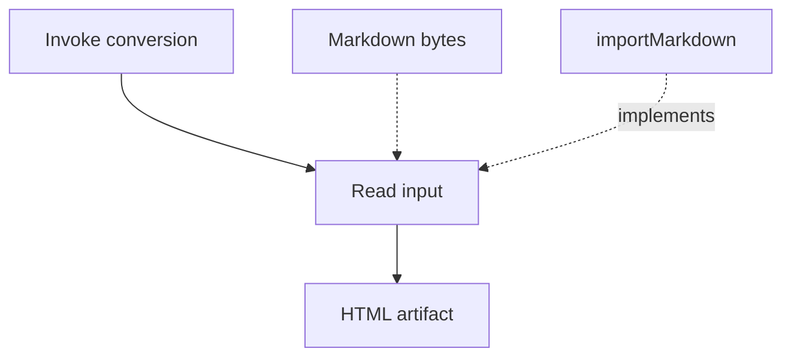

# Portable authoring reference

## One diagram with metadata

Metadata fences apply to the **preceding Mermaid block**. At most one of each
metadata fence is allowed per diagram; node IDs are local to that diagram.

````markdown
# Conversion

The action consumes data; the function implements the action.



```portable-canvas
title: Conversion pipeline
scrollZoom: true
```

```portable-nodes
invoke:
  component: card
  title: Invoke conversion
  body: Run the Portable generator.
  footer:
    text: Invocation
read:
  component: card
  title: Read input
  body: Read Markdown and collect diagrams.
  footer:
    text: Action
output:
  component: card
  title: HTML artifact
  footer:
    text: Output
source:
  component: card
  title: Markdown bytes
  footer:
    text: Data
parser:
  component: card
  title: importMarkdown
  body: Render prose and collect Mermaid graphs.
  footer:
    text: packages/portable/src/import/markdown.ts
```
````

Ordinary Cards require `component: card` and a string `title`. `body` and `footer` are
optional; footer requires `text` and may include `href`. Content is plain text.
Unknown node IDs, component names, fields, and unsupported link schemes fail
generation. Nodes without metadata still render as basic label nodes.

`title` in `portable-canvas` is a nonempty string; it replaces the visible canvas
ID in regular and fullscreen headers, not the internal/diagnostic ID.
`scrollZoom` defaults to true. False makes ordinary wheel gestures pan; Ctrl+wheel
zooms. Overflowing node text retains ordinary scroll priority.

## Layout choice

- `mermaid`: general flowchart with edges, branches, and subgraphs; layered layout
  computed before packaging. `flowchart TB` is top-down; `LR` is left-to-right.
- `mermaid rest-api-tree`: a flat single-root `flowchart LR` path tree. The first
  child aligns with its parent; later sibling subtrees stack below it. Use
  `rest-card` to get header collapse controls with descendant counts.
- `mermaid action-flow`: flat diagram with one connected, unbranched action chain.
  `:::data` and `:::code` nodes are attachments, positioned above their first
  action target (above-left for TB). All other nodes belong to the chain.
  Every attachment needs an outgoing edge to a chain node. Groups, action loops,
  and branching chains are rejected. Use ordinary Mermaid when those are needed.

Don't imply an `implements` edge is execution order. For an explanatory pipeline,
a useful pattern is a clear action chain with incoming data and code attachments.
This is an authoring option, not a restriction on the user's design vocabulary.

## Theme palette

Pass a companion JSON file through `--theme`. Names correspond to Mermaid
classes. All fill/stroke values must be six-digit hex colors. Ground uses the
light palette; each class needs light and dark variants.

```json
{
  "version": 1,
  "styles": {
    "code": {
      "label": "Module / function",
      "light": { "fill": "#ddd1e9", "stroke": "#9278aa" },
      "dark": { "fill": "#3e304d", "stroke": "#ac91c3" }
    }
  }
}
```

For a complete example palette, see
`packages/portable/examples/conversion-walkthrough.theme.json`: blue data, red
actions, yellow invocations/outputs, purple code. Reuse or change roles to suit
the requested explanation; those colors are not universal product semantics.

Cards use one role color with subtle section variations. Title, body, and footer
have separate `--portable-card-{title,body,footer}-{bg,fg}` CSS tokens. Custom
styles may target `.portable-card-title`, `.portable-card-body`, and
`.portable-card-footer`; use theme tokens rather than fixed white backgrounds.

At distant zoom (currently below 0.6), Cards render their title and a disclosure
ellipsis for hidden details. Titles draw above the ellipsis; it reserves no text
space. Bounds and edge anchors remain fixed across semantic zoom.

## Legend

Declare a legend explicitly on each canvas. Omitting `legend` produces no legend,
even when a theme is supplied. Entries refer to classes in `--theme`; their order
is retained and an optional label overrides the theme's meaning for that canvas.
Unknown classes fail generation. Legend entries may alternatively declare `diff`; see the diff-language reference.

```yaml
legend:
  entries:
    - class: code
      label: Executing code
    - class: data
```

Place these fields inside the diagram's `portable-canvas` fence alongside `title`
and `scrollZoom`. The built-in Legend stays at the bottom-right of that canvas's
viewport, outside zoomed geometry. It has a header and a minimize/expand button.
Each canvas owns its state; fullscreen retains that same component and state.
There is no shared page legend. Ground uses light swatches; Dark uses dark ones.
State resets on page reload.

## Source links

A footer can link to source using a real absolute path:

```yaml
footer:
  text: src/import/markdown.ts
  href: zed://file/home/saxon/code/github/saxonthune/luminous-portable/packages/portable/src/import/markdown.ts
```

Substitute the actual checkout path. **Use `zed://file/absolute/path`, not
`zed:///absolute/path`.** The latter reaches Zed but produces an `unhandled url`
error. Encode spaces/special characters in the path. Zed must be installed with
its URL handler; these paths are machine-specific, not portable to other users.
Use a repository web link if that is the intended audience instead.

Allowed footer schemes: `zed://`, HTTP(S), mailto, and document anchors.
For failed handoff on Linux, inspect `xdg-mime query default x-scheme-handler/zed`
and `~/.local/share/zed/logs/Zed.log` before changing desktop configuration.

The legend header is always **Legend**; `legend.title` is not supported.
The reusable Solid component is `packages/portable/src/runtime/Legend.tsx`; each
canvas supplies its declaration and theme through props and owns its minimize state.

## Architecture diff badges

Cards accept optional `diff` metadata. See [diff-language.md](diff-language.md)
for the shared vocabulary and matching per-canvas legend entries.


## Checked semantic diagrams

For new architecture diagrams, use `portable-model` plus per-canvas `kinds` and
`kind` legend entries. See [metamodel.md](metamodel.md) for the implemented version-1
schema, architecture Recipe and validation rules. The class-based examples above
remain supported legacy input; they do not activate semantic legend coverage.

## Extended information and source inspection

Use `portable-info` for Markdown explanations and source links, and set each
Card's `info` to its entry ID. `[more]` opens a reusable floating panel owned by
that canvas. See [metamodel.md](metamodel.md#extended-info-plugin) for the schema,
link handling and interactions. Keep main Card content brief; place supporting
route definitions, implementation detail and source evidence in Extended Info.

For a genuine return call that disrupts vertical layout, retain the edge and
use `layout.nonOrderingEdges`; do not hide the relationship by deleting the edge.

### Transition nodes

Use `component: transition` and `title: Full navigation label` in `portable-nodes`
for a blueish stadium-shaped transition node with a visible label. Only these two fields are accepted.
Connect `source --> transition_id --> destination` without edge labels. Each
node occupies a horizontal layout footprint and centers its label directly on the
pill. Text may overflow; both the pill and its label remain draggable. Its
accessible name also carries the full title.
Declare a semantic transition kind and include it in that canvas's Legend;
supply its blue palette through the theme. State nodes remain ordinary Cards.

### Usage Patterns Diagram

The [UI State Diagram recipe](ui-state-diagram.md#usage-patterns-component) owns
the Usage Patterns requirements and component interaction contract.

`usage-card` is a reusable Card variant whose structured body lists API usage:

```yaml
component: usage-card
title: Library
usage:
  uiRoute:
    paths: [/reading-buddy]
    context: Document Library; no Book selected.
  startup:
    - method: GET
      endpoint: /reading-buddy/books
      description: Loads the prepared documents shown in the Library.
  capabilities:
    - method: PUT
      endpoint: /reading-buddy/books/{bookId}
      description: Registers the selected prepared Book revision for reading.
```

The required `uiRoute` object supplies nonempty `paths` (UI URL patterns) and
`context` (the selected page/view/overlay). Its section appears above Startup.
Both `startup` and `capabilities` arrays are required; either can be empty.
Methods use uppercase HTTP verbs, and endpoint paths start with `/`. Every item
uses a compact badge background. A required nonempty `description` explains
why this UI state needs the endpoint. Press the badge to toggle that description
below it. Usage Cards reserve generous space up to a shared maximum height;
expanded content scrolls within the body, with above/below overflow indicators. `info`, footer and diff fields retain ordinary
Card behavior; structured `usage` replaces `body`. Details use Card semantic zoom.

Give mirrored states separate IDs but matching titles, and a distinct semantic
kind/palette. Clone the navigation connections with separate IDs and mark return
second legs in `layout.nonOrderingEdges`. Keep both trees disconnected in one
flat canvas. Cactus stacks connected components vertically using their full
bounds, so taller usage Cards cannot overlap the upper UI-state tree. This is
layout behavior, not an additional visible container. Retain a kind Legend for
the usage Cards. This support does not infer or verify application API use;
input authors must supply evidence and distinguish current from proposed routes.
