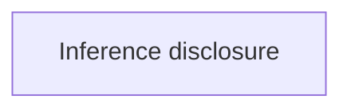

# Portable semantic metamodel (version 1)

This is the implemented contract for semantic Markdown input. Read it before
adding meaning categories, Recipe rules or semantic fields. Source of truth:
`packages/portable/src/semantics.ts`; graph/render types live in `graph.ts`.

## Entities and relationships

- **Document** contains Markdown and canvases, with at most one `portable-model`
  block. Its placement is unrestricted; resolution happens after all parsing.
- **Model** selects a Recipe and declares vocabulary, presentation bindings and
  validation policy. `version: 1` is required.
- **Kind** is a stable semantic ID plus a nonempty human label. It describes a
  node or container, not a color, component implementation or deployment instance.
- **Canvas** contains graph nodes/edges, a node-ID-to-kind mapping, and its own
  legend. IDs are canvas-local. Each node has at most one kind in this version.
- **Diff status** is a separate semantic dimension on a Card: `new`, `additive`,
  `modified`, defined in `diff.ts`. It does not replace the node kind.
- **Presentation binding** maps a kind ID to a named slot in `--theme`'s existing
  `styles` dictionary. Theme resolves palettes. Multiple kinds may share a slot.
- **Legend entry** references a kind or diff status. Kind labels default to the
  vocabulary; a local label may override wording. Coverage compares IDs, not colors.
- **Recipe** supplies rule severity defaults and may supply vocabulary/presentation
  defaults. Document declarations override these defaults by ID.
- **Rule** is a trusted TypeScript function returning findings; policy assigns
  warning/error/off. Structural/reference errors cannot be disabled.
- **Diagnostic** records rule ID, severity, message, canvas and element IDs,
  source line when available, and optional suggested correction.

## Input example

````markdown
```portable-model
version: 1
recipe: architecture
vocabulary:
  decision:
    label: Unresolved design decision
presentation:
  decision: contract
validation:
  rules:
    legend/coverage: error
```



```portable-canvas
title: Privacy choices
kinds:
  policy: decision
legend:
  entries:
    - kind: decision
    - diff: new
```

```portable-nodes
policy:
  component: card
  title: Decision · inference disclosure
  diff: new
  body: Decide whether selected plaintext may be sent to a remote provider.
```
````

Here `contract` is only a slot name in an existing palette. The semantic label
comes from `decision`; it is not inferred from that slot's old label. Supply that
slot in `--theme`. For a new palette, prefer neutral reusable slot names.

`portable-canvas.kinds` also declares container kinds. Cards remain presentation
content in `portable-nodes`; groups do not become Cards. Mermaid supplies topology.
Remove semantic `:::classes` and `class` declarations after migrating to kinds.
A themed Mermaid class without a kind is an error in a semantic document; a
class conflicting with the kind's chosen slot is also an error. Non-theme classes
may remain decorative. Arbitrary custom CSS is not inspected by semantic checks.

## Implemented pipeline and policies

1. `importMarkdown` parses input and returns a `ParsedDocument`. It does **not**
   compute layout. It retains each Mermaid fence's starting line.
2. `validateDocument` resolves Recipe, node and kind references; assigns `node.kind`;
   checks theme bindings; runs enabled rules. It returns structured diagnostics.
3. `generate.ts` logs diagnostics. Any error stops before layout/bundling/output;
   an existing HTML file remains the previous successful artifact. Warnings proceed.
4. `projectDiagram` resolves kinds into rendering classes and legend swatches.
   Graph nodes retain kind IDs, and the output artifact embeds the declared model.
5. Layout and bundling run only after successful validation.

Rules currently available:

- `legend/coverage`: every used kind and Card diff status must appear in that
  same canvas's legend. Includes containers. Reports missing meanings with affected
  node IDs. Extra unused legend entries are allowed. No automatic legend repair.
- `nodes/kind-required`: every node/container must have a kind.

Recipes currently available:

- `standard`: `legend/coverage: warning`.
- `architecture`: both rules above are errors.

Document rule settings override Recipe defaults. Unknown recipes/rules/kinds,
node references and presentation slots are unconditional errors. One canvas's
legend cannot cover another. A legacy `{class: ...}` entry cannot cover a semantic
`kind`, even when they happen to use the same palette.

Documents without `portable-model` retain legacy class-based rendering; the new
semantic rules are not enabled for them. Their legacy legend slot references are
still validated. Migrate a document explicitly to obtain semantic guarantees.
The model currently requires vocabulary and presentation mappings (empty mappings
are valid when defaults supply everything). There is one Recipe per document.

## Extending the system

Add a `ValidationRule` to the exported `rules` registry in `semantics.ts`, then
select its default severity in a Recipe or document. Rule functions receive a
resolved canvas and effective model and return findings; they should not mutate
the graph, repair the legend or inspect DOM/CSS. Add Recipe entries to `recipes`.
Rules run after reference resolution; a canvas with reference errors skips
checks dependent on valid references. Independent canvases still report failures.
No executable rules or dynamically imported plugins are accepted from Markdown.

Update this reference and the Portable requirements when expanding input semantics.
Don't conflate `kind` (meaning), `component` (Card rendering), `diff` (change), and
`theme slot` (appearance). Future relationship typing can add edge meaning without
turning these axes into combined enum values.

## Limits

Locations identify the Mermaid block, not an exact node/YAML field span. Syntax
errors are logged as `input/parse`; they can stop parsing before other failures
are collected. Theme-file format parsing still uses the existing CLI checks.
Rules cannot prove architectural truth, correct labels or absence of private-data
exposure. They do not inspect arbitrary CSS. Recipe formalization tooling and
flowchart-specific rules remain unimplemented. This is a small static checker,
not a general type-inference engine.

## Extended Info Plugin

A document may declare one `portable-info` fence, mapping stable IDs to a title
and Markdown body. A Card refers to one entry using `info` in `portable-nodes`.
Multiple Cards/canvases may reuse one entry. Unknown IDs are unconditional
`reference/info` errors before layout/bundling. This is declarative content for a
built-in component, not executable plugin code.

````markdown
```portable-info
harness-definition:
  title: Harness definition and routes
  body: |
    The entry module exports a default `fetch` handler.

    - [Open the implementation](zed://file/home/user/project/src/worker.ts)
```

```portable-nodes
harness:
  component: card
  title: Harness Worker
  info: harness-definition
  footer:
    text: Worker entry handler
```
````

The Card footer adds `[more]`; a compact footer link remains available at summary
zoom. Opening it creates a canvas-owned floating Extended Info component. Its
header supports dragging, minimize/restore and close. The corner grip resizes;
the body scrolls independently of canvas zoom. Header arrow keys move the panel;
resize-grip arrow keys resize it. Escape closes the focused panel. One panel per
info ID per canvas is reused on repeated opening. Panels remain inside the canvas
viewport and move with it into fullscreen; state is transient.

`import/extended-info.ts` parses and compiles Markdown at generation time. Raw HTML
is escaped; images become alt text. Links permit HTTP(S), mailto, anchors and Zed
file links. `zed:///absolute/path` inputs normalize to `zed://file/absolute/path`,
the installed Zed handler form. There is no browser Markdown evaluator or network
fetch for info content. The output artifact embeds compiled HTML in `info`.
`runtime/ExtendedInfo.tsx` is the reusable component, configured by content and
canvas viewport props. UI state belongs to each owning canvas.

## Topology versus layout ordering

Restore real calls in the graph even when a return dependency makes automatic
layout awkward. Use this optional canvas presentation hint for ordinary Mermaid
layout:

```yaml
layout:
  nonOrderingEdges:
    - source: harness
      target: registry
```

The specified source/target pair must name an existing edge. All edges for that
pair remain in the graph and render normally, but do not influence layered layout.
The hint changes no call semantics, labels, direction or graph validation. It does
not add a new edge. It is unsupported in `action-flow`, whose execution chain
must remain unambiguous. Prefer a hint over deleting a true dependency to make a
layout look tidy.
