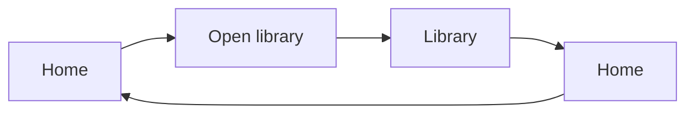

# UI State Diagram

Purpose: **From this UI state, where can the user navigate next?**

This file owns the recipe definition, requirements, and Usage Patterns component
contract. Keep recipe-specific requirements in the skill references, rather than
in the Luminous Rhidoc workspace. Requirements marked `[p]` remain pending review.

## Model and scope

- A state node represents an abstract UI state. A route, a selected component,
  and an open modal can each be a state. Distinct states can share a URL.
- Organize the graph by available navigation, not containers of UI element types.
- A transition node represents one navigation exit and has one incoming edge
  from its source state and one outgoing edge to its destination state.
- Include Back and Close as explicit transitions. Keep opposite directions as
  separate nodes. Retain any condition that selects the return destination.
- During the initial inventory pass, omit required resource usage and activities
  that stay within the same state. An action that navigates to another state
  is an exit: New Conversation → Start Conversation → Conversation is an example.
- Keep a generally tree-like forward layout. A state with only return navigation
  is a forward-tree leaf even though its Back edge remains in the graph.

Use ordinary Cards for states and `component: transition` for blueish stadium
pills. Put the transition label directly in `title`; labels may overflow while
remaining part of the draggable node. Do not put navigation labels on edges.

## Minimal input

This is the implemented authoring convention, not a registered parser Recipe
named `ui-state-diagram`. Use the current `architecture` semantic Recipe and
input-declared kinds. No new command or recipe selector is required.

````md
```portable-model
version: 1
recipe: architecture
vocabulary:
  ui-state:
    label: UI state
  navigation:
    label: Navigation transition
presentation:
  ui-state: ui-state
  navigation: ui-transition
```



```portable-canvas
title: UI navigation
scrollZoom: true
kinds:
  home: ui-state
  library: ui-state
  openLibrary: navigation
  returnHome: navigation
layout:
  nonOrderingEdges:
    - source: returnHome
      target: home
legend:
  entries:
    - kind: ui-state
    - kind: navigation
```

```portable-nodes
home:
  component: card
  title: Home
library:
  component: card
  title: Library
openLibrary:
  component: transition
  title: Open library
returnHome:
  component: transition
  title: Home
```
````

Supply a theme whose `styles` includes the `ui-state` and `ui-transition` slots.
For example:

```json
{
  "version": 1,
  "styles": {
    "ui-state": {
      "label": "UI state",
      "light": { "fill": "#eee5ff", "stroke": "#8255b7" },
      "dark": { "fill": "#30233f", "stroke": "#b594e4" }
    },
    "ui-transition": {
      "label": "Navigation transition",
      "light": { "fill": "#c4e7fa", "stroke": "#3588b0" },
      "dark": { "fill": "#234c65", "stroke": "#77c6ee" }
    }
  }
}
```

## Layout contract

Keep the actual return direction in the graph. Mark only a return transition's
second leg (`returnHome --> home`) as non-ordering. The flat layout requires
all connections between states to pass through transition nodes.

Cactus counts every transition between each unordered pair of states. It
reserves a corridor sized for the entire pair before laying out the forward
graph, then places the individual pills inside it. Opposite directions occupy
adjacent lanes. Return transitions therefore stay near their forward transitions
instead of being packed into unrelated empty space afterward.

The current implementation requires an acyclic forward graph once return links
are excluded. Shared destinations remain shared states; the drawing need not
be a strict tree. Structural validation does not prove that the inventory
matches every navigation path in an application.

## Navigation requirements

- **UISDTERM1.** [p] **UI state** — an abstracted state of the user interface that the user can navigate to, such as a UI route, a selected component, or a modal overlay.

## State inventory

- **UISD1.** [p] The recipe inventories abstract UI states that a user can navigate to.
- **UISD2.** [p] The inventory includes distinct view states even when they share a UI route.

## Navigation

- **UISD3.** [p] For each state, the diagram shows where the user can navigate from that state.
- **UISD4.** [p] The graph organizes states by navigation rather than grouping them by UI type.
- **UISD5.** [p] The forward navigation layout has a generally tree-like shape.
- **UISD6.** [p] States whose only exits return to earlier states appear as leaves of the forward navigation tree.
- **UISD7.** [p] Return navigation appears as additional transition nodes rather than as Back text in state Card details.

## Initial pass

- **UISD8.** [p] During the initial navigation inventory pass, the diagram omits required-resource-usage nodes.
- **UISD9.** [p] During the initial navigation inventory pass, the diagram omits activities within a state other than navigation.

## Reading Buddy example

- **UISD10.** [p] The initial example inventories a subset of Reading Buddy UI states.
- **UISD11.** [p] The Reading Buddy example includes navigation from the post-login homepage to the document library.
- **UISD12.** [p] The Reading Buddy example represents New Conversation and the regular Conversation view as distinct states.
- **UISD13.** [p] From New Conversation, the example shows an exit that goes back.
- **UISD14.** [p] From New Conversation, starting a Conversation leads to the regular Conversation view.

### Transition presentation and layout

- **PCARD11.** [p] A transition can be represented by a blueish stadium-shaped node in place of an edge label.
- **PCARD12.** [p] Transition nodes display their labels directly; label text may overflow the node.
- **PCARD13.** [p] The layout engine accounts for transition nodes as nodes.
- **PCARD14.** [p] The user can drag a transition node even when its label overflows the node.
- **PCARD15.** [p] Forward and return transitions shall use separate nodes with enough spacing to distinguish both directions.
- **PCARD16.** [p] The layout shall count transitions in both directions between each pair of states.
- **PCARD17.** [p] The forward layout shall reserve extra space for the pair’s backward transitions.
- **PCARD18.** [p] Backward transition nodes shall be placed near the forward transition nodes for the same state pair.

## Usage Patterns component

Purpose: **What API resources does each UI state need to load and function?**
Mirror the navigation tree underneath it in the same canvas, using separate IDs,
matching state titles, and a distinct semantic kind/color for Usage Cards. Keep
transitions and return directions consistent between the two trees.

### Input contract

```yaml
component: usage-card
title: Library
usage:
  uiRoute:
    paths: [/reading-buddy]
    context: Document Library; no Book selected.
  startup:
    - method: GET
      endpoint: /reading-buddy/books
      description: Loads the prepared documents shown in the Library.
  capabilities:
    - method: PUT
      endpoint: /reading-buddy/books/{bookId}
      description: Registers the selected prepared Book revision for reading.
```

`uiRoute` is required: `paths` lists the UI URL patterns and `context` names the
selected view, dialog, or overlay within those routes. Do not substitute an API
path or invent a URL for a modal. Both endpoint arrays are required and may be empty. Each entry requires an uppercase HTTP
verb, a path starting with `/`, and a nonempty description explaining why this
particular state needs that endpoint. Declare whether the endpoints are current
or proposed; these mappings are authored, not inferred from application code.
Startup includes content prerequisites that may already be cached. Capabilities
covers other resource usage. Preserve proposal gaps rather than inventing routes.

### Interaction and layout contract

- Show **UI route** above Startup and Capabilities, with the actual route patterns
  and concise state context. For overlays that keep the URL unchanged, name their
  parent route and selected overlay.
- Compact endpoint badges toggle their descriptions directly beneath the badge.
- The shared height cap is currently 420 canvas pixels. Content exceeding it
  scrolls inside the body; the title and footer remain outside the scroller.
- Wheel gestures over content never reach canvas zoom/pan or surrounding controls,
  including at either scroll limit. Native scroll chaining is contained.
- Use a visible scrollbar of normal width, with a contrasting thumb.
- The hint reads `↑ Score for more ↓`, showing only available directions.
  Reserve both arrow slots and hide unavailable arrows without removing their
  space, so the text does not move. Hide the label when neither direction exists.
- Retain Card Extended Info and semantic zoom behavior.
- Keep mirrored state/transition graphs disconnected within one flat canvas.
  Layout stacks their full bounds, accounting for the taller Usage Cards.

### Requirements

### Paired trees

- **UPD1.** [p] Usage Patterns Diagram shows a second tree containing the same UI states as its UI State Diagram counterpart.
- **UPD2.** [p] The usage tree appears in the same canvas as the UI navigation tree.
- **UPD3.** [p] The usage tree is placed underneath the UI navigation tree.
- **UPD4.** [p] Usage state nodes use a different color from their UI navigation counterparts.
- **UPD5.** [p] Usage state nodes use a different component from their UI navigation counterparts.
- **UPD6.** [p] Each usage state component has the same title as its UI navigation counterpart.

### Endpoint lists

- **UPD7.** [p] Each usage state component body contains a vertical list of HTTP verb and endpoint pairs used by that UI state.
- **UPD8.** [p] The component divides the endpoint list into Startup and Capabilities sections.
- **UPD9.** [p] Startup lists endpoints needed to load the state’s page content.
- **UPD10.** [p] Capabilities lists other endpoint usage for that state.
- **UPD11.** [p] Each verb-and-endpoint list item uses a badge-like background for visibility.
- **UPD12.** [p] Verb-and-endpoint list items use minimal vertical padding.

### Endpoint explanations and scrolling

- **UPD13.** [p] Usage state components have a bounded maximum height that keeps the component compact while allowing content inspection.
- **UPD14.** [p] When the user presses an endpoint indicator, its description opens.
- **UPD15.** [p] The endpoint description appears underneath its indicator.
- **UPD16.** [p] The endpoint description explains why that endpoint is needed for the UI state to perform its function.
- **UPD17.** [p] When content exceeds the maximum height, the component body is scrollable.
- **UPD18.** [p] When body content is out of view, the component displays an indicator that the user can scroll within its body to see it.

- **UPD19.** [p] While the pointer is over the component content, wheel scrolling remains within that content, including at its top and bottom limits; it does not zoom the canvas or operate surrounding controls.
- **UPD20.** [p] The component scrollbar is wide enough to be easy to see.
- **UPD21.** [p] The scroll indicator uses a single “Score for more” label, with a down arrow to its right when more content is below and an up arrow to its left when more content is above.

- **UPD22.** [p] The scroll indicator reserves space for both arrows so its text stays in the same position as scroll directions become available or unavailable.


- **UPD23.** [p] Each Usage Patterns component displays a UI route section above Startup and Capabilities.
- **UPD24.** [p] The UI route section identifies the UI route associated with the represented state.

### Retained example

The Braincrawl service-standardization worktree retains navigation and usage
inputs in `.luminous/api-tree/reading-buddy-navigation.json` and
`.luminous/api-tree/reading-buddy-usage.json`. Its
`.luminous/tools/render-ui-navigation.mjs` joins states by stable ID and checks
usage against the proposed API inventory and separately declared current supporting
APIs. Proposed query parameters are checked against their underlying method/path;
response/query contracts remain in Extended Info. Researcher and the remaining
Store/account/admin screens use the same paired inventories. “Reading Buddy Library” is an example
label, not a confirmed product rename.
