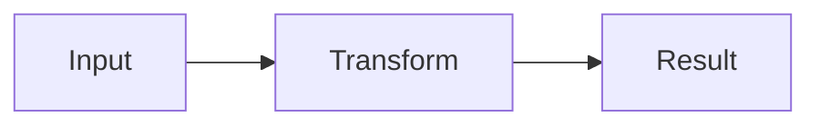
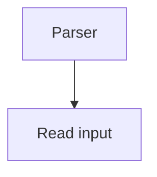

# Luminous Portable

Convert a Markdown document into a formatted, self-contained HTML page. Each
fenced Mermaid block becomes an independent interactive Solid/cactus canvas.

```sh
just portable --input design.md --theme theme.json --output design.html
```

`--theme`, `--css`, `--title`, and `--output` are optional. Without `--output`, a
unique directory under `/tmp` is used. Existing output requires `--force`.
Only `.md` input is accepted. Mermaid fences currently support flowcharts; Pele
parses them, and Marked renders the surrounding prose, lists, tables and code. The theme
format matches Pele artifact generator version 1 (class names and light/dark
fill/stroke palettes). CSS is trusted author input.

The generated file embeds data, CSS, and JavaScript. Open it directly in a browser.
Node movement and selection are transient; refresh restores generated positions.
Reset layout restores the computed default positions without changing source data.

## Controls

- Drag a node to move it; dragging a group includes its descendants.
- Drag the canvas background to box-select.
- Shift/Ctrl/Command-click adds or removes a node from selection.
- Drag a selected node to move the selected set.
- Right/middle-drag pans; wheel zooms.
- Fit all / `0`, Fit selection / `F`, zoom buttons / `+` and `-`.
- Escape clears selection; Ctrl/Command-A selects all nodes.
- One page-level theme control cycles Ground, Light and Dark.
- Each canvas has independent fit, zoom, reset, selection and transient geometry.
- Click or tab into a canvas to target its keyboard shortcuts.
- Wheel gestures outside a canvas scroll the document.

## Modules

- `src/graph.ts`: source graph and artifact data.
- `src/import/markdown.ts`: Markdown rendering and Mermaid canvas slots.
- `src/import/mermaid.ts`: Pele flowchart adapter.
- `src/layout/`: cactus ELK layered compound layout, inspired by the layered
  approach used in Pele; not Pele's exact layout implementation.
- `src/runtime/`: Solid canvas runtime using cactus.
- `src/generate.ts`: standalone HTML generation using Vite.

Invisible Mermaid links participate in layout but are not rendered. Computed
default geometry is separate from user-adjusted positions. Browser checks covered dragging, multiselection, marquee, pan/zoom, reset,
refresh, both themes, and offline loading. A large expanded graph needs zooming
or Fit selection to read. Edge routing is direct, not Pele obstacle routing.

Product docs: `.rhidoc/01-product/16-portable/` (doc01.16).

## Performance diagnostics

Add `--debug-performance` when generating an artifact. Diagnostics work in the
standalone production bundle; they are off by default. After each node drag,
the console prints one `[portable performance]` summary containing:

- frame interval count, total, maximum, and 95th percentile;
- synchronous drag-update and edge-routing durations;
- created edge render instances (including separate route bands and labels);
- release-to-render-opportunity delay, approximated by two animation frames.

The last value is not a measured GPU presentation timestamp. Frame intervals
include the release tail. Clicks below the shared drag threshold do not start drag diagnostics.
The last 30 summaries are available as `window.portablePerformance["canvas-1"].summaries`.
User Timing entries (`portable:drag-update`, `portable:routing`) appear in a
DevTools recording and are cleared from the entry buffer after each summary.
The current diagnostics measure node/group dragging, not pan/zoom separately.

Dragging updates only moving nodes, at most once per animation frame. Edge
objects keep their identities. Routes and container clipping follow moving nodes during the drag; the final
release position is flushed before the gesture ends. The shared cactus
`useGesture` supplies the same click/drag threshold and pointer lifecycle as Denim.

## Zoom styling

Node and container boundary overlays stay one screen pixel thick, and selection
outlines stay two screen pixels thick. These overlays do not take layout space.
Card geometry and content continue scaling normally. Edge labels fade between
30% and 50% zoom; incident labels remain visible when their node is selected.

## Ground and Recipe design example

New artifacts start in Ground. The theme button cycles Ground, Light, Dark.
Class palettes supplied by `--theme` use their light colors for Ground.

The proposed Recipe pipeline can be viewed with:

```sh
just portable --input packages/portable/examples/recipe-pipeline.md --theme packages/portable/examples/recipe-pipeline.theme.json --output /tmp/portable-recipe-pipeline.html --title "Recipe pipeline — design proposal" --force
```

This illustrates the proposed design; Recipe selection and checks are not yet
implemented. See doc01.16.03 for the flowchart Recipe proposal.

## Interaction reuse from Denim

Reuse cactus interaction primitives before introducing Portable-specific handling.
Portable uses `useGesture`, Canvas marquee selection, NodeContainer selection
outlines, edge content overlays, and counter-scaled edge strokes/hit areas.

Implemented parity:
- Container content starts a marquee; headers drag containers.
- Overflowing node labels consume wheel input until the scroll boundary.
- Inputs, toolbars and resize handles take precedence over selection/drag.
- Selected items expose shared cactus resize handles.
- The floating node Fit button has been removed. Shared ToolbarSurface remains
  available in cactus for future controls; node containers permit overflow.
- Denim and Portable share the directional scroll helper from cactus.

Resizing and dragging remain transient. Reset layout restores default geometry.

## Markdown authoring

````markdown
# A design explanation

Markdown commentary goes here.



More commentary, then another Mermaid block if useful.
````

One runtime bundle serves all canvases. A Markdown-only page also works.
Raw HTML is displayed as text. Ordinary fenced code remains formatted code.
Links allow HTTP(S), mailto and document anchors; images currently render their
alt text, keeping the generated page independent of remote image resources.
No arbitrary scripts from Markdown are executed. `--css` remains trusted author input.

## Reusable sample inputs

See [examples/README.md](examples/README.md) for the retained sample set,
including plain Markdown without diagrams, and repeatable generation commands.

## Page surfaces and canvas width

The article uses `--portable-content-bg`, which defaults to the active theme's
`--cactus-surface`; the surrounding page uses `--cactus-canvas-bg`.
Each canvas offers Expand width / Restore width, independently of the others.
Expansion uses the available viewport width excluding the scrollbar, retains its
height and graph state, and follows browser resizing. It does not enter fullscreen.

Expand/restore preserves the content's screen-space anchor: after the width
change, camera translation compensates for the viewport's horizontal and vertical
displacement before paint. Zoom and node geometry are unchanged. Immediate camera
corrections cancel any previous animated fit/zoom transition.

## Fullscreen canvas

The Canvas Header's Fullscreen button fills the browser viewport using a modal
dialog. The Fullscreen Canvas Header combines the regular controls with the
source filename and shared theme selector. Background content is inert and page
scrolling is locked. Exit fullscreen or Escape restores the canvas and focus.
This requires no server and does not request browser fullscreen permission.

### Live-edge performance follow-up

Frame-batched node updates and stable edge declarations remain active. Routing
runs during dragging to keep endpoints and clipping attached. Cactus now retains
SVG segment and clipping elements by their position in the route, updating their
coordinates rather than remounting them when new geometry objects arrive. Routing
and label collision placement still do work on each update. No new timing claim
is made without a measurement on the affected graph. Debug diagnostics remain
available per canvas, for example `window.portablePerformance["canvas-1"]`.

### Action-row layout experiment

A fence beginning `mermaid action-flow` opts into the walkthrough's simple
layout convention: one unbranched action chain following the Mermaid direction (`LR` or `TB`), with `:::data` and `:::code` nodes stacked
above their first action target (and to its left in top-down mode). Other classes can name color slots; the example
uses `action`, `invocation`, and `artifact`. Pass its companion theme JSON.
Groups and branching action chains are rejected by this mode. Ordinary
`mermaid` fences retain the existing layered layout. This is an explicit layout
experiment, not the full Recipe system.

## Card content

Keep topology in Mermaid; place one `portable-nodes` YAML fence after the diagram
it describes. IDs are local to that diagram. Content is plain text, not HTML.

````md

```portable-nodes
parser:
  component: card
  title: importMarkdown
  body: Render prose and collect diagrams.
  footer:
    text: packages/portable/src/import/markdown.ts
    href: zed://file/absolute/path/to/packages/portable/src/import/markdown.ts
```
````

Title is required; body and footer are optional. Unknown IDs, component names,
fields, and unsupported link schemes fail generation. Footer links support
`zed://`, HTTP(S), mailto, and document anchors. Zed links require a registered
OS handler and the source path on the reader's machine.

The built-in `Card` in `src/runtime/Card.tsx` is bundled into the artifact.
Documents supply data, not executable components. Below 60% zoom, only its title
is mounted; its full bounds and edge anchors remain fixed. Expanded bounds are
estimated before layout. Sections can scroll if the user shrinks a card.

Custom CSS can style `.portable-card-title`, `.portable-card-body`, and
`.portable-card-footer`, or their `--portable-card-{title,body,footer}-{bg,fg}`
tokens. The node's theme class palette supplies the whole card's base color (purple
for `code` in the walkthrough); title and footer mix in a little of its border
color to distinguish sections while retaining the same hue.

## Canvas settings

Each Canvas Header has a settings dropdown. **Scroll Zoom** defaults to checked.
Uncheck it to pan with the wheel; Ctrl+wheel still zooms, without D3's usual
Ctrl multiplier. Scrollable node text retains ordinary wheel priority.

Set a header title and/or override the initial wheel behavior for the preceding Mermaid diagram:

````md
```portable-canvas
title: Conversion pipeline
scrollZoom: false
```
````

The title appears in regular and fullscreen headers. Without a title, the header
uses the generated canvas ID; internal IDs and diagnostic keys do not change.

This block can coexist with `portable-nodes`. Each diagram has its own setting;
browser changes are transient. The same settings control appears in fullscreen.

### Bundle size diagnostics

`--debug-performance` prints a build-size report during generation and embeds
it for the browser console under `[portable bundle size]`. It lists exact UTF-8
JavaScript, CSS, and content payload bytes (content excludes the report itself),
plus per-package rendered module character counts before final minification.
Those attribution counts identify large dependencies but do not sum to the
minified file size and do not measure runtime memory or individual UI instances.
The report includes package names/counts, not source code or absolute paths.
Without the debug flag, attribution is neither collected nor embedded.

### Runtime versus generation dependencies

Portable's browser code imports `@luminous/cactus/runtime`, which exposes canvas
rendering and interactions without the layout-engine exports. Generation uses
`@luminous/cactus/layout`: ordinary Mermaid diagrams can still use ELK there.
Reset layout restores embedded coordinates and does not run ELK in the browser.
Avoid importing the broad cactus entry point into Portable runtime components:
its layout re-exports can retain ELK's bundled module through import side effects.

## Per-canvas legends

`--theme` supplies colors and default meanings. Each canvas explicitly selects
its own legend in a `portable-canvas` fence:

```yaml
title: Read a source
scrollZoom: true
legend:
  entries:
    - class: code
      label: Executing code
    - class: data
```

Entries use theme class names and optional label overrides. Unknown classes fail
generation. Omitting `legend` renders no legend. Each Legend stays at the bottom-right
of its canvas viewport, has a header and minimize/expand button, and retains its
own state when that canvas enters fullscreen. There is no page-level legend.
Ground uses light swatches; Dark uses dark swatches. State is transient.

Scroll Zoom is enabled by default. Set `scrollZoom: false` only when wheel panning
is desired.

The legend header is always **Legend**; `legend.title` is not supported.
The reusable Solid component is `packages/portable/src/runtime/Legend.tsx`; each
canvas supplies its declaration and theme through props and owns its minimize state.

## Architecture comparisons

Cards accept optional `diff` metadata; canvas legends accept matching diff entries.
The shared vocabulary is `src/diff.ts`, rendered by `runtime/DiffBadge.tsx`.
Authoring examples and meanings: [diff language](../../.agents/skills/luminous-portable-artifact-generator/references/diff-language.md).

## Semantic input and generation validation

The implemented [metamodel reference](../../.agents/skills/luminous-portable-artifact-generator/references/metamodel.md)
defines `portable-model`, canvas `kinds`, semantic legends, Recipe defaults and
rule policies. Start there when extending the parser. `src/semantics.ts` owns the
model and trusted rule/Recipe registries. Import no longer computes layout:
parse → resolve/check → project → layout → bundle. The architecture Recipe makes
missing legend coverage an error. Failed validation leaves existing HTML intact.

## Extended Info Plugin

Author a document-level `portable-info` mapping with `{ title, body }` entries
(Markdown body), then reference an ID using `info` on a Card. Its footer's `[more]`
link opens a reusable, draggable/resizable, scrollable canvas-owned panel with
minimize/restore and close controls. Source links use `zed://file/absolute/path`;
`zed:///absolute/path` input is normalized. Missing references stop generation.
See the metamodel reference above for complete syntax and layout-ordering hints.
