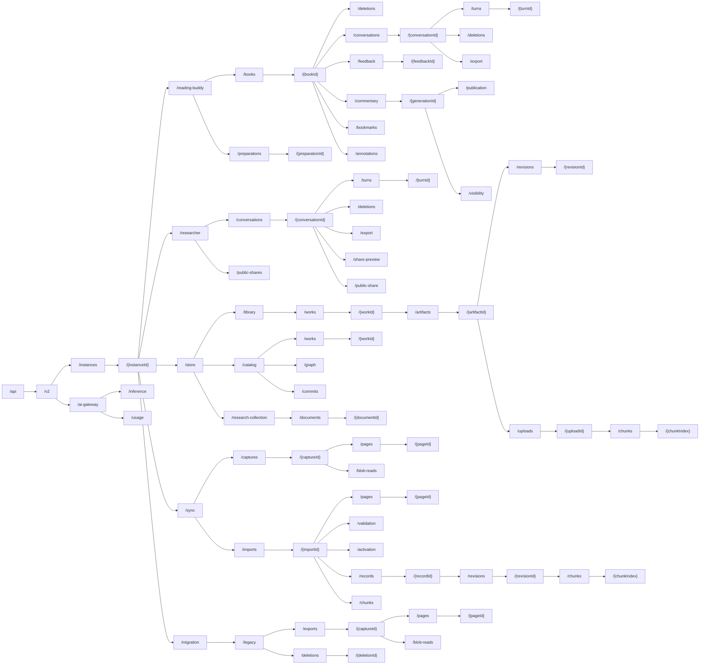

# Unified Worker · v2 API tree

API migration · the listed v2 resource routes are implemented with selectable browser transports; v2 is the source-level browser default, with explicit legacy and mixed-domain selections retained. In the API tree, each edge appends the child path to its parent; it does not represent a network call. Full methods, paths, contract sketches and current source references open under **[more]**. The Rust service authenticates these public routes and forwards product storage requests to the existing private harness. Worker topology and storage formats are unchanged.

The v2 contract replaces generic product selectors with explicit paths. Existing URLs remain for cached clients and explicit legacy selection. Supporting account, privacy/key setup, provider and administration APIs retain their existing contracts.

```portable-model
{
  "version": 1,
  "recipe": "architecture",
  "vocabulary": {
    "namespace": {
      "label": "Domain / path prefix"
    },
    "resource": {
      "label": "Parent resource"
    },
    "route": {
      "label": "HTTP endpoint"
    },
    "prefix": {
      "label": "Organizational prefix"
    },
    "endpoint": {
      "label": "Callable literal resource"
    },
    "parameter": {
      "label": "Path parameter; badges show callability"
    },
    "ui-state": {
      "label": "UI state"
    },
    "ui-transition": {
      "label": "Navigation transition"
    },
    "ui-usage": {
      "label": "Resource usage by UI state"
    }
  },
  "presentation": {
    "namespace": "boundary",
    "resource": "contract",
    "route": "storage",
    "prefix": "rest-prefix",
    "endpoint": "rest-endpoint",
    "parameter": "rest-parameter",
    "ui-state": "ui-state",
    "ui-transition": "ui-transition",
    "ui-usage": "ui-usage"
  }
}
```

## Full REST API Tree

All 83 v2 HTTP operations appear here. Each edge appends one path segment. Parameter backgrounds take precedence; badges show whether that resource is callable. This is the complete inventoried v2 resource set, not an inventory of every existing production API.




```portable-canvas
{
  "title": "Full REST API Tree · all endpoints",
  "scrollZoom": true,
  "kinds": {
    "r702acf7c08d3": "prefix",
    "r29be853cd959": "prefix",
    "r4c76272de11b": "prefix",
    "r9cc9206d4801": "parameter",
    "r93a5e3c27baa": "prefix",
    "r85f4c1443663": "endpoint",
    "rc720f0a5d832": "parameter",
    "r193242b9c99f": "endpoint",
    "r5b7ef8e9c9ba": "endpoint",
    "rabeed79c203c": "parameter",
    "rdd8b17c33340": "endpoint",
    "r7091b1821149": "parameter",
    "r8fb41c1688e4": "endpoint",
    "rab877eba1f4d": "endpoint",
    "r33fc57331164": "prefix",
    "r913c51f5519b": "parameter",
    "r46bbc40128b9": "endpoint",
    "re3f1809d9f68": "parameter",
    "r9cacc19e2d36": "endpoint",
    "r490ab2d96486": "endpoint",
    "rcbc75fcf17ef": "endpoint",
    "rf6187eae85fc": "endpoint",
    "r71b0e25cb0f3": "endpoint",
    "r4879f1b41852": "parameter",
    "r1d091693263b": "prefix",
    "re3f2cfbf40e0": "endpoint",
    "rcc85e1ef01d6": "parameter",
    "r6bbf5bacc640": "endpoint",
    "rdb1ddc258850": "parameter",
    "rcb7e8536bd6d": "endpoint",
    "r3e7481e64086": "endpoint",
    "r6f87a2128726": "endpoint",
    "r81fa059d0b61": "endpoint",
    "re9e1c756bcbf": "endpoint",
    "r2bafa8636553": "prefix",
    "r9465c5fe7688": "prefix",
    "rad4cd9711998": "prefix",
    "r1dd3a678b95c": "parameter",
    "rc84d64429b96": "endpoint",
    "r2a2d46378a4f": "parameter",
    "r8d30ddc7a923": "prefix",
    "rfb88ff26cb9f": "parameter",
    "rc041121fd934": "endpoint",
    "r5cc497842e76": "parameter",
    "r5d910d9a33ad": "prefix",
    "r469b3e5931c0": "parameter",
    "r15ae384fa8c0": "prefix",
    "r92808a34ec64": "endpoint",
    "r5c8090fa0dbf": "parameter",
    "r546112c31745": "endpoint",
    "r839d31cd2060": "prefix",
    "r18bd0f241900": "endpoint",
    "r6ed35ed8e96c": "parameter",
    "r719615e342e4": "endpoint",
    "r69daf51fad3c": "prefix",
    "ra9b14dae4acd": "endpoint",
    "r4af3bf2f2cb6": "parameter",
    "r2f4a2e5ba0de": "prefix",
    "r64f516332324": "parameter",
    "re6c7dc1a2fc4": "endpoint",
    "r591f641a5f90": "parameter",
    "rb09864421c57": "prefix",
    "r907cf5416b78": "parameter",
    "ra804672d69b3": "endpoint",
    "r6c5b4850b5cf": "endpoint",
    "rb9c0a14243a4": "prefix",
    "re2758e5d57e1": "prefix",
    "r0f8bcc731818": "endpoint",
    "r55b637ce1ad6": "endpoint",
    "r17a2979febd1": "endpoint",
    "raa05b6780cd5": "parameter",
    "r56a3599ff206": "prefix",
    "r464d253c48f3": "parameter",
    "r57de66ac7f6a": "endpoint",
    "r41a4b2ee795d": "endpoint",
    "ra6764bcc1fc5": "parameter",
    "rc18db767cfd3": "prefix",
    "r464291d97a49": "parameter",
    "rc176313fc286": "endpoint",
    "ra6a18da1acec": "prefix",
    "r798ed376899c": "parameter",
    "ra74ad6e9f30e": "parameter",
    "r935ef8ec64da": "prefix",
    "r304bac977ab6": "endpoint",
    "r987f368f1e1e": "endpoint"
  },
  "legend": {
    "entries": [
      {
        "kind": "prefix"
      },
      {
        "kind": "endpoint"
      },
      {
        "kind": "parameter"
      }
    ]
  }
}
```


```portable-nodes
{
  "r702acf7c08d3": {
    "component": "rest-card",
    "title": "/api",
    "methods": [],
    "info": "r702acf7c08d3"
  },
  "r29be853cd959": {
    "component": "rest-card",
    "title": "/v2",
    "methods": [],
    "info": "r29be853cd959"
  },
  "r4c76272de11b": {
    "component": "rest-card",
    "title": "/instances",
    "methods": [],
    "info": "r4c76272de11b"
  },
  "r9cc9206d4801": {
    "component": "rest-card",
    "title": "/{instanceId}",
    "methods": [],
    "info": "r9cc9206d4801"
  },
  "r93a5e3c27baa": {
    "component": "rest-card",
    "title": "/reading-buddy",
    "methods": [],
    "info": "r93a5e3c27baa"
  },
  "r85f4c1443663": {
    "component": "rest-card",
    "title": "/books",
    "methods": [
      "GET"
    ],
    "body": "Books",
    "info": "c2-books"
  },
  "rc720f0a5d832": {
    "component": "rest-card",
    "title": "/{bookId}",
    "methods": [
      "GET",
      "PUT"
    ],
    "body": "One Book",
    "info": "c2-book"
  },
  "r193242b9c99f": {
    "component": "rest-card",
    "title": "/deletions",
    "methods": [
      "POST"
    ],
    "body": "Delete Book data",
    "info": "c2-deletebook"
  },
  "r5b7ef8e9c9ba": {
    "component": "rest-card",
    "title": "/conversations",
    "methods": [
      "GET"
    ],
    "body": "Book Conversations",
    "info": "c2-conversations"
  },
  "rabeed79c203c": {
    "component": "rest-card",
    "title": "/{conversationId}",
    "methods": [
      "GET",
      "PUT"
    ],
    "body": "One Conversation",
    "info": "c2-conversation"
  },
  "rdd8b17c33340": {
    "component": "rest-card",
    "title": "/turns",
    "methods": [
      "GET"
    ],
    "body": "Transcript pages",
    "info": "c2-turn-collection"
  },
  "r7091b1821149": {
    "component": "rest-card",
    "title": "/{turnId}",
    "methods": [
      "GET",
      "PUT"
    ],
    "body": "Turn checkpoint",
    "info": "c2-turn"
  },
  "r8fb41c1688e4": {
    "component": "rest-card",
    "title": "/deletions",
    "methods": [
      "POST"
    ],
    "body": "Delete Conversation",
    "info": "c2-deletion"
  },
  "rab877eba1f4d": {
    "component": "rest-card",
    "title": "/export",
    "methods": [
      "GET"
    ],
    "body": "Encrypted export",
    "info": "c2-export"
  },
  "r33fc57331164": {
    "component": "rest-card",
    "title": "/feedback",
    "methods": [],
    "info": "r33fc57331164"
  },
  "r913c51f5519b": {
    "component": "rest-card",
    "title": "/{feedbackId}",
    "methods": [
      "PUT"
    ],
    "body": "Private Commentary feedback",
    "info": "c2-private-book-feedback"
  },
  "r46bbc40128b9": {
    "component": "rest-card",
    "title": "/commentary",
    "methods": [
      "GET"
    ],
    "body": "Commentary generations",
    "info": "c3-commentaries"
  },
  "re3f1809d9f68": {
    "component": "rest-card",
    "title": "/{generationId}",
    "methods": [
      "GET",
      "PUT"
    ],
    "body": "Generation checkpoint",
    "info": "c3-generation"
  },
  "r9cacc19e2d36": {
    "component": "rest-card",
    "title": "/publication",
    "methods": [
      "PUT"
    ],
    "body": "Private Library publication",
    "info": "c3-publication"
  },
  "r490ab2d96486": {
    "component": "rest-card",
    "title": "/visibility",
    "methods": [
      "PUT"
    ],
    "body": "Visibility",
    "info": "c3-visibility"
  },
  "rcbc75fcf17ef": {
    "component": "rest-card",
    "title": "/bookmarks",
    "methods": [
      "GET",
      "PUT"
    ],
    "body": "Bookmarks",
    "info": "c3-bookmarks"
  },
  "rf6187eae85fc": {
    "component": "rest-card",
    "title": "/annotations",
    "methods": [
      "GET",
      "PUT"
    ],
    "body": "Annotations",
    "info": "c3-annotations"
  },
  "r71b0e25cb0f3": {
    "component": "rest-card",
    "title": "/preparations",
    "methods": [
      "GET"
    ],
    "body": "Preparations",
    "info": "c3-preparations"
  },
  "r4879f1b41852": {
    "component": "rest-card",
    "title": "/{preparationId}",
    "methods": [
      "GET",
      "PUT",
      "DELETE"
    ],
    "body": "Preparation checkpoint",
    "info": "c3-prep"
  },
  "r1d091693263b": {
    "component": "rest-card",
    "title": "/researcher",
    "methods": [],
    "info": "r1d091693263b"
  },
  "re3f2cfbf40e0": {
    "component": "rest-card",
    "title": "/conversations",
    "methods": [
      "GET"
    ],
    "body": "Conversations",
    "info": "c4-conversations"
  },
  "rcc85e1ef01d6": {
    "component": "rest-card",
    "title": "/{conversationId}",
    "methods": [
      "GET",
      "PUT"
    ],
    "body": "One Conversation",
    "info": "c4-conversation"
  },
  "r6bbf5bacc640": {
    "component": "rest-card",
    "title": "/turns",
    "methods": [
      "GET"
    ],
    "body": "Transcript pages",
    "info": "c4-turns"
  },
  "rdb1ddc258850": {
    "component": "rest-card",
    "title": "/{turnId}",
    "methods": [
      "GET",
      "PUT"
    ],
    "body": "Turn checkpoint",
    "info": "c4-turn"
  },
  "rcb7e8536bd6d": {
    "component": "rest-card",
    "title": "/deletions",
    "methods": [
      "POST"
    ],
    "body": "Delete Conversation",
    "info": "c4-deletion"
  },
  "r3e7481e64086": {
    "component": "rest-card",
    "title": "/export",
    "methods": [
      "GET"
    ],
    "body": "Encrypted export",
    "info": "c4-export"
  },
  "r6f87a2128726": {
    "component": "rest-card",
    "title": "/share-preview",
    "methods": [
      "POST"
    ],
    "body": "Share commitment",
    "info": "c4-preview"
  },
  "r81fa059d0b61": {
    "component": "rest-card",
    "title": "/public-share",
    "methods": [
      "GET",
      "PUT",
      "DELETE"
    ],
    "body": "Public copy",
    "info": "c4-share"
  },
  "re9e1c756bcbf": {
    "component": "rest-card",
    "title": "/public-shares",
    "methods": [
      "GET"
    ],
    "body": "Published copies",
    "info": "c4-shares"
  },
  "r2bafa8636553": {
    "component": "rest-card",
    "title": "/store",
    "methods": [],
    "info": "r2bafa8636553"
  },
  "r9465c5fe7688": {
    "component": "rest-card",
    "title": "/library",
    "methods": [],
    "info": "r9465c5fe7688"
  },
  "rad4cd9711998": {
    "component": "rest-card",
    "title": "/works",
    "methods": [],
    "info": "rad4cd9711998"
  },
  "r1dd3a678b95c": {
    "component": "rest-card",
    "title": "/{workId}",
    "methods": [],
    "info": "r1dd3a678b95c"
  },
  "rc84d64429b96": {
    "component": "rest-card",
    "title": "/artifacts",
    "methods": [
      "GET"
    ],
    "body": "Artifacts",
    "info": "c5-artifacts"
  },
  "r2a2d46378a4f": {
    "component": "rest-card",
    "title": "/{artifactId}",
    "methods": [
      "GET",
      "PUT",
      "DELETE"
    ],
    "body": "One artifact",
    "info": "c5-artifact"
  },
  "r8d30ddc7a923": {
    "component": "rest-card",
    "title": "/revisions",
    "methods": [],
    "info": "r8d30ddc7a923"
  },
  "rfb88ff26cb9f": {
    "component": "rest-card",
    "title": "/{revisionId}",
    "methods": [
      "GET"
    ],
    "body": "Exact artifact revision",
    "info": "c5-revision"
  },
  "rc041121fd934": {
    "component": "rest-card",
    "title": "/uploads",
    "methods": [
      "POST"
    ],
    "body": "Begin encrypted upload",
    "info": "c5-upload"
  },
  "r5cc497842e76": {
    "component": "rest-card",
    "title": "/{uploadId}",
    "methods": [
      "DELETE"
    ],
    "body": "Cancel upload",
    "info": "c5-uploadid"
  },
  "r5d910d9a33ad": {
    "component": "rest-card",
    "title": "/chunks",
    "methods": [],
    "info": "r5d910d9a33ad"
  },
  "r469b3e5931c0": {
    "component": "rest-card",
    "title": "/{chunkIndex}",
    "methods": [
      "PUT"
    ],
    "body": "Ciphertext chunk",
    "info": "c5-chunk"
  },
  "r15ae384fa8c0": {
    "component": "rest-card",
    "title": "/catalog",
    "methods": [],
    "info": "r15ae384fa8c0"
  },
  "r92808a34ec64": {
    "component": "rest-card",
    "title": "/works",
    "methods": [
      "GET"
    ],
    "body": "Works",
    "info": "c5-works"
  },
  "r5c8090fa0dbf": {
    "component": "rest-card",
    "title": "/{workId}",
    "methods": [
      "GET",
      "PUT"
    ],
    "body": "One Work",
    "info": "c5-catalogwork"
  },
  "r546112c31745": {
    "component": "rest-card",
    "title": "/graph",
    "methods": [
      "GET",
      "PUT"
    ],
    "body": "Catalog graph",
    "info": "c5-cataloggraph"
  },
  "r839d31cd2060": {
    "component": "rest-card",
    "title": "/research-collection",
    "methods": [],
    "info": "r839d31cd2060"
  },
  "r18bd0f241900": {
    "component": "rest-card",
    "title": "/documents",
    "methods": [
      "GET"
    ],
    "body": "Research Documents",
    "info": "c5-documents"
  },
  "r6ed35ed8e96c": {
    "component": "rest-card",
    "title": "/{documentId}",
    "methods": [
      "GET",
      "PUT",
      "DELETE"
    ],
    "body": "One Research Document",
    "info": "c5-document"
  },
  "r719615e342e4": {
    "component": "rest-card",
    "title": "/commits",
    "methods": [
      "POST"
    ],
    "body": "Atomic Catalog changes",
    "info": "c5-catalogcommit"
  },
  "r69daf51fad3c": {
    "component": "rest-card",
    "title": "/sync",
    "methods": [],
    "info": "r69daf51fad3c"
  },
  "ra9b14dae4acd": {
    "component": "rest-card",
    "title": "/captures",
    "methods": [
      "POST"
    ],
    "body": "Create capture",
    "info": "c6-capture"
  },
  "r4af3bf2f2cb6": {
    "component": "rest-card",
    "title": "/{captureId}",
    "methods": [
      "GET",
      "DELETE"
    ],
    "body": "Capture status / release",
    "info": "c6-captureid"
  },
  "r2f4a2e5ba0de": {
    "component": "rest-card",
    "title": "/pages",
    "methods": [],
    "info": "r2f4a2e5ba0de"
  },
  "r64f516332324": {
    "component": "rest-card",
    "title": "/{pageId}",
    "methods": [
      "GET"
    ],
    "body": "Capture record page",
    "info": "c6-capturepages"
  },
  "re6c7dc1a2fc4": {
    "component": "rest-card",
    "title": "/imports",
    "methods": [
      "POST"
    ],
    "body": "Begin import",
    "info": "c6-imports"
  },
  "r591f641a5f90": {
    "component": "rest-card",
    "title": "/{importId}",
    "methods": [
      "GET",
      "DELETE"
    ],
    "body": "Import status / cancel",
    "info": "c6-importid"
  },
  "rb09864421c57": {
    "component": "rest-card",
    "title": "/pages",
    "methods": [],
    "info": "rb09864421c57"
  },
  "r907cf5416b78": {
    "component": "rest-card",
    "title": "/{pageId}",
    "methods": [
      "PUT"
    ],
    "body": "Stage encrypted page",
    "info": "c6-importpages"
  },
  "ra804672d69b3": {
    "component": "rest-card",
    "title": "/validation",
    "methods": [
      "POST"
    ],
    "body": "Validate staged import",
    "info": "c6-validate"
  },
  "r6c5b4850b5cf": {
    "component": "rest-card",
    "title": "/activation",
    "methods": [
      "POST"
    ],
    "body": "Activate validated import",
    "info": "c6-activate"
  },
  "rb9c0a14243a4": {
    "component": "rest-card",
    "title": "/migration",
    "methods": [],
    "info": "rb9c0a14243a4"
  },
  "re2758e5d57e1": {
    "component": "rest-card",
    "title": "/legacy",
    "methods": [],
    "info": "re2758e5d57e1"
  },
  "r0f8bcc731818": {
    "component": "rest-card",
    "title": "/exports",
    "methods": [
      "POST"
    ],
    "body": "Legacy export captures",
    "info": "c6-legacyexport"
  },
  "r55b637ce1ad6": {
    "component": "rest-card",
    "title": "/deletions",
    "methods": [
      "GET",
      "POST"
    ],
    "body": "Delete verified legacy data",
    "info": "c6-legacydeletion"
  },
  "r17a2979febd1": {
    "component": "rest-card",
    "title": "/blob-reads",
    "methods": [
      "POST"
    ],
    "body": "Batch snapshot file reads",
    "info": "c6-capture-batch"
  },
  "raa05b6780cd5": {
    "component": "rest-card",
    "title": "/{captureId}",
    "methods": [
      "GET",
      "DELETE"
    ],
    "body": "Legacy export capture",
    "info": "c6-legacycapture"
  },
  "r56a3599ff206": {
    "component": "rest-card",
    "title": "/pages",
    "methods": [],
    "info": "r56a3599ff206"
  },
  "r464d253c48f3": {
    "component": "rest-card",
    "title": "/{pageId}",
    "methods": [
      "GET"
    ],
    "body": "Legacy export page",
    "info": "c6-legacypages"
  },
  "r57de66ac7f6a": {
    "component": "rest-card",
    "title": "/blob-reads",
    "methods": [
      "POST"
    ],
    "body": "Legacy batch file reads",
    "info": "c6-legacybatch"
  },
  "r41a4b2ee795d": {
    "component": "rest-card",
    "title": "/records",
    "methods": [
      "GET",
      "POST"
    ],
    "body": "Staged encrypted records",
    "info": "c6-import-records"
  },
  "ra6764bcc1fc5": {
    "component": "rest-card",
    "title": "/{recordId}",
    "methods": [],
    "info": "ra6764bcc1fc5"
  },
  "rc18db767cfd3": {
    "component": "rest-card",
    "title": "/revisions",
    "methods": [],
    "info": "rc18db767cfd3"
  },
  "r464291d97a49": {
    "component": "rest-card",
    "title": "/{revisionId}",
    "methods": [
      "PUT"
    ],
    "body": "Stage one encrypted revision",
    "info": "c6-import-record"
  },
  "rc176313fc286": {
    "component": "rest-card",
    "title": "/chunks",
    "methods": [
      "POST"
    ],
    "body": "Stage encrypted chunk batch",
    "info": "c6-import-chunks"
  },
  "ra6a18da1acec": {
    "component": "rest-card",
    "title": "/chunks",
    "methods": [],
    "info": "ra6a18da1acec"
  },
  "r798ed376899c": {
    "component": "rest-card",
    "title": "/{chunkIndex}",
    "methods": [
      "PUT"
    ],
    "body": "Stage one encrypted chunk",
    "info": "c6-import-chunk"
  },
  "ra74ad6e9f30e": {
    "component": "rest-card",
    "title": "/{deletionId}",
    "methods": [
      "GET"
    ],
    "body": "Legacy deletion job",
    "info": "c6-deletion-status"
  },
  "r935ef8ec64da": {
    "component": "rest-card",
    "title": "/ai-gateway",
    "methods": [],
    "info": "r935ef8ec64da"
  },
  "r304bac977ab6": {
    "component": "rest-card",
    "title": "/inference",
    "methods": [
      "POST"
    ],
    "body": "Provider inference",
    "info": "c7-inference"
  },
  "r987f368f1e1e": {
    "component": "rest-card",
    "title": "/usage",
    "methods": [
      "GET"
    ],
    "body": "Usage and billing",
    "info": "c7-usage"
  }
}
```

## Reading Buddy · navigation states and exits

Navigation states and explicit return transitions above; matching Startup and Capabilities usage below. Paths beginning /api/v2/ are proposed; other /api/ paths are current. Instance-relative paths use /api/v2/instances/{instanceId}. Startup prerequisites may already be cached.

```mermaid
flowchart LR
 home["Home · signed in"]
 library["Reading Buddy Library"]
 details["Document details"]
 commentary["Commentary"]
 conversations["Conversations"]
 draft["New Conversation"]
 conversation["Conversation"]
 history["Commentary history"]
 generation["Generation details"]
 bookmarks["Bookmarks"]
 bookmark["Bookmark editor"]
 annotation["Annotation editor"]
 search["Document search"]
transition-0-home-library["Transition"]
home --> transition-0-home-library
transition-0-home-library --> library
transition-1-library-details["Transition"]
library --> transition-1-library-details
transition-1-library-details --> details
transition-2-library-commentary["Transition"]
library --> transition-2-library-commentary
transition-2-library-commentary --> commentary
transition-3-commentary-conversations["Transition"]
commentary --> transition-3-commentary-conversations
transition-3-commentary-conversations --> conversations
transition-4-conversations-draft["Transition"]
conversations --> transition-4-conversations-draft
transition-4-conversations-draft --> draft
transition-5-conversations-conversation["Transition"]
conversations --> transition-5-conversations-conversation
transition-5-conversations-conversation --> conversation
transition-6-commentary-draft["Transition"]
commentary --> transition-6-commentary-draft
transition-6-commentary-draft --> draft
transition-7-draft-conversation["Transition"]
draft --> transition-7-draft-conversation
transition-7-draft-conversation --> conversation
transition-8-commentary-history["Transition"]
commentary --> transition-8-commentary-history
transition-8-commentary-history --> history
transition-9-history-generation["Transition"]
history --> transition-9-history-generation
transition-9-history-generation --> generation
transition-10-commentary-bookmarks["Transition"]
commentary --> transition-10-commentary-bookmarks
transition-10-commentary-bookmarks --> bookmarks
transition-11-bookmarks-bookmark["Transition"]
bookmarks --> transition-11-bookmarks-bookmark
transition-11-bookmarks-bookmark --> bookmark
transition-12-commentary-annotation["Transition"]
commentary --> transition-12-commentary-annotation
transition-12-commentary-annotation --> annotation
transition-13-commentary-search["Transition"]
commentary --> transition-13-commentary-search
transition-13-commentary-search --> search
transition-14-conversations-commentary["Transition"]
conversations --> transition-14-conversations-commentary
transition-14-conversations-commentary --> commentary
transition-15-annotation-draft["Transition"]
annotation --> transition-15-annotation-draft
transition-15-annotation-draft --> draft
transition-16-library-home["Transition"]
library --> transition-16-library-home
transition-16-library-home --> home
transition-17-details-library["Transition"]
details --> transition-17-details-library
transition-17-details-library --> library
transition-18-commentary-library["Transition"]
commentary --> transition-18-commentary-library
transition-18-commentary-library --> library
transition-19-conversations-library["Transition"]
conversations --> transition-19-conversations-library
transition-19-conversations-library --> library
transition-20-draft-commentary["Transition"]
draft --> transition-20-draft-commentary
transition-20-draft-commentary --> commentary
transition-21-draft-conversations["Transition"]
draft --> transition-21-draft-conversations
transition-21-draft-conversations --> conversations
transition-22-conversation-commentary["Transition"]
conversation --> transition-22-conversation-commentary
transition-22-conversation-commentary --> commentary
transition-23-conversation-conversations["Transition"]
conversation --> transition-23-conversation-conversations
transition-23-conversation-conversations --> conversations
transition-24-history-commentary["Transition"]
history --> transition-24-history-commentary
transition-24-history-commentary --> commentary
transition-25-generation-history["Transition"]
generation --> transition-25-generation-history
transition-25-generation-history --> history
transition-26-generation-commentary["Transition"]
generation --> transition-26-generation-commentary
transition-26-generation-commentary --> commentary
transition-27-bookmarks-commentary["Transition"]
bookmarks --> transition-27-bookmarks-commentary
transition-27-bookmarks-commentary --> commentary
transition-28-bookmark-commentary["Transition"]
bookmark --> transition-28-bookmark-commentary
transition-28-bookmark-commentary --> commentary
transition-29-annotation-commentary["Transition"]
annotation --> transition-29-annotation-commentary
transition-29-annotation-commentary --> commentary
transition-30-search-commentary["Transition"]
search --> transition-30-search-commentary
transition-30-search-commentary --> commentary
usage-home["Home · signed in"]
usage-library["Reading Buddy Library"]
usage-details["Document details"]
usage-commentary["Commentary"]
usage-conversations["Conversations"]
usage-draft["New Conversation"]
usage-conversation["Conversation"]
usage-history["Commentary history"]
usage-generation["Generation details"]
usage-bookmarks["Bookmarks"]
usage-bookmark["Bookmark editor"]
usage-annotation["Annotation editor"]
usage-search["Document search"]
usage-transition-0-home-library["Transition"]
usage-home --> usage-transition-0-home-library
usage-transition-0-home-library --> usage-library
usage-transition-1-library-details["Transition"]
usage-library --> usage-transition-1-library-details
usage-transition-1-library-details --> usage-details
usage-transition-2-library-commentary["Transition"]
usage-library --> usage-transition-2-library-commentary
usage-transition-2-library-commentary --> usage-commentary
usage-transition-3-commentary-conversations["Transition"]
usage-commentary --> usage-transition-3-commentary-conversations
usage-transition-3-commentary-conversations --> usage-conversations
usage-transition-4-conversations-draft["Transition"]
usage-conversations --> usage-transition-4-conversations-draft
usage-transition-4-conversations-draft --> usage-draft
usage-transition-5-conversations-conversation["Transition"]
usage-conversations --> usage-transition-5-conversations-conversation
usage-transition-5-conversations-conversation --> usage-conversation
usage-transition-6-commentary-draft["Transition"]
usage-commentary --> usage-transition-6-commentary-draft
usage-transition-6-commentary-draft --> usage-draft
usage-transition-7-draft-conversation["Transition"]
usage-draft --> usage-transition-7-draft-conversation
usage-transition-7-draft-conversation --> usage-conversation
usage-transition-8-commentary-history["Transition"]
usage-commentary --> usage-transition-8-commentary-history
usage-transition-8-commentary-history --> usage-history
usage-transition-9-history-generation["Transition"]
usage-history --> usage-transition-9-history-generation
usage-transition-9-history-generation --> usage-generation
usage-transition-10-commentary-bookmarks["Transition"]
usage-commentary --> usage-transition-10-commentary-bookmarks
usage-transition-10-commentary-bookmarks --> usage-bookmarks
usage-transition-11-bookmarks-bookmark["Transition"]
usage-bookmarks --> usage-transition-11-bookmarks-bookmark
usage-transition-11-bookmarks-bookmark --> usage-bookmark
usage-transition-12-commentary-annotation["Transition"]
usage-commentary --> usage-transition-12-commentary-annotation
usage-transition-12-commentary-annotation --> usage-annotation
usage-transition-13-commentary-search["Transition"]
usage-commentary --> usage-transition-13-commentary-search
usage-transition-13-commentary-search --> usage-search
usage-transition-14-conversations-commentary["Transition"]
usage-conversations --> usage-transition-14-conversations-commentary
usage-transition-14-conversations-commentary --> usage-commentary
usage-transition-15-annotation-draft["Transition"]
usage-annotation --> usage-transition-15-annotation-draft
usage-transition-15-annotation-draft --> usage-draft
usage-transition-16-library-home["Transition"]
usage-library --> usage-transition-16-library-home
usage-transition-16-library-home --> usage-home
usage-transition-17-details-library["Transition"]
usage-details --> usage-transition-17-details-library
usage-transition-17-details-library --> usage-library
usage-transition-18-commentary-library["Transition"]
usage-commentary --> usage-transition-18-commentary-library
usage-transition-18-commentary-library --> usage-library
usage-transition-19-conversations-library["Transition"]
usage-conversations --> usage-transition-19-conversations-library
usage-transition-19-conversations-library --> usage-library
usage-transition-20-draft-commentary["Transition"]
usage-draft --> usage-transition-20-draft-commentary
usage-transition-20-draft-commentary --> usage-commentary
usage-transition-21-draft-conversations["Transition"]
usage-draft --> usage-transition-21-draft-conversations
usage-transition-21-draft-conversations --> usage-conversations
usage-transition-22-conversation-commentary["Transition"]
usage-conversation --> usage-transition-22-conversation-commentary
usage-transition-22-conversation-commentary --> usage-commentary
usage-transition-23-conversation-conversations["Transition"]
usage-conversation --> usage-transition-23-conversation-conversations
usage-transition-23-conversation-conversations --> usage-conversations
usage-transition-24-history-commentary["Transition"]
usage-history --> usage-transition-24-history-commentary
usage-transition-24-history-commentary --> usage-commentary
usage-transition-25-generation-history["Transition"]
usage-generation --> usage-transition-25-generation-history
usage-transition-25-generation-history --> usage-history
usage-transition-26-generation-commentary["Transition"]
usage-generation --> usage-transition-26-generation-commentary
usage-transition-26-generation-commentary --> usage-commentary
usage-transition-27-bookmarks-commentary["Transition"]
usage-bookmarks --> usage-transition-27-bookmarks-commentary
usage-transition-27-bookmarks-commentary --> usage-commentary
usage-transition-28-bookmark-commentary["Transition"]
usage-bookmark --> usage-transition-28-bookmark-commentary
usage-transition-28-bookmark-commentary --> usage-commentary
usage-transition-29-annotation-commentary["Transition"]
usage-annotation --> usage-transition-29-annotation-commentary
usage-transition-29-annotation-commentary --> usage-commentary
usage-transition-30-search-commentary["Transition"]
usage-search --> usage-transition-30-search-commentary
usage-transition-30-search-commentary --> usage-commentary
```




```portable-canvas
{
  "title": "Reading Buddy · navigation states and exits",
  "scrollZoom": true,
  "kinds": {
    "home": "ui-state",
    "library": "ui-state",
    "details": "ui-state",
    "commentary": "ui-state",
    "conversations": "ui-state",
    "draft": "ui-state",
    "conversation": "ui-state",
    "history": "ui-state",
    "generation": "ui-state",
    "bookmarks": "ui-state",
    "bookmark": "ui-state",
    "annotation": "ui-state",
    "search": "ui-state",
    "transition-0-home-library": "ui-transition",
    "transition-1-library-details": "ui-transition",
    "transition-2-library-commentary": "ui-transition",
    "transition-3-commentary-conversations": "ui-transition",
    "transition-4-conversations-draft": "ui-transition",
    "transition-5-conversations-conversation": "ui-transition",
    "transition-6-commentary-draft": "ui-transition",
    "transition-7-draft-conversation": "ui-transition",
    "transition-8-commentary-history": "ui-transition",
    "transition-9-history-generation": "ui-transition",
    "transition-10-commentary-bookmarks": "ui-transition",
    "transition-11-bookmarks-bookmark": "ui-transition",
    "transition-12-commentary-annotation": "ui-transition",
    "transition-13-commentary-search": "ui-transition",
    "transition-14-conversations-commentary": "ui-transition",
    "transition-15-annotation-draft": "ui-transition",
    "transition-16-library-home": "ui-transition",
    "transition-17-details-library": "ui-transition",
    "transition-18-commentary-library": "ui-transition",
    "transition-19-conversations-library": "ui-transition",
    "transition-20-draft-commentary": "ui-transition",
    "transition-21-draft-conversations": "ui-transition",
    "transition-22-conversation-commentary": "ui-transition",
    "transition-23-conversation-conversations": "ui-transition",
    "transition-24-history-commentary": "ui-transition",
    "transition-25-generation-history": "ui-transition",
    "transition-26-generation-commentary": "ui-transition",
    "transition-27-bookmarks-commentary": "ui-transition",
    "transition-28-bookmark-commentary": "ui-transition",
    "transition-29-annotation-commentary": "ui-transition",
    "transition-30-search-commentary": "ui-transition",
    "usage-home": "ui-usage",
    "usage-library": "ui-usage",
    "usage-details": "ui-usage",
    "usage-commentary": "ui-usage",
    "usage-conversations": "ui-usage",
    "usage-draft": "ui-usage",
    "usage-conversation": "ui-usage",
    "usage-history": "ui-usage",
    "usage-generation": "ui-usage",
    "usage-bookmarks": "ui-usage",
    "usage-bookmark": "ui-usage",
    "usage-annotation": "ui-usage",
    "usage-search": "ui-usage",
    "usage-transition-0-home-library": "ui-transition",
    "usage-transition-1-library-details": "ui-transition",
    "usage-transition-2-library-commentary": "ui-transition",
    "usage-transition-3-commentary-conversations": "ui-transition",
    "usage-transition-4-conversations-draft": "ui-transition",
    "usage-transition-5-conversations-conversation": "ui-transition",
    "usage-transition-6-commentary-draft": "ui-transition",
    "usage-transition-7-draft-conversation": "ui-transition",
    "usage-transition-8-commentary-history": "ui-transition",
    "usage-transition-9-history-generation": "ui-transition",
    "usage-transition-10-commentary-bookmarks": "ui-transition",
    "usage-transition-11-bookmarks-bookmark": "ui-transition",
    "usage-transition-12-commentary-annotation": "ui-transition",
    "usage-transition-13-commentary-search": "ui-transition",
    "usage-transition-14-conversations-commentary": "ui-transition",
    "usage-transition-15-annotation-draft": "ui-transition",
    "usage-transition-16-library-home": "ui-transition",
    "usage-transition-17-details-library": "ui-transition",
    "usage-transition-18-commentary-library": "ui-transition",
    "usage-transition-19-conversations-library": "ui-transition",
    "usage-transition-20-draft-commentary": "ui-transition",
    "usage-transition-21-draft-conversations": "ui-transition",
    "usage-transition-22-conversation-commentary": "ui-transition",
    "usage-transition-23-conversation-conversations": "ui-transition",
    "usage-transition-24-history-commentary": "ui-transition",
    "usage-transition-25-generation-history": "ui-transition",
    "usage-transition-26-generation-commentary": "ui-transition",
    "usage-transition-27-bookmarks-commentary": "ui-transition",
    "usage-transition-28-bookmark-commentary": "ui-transition",
    "usage-transition-29-annotation-commentary": "ui-transition",
    "usage-transition-30-search-commentary": "ui-transition"
  },
  "layout": {
    "nonOrderingEdges": [
      {
        "source": "transition-14-conversations-commentary",
        "target": "commentary"
      },
      {
        "source": "transition-16-library-home",
        "target": "home"
      },
      {
        "source": "transition-17-details-library",
        "target": "library"
      },
      {
        "source": "transition-18-commentary-library",
        "target": "library"
      },
      {
        "source": "transition-19-conversations-library",
        "target": "library"
      },
      {
        "source": "transition-20-draft-commentary",
        "target": "commentary"
      },
      {
        "source": "transition-21-draft-conversations",
        "target": "conversations"
      },
      {
        "source": "transition-22-conversation-commentary",
        "target": "commentary"
      },
      {
        "source": "transition-23-conversation-conversations",
        "target": "conversations"
      },
      {
        "source": "transition-24-history-commentary",
        "target": "commentary"
      },
      {
        "source": "transition-25-generation-history",
        "target": "history"
      },
      {
        "source": "transition-26-generation-commentary",
        "target": "commentary"
      },
      {
        "source": "transition-27-bookmarks-commentary",
        "target": "commentary"
      },
      {
        "source": "transition-28-bookmark-commentary",
        "target": "commentary"
      },
      {
        "source": "transition-29-annotation-commentary",
        "target": "commentary"
      },
      {
        "source": "transition-30-search-commentary",
        "target": "commentary"
      },
      {
        "source": "usage-transition-14-conversations-commentary",
        "target": "usage-commentary"
      },
      {
        "source": "usage-transition-16-library-home",
        "target": "usage-home"
      },
      {
        "source": "usage-transition-17-details-library",
        "target": "usage-library"
      },
      {
        "source": "usage-transition-18-commentary-library",
        "target": "usage-library"
      },
      {
        "source": "usage-transition-19-conversations-library",
        "target": "usage-library"
      },
      {
        "source": "usage-transition-20-draft-commentary",
        "target": "usage-commentary"
      },
      {
        "source": "usage-transition-21-draft-conversations",
        "target": "usage-conversations"
      },
      {
        "source": "usage-transition-22-conversation-commentary",
        "target": "usage-commentary"
      },
      {
        "source": "usage-transition-23-conversation-conversations",
        "target": "usage-conversations"
      },
      {
        "source": "usage-transition-24-history-commentary",
        "target": "usage-commentary"
      },
      {
        "source": "usage-transition-25-generation-history",
        "target": "usage-history"
      },
      {
        "source": "usage-transition-26-generation-commentary",
        "target": "usage-commentary"
      },
      {
        "source": "usage-transition-27-bookmarks-commentary",
        "target": "usage-commentary"
      },
      {
        "source": "usage-transition-28-bookmark-commentary",
        "target": "usage-commentary"
      },
      {
        "source": "usage-transition-29-annotation-commentary",
        "target": "usage-commentary"
      },
      {
        "source": "usage-transition-30-search-commentary",
        "target": "usage-commentary"
      }
    ]
  },
  "legend": {
    "entries": [
      {
        "kind": "ui-state"
      },
      {
        "kind": "ui-transition"
      },
      {
        "kind": "ui-usage"
      }
    ]
  }
}
```


```portable-nodes
{
  "home": {
    "component": "card",
    "title": "Home · signed in",
    "info": "reading-buddy-ui-home"
  },
  "library": {
    "component": "card",
    "title": "Reading Buddy Library",
    "info": "reading-buddy-ui-library"
  },
  "details": {
    "component": "card",
    "title": "Document details",
    "info": "reading-buddy-ui-details"
  },
  "commentary": {
    "component": "card",
    "title": "Commentary",
    "info": "reading-buddy-ui-commentary"
  },
  "conversations": {
    "component": "card",
    "title": "Conversations",
    "info": "reading-buddy-ui-conversations"
  },
  "draft": {
    "component": "card",
    "title": "New Conversation",
    "info": "reading-buddy-ui-draft"
  },
  "conversation": {
    "component": "card",
    "title": "Conversation",
    "info": "reading-buddy-ui-conversation"
  },
  "history": {
    "component": "card",
    "title": "Commentary history",
    "info": "reading-buddy-ui-history"
  },
  "generation": {
    "component": "card",
    "title": "Generation details",
    "info": "reading-buddy-ui-generation"
  },
  "bookmarks": {
    "component": "card",
    "title": "Bookmarks",
    "info": "reading-buddy-ui-bookmarks"
  },
  "bookmark": {
    "component": "card",
    "title": "Bookmark editor",
    "info": "reading-buddy-ui-bookmark"
  },
  "annotation": {
    "component": "card",
    "title": "Annotation editor",
    "info": "reading-buddy-ui-annotation"
  },
  "search": {
    "component": "card",
    "title": "Document search",
    "info": "reading-buddy-ui-search"
  },
  "transition-0-home-library": {
    "component": "transition",
    "title": "Reading Buddy Library"
  },
  "transition-1-library-details": {
    "component": "transition",
    "title": "Edit details"
  },
  "transition-2-library-commentary": {
    "component": "transition",
    "title": "Open Book"
  },
  "transition-3-commentary-conversations": {
    "component": "transition",
    "title": "Switch to Conversations"
  },
  "transition-4-conversations-draft": {
    "component": "transition",
    "title": "New Conversation"
  },
  "transition-5-conversations-conversation": {
    "component": "transition",
    "title": "Open preview"
  },
  "transition-6-commentary-draft": {
    "component": "transition",
    "title": "Discuss a passage or explanation"
  },
  "transition-7-draft-conversation": {
    "component": "transition",
    "title": "Start Conversation"
  },
  "transition-8-commentary-history": {
    "component": "transition",
    "title": "Open generation history"
  },
  "transition-9-history-generation": {
    "component": "transition",
    "title": "Select run"
  },
  "transition-10-commentary-bookmarks": {
    "component": "transition",
    "title": "Open Bookmarks"
  },
  "transition-11-bookmarks-bookmark": {
    "component": "transition",
    "title": "Add a Bookmark"
  },
  "transition-12-commentary-annotation": {
    "component": "transition",
    "title": "Select passage or existing Annotation"
  },
  "transition-13-commentary-search": {
    "component": "transition",
    "title": "Search document"
  },
  "transition-14-conversations-commentary": {
    "component": "transition",
    "title": "Commentary tab"
  },
  "transition-15-annotation-draft": {
    "component": "transition",
    "title": "Open discussion"
  },
  "transition-16-library-home": {
    "component": "transition",
    "title": "Home"
  },
  "transition-17-details-library": {
    "component": "transition",
    "title": "Close"
  },
  "transition-18-commentary-library": {
    "component": "transition",
    "title": "Back"
  },
  "transition-19-conversations-library": {
    "component": "transition",
    "title": "Back"
  },
  "transition-20-draft-commentary": {
    "component": "transition",
    "title": "Back"
  },
  "transition-21-draft-conversations": {
    "component": "transition",
    "title": "Back"
  },
  "transition-22-conversation-commentary": {
    "component": "transition",
    "title": "Back"
  },
  "transition-23-conversation-conversations": {
    "component": "transition",
    "title": "Back"
  },
  "transition-24-history-commentary": {
    "component": "transition",
    "title": "Close"
  },
  "transition-25-generation-history": {
    "component": "transition",
    "title": "Back"
  },
  "transition-26-generation-commentary": {
    "component": "transition",
    "title": "Close"
  },
  "transition-27-bookmarks-commentary": {
    "component": "transition",
    "title": "Close"
  },
  "transition-28-bookmark-commentary": {
    "component": "transition",
    "title": "Close"
  },
  "transition-29-annotation-commentary": {
    "component": "transition",
    "title": "Close"
  },
  "transition-30-search-commentary": {
    "component": "transition",
    "title": "Close"
  },
  "usage-home": {
    "component": "usage-card",
    "title": "Home · signed in",
    "usage": {
      "uiRoute": {
        "paths": [
          "/"
        ],
        "context": "Signed-in homepage."
      },
      "startup": [
        {
          "method": "GET",
          "description": "Loads recent Reading Buddy sessions so the homepage can offer documents to resume.",
          "endpoint": "/reading-buddy/books"
        },
        {
          "method": "GET",
          "description": "Loads only the three most recent encrypted Researcher Conversation summaries for the homepage.",
          "endpoint": "/researcher/conversations?limit=3&sort=updated-desc"
        }
      ],
      "capabilities": []
    },
    "info": "reading-buddy-usage-info-home"
  },
  "usage-library": {
    "component": "usage-card",
    "title": "Reading Buddy Library",
    "usage": {
      "uiRoute": {
        "paths": [
          "/reading-buddy"
        ],
        "context": "Document Library; no reader hash selected."
      },
      "startup": [
        {
          "method": "GET",
          "description": "Loads the prepared documents and encrypted metadata needed to display the Reading Buddy Library.",
          "endpoint": "/reading-buddy/books"
        }
      ],
      "capabilities": [
        {
          "method": "GET",
          "description": "Resolves the selected Book and its stored metadata reference before opening it.",
          "endpoint": "/reading-buddy/books/{bookId}"
        },
        {
          "method": "PUT",
          "description": "Registers the exact prepared artifact revision as this Book so the reader opens the selected version.",
          "endpoint": "/reading-buddy/books/{bookId}"
        },
        {
          "method": "POST",
          "description": "Removes this Book and its dependent Reading Buddy data through the coordinated deletion operation.",
          "endpoint": "/reading-buddy/books/{bookId}/deletions"
        },
        {
          "method": "GET",
          "description": "Fetches the selected original artifact revision so the browser can decrypt and download it.",
          "endpoint": "/store/library/works/{workId}/artifacts/{artifactId}/revisions/{revisionId}"
        }
      ]
    },
    "info": "reading-buddy-usage-info-library"
  },
  "usage-details": {
    "component": "usage-card",
    "title": "Document details",
    "usage": {
      "uiRoute": {
        "paths": [
          "/reading-buddy"
        ],
        "context": "Document details dialog for a selected Book; the page route stays unchanged."
      },
      "startup": [
        {
          "method": "GET",
          "description": "Loads the prepared Book metadata so the details editor can show the current title, authors, and document information.",
          "endpoint": "/store/library/works/{workId}/artifacts/{artifactId}/revisions/{revisionId}"
        }
      ],
      "capabilities": [
        {
          "method": "POST",
          "description": "Reserves an upload for the edited Book metadata after the browser encrypts the replacement artifact.",
          "endpoint": "/store/library/works/{workId}/artifacts/{artifactId}/uploads"
        },
        {
          "method": "PUT",
          "description": "Uploads the encrypted chunks containing the edited Book metadata.",
          "endpoint": "/store/library/works/{workId}/artifacts/{artifactId}/uploads/{uploadId}/chunks/{chunkIndex}"
        },
        {
          "method": "PUT",
          "description": "Commits the staged L1 artifact revision and its updated Catalog Work reference atomically; a failed revision check publishes neither.",
          "endpoint": "/store/library/works/{workId}/artifacts/{artifactId}"
        },
        {
          "method": "PUT",
          "description": "Creates or updates the target Work metadata before upload when needed; publication of the new artifact reference occurs atomically in the artifact commit.",
          "endpoint": "/store/catalog/works/{workId}"
        },
        {
          "method": "PUT",
          "description": "Updates the Reading Buddy Book registration to point to that exact prepared metadata revision.",
          "endpoint": "/reading-buddy/books/{bookId}"
        }
      ]
    },
    "info": "reading-buddy-usage-info-details"
  },
  "usage-commentary": {
    "component": "usage-card",
    "title": "Commentary",
    "usage": {
      "uiRoute": {
        "paths": [
          "/reading-buddy#/read/{bookId}"
        ],
        "context": "Commentary tab selected (tab=commentary in the reader hash query)."
      },
      "startup": [
        {
          "method": "GET",
          "description": "Resolves the open Book and the prepared metadata reference needed to connect Commentary to the correct document.",
          "endpoint": "/reading-buddy/books/{bookId}"
        },
        {
          "method": "GET",
          "description": "Loads the prepared reader content and source artifact bytes that the browser decrypts and displays beside Commentary.",
          "endpoint": "/store/library/works/{workId}/artifacts/{artifactId}/revisions/{revisionId}"
        },
        {
          "method": "GET",
          "description": "Loads saved Commentary generations so the view can display explanations aligned to the current source location.",
          "endpoint": "/reading-buddy/books/{bookId}/commentary"
        },
        {
          "method": "GET",
          "description": "Loads saved Bookmark positions and preferences so the shared source pane can show its navigation markers.",
          "endpoint": "/reading-buddy/books/{bookId}/bookmarks"
        },
        {
          "method": "GET",
          "description": "Loads saved highlights and Annotation preferences so the shared source pane can display them.",
          "endpoint": "/reading-buddy/books/{bookId}/annotations"
        }
      ],
      "capabilities": [
        {
          "method": "POST",
          "description": "Sends the selected source context from the browser harness to the AI gateway to generate Commentary.",
          "endpoint": "/api/v2/ai-gateway/inference"
        },
        {
          "method": "PUT",
          "description": "Saves encrypted Commentary checkpoints and results so this generation can be reopened after leaving the view.",
          "endpoint": "/reading-buddy/books/{bookId}/commentary/{generationId}"
        },
        {
          "method": "PUT",
          "description": "Records the selected generation’s publication into the private Library so its Commentary can be retained as an artifact.",
          "endpoint": "/reading-buddy/books/{bookId}/commentary/{generationId}/publication"
        }
      ]
    },
    "info": "reading-buddy-usage-info-commentary"
  },
  "usage-conversations": {
    "component": "usage-card",
    "title": "Conversations",
    "usage": {
      "uiRoute": {
        "paths": [
          "/reading-buddy#/read/{bookId}"
        ],
        "context": "Conversations tab selected (tab=conversations in the reader hash query)."
      },
      "startup": [
        {
          "method": "GET",
          "description": "Lists Conversations belonging to the open Book so the user can choose an earlier discussion.",
          "endpoint": "/reading-buddy/books/{bookId}/conversations"
        },
        {
          "method": "GET",
          "description": "Loads each listed Conversation’s encrypted details so the browser can display its title, preview, and saved location.",
          "endpoint": "/reading-buddy/books/{bookId}/conversations/{conversationId}"
        }
      ],
      "capabilities": []
    },
    "info": "reading-buddy-usage-info-conversations"
  },
  "usage-draft": {
    "component": "usage-card",
    "title": "New Conversation",
    "usage": {
      "uiRoute": {
        "paths": [
          "/reading-buddy#/read/{bookId}"
        ],
        "context": "New Conversation panel within the reader; no saved Conversation selected."
      },
      "startup": [],
      "capabilities": [
        {
          "method": "POST",
          "description": "Sends the first question and selected document context to the AI gateway from the browser harness.",
          "endpoint": "/api/v2/ai-gateway/inference"
        },
        {
          "method": "PUT",
          "description": "Creates the encrypted Conversation record that turns this draft into a saved discussion.",
          "endpoint": "/reading-buddy/books/{bookId}/conversations/{conversationId}"
        },
        {
          "method": "PUT",
          "description": "Saves encrypted checkpoints for the first question and answer so the new Conversation can be reopened.",
          "endpoint": "/reading-buddy/books/{bookId}/conversations/{conversationId}/turns/{turnId}"
        }
      ]
    },
    "info": "reading-buddy-usage-info-draft"
  },
  "usage-conversation": {
    "component": "usage-card",
    "title": "Conversation",
    "usage": {
      "uiRoute": {
        "paths": [
          "/reading-buddy#/read/{bookId}"
        ],
        "context": "Saved Conversation panel within the reader; selected Conversation ID is component state."
      },
      "startup": [
        {
          "method": "GET",
          "description": "Loads the selected Conversation routing metadata and encrypted title; turn checkpoints use the separate turns collection.",
          "endpoint": "/reading-buddy/books/{bookId}/conversations/{conversationId}"
        },
        {
          "method": "GET",
          "description": "Loads the latest bounded transcript page; the browser decrypts its turn checkpoints.",
          "endpoint": "/reading-buddy/books/{bookId}/conversations/{conversationId}/turns?limit=20"
        }
      ],
      "capabilities": [
        {
          "method": "GET",
          "description": "Loads earlier visible messages on request. Model continuation independently follows all history pages, even when those messages have not been displayed.",
          "endpoint": "/reading-buddy/books/{bookId}/conversations/{conversationId}/turns?limit=20&cursor={cursor}"
        },
        {
          "method": "POST",
          "description": "Sends a follow-up question with the discussion history and selected source context to the AI gateway.",
          "endpoint": "/api/v2/ai-gateway/inference"
        },
        {
          "method": "PUT",
          "description": "Persists updated encrypted Conversation metadata as the discussion changes.",
          "endpoint": "/reading-buddy/books/{bookId}/conversations/{conversationId}"
        },
        {
          "method": "PUT",
          "description": "Saves encrypted checkpoints for each new question and answer, including partial progress.",
          "endpoint": "/reading-buddy/books/{bookId}/conversations/{conversationId}/turns/{turnId}"
        },
        {
          "method": "POST",
          "description": "Deletes this Conversation and its referenced turn records using the coordinated deletion contract.",
          "endpoint": "/reading-buddy/books/{bookId}/conversations/{conversationId}/deletions"
        },
        {
          "method": "GET",
          "description": "Retrieves the encrypted Conversation export so the browser can produce the user’s downloaded copy.",
          "endpoint": "/reading-buddy/books/{bookId}/conversations/{conversationId}/export"
        },
        {
          "method": "POST",
          "description": "Submits the user’s feedback and a readable copy of the selected Conversation to Braincrawl’s central review store; the original Conversation stays private.",
          "endpoint": "/api/conversation-feedback"
        }
      ]
    },
    "info": "reading-buddy-usage-info-conversation"
  },
  "usage-history": {
    "component": "usage-card",
    "title": "Commentary history",
    "usage": {
      "uiRoute": {
        "paths": [
          "/reading-buddy#/read/{bookId}"
        ],
        "context": "Commentary history dialog over the reader."
      },
      "startup": [
        {
          "method": "GET",
          "description": "Loads the generation inventory for this Book so the history dialog can list earlier Commentary runs.",
          "endpoint": "/reading-buddy/books/{bookId}/commentary"
        }
      ],
      "capabilities": []
    },
    "info": "reading-buddy-usage-info-history"
  },
  "usage-generation": {
    "component": "usage-card",
    "title": "Generation details",
    "usage": {
      "uiRoute": {
        "paths": [
          "/reading-buddy#/read/{bookId}"
        ],
        "context": "Selected generation details inside the history dialog."
      },
      "startup": [
        {
          "method": "GET",
          "description": "Loads the selected generation’s saved checkpoint and result so the details view can show that run.",
          "endpoint": "/reading-buddy/books/{bookId}/commentary/{generationId}"
        }
      ],
      "capabilities": [
        {
          "method": "PUT",
          "description": "Changes whether this generation’s Commentary is shown in the reader without deleting the generation.",
          "endpoint": "/reading-buddy/books/{bookId}/commentary/{generationId}/visibility"
        },
        {
          "method": "PUT",
          "description": "Records publication of this generation into the private Library so its result can be retained as an artifact.",
          "endpoint": "/reading-buddy/books/{bookId}/commentary/{generationId}/publication"
        },
        {
          "method": "PUT",
          "description": "Saves encrypted private Commentary feedback for this Book.",
          "endpoint": "/reading-buddy/books/{bookId}/feedback/{feedbackId}"
        }
      ]
    },
    "info": "reading-buddy-usage-info-generation"
  },
  "usage-bookmarks": {
    "component": "usage-card",
    "title": "Bookmarks",
    "usage": {
      "uiRoute": {
        "paths": [
          "/reading-buddy#/read/{bookId}"
        ],
        "context": "Bookmarks menu over the reader."
      },
      "startup": [
        {
          "method": "GET",
          "description": "Loads saved Bookmark positions and their preferences so the menu can list destinations and show current visibility settings.",
          "endpoint": "/reading-buddy/books/{bookId}/bookmarks"
        },
        {
          "method": "GET",
          "description": "Loads the Annotation collection and its visibility preference used by the same menu.",
          "endpoint": "/reading-buddy/books/{bookId}/annotations"
        }
      ],
      "capabilities": [
        {
          "method": "PUT",
          "description": "Persists changes to Bookmark visibility and the encrypted Bookmark collection.",
          "endpoint": "/reading-buddy/books/{bookId}/bookmarks"
        },
        {
          "method": "PUT",
          "description": "Persists changes to Annotation visibility made from the menu.",
          "endpoint": "/reading-buddy/books/{bookId}/annotations"
        }
      ]
    },
    "info": "reading-buddy-usage-info-bookmarks"
  },
  "usage-bookmark": {
    "component": "usage-card",
    "title": "Bookmark editor",
    "usage": {
      "uiRoute": {
        "paths": [
          "/reading-buddy#/read/{bookId}"
        ],
        "context": "Bookmark editor over the reader."
      },
      "startup": [
        {
          "method": "GET",
          "description": "Provides the selected Bookmark and existing collection needed to open the position, title, and notes in the editor.",
          "endpoint": "/reading-buddy/books/{bookId}/bookmarks"
        }
      ],
      "capabilities": [
        {
          "method": "PUT",
          "description": "Saves the edited position, title, or notes, or removes the selected Bookmark, by replacing the encrypted collection.",
          "endpoint": "/reading-buddy/books/{bookId}/bookmarks"
        }
      ]
    },
    "info": "reading-buddy-usage-info-bookmark"
  },
  "usage-annotation": {
    "component": "usage-card",
    "title": "Annotation editor",
    "usage": {
      "uiRoute": {
        "paths": [
          "/reading-buddy#/read/{bookId}"
        ],
        "context": "Annotation editor for a selected passage or saved Annotation."
      },
      "startup": [
        {
          "method": "GET",
          "description": "Provides the selected Annotation and collection needed to open its highlighted passage, notes, and tags.",
          "endpoint": "/reading-buddy/books/{bookId}/annotations"
        }
      ],
      "capabilities": [
        {
          "method": "PUT",
          "description": "Saves highlight, note, or tag changes, or removes the Annotation, by replacing the encrypted collection.",
          "endpoint": "/reading-buddy/books/{bookId}/annotations"
        }
      ]
    },
    "info": "reading-buddy-usage-info-annotation"
  },
  "usage-search": {
    "component": "usage-card",
    "title": "Document search",
    "usage": {
      "uiRoute": {
        "paths": [
          "/reading-buddy#/read/{bookId}"
        ],
        "context": "Document search expanded in the reader toolbar."
      },
      "startup": [],
      "capabilities": []
    },
    "info": "reading-buddy-usage-info-search"
  },
  "usage-transition-0-home-library": {
    "component": "transition",
    "title": "Reading Buddy Library"
  },
  "usage-transition-1-library-details": {
    "component": "transition",
    "title": "Edit details"
  },
  "usage-transition-2-library-commentary": {
    "component": "transition",
    "title": "Open Book"
  },
  "usage-transition-3-commentary-conversations": {
    "component": "transition",
    "title": "Switch to Conversations"
  },
  "usage-transition-4-conversations-draft": {
    "component": "transition",
    "title": "New Conversation"
  },
  "usage-transition-5-conversations-conversation": {
    "component": "transition",
    "title": "Open preview"
  },
  "usage-transition-6-commentary-draft": {
    "component": "transition",
    "title": "Discuss a passage or explanation"
  },
  "usage-transition-7-draft-conversation": {
    "component": "transition",
    "title": "Start Conversation"
  },
  "usage-transition-8-commentary-history": {
    "component": "transition",
    "title": "Open generation history"
  },
  "usage-transition-9-history-generation": {
    "component": "transition",
    "title": "Select run"
  },
  "usage-transition-10-commentary-bookmarks": {
    "component": "transition",
    "title": "Open Bookmarks"
  },
  "usage-transition-11-bookmarks-bookmark": {
    "component": "transition",
    "title": "Add a Bookmark"
  },
  "usage-transition-12-commentary-annotation": {
    "component": "transition",
    "title": "Select passage or existing Annotation"
  },
  "usage-transition-13-commentary-search": {
    "component": "transition",
    "title": "Search document"
  },
  "usage-transition-14-conversations-commentary": {
    "component": "transition",
    "title": "Commentary tab"
  },
  "usage-transition-15-annotation-draft": {
    "component": "transition",
    "title": "Open discussion"
  },
  "usage-transition-16-library-home": {
    "component": "transition",
    "title": "Home"
  },
  "usage-transition-17-details-library": {
    "component": "transition",
    "title": "Close"
  },
  "usage-transition-18-commentary-library": {
    "component": "transition",
    "title": "Back"
  },
  "usage-transition-19-conversations-library": {
    "component": "transition",
    "title": "Back"
  },
  "usage-transition-20-draft-commentary": {
    "component": "transition",
    "title": "Back"
  },
  "usage-transition-21-draft-conversations": {
    "component": "transition",
    "title": "Back"
  },
  "usage-transition-22-conversation-commentary": {
    "component": "transition",
    "title": "Back"
  },
  "usage-transition-23-conversation-conversations": {
    "component": "transition",
    "title": "Back"
  },
  "usage-transition-24-history-commentary": {
    "component": "transition",
    "title": "Close"
  },
  "usage-transition-25-generation-history": {
    "component": "transition",
    "title": "Back"
  },
  "usage-transition-26-generation-commentary": {
    "component": "transition",
    "title": "Close"
  },
  "usage-transition-27-bookmarks-commentary": {
    "component": "transition",
    "title": "Close"
  },
  "usage-transition-28-bookmark-commentary": {
    "component": "transition",
    "title": "Close"
  },
  "usage-transition-29-annotation-commentary": {
    "component": "transition",
    "title": "Close"
  },
  "usage-transition-30-search-commentary": {
    "component": "transition",
    "title": "Close"
  }
}
```

## Researcher · UI navigation and usage patterns

Navigation above; matching resource usage below. Proposed Researcher reads use paginated encrypted summaries and separate transcript pages. /api/v2/ paths are proposed; other paths are current supporting APIs. Sharing Options works through the encrypted browser adapter; the separate Public Sessions list and history rename retain their UI restrictions.

```mermaid
flowchart LR
 home["Home · signed in"]
 new["New Researcher conversation"]
 conversation["Researcher conversation"]
 history["Researcher history"]
 rename["Rename conversation"]
 more["Conversation options"]
 delete["Delete conversation confirmation"]
 upload["Upload to Store"]
 work["Work details · L2 metadata + L1 artifacts"]
 artifact["Artifact preview"]
 document["Research Document · L3 viewer"]
 feedback["Conversation feedback"]
 sharing["Sharing Options"]
 publicsessions["Public sessions"]
 publicviewer["Public conversation"]
transition-0-home-new["Transition"]
home --> transition-0-home-new
transition-0-home-new --> new
transition-1-new-home["Transition"]
new --> transition-1-new-home
transition-1-new-home --> home
transition-2-home-conversation["Transition"]
home --> transition-2-home-conversation
transition-2-home-conversation --> conversation
transition-3-conversation-home["Transition"]
conversation --> transition-3-conversation-home
transition-3-conversation-home --> home
transition-4-new-conversation["Transition"]
new --> transition-4-new-conversation
transition-4-new-conversation --> conversation
transition-5-conversation-new["Transition"]
conversation --> transition-5-conversation-new
transition-5-conversation-new --> new
transition-6-new-history["Transition"]
new --> transition-6-new-history
transition-6-new-history --> history
transition-7-history-new["Transition"]
history --> transition-7-history-new
transition-7-history-new --> new
transition-8-conversation-history["Transition"]
conversation --> transition-8-conversation-history
transition-8-conversation-history --> history
transition-9-history-conversation["Transition"]
history --> transition-9-history-conversation
transition-9-history-conversation --> conversation
transition-10-history-new["Transition"]
history --> transition-10-history-new
transition-10-history-new --> new
transition-11-history-rename["Transition"]
history --> transition-11-history-rename
transition-11-history-rename --> rename
transition-12-rename-history["Transition"]
rename --> transition-12-rename-history
transition-12-rename-history --> history
transition-13-conversation-more["Transition"]
conversation --> transition-13-conversation-more
transition-13-conversation-more --> more
transition-14-more-conversation["Transition"]
more --> transition-14-more-conversation
transition-14-more-conversation --> conversation
transition-15-new-more["Transition"]
new --> transition-15-new-more
transition-15-new-more --> more
transition-16-more-new["Transition"]
more --> transition-16-more-new
transition-16-more-new --> new
transition-17-more-delete["Transition"]
more --> transition-17-more-delete
transition-17-more-delete --> delete
transition-18-delete-new["Transition"]
delete --> transition-18-delete-new
transition-18-delete-new --> new
transition-19-more-upload["Transition"]
more --> transition-19-more-upload
transition-19-more-upload --> upload
transition-20-conversation-work["Transition"]
conversation --> transition-20-conversation-work
transition-20-conversation-work --> work
transition-21-work-conversation["Transition"]
work --> transition-21-work-conversation
transition-21-work-conversation --> conversation
transition-22-work-artifact["Transition"]
work --> transition-22-work-artifact
transition-22-work-artifact --> artifact
transition-23-artifact-work["Transition"]
artifact --> transition-23-artifact-work
transition-23-artifact-work --> work
transition-24-conversation-artifact["Transition"]
conversation --> transition-24-conversation-artifact
transition-24-conversation-artifact --> artifact
transition-25-artifact-conversation["Transition"]
artifact --> transition-25-artifact-conversation
transition-25-artifact-conversation --> conversation
transition-26-conversation-document["Transition"]
conversation --> transition-26-conversation-document
transition-26-conversation-document --> document
transition-27-document-conversation["Transition"]
document --> transition-27-document-conversation
transition-27-document-conversation --> conversation
transition-28-conversation-feedback["Transition"]
conversation --> transition-28-conversation-feedback
transition-28-conversation-feedback --> feedback
transition-29-feedback-conversation["Transition"]
feedback --> transition-29-feedback-conversation
transition-29-feedback-conversation --> conversation
transition-30-more-sharing["Transition"]
more --> transition-30-more-sharing
transition-30-more-sharing --> sharing
transition-31-history-publicsessions["Transition"]
history --> transition-31-history-publicsessions
transition-31-history-publicsessions --> publicsessions
transition-32-publicsessions-history["Transition"]
publicsessions --> transition-32-publicsessions-history
transition-32-publicsessions-history --> history
transition-33-publicsessions-publicviewer["Transition"]
publicsessions --> transition-33-publicsessions-publicviewer
transition-33-publicsessions-publicviewer --> publicviewer
transition-34-publicviewer-publicsessions["Transition"]
publicviewer --> transition-34-publicviewer-publicsessions
transition-34-publicviewer-publicsessions --> publicsessions
transition-35-sharing-publicviewer["Transition"]
sharing --> transition-35-sharing-publicviewer
transition-35-sharing-publicviewer --> publicviewer
transition-36-publicviewer-sharing["Transition"]
publicviewer --> transition-36-publicviewer-sharing
transition-36-publicviewer-sharing --> sharing
transition-37-upload-conversation["Transition"]
upload --> transition-37-upload-conversation
transition-37-upload-conversation --> conversation
transition-38-sharing-conversation["Transition"]
sharing --> transition-38-sharing-conversation
transition-38-sharing-conversation --> conversation
transition-39-delete-conversation["Transition"]
delete --> transition-39-delete-conversation
transition-39-delete-conversation --> conversation
transition-40-upload-new["Transition"]
upload --> transition-40-upload-new
transition-40-upload-new --> new
transition-41-history-delete["Transition"]
history --> transition-41-history-delete
transition-41-history-delete --> delete
transition-42-delete-history["Transition"]
delete --> transition-42-delete-history
transition-42-delete-history --> history
usage-home["Home · signed in"]
usage-new["New Researcher conversation"]
usage-conversation["Researcher conversation"]
usage-history["Researcher history"]
usage-rename["Rename conversation"]
usage-more["Conversation options"]
usage-delete["Delete conversation confirmation"]
usage-upload["Upload to Store"]
usage-work["Work details · L2 metadata + L1 artifacts"]
usage-artifact["Artifact preview"]
usage-document["Research Document · L3 viewer"]
usage-feedback["Conversation feedback"]
usage-sharing["Sharing Options"]
usage-publicsessions["Public sessions"]
usage-publicviewer["Public conversation"]
usage-transition-0-home-new["Transition"]
usage-home --> usage-transition-0-home-new
usage-transition-0-home-new --> usage-new
usage-transition-1-new-home["Transition"]
usage-new --> usage-transition-1-new-home
usage-transition-1-new-home --> usage-home
usage-transition-2-home-conversation["Transition"]
usage-home --> usage-transition-2-home-conversation
usage-transition-2-home-conversation --> usage-conversation
usage-transition-3-conversation-home["Transition"]
usage-conversation --> usage-transition-3-conversation-home
usage-transition-3-conversation-home --> usage-home
usage-transition-4-new-conversation["Transition"]
usage-new --> usage-transition-4-new-conversation
usage-transition-4-new-conversation --> usage-conversation
usage-transition-5-conversation-new["Transition"]
usage-conversation --> usage-transition-5-conversation-new
usage-transition-5-conversation-new --> usage-new
usage-transition-6-new-history["Transition"]
usage-new --> usage-transition-6-new-history
usage-transition-6-new-history --> usage-history
usage-transition-7-history-new["Transition"]
usage-history --> usage-transition-7-history-new
usage-transition-7-history-new --> usage-new
usage-transition-8-conversation-history["Transition"]
usage-conversation --> usage-transition-8-conversation-history
usage-transition-8-conversation-history --> usage-history
usage-transition-9-history-conversation["Transition"]
usage-history --> usage-transition-9-history-conversation
usage-transition-9-history-conversation --> usage-conversation
usage-transition-10-history-new["Transition"]
usage-history --> usage-transition-10-history-new
usage-transition-10-history-new --> usage-new
usage-transition-11-history-rename["Transition"]
usage-history --> usage-transition-11-history-rename
usage-transition-11-history-rename --> usage-rename
usage-transition-12-rename-history["Transition"]
usage-rename --> usage-transition-12-rename-history
usage-transition-12-rename-history --> usage-history
usage-transition-13-conversation-more["Transition"]
usage-conversation --> usage-transition-13-conversation-more
usage-transition-13-conversation-more --> usage-more
usage-transition-14-more-conversation["Transition"]
usage-more --> usage-transition-14-more-conversation
usage-transition-14-more-conversation --> usage-conversation
usage-transition-15-new-more["Transition"]
usage-new --> usage-transition-15-new-more
usage-transition-15-new-more --> usage-more
usage-transition-16-more-new["Transition"]
usage-more --> usage-transition-16-more-new
usage-transition-16-more-new --> usage-new
usage-transition-17-more-delete["Transition"]
usage-more --> usage-transition-17-more-delete
usage-transition-17-more-delete --> usage-delete
usage-transition-18-delete-new["Transition"]
usage-delete --> usage-transition-18-delete-new
usage-transition-18-delete-new --> usage-new
usage-transition-19-more-upload["Transition"]
usage-more --> usage-transition-19-more-upload
usage-transition-19-more-upload --> usage-upload
usage-transition-20-conversation-work["Transition"]
usage-conversation --> usage-transition-20-conversation-work
usage-transition-20-conversation-work --> usage-work
usage-transition-21-work-conversation["Transition"]
usage-work --> usage-transition-21-work-conversation
usage-transition-21-work-conversation --> usage-conversation
usage-transition-22-work-artifact["Transition"]
usage-work --> usage-transition-22-work-artifact
usage-transition-22-work-artifact --> usage-artifact
usage-transition-23-artifact-work["Transition"]
usage-artifact --> usage-transition-23-artifact-work
usage-transition-23-artifact-work --> usage-work
usage-transition-24-conversation-artifact["Transition"]
usage-conversation --> usage-transition-24-conversation-artifact
usage-transition-24-conversation-artifact --> usage-artifact
usage-transition-25-artifact-conversation["Transition"]
usage-artifact --> usage-transition-25-artifact-conversation
usage-transition-25-artifact-conversation --> usage-conversation
usage-transition-26-conversation-document["Transition"]
usage-conversation --> usage-transition-26-conversation-document
usage-transition-26-conversation-document --> usage-document
usage-transition-27-document-conversation["Transition"]
usage-document --> usage-transition-27-document-conversation
usage-transition-27-document-conversation --> usage-conversation
usage-transition-28-conversation-feedback["Transition"]
usage-conversation --> usage-transition-28-conversation-feedback
usage-transition-28-conversation-feedback --> usage-feedback
usage-transition-29-feedback-conversation["Transition"]
usage-feedback --> usage-transition-29-feedback-conversation
usage-transition-29-feedback-conversation --> usage-conversation
usage-transition-30-more-sharing["Transition"]
usage-more --> usage-transition-30-more-sharing
usage-transition-30-more-sharing --> usage-sharing
usage-transition-31-history-publicsessions["Transition"]
usage-history --> usage-transition-31-history-publicsessions
usage-transition-31-history-publicsessions --> usage-publicsessions
usage-transition-32-publicsessions-history["Transition"]
usage-publicsessions --> usage-transition-32-publicsessions-history
usage-transition-32-publicsessions-history --> usage-history
usage-transition-33-publicsessions-publicviewer["Transition"]
usage-publicsessions --> usage-transition-33-publicsessions-publicviewer
usage-transition-33-publicsessions-publicviewer --> usage-publicviewer
usage-transition-34-publicviewer-publicsessions["Transition"]
usage-publicviewer --> usage-transition-34-publicviewer-publicsessions
usage-transition-34-publicviewer-publicsessions --> usage-publicsessions
usage-transition-35-sharing-publicviewer["Transition"]
usage-sharing --> usage-transition-35-sharing-publicviewer
usage-transition-35-sharing-publicviewer --> usage-publicviewer
usage-transition-36-publicviewer-sharing["Transition"]
usage-publicviewer --> usage-transition-36-publicviewer-sharing
usage-transition-36-publicviewer-sharing --> usage-sharing
usage-transition-37-upload-conversation["Transition"]
usage-upload --> usage-transition-37-upload-conversation
usage-transition-37-upload-conversation --> usage-conversation
usage-transition-38-sharing-conversation["Transition"]
usage-sharing --> usage-transition-38-sharing-conversation
usage-transition-38-sharing-conversation --> usage-conversation
usage-transition-39-delete-conversation["Transition"]
usage-delete --> usage-transition-39-delete-conversation
usage-transition-39-delete-conversation --> usage-conversation
usage-transition-40-upload-new["Transition"]
usage-upload --> usage-transition-40-upload-new
usage-transition-40-upload-new --> usage-new
usage-transition-41-history-delete["Transition"]
usage-history --> usage-transition-41-history-delete
usage-transition-41-history-delete --> usage-delete
usage-transition-42-delete-history["Transition"]
usage-delete --> usage-transition-42-delete-history
usage-transition-42-delete-history --> usage-history
```




```portable-canvas
{
  "title": "Researcher · UI navigation and usage patterns",
  "scrollZoom": true,
  "kinds": {
    "home": "ui-state",
    "new": "ui-state",
    "conversation": "ui-state",
    "history": "ui-state",
    "rename": "ui-state",
    "more": "ui-state",
    "delete": "ui-state",
    "upload": "ui-state",
    "work": "ui-state",
    "artifact": "ui-state",
    "document": "ui-state",
    "feedback": "ui-state",
    "sharing": "ui-state",
    "publicsessions": "ui-state",
    "publicviewer": "ui-state",
    "transition-0-home-new": "ui-transition",
    "transition-1-new-home": "ui-transition",
    "transition-2-home-conversation": "ui-transition",
    "transition-3-conversation-home": "ui-transition",
    "transition-4-new-conversation": "ui-transition",
    "transition-5-conversation-new": "ui-transition",
    "transition-6-new-history": "ui-transition",
    "transition-7-history-new": "ui-transition",
    "transition-8-conversation-history": "ui-transition",
    "transition-9-history-conversation": "ui-transition",
    "transition-10-history-new": "ui-transition",
    "transition-11-history-rename": "ui-transition",
    "transition-12-rename-history": "ui-transition",
    "transition-13-conversation-more": "ui-transition",
    "transition-14-more-conversation": "ui-transition",
    "transition-15-new-more": "ui-transition",
    "transition-16-more-new": "ui-transition",
    "transition-17-more-delete": "ui-transition",
    "transition-18-delete-new": "ui-transition",
    "transition-19-more-upload": "ui-transition",
    "transition-20-conversation-work": "ui-transition",
    "transition-21-work-conversation": "ui-transition",
    "transition-22-work-artifact": "ui-transition",
    "transition-23-artifact-work": "ui-transition",
    "transition-24-conversation-artifact": "ui-transition",
    "transition-25-artifact-conversation": "ui-transition",
    "transition-26-conversation-document": "ui-transition",
    "transition-27-document-conversation": "ui-transition",
    "transition-28-conversation-feedback": "ui-transition",
    "transition-29-feedback-conversation": "ui-transition",
    "transition-30-more-sharing": "ui-transition",
    "transition-31-history-publicsessions": "ui-transition",
    "transition-32-publicsessions-history": "ui-transition",
    "transition-33-publicsessions-publicviewer": "ui-transition",
    "transition-34-publicviewer-publicsessions": "ui-transition",
    "transition-35-sharing-publicviewer": "ui-transition",
    "transition-36-publicviewer-sharing": "ui-transition",
    "transition-37-upload-conversation": "ui-transition",
    "transition-38-sharing-conversation": "ui-transition",
    "transition-39-delete-conversation": "ui-transition",
    "transition-40-upload-new": "ui-transition",
    "transition-41-history-delete": "ui-transition",
    "transition-42-delete-history": "ui-transition",
    "usage-home": "ui-usage",
    "usage-new": "ui-usage",
    "usage-conversation": "ui-usage",
    "usage-history": "ui-usage",
    "usage-rename": "ui-usage",
    "usage-more": "ui-usage",
    "usage-delete": "ui-usage",
    "usage-upload": "ui-usage",
    "usage-work": "ui-usage",
    "usage-artifact": "ui-usage",
    "usage-document": "ui-usage",
    "usage-feedback": "ui-usage",
    "usage-sharing": "ui-usage",
    "usage-publicsessions": "ui-usage",
    "usage-publicviewer": "ui-usage",
    "usage-transition-0-home-new": "ui-transition",
    "usage-transition-1-new-home": "ui-transition",
    "usage-transition-2-home-conversation": "ui-transition",
    "usage-transition-3-conversation-home": "ui-transition",
    "usage-transition-4-new-conversation": "ui-transition",
    "usage-transition-5-conversation-new": "ui-transition",
    "usage-transition-6-new-history": "ui-transition",
    "usage-transition-7-history-new": "ui-transition",
    "usage-transition-8-conversation-history": "ui-transition",
    "usage-transition-9-history-conversation": "ui-transition",
    "usage-transition-10-history-new": "ui-transition",
    "usage-transition-11-history-rename": "ui-transition",
    "usage-transition-12-rename-history": "ui-transition",
    "usage-transition-13-conversation-more": "ui-transition",
    "usage-transition-14-more-conversation": "ui-transition",
    "usage-transition-15-new-more": "ui-transition",
    "usage-transition-16-more-new": "ui-transition",
    "usage-transition-17-more-delete": "ui-transition",
    "usage-transition-18-delete-new": "ui-transition",
    "usage-transition-19-more-upload": "ui-transition",
    "usage-transition-20-conversation-work": "ui-transition",
    "usage-transition-21-work-conversation": "ui-transition",
    "usage-transition-22-work-artifact": "ui-transition",
    "usage-transition-23-artifact-work": "ui-transition",
    "usage-transition-24-conversation-artifact": "ui-transition",
    "usage-transition-25-artifact-conversation": "ui-transition",
    "usage-transition-26-conversation-document": "ui-transition",
    "usage-transition-27-document-conversation": "ui-transition",
    "usage-transition-28-conversation-feedback": "ui-transition",
    "usage-transition-29-feedback-conversation": "ui-transition",
    "usage-transition-30-more-sharing": "ui-transition",
    "usage-transition-31-history-publicsessions": "ui-transition",
    "usage-transition-32-publicsessions-history": "ui-transition",
    "usage-transition-33-publicsessions-publicviewer": "ui-transition",
    "usage-transition-34-publicviewer-publicsessions": "ui-transition",
    "usage-transition-35-sharing-publicviewer": "ui-transition",
    "usage-transition-36-publicviewer-sharing": "ui-transition",
    "usage-transition-37-upload-conversation": "ui-transition",
    "usage-transition-38-sharing-conversation": "ui-transition",
    "usage-transition-39-delete-conversation": "ui-transition",
    "usage-transition-40-upload-new": "ui-transition",
    "usage-transition-41-history-delete": "ui-transition",
    "usage-transition-42-delete-history": "ui-transition"
  },
  "layout": {
    "nonOrderingEdges": [
      {
        "source": "transition-1-new-home",
        "target": "home"
      },
      {
        "source": "transition-3-conversation-home",
        "target": "home"
      },
      {
        "source": "transition-5-conversation-new",
        "target": "new"
      },
      {
        "source": "transition-7-history-new",
        "target": "new"
      },
      {
        "source": "transition-9-history-conversation",
        "target": "conversation"
      },
      {
        "source": "transition-10-history-new",
        "target": "new"
      },
      {
        "source": "transition-12-rename-history",
        "target": "history"
      },
      {
        "source": "transition-14-more-conversation",
        "target": "conversation"
      },
      {
        "source": "transition-16-more-new",
        "target": "new"
      },
      {
        "source": "transition-18-delete-new",
        "target": "new"
      },
      {
        "source": "transition-21-work-conversation",
        "target": "conversation"
      },
      {
        "source": "transition-23-artifact-work",
        "target": "work"
      },
      {
        "source": "transition-25-artifact-conversation",
        "target": "conversation"
      },
      {
        "source": "transition-27-document-conversation",
        "target": "conversation"
      },
      {
        "source": "transition-29-feedback-conversation",
        "target": "conversation"
      },
      {
        "source": "transition-32-publicsessions-history",
        "target": "history"
      },
      {
        "source": "transition-34-publicviewer-publicsessions",
        "target": "publicsessions"
      },
      {
        "source": "transition-36-publicviewer-sharing",
        "target": "sharing"
      },
      {
        "source": "transition-37-upload-conversation",
        "target": "conversation"
      },
      {
        "source": "transition-38-sharing-conversation",
        "target": "conversation"
      },
      {
        "source": "transition-39-delete-conversation",
        "target": "conversation"
      },
      {
        "source": "transition-40-upload-new",
        "target": "new"
      },
      {
        "source": "transition-42-delete-history",
        "target": "history"
      },
      {
        "source": "usage-transition-1-new-home",
        "target": "usage-home"
      },
      {
        "source": "usage-transition-3-conversation-home",
        "target": "usage-home"
      },
      {
        "source": "usage-transition-5-conversation-new",
        "target": "usage-new"
      },
      {
        "source": "usage-transition-7-history-new",
        "target": "usage-new"
      },
      {
        "source": "usage-transition-9-history-conversation",
        "target": "usage-conversation"
      },
      {
        "source": "usage-transition-10-history-new",
        "target": "usage-new"
      },
      {
        "source": "usage-transition-12-rename-history",
        "target": "usage-history"
      },
      {
        "source": "usage-transition-14-more-conversation",
        "target": "usage-conversation"
      },
      {
        "source": "usage-transition-16-more-new",
        "target": "usage-new"
      },
      {
        "source": "usage-transition-18-delete-new",
        "target": "usage-new"
      },
      {
        "source": "usage-transition-21-work-conversation",
        "target": "usage-conversation"
      },
      {
        "source": "usage-transition-23-artifact-work",
        "target": "usage-work"
      },
      {
        "source": "usage-transition-25-artifact-conversation",
        "target": "usage-conversation"
      },
      {
        "source": "usage-transition-27-document-conversation",
        "target": "usage-conversation"
      },
      {
        "source": "usage-transition-29-feedback-conversation",
        "target": "usage-conversation"
      },
      {
        "source": "usage-transition-32-publicsessions-history",
        "target": "usage-history"
      },
      {
        "source": "usage-transition-34-publicviewer-publicsessions",
        "target": "usage-publicsessions"
      },
      {
        "source": "usage-transition-36-publicviewer-sharing",
        "target": "usage-sharing"
      },
      {
        "source": "usage-transition-37-upload-conversation",
        "target": "usage-conversation"
      },
      {
        "source": "usage-transition-38-sharing-conversation",
        "target": "usage-conversation"
      },
      {
        "source": "usage-transition-39-delete-conversation",
        "target": "usage-conversation"
      },
      {
        "source": "usage-transition-40-upload-new",
        "target": "usage-new"
      },
      {
        "source": "usage-transition-42-delete-history",
        "target": "usage-history"
      }
    ]
  },
  "legend": {
    "entries": [
      {
        "kind": "ui-state"
      },
      {
        "kind": "ui-transition"
      },
      {
        "kind": "ui-usage"
      }
    ]
  }
}
```


```portable-nodes
{
  "home": {
    "component": "card",
    "title": "Home · signed in",
    "info": "researcher-ui-home"
  },
  "new": {
    "component": "card",
    "title": "New Researcher conversation",
    "info": "researcher-ui-new"
  },
  "conversation": {
    "component": "card",
    "title": "Researcher conversation",
    "info": "researcher-ui-conversation"
  },
  "history": {
    "component": "card",
    "title": "Researcher history",
    "info": "researcher-ui-history"
  },
  "rename": {
    "component": "card",
    "title": "Rename conversation",
    "info": "researcher-ui-rename"
  },
  "more": {
    "component": "card",
    "title": "Conversation options",
    "info": "researcher-ui-more"
  },
  "delete": {
    "component": "card",
    "title": "Delete conversation confirmation",
    "info": "researcher-ui-delete"
  },
  "upload": {
    "component": "card",
    "title": "Upload to Store",
    "info": "researcher-ui-upload"
  },
  "work": {
    "component": "card",
    "title": "Work details · L2 metadata + L1 artifacts",
    "info": "researcher-ui-work"
  },
  "artifact": {
    "component": "card",
    "title": "Artifact preview",
    "info": "researcher-ui-artifact"
  },
  "document": {
    "component": "card",
    "title": "Research Document · L3 viewer",
    "info": "researcher-ui-document"
  },
  "feedback": {
    "component": "card",
    "title": "Conversation feedback",
    "info": "researcher-ui-feedback"
  },
  "sharing": {
    "component": "card",
    "title": "Sharing Options",
    "info": "researcher-ui-sharing"
  },
  "publicsessions": {
    "component": "card",
    "title": "Public sessions",
    "info": "researcher-ui-publicsessions"
  },
  "publicviewer": {
    "component": "card",
    "title": "Public conversation",
    "info": "researcher-ui-publicviewer"
  },
  "transition-0-home-new": {
    "component": "transition",
    "title": "New Session"
  },
  "transition-1-new-home": {
    "component": "transition",
    "title": "Home"
  },
  "transition-2-home-conversation": {
    "component": "transition",
    "title": "Open recent session"
  },
  "transition-3-conversation-home": {
    "component": "transition",
    "title": "Home"
  },
  "transition-4-new-conversation": {
    "component": "transition",
    "title": "Send first prompt"
  },
  "transition-5-conversation-new": {
    "component": "transition",
    "title": "New chat"
  },
  "transition-6-new-history": {
    "component": "transition",
    "title": "Open Chats"
  },
  "transition-7-history-new": {
    "component": "transition",
    "title": "Close Chats"
  },
  "transition-8-conversation-history": {
    "component": "transition",
    "title": "Open Chats"
  },
  "transition-9-history-conversation": {
    "component": "transition",
    "title": "Select saved chat"
  },
  "transition-10-history-new": {
    "component": "transition",
    "title": "New chat"
  },
  "transition-11-history-rename": {
    "component": "transition",
    "title": "Rename"
  },
  "transition-12-rename-history": {
    "component": "transition",
    "title": "Save / Cancel"
  },
  "transition-13-conversation-more": {
    "component": "transition",
    "title": "More"
  },
  "transition-14-more-conversation": {
    "component": "transition",
    "title": "Dismiss"
  },
  "transition-15-new-more": {
    "component": "transition",
    "title": "More"
  },
  "transition-16-more-new": {
    "component": "transition",
    "title": "Dismiss"
  },
  "transition-17-more-delete": {
    "component": "transition",
    "title": "Delete"
  },
  "transition-18-delete-new": {
    "component": "transition",
    "title": "Confirm deletion"
  },
  "transition-19-more-upload": {
    "component": "transition",
    "title": "Upload to Store"
  },
  "transition-20-conversation-work": {
    "component": "transition",
    "title": "Open Work link"
  },
  "transition-21-work-conversation": {
    "component": "transition",
    "title": "Back / close tab"
  },
  "transition-22-work-artifact": {
    "component": "transition",
    "title": "View artifact"
  },
  "transition-23-artifact-work": {
    "component": "transition",
    "title": "Close preview"
  },
  "transition-24-conversation-artifact": {
    "component": "transition",
    "title": "Open attached source"
  },
  "transition-25-artifact-conversation": {
    "component": "transition",
    "title": "Return to research"
  },
  "transition-26-conversation-document": {
    "component": "transition",
    "title": "Open Research Document"
  },
  "transition-27-document-conversation": {
    "component": "transition",
    "title": "Back"
  },
  "transition-28-conversation-feedback": {
    "component": "transition",
    "title": "Give feedback"
  },
  "transition-29-feedback-conversation": {
    "component": "transition",
    "title": "Close"
  },
  "transition-30-more-sharing": {
    "component": "transition",
    "title": "Sharing Options"
  },
  "transition-31-history-publicsessions": {
    "component": "transition",
    "title": "Public Sessions"
  },
  "transition-32-publicsessions-history": {
    "component": "transition",
    "title": "Close"
  },
  "transition-33-publicsessions-publicviewer": {
    "component": "transition",
    "title": "Open public link"
  },
  "transition-34-publicviewer-publicsessions": {
    "component": "transition",
    "title": "Close tab"
  },
  "transition-35-sharing-publicviewer": {
    "component": "transition",
    "title": "Open public link"
  },
  "transition-36-publicviewer-sharing": {
    "component": "transition",
    "title": "Close tab"
  },
  "transition-37-upload-conversation": {
    "component": "transition",
    "title": "Close"
  },
  "transition-38-sharing-conversation": {
    "component": "transition",
    "title": "Close"
  },
  "transition-39-delete-conversation": {
    "component": "transition",
    "title": "Cancel"
  },
  "transition-40-upload-new": {
    "component": "transition",
    "title": "Close"
  },
  "transition-41-history-delete": {
    "component": "transition",
    "title": "Delete chat"
  },
  "transition-42-delete-history": {
    "component": "transition",
    "title": "Cancel / delete other chat"
  },
  "usage-home": {
    "component": "usage-card",
    "title": "Home · signed in",
    "usage": {
      "uiRoute": {
        "paths": [
          "/"
        ],
        "context": "Signed-in homepage; recent research sessions."
      },
      "startup": [
        {
          "method": "GET",
          "description": "Loads the three most recently updated conversation summaries for the homepage.",
          "endpoint": "/researcher/conversations?limit=3&sort=updated-desc"
        },
        {
          "method": "GET",
          "description": "Loads recent Reading Buddy documents on the signed-in homepage.",
          "endpoint": "/reading-buddy/books"
        },
        {
          "method": "GET",
          "description": "Loads the Store statistics displayed beside recent research sessions.",
          "endpoint": "/api/instances/{instanceId}/stats"
        }
      ],
      "capabilities": []
    },
    "info": "researcher-usage-info-home"
  },
  "usage-new": {
    "component": "usage-card",
    "title": "New Researcher conversation",
    "usage": {
      "uiRoute": {
        "paths": [
          "/researcher"
        ],
        "context": "No saved Conversation selected. /research is a supported alias."
      },
      "startup": [
        {
          "method": "GET",
          "description": "Loads one bounded page of encrypted conversation summaries for history; transcript bodies are not fetched.",
          "endpoint": "/researcher/conversations?limit=20&sort=updated-desc"
        }
      ],
      "capabilities": [
        {
          "method": "POST",
          "description": "Sends the browser-selected prompt and context to the model provider; also used by browser-side title generation.",
          "endpoint": "/api/v2/ai-gateway/inference"
        },
        {
          "method": "PUT",
          "description": "Saves the encrypted conversation metadata after creation, rename, or an updated turn.",
          "endpoint": "/researcher/conversations/{conversationId}"
        },
        {
          "method": "PUT",
          "description": "Saves encrypted response checkpoints, including the final or stopped turn, for later reopening.",
          "endpoint": "/researcher/conversations/{conversationId}/turns/{turnId}"
        },
        {
          "method": "GET",
          "description": "Loads the next page of history summaries when the user requests more conversations.",
          "endpoint": "/researcher/conversations?limit=20&sort=updated-desc&cursor={cursor}"
        }
      ]
    },
    "info": "researcher-usage-info-new"
  },
  "usage-conversation": {
    "component": "usage-card",
    "title": "Researcher conversation",
    "usage": {
      "uiRoute": {
        "paths": [
          "/researcher/{chatId}"
        ],
        "context": "Saved Researcher Conversation selected; {chatId} identifies it."
      },
      "startup": [
        {
          "method": "GET",
          "description": "Loads this Conversation’s routing metadata and encrypted title; transcript checkpoints are loaded through the turns collection.",
          "endpoint": "/researcher/conversations/{conversationId}"
        },
        {
          "method": "GET",
          "description": "Loads the latest bounded transcript page for this Conversation; the browser decrypts its turn checkpoints.",
          "endpoint": "/researcher/conversations/{conversationId}/turns?limit=20"
        }
      ],
      "capabilities": [
        {
          "method": "GET",
          "description": "Loads earlier visible messages on request. Model continuation independently follows all history pages, even when those messages have not been displayed.",
          "endpoint": "/researcher/conversations/{conversationId}/turns?limit=20&cursor={cursor}"
        },
        {
          "method": "POST",
          "description": "Sends the browser-selected prompt and context to the model provider; also used by browser-side title generation.",
          "endpoint": "/api/v2/ai-gateway/inference"
        },
        {
          "method": "PUT",
          "description": "Saves the encrypted conversation metadata after creation, rename, or an updated turn.",
          "endpoint": "/researcher/conversations/{conversationId}"
        },
        {
          "method": "PUT",
          "description": "Saves encrypted response checkpoints, including the final or stopped turn, for later reopening.",
          "endpoint": "/researcher/conversations/{conversationId}/turns/{turnId}"
        },
        {
          "method": "GET",
          "description": "A model tool can search the user’s Catalog when answering the question.",
          "endpoint": "/store/catalog/works"
        },
        {
          "method": "GET",
          "description": "Loads the selected Work metadata and canonical identity.",
          "endpoint": "/store/catalog/works/{workId}"
        },
        {
          "method": "GET",
          "description": "Fetches the selected artifact revision for browser decryption and preview.",
          "endpoint": "/store/library/works/{workId}/artifacts/{artifactId}/revisions/{revisionId}"
        },
        {
          "method": "GET",
          "description": "A model tool can read the user’s citation graph while following sources.",
          "endpoint": "/store/catalog/graph"
        },
        {
          "method": "GET",
          "description": "A model tool can find existing Research Documents relevant to this question.",
          "endpoint": "/store/research-collection/documents"
        },
        {
          "method": "GET",
          "description": "A model tool can read an existing Research Document as context.",
          "endpoint": "/store/research-collection/documents/{documentId}"
        },
        {
          "method": "PUT",
          "description": "A model tool can save findings as a Research Document.",
          "endpoint": "/store/research-collection/documents/{documentId}"
        },
        {
          "method": "GET",
          "description": "Loads the preceding transcript page when the user requests older messages.",
          "endpoint": "/researcher/conversations/{conversationId}/turns?limit=20&cursor={cursor}"
        },
        {
          "method": "POST",
          "description": "A research tool saves related Work metadata and citation-graph changes together, with revision checks and one atomic commit.",
          "endpoint": "/store/catalog/commits"
        }
      ]
    },
    "info": "researcher-usage-info-conversation"
  },
  "usage-history": {
    "component": "usage-card",
    "title": "Researcher history",
    "usage": {
      "uiRoute": {
        "paths": [
          "/researcher",
          "/researcher/{chatId}"
        ],
        "context": "Chat history sidebar; a dialog on narrow screens."
      },
      "startup": [
        {
          "method": "GET",
          "description": "Loads the first bounded page of encrypted Conversation summaries; transcript bodies are not fetched.",
          "endpoint": "/researcher/conversations?limit=20&sort=updated-desc"
        },
        {
          "method": "GET",
          "description": "Follows continuation cursors during history initialization to assemble remaining summaries; the current history controller follows these automatically.",
          "endpoint": "/researcher/conversations?limit=20&sort=updated-desc&cursor={cursor}"
        }
      ],
      "capabilities": []
    },
    "info": "researcher-usage-info-history"
  },
  "usage-rename": {
    "component": "usage-card",
    "title": "Rename conversation",
    "usage": {
      "uiRoute": {
        "paths": [
          "/researcher",
          "/researcher/{chatId}"
        ],
        "context": "Inline history-title editor; currently hidden for encrypted storage."
      },
      "startup": [],
      "capabilities": [
        {
          "method": "PUT",
          "description": "Saves the encrypted conversation metadata after creation, rename, or an updated turn.",
          "endpoint": "/researcher/conversations/{conversationId}"
        }
      ]
    },
    "info": "researcher-usage-info-rename"
  },
  "usage-more": {
    "component": "usage-card",
    "title": "Conversation options",
    "usage": {
      "uiRoute": {
        "paths": [
          "/researcher",
          "/researcher/{chatId}"
        ],
        "context": "More menu for the active new or saved Conversation."
      },
      "startup": [],
      "capabilities": [
        {
          "method": "GET",
          "description": "Fetches the full conversation dump when the user chooses the diagnostic copy action; copying the visible transcript uses already-loaded data.",
          "endpoint": "/researcher/conversations/{conversationId}/export"
        }
      ]
    },
    "info": "researcher-usage-info-more"
  },
  "usage-delete": {
    "component": "usage-card",
    "title": "Delete conversation confirmation",
    "usage": {
      "uiRoute": {
        "paths": [
          "/researcher",
          "/researcher/{chatId}"
        ],
        "context": "Native deletion confirmation for a selected Conversation."
      },
      "startup": [],
      "capabilities": [
        {
          "method": "POST",
          "description": "Deletes the selected conversation and refreshes history after the user confirms.",
          "endpoint": "/researcher/conversations/{conversationId}/deletions"
        }
      ]
    },
    "info": "researcher-usage-info-delete"
  },
  "usage-upload": {
    "component": "usage-card",
    "title": "Upload to Store",
    "usage": {
      "uiRoute": {
        "paths": [
          "/researcher",
          "/researcher/{chatId}"
        ],
        "context": "Upload dialog over Researcher; optionally targets an existing Work."
      },
      "startup": [],
      "capabilities": [
        {
          "method": "POST",
          "description": "Begins an encrypted upload for the selected file.",
          "endpoint": "/store/library/works/{workId}/artifacts/{artifactId}/uploads"
        },
        {
          "method": "PUT",
          "description": "Stores ciphertext chunks while the browser uploads the file.",
          "endpoint": "/store/library/works/{workId}/artifacts/{artifactId}/uploads/{uploadId}/chunks/{chunkIndex}"
        },
        {
          "method": "PUT",
          "description": "Commits the staged L1 artifact revision and its updated Catalog Work reference atomically; a failed revision check publishes neither.",
          "endpoint": "/store/library/works/{workId}/artifacts/{artifactId}"
        },
        {
          "method": "PUT",
          "description": "Creates or updates the target Work metadata before upload when needed; publication of the new artifact reference occurs atomically in the artifact commit.",
          "endpoint": "/store/catalog/works/{workId}"
        },
        {
          "method": "DELETE",
          "description": "Clears a canceled or failed staged file upload.",
          "endpoint": "/store/library/works/{workId}/artifacts/{artifactId}/uploads/{uploadId}"
        }
      ]
    },
    "info": "researcher-usage-info-upload"
  },
  "usage-work": {
    "component": "usage-card",
    "title": "Work details · L2 metadata + L1 artifacts",
    "usage": {
      "uiRoute": {
        "paths": [
          "/store/works/{id}"
        ],
        "context": "L2 Work metadata and its L1 artifact list; {id} is a canonical Work UUID."
      },
      "startup": [
        {
          "method": "GET",
          "description": "Loads the selected Work metadata and canonical identity.",
          "endpoint": "/store/catalog/works/{workId}"
        },
        {
          "method": "GET",
          "description": "Lists the L1 artifacts held for the selected Work.",
          "endpoint": "/store/library/works/{workId}/artifacts"
        }
      ],
      "capabilities": []
    },
    "info": "researcher-usage-info-work"
  },
  "usage-artifact": {
    "component": "usage-card",
    "title": "Artifact preview",
    "usage": {
      "uiRoute": {
        "paths": [
          "/store/works/{id}/artifacts/{artifactId}/revisions/{revisionId}"
        ],
        "context": "Selected L1 artifact preview; an attachment link may open this in a new tab."
      },
      "startup": [
        {
          "method": "GET",
          "description": "Loads the selected Work metadata and canonical identity.",
          "endpoint": "/store/catalog/works/{workId}"
        },
        {
          "method": "GET",
          "description": "Lists the L1 artifacts held for the selected Work.",
          "endpoint": "/store/library/works/{workId}/artifacts"
        },
        {
          "method": "GET",
          "description": "Fetches the selected artifact revision for browser decryption and preview.",
          "endpoint": "/store/library/works/{workId}/artifacts/{artifactId}/revisions/{revisionId}"
        }
      ],
      "capabilities": []
    },
    "info": "researcher-usage-info-artifact"
  },
  "usage-document": {
    "component": "usage-card",
    "title": "Research Document · L3 viewer",
    "usage": {
      "uiRoute": {
        "paths": [
          "/store/research/{slug}"
        ],
        "context": "Read-only L3 Markdown viewer; {slug} selects the Research Document."
      },
      "startup": [
        {
          "method": "GET",
          "description": "Loads the Research Document selected from the research transcript.",
          "endpoint": "/store/research-collection/documents/{documentId}"
        }
      ],
      "capabilities": []
    },
    "info": "researcher-usage-info-document"
  },
  "usage-feedback": {
    "component": "usage-card",
    "title": "Conversation feedback",
    "usage": {
      "uiRoute": {
        "paths": [
          "/researcher",
          "/researcher/{chatId}"
        ],
        "context": "Expanded feedback form beneath the saved Conversation."
      },
      "startup": [],
      "capabilities": [
        {
          "method": "POST",
          "description": "Submits the user’s feedback and a readable copy of the selected Conversation to Braincrawl’s central review store; the original Conversation stays private.",
          "endpoint": "/api/conversation-feedback"
        }
      ]
    },
    "info": "researcher-usage-info-feedback"
  },
  "usage-sharing": {
    "component": "usage-card",
    "title": "Sharing Options",
    "usage": {
      "uiRoute": {
        "paths": [
          "/researcher",
          "/researcher/{chatId}"
        ],
        "context": "Sharing Options dialog for the selected saved Conversation."
      },
      "startup": [
        {
          "method": "GET",
          "description": "Loads the publication status and link shown in Sharing Options.",
          "endpoint": "/researcher/conversations/{conversationId}/public-share"
        }
      ],
      "capabilities": [
        {
          "method": "POST",
          "description": "Prepares the exact conversation revision selected for public publication.",
          "endpoint": "/researcher/conversations/{conversationId}/share-preview"
        },
        {
          "method": "PUT",
          "description": "Publishes the approved snapshot or updates its public version.",
          "endpoint": "/researcher/conversations/{conversationId}/public-share"
        },
        {
          "method": "DELETE",
          "description": "Unpublishes this conversation’s public link.",
          "endpoint": "/researcher/conversations/{conversationId}/public-share"
        }
      ]
    },
    "info": "researcher-usage-info-sharing"
  },
  "usage-publicsessions": {
    "component": "usage-card",
    "title": "Public sessions",
    "usage": {
      "uiRoute": {
        "paths": [
          "/researcher",
          "/researcher/{chatId}"
        ],
        "context": "Public Sessions dialog; control hidden for encrypted storage."
      },
      "startup": [
        {
          "method": "GET",
          "description": "Lists previously published Researcher snapshots.",
          "endpoint": "/researcher/public-shares"
        }
      ],
      "capabilities": [
        {
          "method": "DELETE",
          "description": "Unpublishes a selected snapshot from the public sessions list.",
          "endpoint": "/researcher/conversations/{conversationId}/public-share"
        }
      ]
    },
    "info": "researcher-usage-info-publicsessions"
  },
  "usage-publicviewer": {
    "component": "usage-card",
    "title": "Public conversation",
    "usage": {
      "uiRoute": {
        "paths": [
          "/s/{token}"
        ],
        "context": "Public snapshot on the shares viewer origin, opened in a separate tab."
      },
      "startup": [
        {
          "method": "GET",
          "description": "Loads the published snapshot from the separate public viewer origin; it does not read the user’s private instance.",
          "endpoint": "/s/{token}/data.json"
        }
      ],
      "capabilities": []
    },
    "info": "researcher-usage-info-publicviewer"
  },
  "usage-transition-0-home-new": {
    "component": "transition",
    "title": "New Session"
  },
  "usage-transition-1-new-home": {
    "component": "transition",
    "title": "Home"
  },
  "usage-transition-2-home-conversation": {
    "component": "transition",
    "title": "Open recent session"
  },
  "usage-transition-3-conversation-home": {
    "component": "transition",
    "title": "Home"
  },
  "usage-transition-4-new-conversation": {
    "component": "transition",
    "title": "Send first prompt"
  },
  "usage-transition-5-conversation-new": {
    "component": "transition",
    "title": "New chat"
  },
  "usage-transition-6-new-history": {
    "component": "transition",
    "title": "Open Chats"
  },
  "usage-transition-7-history-new": {
    "component": "transition",
    "title": "Close Chats"
  },
  "usage-transition-8-conversation-history": {
    "component": "transition",
    "title": "Open Chats"
  },
  "usage-transition-9-history-conversation": {
    "component": "transition",
    "title": "Select saved chat"
  },
  "usage-transition-10-history-new": {
    "component": "transition",
    "title": "New chat"
  },
  "usage-transition-11-history-rename": {
    "component": "transition",
    "title": "Rename"
  },
  "usage-transition-12-rename-history": {
    "component": "transition",
    "title": "Save / Cancel"
  },
  "usage-transition-13-conversation-more": {
    "component": "transition",
    "title": "More"
  },
  "usage-transition-14-more-conversation": {
    "component": "transition",
    "title": "Dismiss"
  },
  "usage-transition-15-new-more": {
    "component": "transition",
    "title": "More"
  },
  "usage-transition-16-more-new": {
    "component": "transition",
    "title": "Dismiss"
  },
  "usage-transition-17-more-delete": {
    "component": "transition",
    "title": "Delete"
  },
  "usage-transition-18-delete-new": {
    "component": "transition",
    "title": "Confirm deletion"
  },
  "usage-transition-19-more-upload": {
    "component": "transition",
    "title": "Upload to Store"
  },
  "usage-transition-20-conversation-work": {
    "component": "transition",
    "title": "Open Work link"
  },
  "usage-transition-21-work-conversation": {
    "component": "transition",
    "title": "Back / close tab"
  },
  "usage-transition-22-work-artifact": {
    "component": "transition",
    "title": "View artifact"
  },
  "usage-transition-23-artifact-work": {
    "component": "transition",
    "title": "Close preview"
  },
  "usage-transition-24-conversation-artifact": {
    "component": "transition",
    "title": "Open attached source"
  },
  "usage-transition-25-artifact-conversation": {
    "component": "transition",
    "title": "Return to research"
  },
  "usage-transition-26-conversation-document": {
    "component": "transition",
    "title": "Open Research Document"
  },
  "usage-transition-27-document-conversation": {
    "component": "transition",
    "title": "Back"
  },
  "usage-transition-28-conversation-feedback": {
    "component": "transition",
    "title": "Give feedback"
  },
  "usage-transition-29-feedback-conversation": {
    "component": "transition",
    "title": "Close"
  },
  "usage-transition-30-more-sharing": {
    "component": "transition",
    "title": "Sharing Options"
  },
  "usage-transition-31-history-publicsessions": {
    "component": "transition",
    "title": "Public Sessions"
  },
  "usage-transition-32-publicsessions-history": {
    "component": "transition",
    "title": "Close"
  },
  "usage-transition-33-publicsessions-publicviewer": {
    "component": "transition",
    "title": "Open public link"
  },
  "usage-transition-34-publicviewer-publicsessions": {
    "component": "transition",
    "title": "Close tab"
  },
  "usage-transition-35-sharing-publicviewer": {
    "component": "transition",
    "title": "Open public link"
  },
  "usage-transition-36-publicviewer-sharing": {
    "component": "transition",
    "title": "Close tab"
  },
  "usage-transition-37-upload-conversation": {
    "component": "transition",
    "title": "Close"
  },
  "usage-transition-38-sharing-conversation": {
    "component": "transition",
    "title": "Close"
  },
  "usage-transition-39-delete-conversation": {
    "component": "transition",
    "title": "Cancel"
  },
  "usage-transition-40-upload-new": {
    "component": "transition",
    "title": "Close"
  },
  "usage-transition-41-history-delete": {
    "component": "transition",
    "title": "Delete chat"
  },
  "usage-transition-42-delete-history": {
    "component": "transition",
    "title": "Cancel / delete other chat"
  }
}
```

## Store, accounts and administration · UI navigation and usage patterns

Navigation above; matching resource usage below. Covers Store L1/L2/L3 viewers, admission/sign-in/account completion, privacy/recovery, Sync, Doc Shop, general feedback, administration and About pages. /api/v2/ and instance-relative badges are proposed product contracts; other /api/ paths are current supporting APIs. Admin sections share one state because the app displays them together. Back transitions summarize browser/history returns; conditional destinations are under [more]. Researcher and Reader are boundary states expanded in their dedicated canvases. Loading/error permutations, Not Found, operator-only sign-in grants and every persistent-menu cross-link are outside this abstraction.

```mermaid
flowchart LR
 email["Sign in · email"]
 waitlist["Join the waitlist"]
 code["Email verification"]
 password["Password sign-in"]
 recovery["Recovery key sign-in"]
 reset["Set replacement password"]
 setup["Create password and save recovery key"]
 home["Home · signed in"]
 account["Account Settings"]
 privacy["Privacy & Password"]
 unlock["Unlock private content"]
 unlockrecovery["Unlock with recovery key"]
 unlockreset["Replace password after recovery"]
 store["Braincrawl Store · L2 Works"]
 work["Work · L1 artifacts and L2 metadata"]
 metadata["Work metadata and identifiers"]
 artifact["L1 artifact preview"]
 upload["Upload L1 artifact"]
 documents["L3 Research Documents"]
 document["L3 Research Document"]
 sync["Sync · upload from computer"]
 transfer["Sync · transfer code and progress"]
 export["Export Instance"]
 import["Import legacy export ZIP"]
 omissions["Review omitted items"]
 deletelegacy["Confirm legacy data deletion"]
 docshop["Doc Shop · preparation inventory"]
 preparation["Document preparation"]
 unit["Preparation page preview"]
 prephistory["Preparation history"]
 reader["Reading Buddy · reader"]
 researcher["Researcher"]
 feedback["Service feedback"]
 admin["Administration"]
 about["About Braincrawl"]
 aboutresearch["About Researcher"]
 aboutreading["About Reading Buddy"]
 testing["Beta Testing"]
 aboutprivacy["About privacy"]
transition-0-email-waitlist["Transition"]
email --> transition-0-email-waitlist
transition-0-email-waitlist --> waitlist
transition-1-waitlist-email["Transition"]
waitlist --> transition-1-waitlist-email
transition-1-waitlist-email --> email
transition-2-email-code["Transition"]
email --> transition-2-email-code
transition-2-email-code --> code
transition-3-code-email["Transition"]
code --> transition-3-code-email
transition-3-code-email --> email
transition-4-email-password["Transition"]
email --> transition-4-email-password
transition-4-email-password --> password
transition-5-password-email["Transition"]
password --> transition-5-password-email
transition-5-password-email --> email
transition-6-password-recovery["Transition"]
password --> transition-6-password-recovery
transition-6-password-recovery --> recovery
transition-7-recovery-password["Transition"]
recovery --> transition-7-recovery-password
transition-7-recovery-password --> password
transition-8-recovery-reset["Transition"]
recovery --> transition-8-recovery-reset
transition-8-recovery-reset --> reset
transition-9-reset-home["Transition"]
reset --> transition-9-reset-home
transition-9-reset-home --> home
transition-10-code-setup["Transition"]
code --> transition-10-code-setup
transition-10-code-setup --> setup
transition-11-code-home["Transition"]
code --> transition-11-code-home
transition-11-code-home --> home
transition-12-setup-home["Transition"]
setup --> transition-12-setup-home
transition-12-setup-home --> home
transition-13-password-home["Transition"]
password --> transition-13-password-home
transition-13-password-home --> home
transition-14-home-email["Transition"]
home --> transition-14-home-email
transition-14-home-email --> email
transition-15-home-store["Transition"]
home --> transition-15-home-store
transition-15-home-store --> store
transition-16-store-home["Transition"]
store --> transition-16-store-home
transition-16-store-home --> home
transition-17-home-account["Transition"]
home --> transition-17-home-account
transition-17-home-account --> account
transition-18-account-home["Transition"]
account --> transition-18-account-home
transition-18-account-home --> home
transition-19-home-docshop["Transition"]
home --> transition-19-home-docshop
transition-19-home-docshop --> docshop
transition-20-docshop-home["Transition"]
docshop --> transition-20-docshop-home
transition-20-docshop-home --> home
transition-21-home-feedback["Transition"]
home --> transition-21-home-feedback
transition-21-home-feedback --> feedback
transition-22-feedback-home["Transition"]
feedback --> transition-22-feedback-home
transition-22-feedback-home --> home
transition-23-home-admin["Transition"]
home --> transition-23-home-admin
transition-23-home-admin --> admin
transition-24-admin-home["Transition"]
admin --> transition-24-admin-home
transition-24-admin-home --> home
transition-25-home-about["Transition"]
home --> transition-25-home-about
transition-25-home-about --> about
transition-26-about-home["Transition"]
about --> transition-26-about-home
transition-26-about-home --> home
transition-27-home-testing["Transition"]
home --> transition-27-home-testing
transition-27-home-testing --> testing
transition-28-testing-home["Transition"]
testing --> transition-28-testing-home
transition-28-testing-home --> home
transition-29-home-researcher["Transition"]
home --> transition-29-home-researcher
transition-29-home-researcher --> researcher
transition-30-researcher-home["Transition"]
researcher --> transition-30-researcher-home
transition-30-researcher-home --> home
transition-31-account-privacy["Transition"]
account --> transition-31-account-privacy
transition-31-account-privacy --> privacy
transition-32-privacy-account["Transition"]
privacy --> transition-32-privacy-account
transition-32-privacy-account --> account
transition-33-home-unlock["Transition"]
home --> transition-33-home-unlock
transition-33-home-unlock --> unlock
transition-34-unlock-home["Transition"]
unlock --> transition-34-unlock-home
transition-34-unlock-home --> home
transition-35-unlock-unlockrecovery["Transition"]
unlock --> transition-35-unlock-unlockrecovery
transition-35-unlock-unlockrecovery --> unlockrecovery
transition-36-unlockrecovery-unlock["Transition"]
unlockrecovery --> transition-36-unlockrecovery-unlock
transition-36-unlockrecovery-unlock --> unlock
transition-37-unlockrecovery-unlockreset["Transition"]
unlockrecovery --> transition-37-unlockrecovery-unlockreset
transition-37-unlockrecovery-unlockreset --> unlockreset
transition-38-unlockreset-home["Transition"]
unlockreset --> transition-38-unlockreset-home
transition-38-unlockreset-home --> home
transition-39-store-work["Transition"]
store --> transition-39-store-work
transition-39-store-work --> work
transition-40-work-store["Transition"]
work --> transition-40-work-store
transition-40-work-store --> store
transition-41-work-metadata["Transition"]
work --> transition-41-work-metadata
transition-41-work-metadata --> metadata
transition-42-metadata-work["Transition"]
metadata --> transition-42-metadata-work
transition-42-metadata-work --> work
transition-43-work-artifact["Transition"]
work --> transition-43-work-artifact
transition-43-work-artifact --> artifact
transition-44-artifact-work["Transition"]
artifact --> transition-44-artifact-work
transition-44-artifact-work --> work
transition-45-store-upload["Transition"]
store --> transition-45-store-upload
transition-45-store-upload --> upload
transition-46-upload-store["Transition"]
upload --> transition-46-upload-store
transition-46-upload-store --> store
transition-47-work-upload["Transition"]
work --> transition-47-work-upload
transition-47-work-upload --> upload
transition-48-upload-work["Transition"]
upload --> transition-48-upload-work
transition-48-upload-work --> work
transition-49-store-documents["Transition"]
store --> transition-49-store-documents
transition-49-store-documents --> documents
transition-50-documents-store["Transition"]
documents --> transition-50-documents-store
transition-50-documents-store --> store
transition-51-documents-document["Transition"]
documents --> transition-51-documents-document
transition-51-documents-document --> document
transition-52-document-documents["Transition"]
document --> transition-52-document-documents
transition-52-document-documents --> documents
transition-53-store-sync["Transition"]
store --> transition-53-store-sync
transition-53-store-sync --> sync
transition-54-sync-store["Transition"]
sync --> transition-54-sync-store
transition-54-sync-store --> store
transition-55-sync-transfer["Transition"]
sync --> transition-55-sync-transfer
transition-55-sync-transfer --> transfer
transition-56-sync-export["Transition"]
sync --> transition-56-sync-export
transition-56-sync-export --> export
transition-57-export-sync["Transition"]
export --> transition-57-export-sync
transition-57-export-sync --> sync
transition-58-privacy-export["Transition"]
privacy --> transition-58-privacy-export
transition-58-privacy-export --> export
transition-59-export-privacy["Transition"]
export --> transition-59-export-privacy
transition-59-export-privacy --> privacy
transition-60-privacy-import["Transition"]
privacy --> transition-60-privacy-import
transition-60-privacy-import --> import
transition-61-import-privacy["Transition"]
import --> transition-61-import-privacy
transition-61-import-privacy --> privacy
transition-62-import-omissions["Transition"]
import --> transition-62-import-omissions
transition-62-import-omissions --> omissions
transition-63-omissions-import["Transition"]
omissions --> transition-63-omissions-import
transition-63-omissions-import --> import
transition-64-privacy-deletelegacy["Transition"]
privacy --> transition-64-privacy-deletelegacy
transition-64-privacy-deletelegacy --> deletelegacy
transition-65-deletelegacy-privacy["Transition"]
deletelegacy --> transition-65-deletelegacy-privacy
transition-65-deletelegacy-privacy --> privacy
transition-66-docshop-preparation["Transition"]
docshop --> transition-66-docshop-preparation
transition-66-docshop-preparation --> preparation
transition-67-preparation-docshop["Transition"]
preparation --> transition-67-preparation-docshop
transition-67-preparation-docshop --> docshop
transition-68-preparation-unit["Transition"]
preparation --> transition-68-preparation-unit
transition-68-preparation-unit --> unit
transition-69-unit-preparation["Transition"]
unit --> transition-69-unit-preparation
transition-69-unit-preparation --> preparation
transition-70-preparation-prephistory["Transition"]
preparation --> transition-70-preparation-prephistory
transition-70-preparation-prephistory --> prephistory
transition-71-prephistory-preparation["Transition"]
prephistory --> transition-71-prephistory-preparation
transition-71-prephistory-preparation --> preparation
transition-72-preparation-reader["Transition"]
preparation --> transition-72-preparation-reader
transition-72-preparation-reader --> reader
transition-73-reader-preparation["Transition"]
reader --> transition-73-reader-preparation
transition-73-reader-preparation --> preparation
transition-74-artifact-docshop["Transition"]
artifact --> transition-74-artifact-docshop
transition-74-artifact-docshop --> docshop
transition-75-docshop-artifact["Transition"]
docshop --> transition-75-docshop-artifact
transition-75-docshop-artifact --> artifact
transition-76-about-aboutresearch["Transition"]
about --> transition-76-about-aboutresearch
transition-76-about-aboutresearch --> aboutresearch
transition-77-aboutresearch-about["Transition"]
aboutresearch --> transition-77-aboutresearch-about
transition-77-aboutresearch-about --> about
transition-78-about-aboutreading["Transition"]
about --> transition-78-about-aboutreading
transition-78-about-aboutreading --> aboutreading
transition-79-aboutreading-about["Transition"]
aboutreading --> transition-79-aboutreading-about
transition-79-aboutreading-about --> about
transition-80-about-aboutprivacy["Transition"]
about --> transition-80-about-aboutprivacy
transition-80-about-aboutprivacy --> aboutprivacy
transition-81-aboutprivacy-about["Transition"]
aboutprivacy --> transition-81-aboutprivacy-about
transition-81-aboutprivacy-about --> about
transition-82-setup-aboutprivacy["Transition"]
setup --> transition-82-setup-aboutprivacy
transition-82-setup-aboutprivacy --> aboutprivacy
transition-83-aboutprivacy-setup["Transition"]
aboutprivacy --> transition-83-aboutprivacy-setup
transition-83-aboutprivacy-setup --> setup
transition-84-transfer-store["Transition"]
transfer --> transition-84-transfer-store
transition-84-transfer-store --> store
usage-email["Sign in · email"]
usage-waitlist["Join the waitlist"]
usage-code["Email verification"]
usage-password["Password sign-in"]
usage-recovery["Recovery key sign-in"]
usage-reset["Set replacement password"]
usage-setup["Create password and save recovery key"]
usage-home["Home · signed in"]
usage-account["Account Settings"]
usage-privacy["Privacy & Password"]
usage-unlock["Unlock private content"]
usage-unlockrecovery["Unlock with recovery key"]
usage-unlockreset["Replace password after recovery"]
usage-store["Braincrawl Store · L2 Works"]
usage-work["Work · L1 artifacts and L2 metadata"]
usage-metadata["Work metadata and identifiers"]
usage-artifact["L1 artifact preview"]
usage-upload["Upload L1 artifact"]
usage-documents["L3 Research Documents"]
usage-document["L3 Research Document"]
usage-sync["Sync · upload from computer"]
usage-transfer["Sync · transfer code and progress"]
usage-export["Export Instance"]
usage-import["Import legacy export ZIP"]
usage-omissions["Review omitted items"]
usage-deletelegacy["Confirm legacy data deletion"]
usage-docshop["Doc Shop · preparation inventory"]
usage-preparation["Document preparation"]
usage-unit["Preparation page preview"]
usage-prephistory["Preparation history"]
usage-reader["Reading Buddy · reader"]
usage-researcher["Researcher"]
usage-feedback["Service feedback"]
usage-admin["Administration"]
usage-about["About Braincrawl"]
usage-aboutresearch["About Researcher"]
usage-aboutreading["About Reading Buddy"]
usage-testing["Beta Testing"]
usage-aboutprivacy["About privacy"]
usage-transition-0-email-waitlist["Transition"]
usage-email --> usage-transition-0-email-waitlist
usage-transition-0-email-waitlist --> usage-waitlist
usage-transition-1-waitlist-email["Transition"]
usage-waitlist --> usage-transition-1-waitlist-email
usage-transition-1-waitlist-email --> usage-email
usage-transition-2-email-code["Transition"]
usage-email --> usage-transition-2-email-code
usage-transition-2-email-code --> usage-code
usage-transition-3-code-email["Transition"]
usage-code --> usage-transition-3-code-email
usage-transition-3-code-email --> usage-email
usage-transition-4-email-password["Transition"]
usage-email --> usage-transition-4-email-password
usage-transition-4-email-password --> usage-password
usage-transition-5-password-email["Transition"]
usage-password --> usage-transition-5-password-email
usage-transition-5-password-email --> usage-email
usage-transition-6-password-recovery["Transition"]
usage-password --> usage-transition-6-password-recovery
usage-transition-6-password-recovery --> usage-recovery
usage-transition-7-recovery-password["Transition"]
usage-recovery --> usage-transition-7-recovery-password
usage-transition-7-recovery-password --> usage-password
usage-transition-8-recovery-reset["Transition"]
usage-recovery --> usage-transition-8-recovery-reset
usage-transition-8-recovery-reset --> usage-reset
usage-transition-9-reset-home["Transition"]
usage-reset --> usage-transition-9-reset-home
usage-transition-9-reset-home --> usage-home
usage-transition-10-code-setup["Transition"]
usage-code --> usage-transition-10-code-setup
usage-transition-10-code-setup --> usage-setup
usage-transition-11-code-home["Transition"]
usage-code --> usage-transition-11-code-home
usage-transition-11-code-home --> usage-home
usage-transition-12-setup-home["Transition"]
usage-setup --> usage-transition-12-setup-home
usage-transition-12-setup-home --> usage-home
usage-transition-13-password-home["Transition"]
usage-password --> usage-transition-13-password-home
usage-transition-13-password-home --> usage-home
usage-transition-14-home-email["Transition"]
usage-home --> usage-transition-14-home-email
usage-transition-14-home-email --> usage-email
usage-transition-15-home-store["Transition"]
usage-home --> usage-transition-15-home-store
usage-transition-15-home-store --> usage-store
usage-transition-16-store-home["Transition"]
usage-store --> usage-transition-16-store-home
usage-transition-16-store-home --> usage-home
usage-transition-17-home-account["Transition"]
usage-home --> usage-transition-17-home-account
usage-transition-17-home-account --> usage-account
usage-transition-18-account-home["Transition"]
usage-account --> usage-transition-18-account-home
usage-transition-18-account-home --> usage-home
usage-transition-19-home-docshop["Transition"]
usage-home --> usage-transition-19-home-docshop
usage-transition-19-home-docshop --> usage-docshop
usage-transition-20-docshop-home["Transition"]
usage-docshop --> usage-transition-20-docshop-home
usage-transition-20-docshop-home --> usage-home
usage-transition-21-home-feedback["Transition"]
usage-home --> usage-transition-21-home-feedback
usage-transition-21-home-feedback --> usage-feedback
usage-transition-22-feedback-home["Transition"]
usage-feedback --> usage-transition-22-feedback-home
usage-transition-22-feedback-home --> usage-home
usage-transition-23-home-admin["Transition"]
usage-home --> usage-transition-23-home-admin
usage-transition-23-home-admin --> usage-admin
usage-transition-24-admin-home["Transition"]
usage-admin --> usage-transition-24-admin-home
usage-transition-24-admin-home --> usage-home
usage-transition-25-home-about["Transition"]
usage-home --> usage-transition-25-home-about
usage-transition-25-home-about --> usage-about
usage-transition-26-about-home["Transition"]
usage-about --> usage-transition-26-about-home
usage-transition-26-about-home --> usage-home
usage-transition-27-home-testing["Transition"]
usage-home --> usage-transition-27-home-testing
usage-transition-27-home-testing --> usage-testing
usage-transition-28-testing-home["Transition"]
usage-testing --> usage-transition-28-testing-home
usage-transition-28-testing-home --> usage-home
usage-transition-29-home-researcher["Transition"]
usage-home --> usage-transition-29-home-researcher
usage-transition-29-home-researcher --> usage-researcher
usage-transition-30-researcher-home["Transition"]
usage-researcher --> usage-transition-30-researcher-home
usage-transition-30-researcher-home --> usage-home
usage-transition-31-account-privacy["Transition"]
usage-account --> usage-transition-31-account-privacy
usage-transition-31-account-privacy --> usage-privacy
usage-transition-32-privacy-account["Transition"]
usage-privacy --> usage-transition-32-privacy-account
usage-transition-32-privacy-account --> usage-account
usage-transition-33-home-unlock["Transition"]
usage-home --> usage-transition-33-home-unlock
usage-transition-33-home-unlock --> usage-unlock
usage-transition-34-unlock-home["Transition"]
usage-unlock --> usage-transition-34-unlock-home
usage-transition-34-unlock-home --> usage-home
usage-transition-35-unlock-unlockrecovery["Transition"]
usage-unlock --> usage-transition-35-unlock-unlockrecovery
usage-transition-35-unlock-unlockrecovery --> usage-unlockrecovery
usage-transition-36-unlockrecovery-unlock["Transition"]
usage-unlockrecovery --> usage-transition-36-unlockrecovery-unlock
usage-transition-36-unlockrecovery-unlock --> usage-unlock
usage-transition-37-unlockrecovery-unlockreset["Transition"]
usage-unlockrecovery --> usage-transition-37-unlockrecovery-unlockreset
usage-transition-37-unlockrecovery-unlockreset --> usage-unlockreset
usage-transition-38-unlockreset-home["Transition"]
usage-unlockreset --> usage-transition-38-unlockreset-home
usage-transition-38-unlockreset-home --> usage-home
usage-transition-39-store-work["Transition"]
usage-store --> usage-transition-39-store-work
usage-transition-39-store-work --> usage-work
usage-transition-40-work-store["Transition"]
usage-work --> usage-transition-40-work-store
usage-transition-40-work-store --> usage-store
usage-transition-41-work-metadata["Transition"]
usage-work --> usage-transition-41-work-metadata
usage-transition-41-work-metadata --> usage-metadata
usage-transition-42-metadata-work["Transition"]
usage-metadata --> usage-transition-42-metadata-work
usage-transition-42-metadata-work --> usage-work
usage-transition-43-work-artifact["Transition"]
usage-work --> usage-transition-43-work-artifact
usage-transition-43-work-artifact --> usage-artifact
usage-transition-44-artifact-work["Transition"]
usage-artifact --> usage-transition-44-artifact-work
usage-transition-44-artifact-work --> usage-work
usage-transition-45-store-upload["Transition"]
usage-store --> usage-transition-45-store-upload
usage-transition-45-store-upload --> usage-upload
usage-transition-46-upload-store["Transition"]
usage-upload --> usage-transition-46-upload-store
usage-transition-46-upload-store --> usage-store
usage-transition-47-work-upload["Transition"]
usage-work --> usage-transition-47-work-upload
usage-transition-47-work-upload --> usage-upload
usage-transition-48-upload-work["Transition"]
usage-upload --> usage-transition-48-upload-work
usage-transition-48-upload-work --> usage-work
usage-transition-49-store-documents["Transition"]
usage-store --> usage-transition-49-store-documents
usage-transition-49-store-documents --> usage-documents
usage-transition-50-documents-store["Transition"]
usage-documents --> usage-transition-50-documents-store
usage-transition-50-documents-store --> usage-store
usage-transition-51-documents-document["Transition"]
usage-documents --> usage-transition-51-documents-document
usage-transition-51-documents-document --> usage-document
usage-transition-52-document-documents["Transition"]
usage-document --> usage-transition-52-document-documents
usage-transition-52-document-documents --> usage-documents
usage-transition-53-store-sync["Transition"]
usage-store --> usage-transition-53-store-sync
usage-transition-53-store-sync --> usage-sync
usage-transition-54-sync-store["Transition"]
usage-sync --> usage-transition-54-sync-store
usage-transition-54-sync-store --> usage-store
usage-transition-55-sync-transfer["Transition"]
usage-sync --> usage-transition-55-sync-transfer
usage-transition-55-sync-transfer --> usage-transfer
usage-transition-56-sync-export["Transition"]
usage-sync --> usage-transition-56-sync-export
usage-transition-56-sync-export --> usage-export
usage-transition-57-export-sync["Transition"]
usage-export --> usage-transition-57-export-sync
usage-transition-57-export-sync --> usage-sync
usage-transition-58-privacy-export["Transition"]
usage-privacy --> usage-transition-58-privacy-export
usage-transition-58-privacy-export --> usage-export
usage-transition-59-export-privacy["Transition"]
usage-export --> usage-transition-59-export-privacy
usage-transition-59-export-privacy --> usage-privacy
usage-transition-60-privacy-import["Transition"]
usage-privacy --> usage-transition-60-privacy-import
usage-transition-60-privacy-import --> usage-import
usage-transition-61-import-privacy["Transition"]
usage-import --> usage-transition-61-import-privacy
usage-transition-61-import-privacy --> usage-privacy
usage-transition-62-import-omissions["Transition"]
usage-import --> usage-transition-62-import-omissions
usage-transition-62-import-omissions --> usage-omissions
usage-transition-63-omissions-import["Transition"]
usage-omissions --> usage-transition-63-omissions-import
usage-transition-63-omissions-import --> usage-import
usage-transition-64-privacy-deletelegacy["Transition"]
usage-privacy --> usage-transition-64-privacy-deletelegacy
usage-transition-64-privacy-deletelegacy --> usage-deletelegacy
usage-transition-65-deletelegacy-privacy["Transition"]
usage-deletelegacy --> usage-transition-65-deletelegacy-privacy
usage-transition-65-deletelegacy-privacy --> usage-privacy
usage-transition-66-docshop-preparation["Transition"]
usage-docshop --> usage-transition-66-docshop-preparation
usage-transition-66-docshop-preparation --> usage-preparation
usage-transition-67-preparation-docshop["Transition"]
usage-preparation --> usage-transition-67-preparation-docshop
usage-transition-67-preparation-docshop --> usage-docshop
usage-transition-68-preparation-unit["Transition"]
usage-preparation --> usage-transition-68-preparation-unit
usage-transition-68-preparation-unit --> usage-unit
usage-transition-69-unit-preparation["Transition"]
usage-unit --> usage-transition-69-unit-preparation
usage-transition-69-unit-preparation --> usage-preparation
usage-transition-70-preparation-prephistory["Transition"]
usage-preparation --> usage-transition-70-preparation-prephistory
usage-transition-70-preparation-prephistory --> usage-prephistory
usage-transition-71-prephistory-preparation["Transition"]
usage-prephistory --> usage-transition-71-prephistory-preparation
usage-transition-71-prephistory-preparation --> usage-preparation
usage-transition-72-preparation-reader["Transition"]
usage-preparation --> usage-transition-72-preparation-reader
usage-transition-72-preparation-reader --> usage-reader
usage-transition-73-reader-preparation["Transition"]
usage-reader --> usage-transition-73-reader-preparation
usage-transition-73-reader-preparation --> usage-preparation
usage-transition-74-artifact-docshop["Transition"]
usage-artifact --> usage-transition-74-artifact-docshop
usage-transition-74-artifact-docshop --> usage-docshop
usage-transition-75-docshop-artifact["Transition"]
usage-docshop --> usage-transition-75-docshop-artifact
usage-transition-75-docshop-artifact --> usage-artifact
usage-transition-76-about-aboutresearch["Transition"]
usage-about --> usage-transition-76-about-aboutresearch
usage-transition-76-about-aboutresearch --> usage-aboutresearch
usage-transition-77-aboutresearch-about["Transition"]
usage-aboutresearch --> usage-transition-77-aboutresearch-about
usage-transition-77-aboutresearch-about --> usage-about
usage-transition-78-about-aboutreading["Transition"]
usage-about --> usage-transition-78-about-aboutreading
usage-transition-78-about-aboutreading --> usage-aboutreading
usage-transition-79-aboutreading-about["Transition"]
usage-aboutreading --> usage-transition-79-aboutreading-about
usage-transition-79-aboutreading-about --> usage-about
usage-transition-80-about-aboutprivacy["Transition"]
usage-about --> usage-transition-80-about-aboutprivacy
usage-transition-80-about-aboutprivacy --> usage-aboutprivacy
usage-transition-81-aboutprivacy-about["Transition"]
usage-aboutprivacy --> usage-transition-81-aboutprivacy-about
usage-transition-81-aboutprivacy-about --> usage-about
usage-transition-82-setup-aboutprivacy["Transition"]
usage-setup --> usage-transition-82-setup-aboutprivacy
usage-transition-82-setup-aboutprivacy --> usage-aboutprivacy
usage-transition-83-aboutprivacy-setup["Transition"]
usage-aboutprivacy --> usage-transition-83-aboutprivacy-setup
usage-transition-83-aboutprivacy-setup --> usage-setup
usage-transition-84-transfer-store["Transition"]
usage-transfer --> usage-transition-84-transfer-store
usage-transition-84-transfer-store --> usage-store
```


```portable-canvas
{
  "title": "Store, accounts and administration · UI navigation and usage patterns",
  "scrollZoom": true,
  "kinds": {
    "email": "ui-state",
    "waitlist": "ui-state",
    "code": "ui-state",
    "password": "ui-state",
    "recovery": "ui-state",
    "reset": "ui-state",
    "setup": "ui-state",
    "home": "ui-state",
    "account": "ui-state",
    "privacy": "ui-state",
    "unlock": "ui-state",
    "unlockrecovery": "ui-state",
    "unlockreset": "ui-state",
    "store": "ui-state",
    "work": "ui-state",
    "metadata": "ui-state",
    "artifact": "ui-state",
    "upload": "ui-state",
    "documents": "ui-state",
    "document": "ui-state",
    "sync": "ui-state",
    "transfer": "ui-state",
    "export": "ui-state",
    "import": "ui-state",
    "omissions": "ui-state",
    "deletelegacy": "ui-state",
    "docshop": "ui-state",
    "preparation": "ui-state",
    "unit": "ui-state",
    "prephistory": "ui-state",
    "reader": "ui-state",
    "researcher": "ui-state",
    "feedback": "ui-state",
    "admin": "ui-state",
    "about": "ui-state",
    "aboutresearch": "ui-state",
    "aboutreading": "ui-state",
    "testing": "ui-state",
    "aboutprivacy": "ui-state",
    "transition-0-email-waitlist": "ui-transition",
    "transition-1-waitlist-email": "ui-transition",
    "transition-2-email-code": "ui-transition",
    "transition-3-code-email": "ui-transition",
    "transition-4-email-password": "ui-transition",
    "transition-5-password-email": "ui-transition",
    "transition-6-password-recovery": "ui-transition",
    "transition-7-recovery-password": "ui-transition",
    "transition-8-recovery-reset": "ui-transition",
    "transition-9-reset-home": "ui-transition",
    "transition-10-code-setup": "ui-transition",
    "transition-11-code-home": "ui-transition",
    "transition-12-setup-home": "ui-transition",
    "transition-13-password-home": "ui-transition",
    "transition-14-home-email": "ui-transition",
    "transition-15-home-store": "ui-transition",
    "transition-16-store-home": "ui-transition",
    "transition-17-home-account": "ui-transition",
    "transition-18-account-home": "ui-transition",
    "transition-19-home-docshop": "ui-transition",
    "transition-20-docshop-home": "ui-transition",
    "transition-21-home-feedback": "ui-transition",
    "transition-22-feedback-home": "ui-transition",
    "transition-23-home-admin": "ui-transition",
    "transition-24-admin-home": "ui-transition",
    "transition-25-home-about": "ui-transition",
    "transition-26-about-home": "ui-transition",
    "transition-27-home-testing": "ui-transition",
    "transition-28-testing-home": "ui-transition",
    "transition-29-home-researcher": "ui-transition",
    "transition-30-researcher-home": "ui-transition",
    "transition-31-account-privacy": "ui-transition",
    "transition-32-privacy-account": "ui-transition",
    "transition-33-home-unlock": "ui-transition",
    "transition-34-unlock-home": "ui-transition",
    "transition-35-unlock-unlockrecovery": "ui-transition",
    "transition-36-unlockrecovery-unlock": "ui-transition",
    "transition-37-unlockrecovery-unlockreset": "ui-transition",
    "transition-38-unlockreset-home": "ui-transition",
    "transition-39-store-work": "ui-transition",
    "transition-40-work-store": "ui-transition",
    "transition-41-work-metadata": "ui-transition",
    "transition-42-metadata-work": "ui-transition",
    "transition-43-work-artifact": "ui-transition",
    "transition-44-artifact-work": "ui-transition",
    "transition-45-store-upload": "ui-transition",
    "transition-46-upload-store": "ui-transition",
    "transition-47-work-upload": "ui-transition",
    "transition-48-upload-work": "ui-transition",
    "transition-49-store-documents": "ui-transition",
    "transition-50-documents-store": "ui-transition",
    "transition-51-documents-document": "ui-transition",
    "transition-52-document-documents": "ui-transition",
    "transition-53-store-sync": "ui-transition",
    "transition-54-sync-store": "ui-transition",
    "transition-55-sync-transfer": "ui-transition",
    "transition-56-sync-export": "ui-transition",
    "transition-57-export-sync": "ui-transition",
    "transition-58-privacy-export": "ui-transition",
    "transition-59-export-privacy": "ui-transition",
    "transition-60-privacy-import": "ui-transition",
    "transition-61-import-privacy": "ui-transition",
    "transition-62-import-omissions": "ui-transition",
    "transition-63-omissions-import": "ui-transition",
    "transition-64-privacy-deletelegacy": "ui-transition",
    "transition-65-deletelegacy-privacy": "ui-transition",
    "transition-66-docshop-preparation": "ui-transition",
    "transition-67-preparation-docshop": "ui-transition",
    "transition-68-preparation-unit": "ui-transition",
    "transition-69-unit-preparation": "ui-transition",
    "transition-70-preparation-prephistory": "ui-transition",
    "transition-71-prephistory-preparation": "ui-transition",
    "transition-72-preparation-reader": "ui-transition",
    "transition-73-reader-preparation": "ui-transition",
    "transition-74-artifact-docshop": "ui-transition",
    "transition-75-docshop-artifact": "ui-transition",
    "transition-76-about-aboutresearch": "ui-transition",
    "transition-77-aboutresearch-about": "ui-transition",
    "transition-78-about-aboutreading": "ui-transition",
    "transition-79-aboutreading-about": "ui-transition",
    "transition-80-about-aboutprivacy": "ui-transition",
    "transition-81-aboutprivacy-about": "ui-transition",
    "transition-82-setup-aboutprivacy": "ui-transition",
    "transition-83-aboutprivacy-setup": "ui-transition",
    "transition-84-transfer-store": "ui-transition",
    "usage-email": "ui-usage",
    "usage-waitlist": "ui-usage",
    "usage-code": "ui-usage",
    "usage-password": "ui-usage",
    "usage-recovery": "ui-usage",
    "usage-reset": "ui-usage",
    "usage-setup": "ui-usage",
    "usage-home": "ui-usage",
    "usage-account": "ui-usage",
    "usage-privacy": "ui-usage",
    "usage-unlock": "ui-usage",
    "usage-unlockrecovery": "ui-usage",
    "usage-unlockreset": "ui-usage",
    "usage-store": "ui-usage",
    "usage-work": "ui-usage",
    "usage-metadata": "ui-usage",
    "usage-artifact": "ui-usage",
    "usage-upload": "ui-usage",
    "usage-documents": "ui-usage",
    "usage-document": "ui-usage",
    "usage-sync": "ui-usage",
    "usage-transfer": "ui-usage",
    "usage-export": "ui-usage",
    "usage-import": "ui-usage",
    "usage-omissions": "ui-usage",
    "usage-deletelegacy": "ui-usage",
    "usage-docshop": "ui-usage",
    "usage-preparation": "ui-usage",
    "usage-unit": "ui-usage",
    "usage-prephistory": "ui-usage",
    "usage-reader": "ui-usage",
    "usage-researcher": "ui-usage",
    "usage-feedback": "ui-usage",
    "usage-admin": "ui-usage",
    "usage-about": "ui-usage",
    "usage-aboutresearch": "ui-usage",
    "usage-aboutreading": "ui-usage",
    "usage-testing": "ui-usage",
    "usage-aboutprivacy": "ui-usage",
    "usage-transition-0-email-waitlist": "ui-transition",
    "usage-transition-1-waitlist-email": "ui-transition",
    "usage-transition-2-email-code": "ui-transition",
    "usage-transition-3-code-email": "ui-transition",
    "usage-transition-4-email-password": "ui-transition",
    "usage-transition-5-password-email": "ui-transition",
    "usage-transition-6-password-recovery": "ui-transition",
    "usage-transition-7-recovery-password": "ui-transition",
    "usage-transition-8-recovery-reset": "ui-transition",
    "usage-transition-9-reset-home": "ui-transition",
    "usage-transition-10-code-setup": "ui-transition",
    "usage-transition-11-code-home": "ui-transition",
    "usage-transition-12-setup-home": "ui-transition",
    "usage-transition-13-password-home": "ui-transition",
    "usage-transition-14-home-email": "ui-transition",
    "usage-transition-15-home-store": "ui-transition",
    "usage-transition-16-store-home": "ui-transition",
    "usage-transition-17-home-account": "ui-transition",
    "usage-transition-18-account-home": "ui-transition",
    "usage-transition-19-home-docshop": "ui-transition",
    "usage-transition-20-docshop-home": "ui-transition",
    "usage-transition-21-home-feedback": "ui-transition",
    "usage-transition-22-feedback-home": "ui-transition",
    "usage-transition-23-home-admin": "ui-transition",
    "usage-transition-24-admin-home": "ui-transition",
    "usage-transition-25-home-about": "ui-transition",
    "usage-transition-26-about-home": "ui-transition",
    "usage-transition-27-home-testing": "ui-transition",
    "usage-transition-28-testing-home": "ui-transition",
    "usage-transition-29-home-researcher": "ui-transition",
    "usage-transition-30-researcher-home": "ui-transition",
    "usage-transition-31-account-privacy": "ui-transition",
    "usage-transition-32-privacy-account": "ui-transition",
    "usage-transition-33-home-unlock": "ui-transition",
    "usage-transition-34-unlock-home": "ui-transition",
    "usage-transition-35-unlock-unlockrecovery": "ui-transition",
    "usage-transition-36-unlockrecovery-unlock": "ui-transition",
    "usage-transition-37-unlockrecovery-unlockreset": "ui-transition",
    "usage-transition-38-unlockreset-home": "ui-transition",
    "usage-transition-39-store-work": "ui-transition",
    "usage-transition-40-work-store": "ui-transition",
    "usage-transition-41-work-metadata": "ui-transition",
    "usage-transition-42-metadata-work": "ui-transition",
    "usage-transition-43-work-artifact": "ui-transition",
    "usage-transition-44-artifact-work": "ui-transition",
    "usage-transition-45-store-upload": "ui-transition",
    "usage-transition-46-upload-store": "ui-transition",
    "usage-transition-47-work-upload": "ui-transition",
    "usage-transition-48-upload-work": "ui-transition",
    "usage-transition-49-store-documents": "ui-transition",
    "usage-transition-50-documents-store": "ui-transition",
    "usage-transition-51-documents-document": "ui-transition",
    "usage-transition-52-document-documents": "ui-transition",
    "usage-transition-53-store-sync": "ui-transition",
    "usage-transition-54-sync-store": "ui-transition",
    "usage-transition-55-sync-transfer": "ui-transition",
    "usage-transition-56-sync-export": "ui-transition",
    "usage-transition-57-export-sync": "ui-transition",
    "usage-transition-58-privacy-export": "ui-transition",
    "usage-transition-59-export-privacy": "ui-transition",
    "usage-transition-60-privacy-import": "ui-transition",
    "usage-transition-61-import-privacy": "ui-transition",
    "usage-transition-62-import-omissions": "ui-transition",
    "usage-transition-63-omissions-import": "ui-transition",
    "usage-transition-64-privacy-deletelegacy": "ui-transition",
    "usage-transition-65-deletelegacy-privacy": "ui-transition",
    "usage-transition-66-docshop-preparation": "ui-transition",
    "usage-transition-67-preparation-docshop": "ui-transition",
    "usage-transition-68-preparation-unit": "ui-transition",
    "usage-transition-69-unit-preparation": "ui-transition",
    "usage-transition-70-preparation-prephistory": "ui-transition",
    "usage-transition-71-prephistory-preparation": "ui-transition",
    "usage-transition-72-preparation-reader": "ui-transition",
    "usage-transition-73-reader-preparation": "ui-transition",
    "usage-transition-74-artifact-docshop": "ui-transition",
    "usage-transition-75-docshop-artifact": "ui-transition",
    "usage-transition-76-about-aboutresearch": "ui-transition",
    "usage-transition-77-aboutresearch-about": "ui-transition",
    "usage-transition-78-about-aboutreading": "ui-transition",
    "usage-transition-79-aboutreading-about": "ui-transition",
    "usage-transition-80-about-aboutprivacy": "ui-transition",
    "usage-transition-81-aboutprivacy-about": "ui-transition",
    "usage-transition-82-setup-aboutprivacy": "ui-transition",
    "usage-transition-83-aboutprivacy-setup": "ui-transition",
    "usage-transition-84-transfer-store": "ui-transition"
  },
  "layout": {
    "nonOrderingEdges": [
      {
        "source": "transition-1-waitlist-email",
        "target": "email"
      },
      {
        "source": "transition-3-code-email",
        "target": "email"
      },
      {
        "source": "transition-5-password-email",
        "target": "email"
      },
      {
        "source": "transition-7-recovery-password",
        "target": "password"
      },
      {
        "source": "transition-14-home-email",
        "target": "email"
      },
      {
        "source": "transition-16-store-home",
        "target": "home"
      },
      {
        "source": "transition-18-account-home",
        "target": "home"
      },
      {
        "source": "transition-20-docshop-home",
        "target": "home"
      },
      {
        "source": "transition-22-feedback-home",
        "target": "home"
      },
      {
        "source": "transition-24-admin-home",
        "target": "home"
      },
      {
        "source": "transition-26-about-home",
        "target": "home"
      },
      {
        "source": "transition-28-testing-home",
        "target": "home"
      },
      {
        "source": "transition-30-researcher-home",
        "target": "home"
      },
      {
        "source": "transition-32-privacy-account",
        "target": "account"
      },
      {
        "source": "transition-34-unlock-home",
        "target": "home"
      },
      {
        "source": "transition-36-unlockrecovery-unlock",
        "target": "unlock"
      },
      {
        "source": "transition-38-unlockreset-home",
        "target": "home"
      },
      {
        "source": "transition-40-work-store",
        "target": "store"
      },
      {
        "source": "transition-42-metadata-work",
        "target": "work"
      },
      {
        "source": "transition-44-artifact-work",
        "target": "work"
      },
      {
        "source": "transition-46-upload-store",
        "target": "store"
      },
      {
        "source": "transition-48-upload-work",
        "target": "work"
      },
      {
        "source": "transition-50-documents-store",
        "target": "store"
      },
      {
        "source": "transition-52-document-documents",
        "target": "documents"
      },
      {
        "source": "transition-54-sync-store",
        "target": "store"
      },
      {
        "source": "transition-57-export-sync",
        "target": "sync"
      },
      {
        "source": "transition-59-export-privacy",
        "target": "privacy"
      },
      {
        "source": "transition-61-import-privacy",
        "target": "privacy"
      },
      {
        "source": "transition-63-omissions-import",
        "target": "import"
      },
      {
        "source": "transition-65-deletelegacy-privacy",
        "target": "privacy"
      },
      {
        "source": "transition-67-preparation-docshop",
        "target": "docshop"
      },
      {
        "source": "transition-69-unit-preparation",
        "target": "preparation"
      },
      {
        "source": "transition-71-prephistory-preparation",
        "target": "preparation"
      },
      {
        "source": "transition-73-reader-preparation",
        "target": "preparation"
      },
      {
        "source": "transition-75-docshop-artifact",
        "target": "artifact"
      },
      {
        "source": "transition-77-aboutresearch-about",
        "target": "about"
      },
      {
        "source": "transition-79-aboutreading-about",
        "target": "about"
      },
      {
        "source": "transition-81-aboutprivacy-about",
        "target": "about"
      },
      {
        "source": "transition-83-aboutprivacy-setup",
        "target": "setup"
      },
      {
        "source": "transition-84-transfer-store",
        "target": "store"
      },
      {
        "source": "usage-transition-1-waitlist-email",
        "target": "usage-email"
      },
      {
        "source": "usage-transition-3-code-email",
        "target": "usage-email"
      },
      {
        "source": "usage-transition-5-password-email",
        "target": "usage-email"
      },
      {
        "source": "usage-transition-7-recovery-password",
        "target": "usage-password"
      },
      {
        "source": "usage-transition-14-home-email",
        "target": "usage-email"
      },
      {
        "source": "usage-transition-16-store-home",
        "target": "usage-home"
      },
      {
        "source": "usage-transition-18-account-home",
        "target": "usage-home"
      },
      {
        "source": "usage-transition-20-docshop-home",
        "target": "usage-home"
      },
      {
        "source": "usage-transition-22-feedback-home",
        "target": "usage-home"
      },
      {
        "source": "usage-transition-24-admin-home",
        "target": "usage-home"
      },
      {
        "source": "usage-transition-26-about-home",
        "target": "usage-home"
      },
      {
        "source": "usage-transition-28-testing-home",
        "target": "usage-home"
      },
      {
        "source": "usage-transition-30-researcher-home",
        "target": "usage-home"
      },
      {
        "source": "usage-transition-32-privacy-account",
        "target": "usage-account"
      },
      {
        "source": "usage-transition-34-unlock-home",
        "target": "usage-home"
      },
      {
        "source": "usage-transition-36-unlockrecovery-unlock",
        "target": "usage-unlock"
      },
      {
        "source": "usage-transition-38-unlockreset-home",
        "target": "usage-home"
      },
      {
        "source": "usage-transition-40-work-store",
        "target": "usage-store"
      },
      {
        "source": "usage-transition-42-metadata-work",
        "target": "usage-work"
      },
      {
        "source": "usage-transition-44-artifact-work",
        "target": "usage-work"
      },
      {
        "source": "usage-transition-46-upload-store",
        "target": "usage-store"
      },
      {
        "source": "usage-transition-48-upload-work",
        "target": "usage-work"
      },
      {
        "source": "usage-transition-50-documents-store",
        "target": "usage-store"
      },
      {
        "source": "usage-transition-52-document-documents",
        "target": "usage-documents"
      },
      {
        "source": "usage-transition-54-sync-store",
        "target": "usage-store"
      },
      {
        "source": "usage-transition-57-export-sync",
        "target": "usage-sync"
      },
      {
        "source": "usage-transition-59-export-privacy",
        "target": "usage-privacy"
      },
      {
        "source": "usage-transition-61-import-privacy",
        "target": "usage-privacy"
      },
      {
        "source": "usage-transition-63-omissions-import",
        "target": "usage-import"
      },
      {
        "source": "usage-transition-65-deletelegacy-privacy",
        "target": "usage-privacy"
      },
      {
        "source": "usage-transition-67-preparation-docshop",
        "target": "usage-docshop"
      },
      {
        "source": "usage-transition-69-unit-preparation",
        "target": "usage-preparation"
      },
      {
        "source": "usage-transition-71-prephistory-preparation",
        "target": "usage-preparation"
      },
      {
        "source": "usage-transition-73-reader-preparation",
        "target": "usage-preparation"
      },
      {
        "source": "usage-transition-75-docshop-artifact",
        "target": "usage-artifact"
      },
      {
        "source": "usage-transition-77-aboutresearch-about",
        "target": "usage-about"
      },
      {
        "source": "usage-transition-79-aboutreading-about",
        "target": "usage-about"
      },
      {
        "source": "usage-transition-81-aboutprivacy-about",
        "target": "usage-about"
      },
      {
        "source": "usage-transition-83-aboutprivacy-setup",
        "target": "usage-setup"
      },
      {
        "source": "usage-transition-84-transfer-store",
        "target": "usage-store"
      }
    ]
  },
  "legend": {
    "entries": [
      {
        "kind": "ui-state"
      },
      {
        "kind": "ui-transition"
      },
      {
        "kind": "ui-usage"
      }
    ]
  }
}
```


```portable-nodes
{
  "email": {
    "component": "card",
    "title": "Sign in · email",
    "info": "other-ui-email"
  },
  "waitlist": {
    "component": "card",
    "title": "Join the waitlist",
    "info": "other-ui-waitlist"
  },
  "code": {
    "component": "card",
    "title": "Email verification",
    "info": "other-ui-code"
  },
  "password": {
    "component": "card",
    "title": "Password sign-in",
    "info": "other-ui-password"
  },
  "recovery": {
    "component": "card",
    "title": "Recovery key sign-in",
    "info": "other-ui-recovery"
  },
  "reset": {
    "component": "card",
    "title": "Set replacement password",
    "info": "other-ui-reset"
  },
  "setup": {
    "component": "card",
    "title": "Create password and save recovery key",
    "info": "other-ui-setup"
  },
  "home": {
    "component": "card",
    "title": "Home · signed in",
    "info": "other-ui-home"
  },
  "account": {
    "component": "card",
    "title": "Account Settings",
    "info": "other-ui-account"
  },
  "privacy": {
    "component": "card",
    "title": "Privacy & Password",
    "info": "other-ui-privacy"
  },
  "unlock": {
    "component": "card",
    "title": "Unlock private content",
    "info": "other-ui-unlock"
  },
  "unlockrecovery": {
    "component": "card",
    "title": "Unlock with recovery key",
    "info": "other-ui-unlockrecovery"
  },
  "unlockreset": {
    "component": "card",
    "title": "Replace password after recovery",
    "info": "other-ui-unlockreset"
  },
  "store": {
    "component": "card",
    "title": "Braincrawl Store · L2 Works",
    "info": "other-ui-store"
  },
  "work": {
    "component": "card",
    "title": "Work · L1 artifacts and L2 metadata",
    "info": "other-ui-work"
  },
  "metadata": {
    "component": "card",
    "title": "Work metadata and identifiers",
    "info": "other-ui-metadata"
  },
  "artifact": {
    "component": "card",
    "title": "L1 artifact preview",
    "info": "other-ui-artifact"
  },
  "upload": {
    "component": "card",
    "title": "Upload L1 artifact",
    "info": "other-ui-upload"
  },
  "documents": {
    "component": "card",
    "title": "L3 Research Documents",
    "info": "other-ui-documents"
  },
  "document": {
    "component": "card",
    "title": "L3 Research Document",
    "info": "other-ui-document"
  },
  "sync": {
    "component": "card",
    "title": "Sync · upload from computer",
    "info": "other-ui-sync"
  },
  "transfer": {
    "component": "card",
    "title": "Sync · transfer code and progress",
    "info": "other-ui-transfer"
  },
  "export": {
    "component": "card",
    "title": "Export Instance",
    "info": "other-ui-export"
  },
  "import": {
    "component": "card",
    "title": "Import legacy export ZIP",
    "info": "other-ui-import"
  },
  "omissions": {
    "component": "card",
    "title": "Review omitted items",
    "info": "other-ui-omissions"
  },
  "deletelegacy": {
    "component": "card",
    "title": "Confirm legacy data deletion",
    "info": "other-ui-deletelegacy"
  },
  "docshop": {
    "component": "card",
    "title": "Doc Shop · preparation inventory",
    "info": "other-ui-docshop"
  },
  "preparation": {
    "component": "card",
    "title": "Document preparation",
    "info": "other-ui-preparation"
  },
  "unit": {
    "component": "card",
    "title": "Preparation page preview",
    "info": "other-ui-unit"
  },
  "prephistory": {
    "component": "card",
    "title": "Preparation history",
    "info": "other-ui-prephistory"
  },
  "reader": {
    "component": "card",
    "title": "Reading Buddy · reader",
    "info": "other-ui-reader"
  },
  "researcher": {
    "component": "card",
    "title": "Researcher",
    "info": "other-ui-researcher"
  },
  "feedback": {
    "component": "card",
    "title": "Service feedback",
    "info": "other-ui-feedback"
  },
  "admin": {
    "component": "card",
    "title": "Administration",
    "info": "other-ui-admin"
  },
  "about": {
    "component": "card",
    "title": "About Braincrawl",
    "info": "other-ui-about"
  },
  "aboutresearch": {
    "component": "card",
    "title": "About Researcher",
    "info": "other-ui-aboutresearch"
  },
  "aboutreading": {
    "component": "card",
    "title": "About Reading Buddy",
    "info": "other-ui-aboutreading"
  },
  "testing": {
    "component": "card",
    "title": "Beta Testing",
    "info": "other-ui-testing"
  },
  "aboutprivacy": {
    "component": "card",
    "title": "About privacy",
    "info": "other-ui-aboutprivacy"
  },
  "transition-0-email-waitlist": {
    "component": "transition",
    "title": "Join the Waitlist"
  },
  "transition-1-waitlist-email": {
    "component": "transition",
    "title": "Sign In"
  },
  "transition-2-email-code": {
    "component": "transition",
    "title": "Email code required"
  },
  "transition-3-code-email": {
    "component": "transition",
    "title": "Use another email"
  },
  "transition-4-email-password": {
    "component": "transition",
    "title": "Password required"
  },
  "transition-5-password-email": {
    "component": "transition",
    "title": "Go back"
  },
  "transition-6-password-recovery": {
    "component": "transition",
    "title": "Use recovery key"
  },
  "transition-7-recovery-password": {
    "component": "transition",
    "title": "Use password"
  },
  "transition-8-recovery-reset": {
    "component": "transition",
    "title": "Recover account"
  },
  "transition-9-reset-home": {
    "component": "transition",
    "title": "Save new password"
  },
  "transition-10-code-setup": {
    "component": "transition",
    "title": "Verify email"
  },
  "transition-11-code-home": {
    "component": "transition",
    "title": "Verify email"
  },
  "transition-12-setup-home": {
    "component": "transition",
    "title": "Complete setup"
  },
  "transition-13-password-home": {
    "component": "transition",
    "title": "Sign in"
  },
  "transition-14-home-email": {
    "component": "transition",
    "title": "Sign Out"
  },
  "transition-15-home-store": {
    "component": "transition",
    "title": "Braincrawl Store"
  },
  "transition-16-store-home": {
    "component": "transition",
    "title": "Home"
  },
  "transition-17-home-account": {
    "component": "transition",
    "title": "Account Settings"
  },
  "transition-18-account-home": {
    "component": "transition",
    "title": "Home"
  },
  "transition-19-home-docshop": {
    "component": "transition",
    "title": "Doc Shop"
  },
  "transition-20-docshop-home": {
    "component": "transition",
    "title": "Home"
  },
  "transition-21-home-feedback": {
    "component": "transition",
    "title": "Send Feedback"
  },
  "transition-22-feedback-home": {
    "component": "transition",
    "title": "Home"
  },
  "transition-23-home-admin": {
    "component": "transition",
    "title": "Admin"
  },
  "transition-24-admin-home": {
    "component": "transition",
    "title": "Home"
  },
  "transition-25-home-about": {
    "component": "transition",
    "title": "About"
  },
  "transition-26-about-home": {
    "component": "transition",
    "title": "Home"
  },
  "transition-27-home-testing": {
    "component": "transition",
    "title": "Beta Testing"
  },
  "transition-28-testing-home": {
    "component": "transition",
    "title": "Home"
  },
  "transition-29-home-researcher": {
    "component": "transition",
    "title": "Researcher"
  },
  "transition-30-researcher-home": {
    "component": "transition",
    "title": "Home"
  },
  "transition-31-account-privacy": {
    "component": "transition",
    "title": "Privacy & Password"
  },
  "transition-32-privacy-account": {
    "component": "transition",
    "title": "Account Settings"
  },
  "transition-33-home-unlock": {
    "component": "transition",
    "title": "Private route locked"
  },
  "transition-34-unlock-home": {
    "component": "transition",
    "title": "Unlock"
  },
  "transition-35-unlock-unlockrecovery": {
    "component": "transition",
    "title": "Use recovery key"
  },
  "transition-36-unlockrecovery-unlock": {
    "component": "transition",
    "title": "Use password"
  },
  "transition-37-unlockrecovery-unlockreset": {
    "component": "transition",
    "title": "Recover keys"
  },
  "transition-38-unlockreset-home": {
    "component": "transition",
    "title": "Save replacement password"
  },
  "transition-39-store-work": {
    "component": "transition",
    "title": "Open Work"
  },
  "transition-40-work-store": {
    "component": "transition",
    "title": "Back to Store"
  },
  "transition-41-work-metadata": {
    "component": "transition",
    "title": "Expand metadata"
  },
  "transition-42-metadata-work": {
    "component": "transition",
    "title": "Collapse metadata"
  },
  "transition-43-work-artifact": {
    "component": "transition",
    "title": "View artifact"
  },
  "transition-44-artifact-work": {
    "component": "transition",
    "title": "Close preview"
  },
  "transition-45-store-upload": {
    "component": "transition",
    "title": "Upload"
  },
  "transition-46-upload-store": {
    "component": "transition",
    "title": "Close"
  },
  "transition-47-work-upload": {
    "component": "transition",
    "title": "Upload to this Work"
  },
  "transition-48-upload-work": {
    "component": "transition",
    "title": "Close"
  },
  "transition-49-store-documents": {
    "component": "transition",
    "title": "Research Documents"
  },
  "transition-50-documents-store": {
    "component": "transition",
    "title": "Back to Store"
  },
  "transition-51-documents-document": {
    "component": "transition",
    "title": "Open document"
  },
  "transition-52-document-documents": {
    "component": "transition",
    "title": "Back"
  },
  "transition-53-store-sync": {
    "component": "transition",
    "title": "Sync"
  },
  "transition-54-sync-store": {
    "component": "transition",
    "title": "Back to Store"
  },
  "transition-55-sync-transfer": {
    "component": "transition",
    "title": "Generate transfer code"
  },
  "transition-56-sync-export": {
    "component": "transition",
    "title": "Export Instance"
  },
  "transition-57-export-sync": {
    "component": "transition",
    "title": "Back to Sync"
  },
  "transition-58-privacy-export": {
    "component": "transition",
    "title": "Export legacy data"
  },
  "transition-59-export-privacy": {
    "component": "transition",
    "title": "Back"
  },
  "transition-60-privacy-import": {
    "component": "transition",
    "title": "Choose export ZIP"
  },
  "transition-61-import-privacy": {
    "component": "transition",
    "title": "Back"
  },
  "transition-62-import-omissions": {
    "component": "transition",
    "title": "Review omitted items"
  },
  "transition-63-omissions-import": {
    "component": "transition",
    "title": "Continue / Cancel"
  },
  "transition-64-privacy-deletelegacy": {
    "component": "transition",
    "title": "Delete Unencrypted Data"
  },
  "transition-65-deletelegacy-privacy": {
    "component": "transition",
    "title": "Cancel / Confirm"
  },
  "transition-66-docshop-preparation": {
    "component": "transition",
    "title": "Select or create preparation"
  },
  "transition-67-preparation-docshop": {
    "component": "transition",
    "title": "Upload another document"
  },
  "transition-68-preparation-unit": {
    "component": "transition",
    "title": "Preview selected page"
  },
  "transition-69-unit-preparation": {
    "component": "transition",
    "title": "Hide preview"
  },
  "transition-70-preparation-prephistory": {
    "component": "transition",
    "title": "Prep History"
  },
  "transition-71-prephistory-preparation": {
    "component": "transition",
    "title": "Collapse history"
  },
  "transition-72-preparation-reader": {
    "component": "transition",
    "title": "Open Reader"
  },
  "transition-73-reader-preparation": {
    "component": "transition",
    "title": "Back"
  },
  "transition-74-artifact-docshop": {
    "component": "transition",
    "title": "Prepare in Doc Shop"
  },
  "transition-75-docshop-artifact": {
    "component": "transition",
    "title": "Back to source"
  },
  "transition-76-about-aboutresearch": {
    "component": "transition",
    "title": "Researcher"
  },
  "transition-77-aboutresearch-about": {
    "component": "transition",
    "title": "About"
  },
  "transition-78-about-aboutreading": {
    "component": "transition",
    "title": "Reading Buddy"
  },
  "transition-79-aboutreading-about": {
    "component": "transition",
    "title": "About"
  },
  "transition-80-about-aboutprivacy": {
    "component": "transition",
    "title": "Privacy"
  },
  "transition-81-aboutprivacy-about": {
    "component": "transition",
    "title": "About"
  },
  "transition-82-setup-aboutprivacy": {
    "component": "transition",
    "title": "Learn about privacy"
  },
  "transition-83-aboutprivacy-setup": {
    "component": "transition",
    "title": "Back to setup"
  },
  "transition-84-transfer-store": {
    "component": "transition",
    "title": "Back to Store"
  },
  "usage-email": {
    "component": "usage-card",
    "title": "Sign in · email",
    "usage": {
      "uiRoute": {
        "paths": [
          "/"
        ],
        "context": "Signed-out email form; also guards other private routes."
      },
      "startup": [
        {
          "method": "GET",
          "description": "Determines whether privacy sign-in and setup are enabled.",
          "endpoint": "/api/privacy/config"
        }
      ],
      "capabilities": [
        {
          "method": "POST",
          "description": "Determines whether this email should use password authentication or an email verification code.",
          "endpoint": "/api/auth/continue"
        }
      ]
    },
    "info": "other-usage-info-email"
  },
  "usage-waitlist": {
    "component": "usage-card",
    "title": "Join the waitlist",
    "usage": {
      "uiRoute": {
        "paths": [
          "/signup"
        ],
        "context": "Waitlist admission request, not unrestricted account creation."
      },
      "startup": [],
      "capabilities": [
        {
          "method": "POST",
          "description": "Records the requested signup email on the admission waitlist.",
          "endpoint": "/api/signup"
        }
      ]
    },
    "info": "other-usage-info-waitlist"
  },
  "usage-code": {
    "component": "usage-card",
    "title": "Email verification",
    "usage": {
      "uiRoute": {
        "paths": [
          "/"
        ],
        "context": "Email-code verification within the sign-in form."
      },
      "startup": [],
      "capabilities": [
        {
          "method": "POST",
          "description": "Verifies the email code and establishes the session needed to continue account setup or legacy sign-in.",
          "endpoint": "/api/auth/verify"
        },
        {
          "method": "GET",
          "description": "Loads the authenticated account and its instance identity.",
          "endpoint": "/api/me"
        }
      ]
    },
    "info": "other-usage-info-code"
  },
  "usage-password": {
    "component": "usage-card",
    "title": "Password sign-in",
    "usage": {
      "uiRoute": {
        "paths": [
          "/"
        ],
        "context": "Password sign-in form for the entered email."
      },
      "startup": [],
      "capabilities": [
        {
          "method": "POST",
          "description": "Starts password or recovery authentication without sending the secret itself.",
          "endpoint": "/api/privacy/start"
        },
        {
          "method": "POST",
          "description": "Submits the browser-generated proof to finish authentication.",
          "endpoint": "/api/privacy/finish"
        },
        {
          "method": "GET",
          "description": "Fetches the encrypted key bundle that the browser opens locally.",
          "endpoint": "/api/privacy/bundle"
        },
        {
          "method": "POST",
          "description": "Persists the browser-session wrapping material after a successful browser unlock.",
          "endpoint": "/api/privacy/session-key"
        },
        {
          "method": "GET",
          "description": "Loads the authenticated account and its instance identity.",
          "endpoint": "/api/me"
        }
      ]
    },
    "info": "other-usage-info-password"
  },
  "usage-recovery": {
    "component": "usage-card",
    "title": "Recovery key sign-in",
    "usage": {
      "uiRoute": {
        "paths": [
          "/"
        ],
        "context": "Recovery-key sign-in mode."
      },
      "startup": [],
      "capabilities": [
        {
          "method": "POST",
          "description": "Starts password or recovery authentication without sending the secret itself.",
          "endpoint": "/api/privacy/start"
        },
        {
          "method": "POST",
          "description": "Submits the browser-generated proof to finish authentication.",
          "endpoint": "/api/privacy/finish"
        },
        {
          "method": "GET",
          "description": "Fetches the encrypted key bundle that the browser opens locally.",
          "endpoint": "/api/privacy/bundle"
        }
      ]
    },
    "info": "other-usage-info-recovery"
  },
  "usage-reset": {
    "component": "usage-card",
    "title": "Set replacement password",
    "usage": {
      "uiRoute": {
        "paths": [
          "/"
        ],
        "context": "Replacement-password form after recovery."
      },
      "startup": [],
      "capabilities": [
        {
          "method": "POST",
          "description": "Registers the replacement password credential using the browser-generated protocol message.",
          "endpoint": "/api/privacy/registration/start"
        },
        {
          "method": "POST",
          "description": "Commits the replacement password credential and rewrapped key bundle.",
          "endpoint": "/api/privacy/password-change"
        },
        {
          "method": "POST",
          "description": "Starts password or recovery authentication without sending the secret itself.",
          "endpoint": "/api/privacy/start"
        },
        {
          "method": "POST",
          "description": "Submits the browser-generated proof to finish authentication.",
          "endpoint": "/api/privacy/finish"
        },
        {
          "method": "GET",
          "description": "Fetches the encrypted key bundle that the browser opens locally.",
          "endpoint": "/api/privacy/bundle"
        },
        {
          "method": "POST",
          "description": "Persists the browser-session wrapping material after a successful browser unlock.",
          "endpoint": "/api/privacy/session-key"
        },
        {
          "method": "GET",
          "description": "Loads the authenticated account and its instance identity.",
          "endpoint": "/api/me"
        }
      ]
    },
    "info": "other-usage-info-reset"
  },
  "usage-setup": {
    "component": "usage-card",
    "title": "Create password and save recovery key",
    "usage": {
      "uiRoute": {
        "paths": [
          "/setup"
        ],
        "context": "Initial password and recovery-key enrollment after admitted email verification."
      },
      "startup": [],
      "capabilities": [
        {
          "method": "POST",
          "description": "Registers password and recovery credentials after the user confirms the saved recovery key.",
          "endpoint": "/api/privacy/registration/start"
        },
        {
          "method": "POST",
          "description": "Saves the initial encrypted key bundle and authentication registrations.",
          "endpoint": "/api/privacy/enroll"
        },
        {
          "method": "POST",
          "description": "Starts password or recovery authentication without sending the secret itself.",
          "endpoint": "/api/privacy/start"
        },
        {
          "method": "POST",
          "description": "Submits the browser-generated proof to finish authentication.",
          "endpoint": "/api/privacy/finish"
        },
        {
          "method": "GET",
          "description": "Fetches the encrypted key bundle that the browser opens locally.",
          "endpoint": "/api/privacy/bundle"
        },
        {
          "method": "POST",
          "description": "Creates or activates encrypted storage after successful key enrollment.",
          "endpoint": "/api/privacy/storage/activate"
        },
        {
          "method": "POST",
          "description": "Persists the browser-session wrapping material after a successful browser unlock.",
          "endpoint": "/api/privacy/session-key"
        },
        {
          "method": "GET",
          "description": "Loads the authenticated account and its instance identity.",
          "endpoint": "/api/me"
        }
      ]
    },
    "info": "other-usage-info-setup"
  },
  "usage-home": {
    "component": "usage-card",
    "title": "Home · signed in",
    "usage": {
      "uiRoute": {
        "paths": [
          "/"
        ],
        "context": "Signed-in homepage."
      },
      "startup": [
        {
          "method": "GET",
          "description": "Loads the authenticated account and its instance identity.",
          "endpoint": "/api/me"
        },
        {
          "method": "GET",
          "description": "Determines the account’s active storage format and dataset before private content opens.",
          "endpoint": "/api/privacy/storage/status"
        },
        {
          "method": "GET",
          "description": "Loads recent Reading Buddy documents on the signed-in homepage.",
          "endpoint": "/reading-buddy/books"
        },
        {
          "method": "GET",
          "description": "Loads only the three most recent encrypted Researcher Conversation summaries for the homepage.",
          "endpoint": "/researcher/conversations?limit=3&sort=updated-desc"
        },
        {
          "method": "GET",
          "description": "Loads the four Store totals shown on the homepage.",
          "endpoint": "/api/instances/{instanceId}/stats"
        }
      ],
      "capabilities": [
        {
          "method": "POST",
          "description": "Ends the account session when the user selects Sign Out.",
          "endpoint": "/api/auth/logout"
        },
        {
          "method": "DELETE",
          "description": "Discards browser-session wrapping material when private state is cleared.",
          "endpoint": "/api/privacy/session-key"
        }
      ]
    },
    "info": "other-usage-info-home"
  },
  "usage-account": {
    "component": "usage-card",
    "title": "Account Settings",
    "usage": {
      "uiRoute": {
        "paths": [
          "/account-settings"
        ],
        "context": "Account identifiers and privacy-settings link."
      },
      "startup": [
        {
          "method": "GET",
          "description": "Loads the authenticated account and its instance identity.",
          "endpoint": "/api/me"
        }
      ],
      "capabilities": []
    },
    "info": "other-usage-info-account"
  },
  "usage-privacy": {
    "component": "usage-card",
    "title": "Privacy & Password",
    "usage": {
      "uiRoute": {
        "paths": [
          "/setup"
        ],
        "context": "Existing account’s Privacy & Password controls; keys unlocked."
      },
      "startup": [
        {
          "method": "GET",
          "description": "Determines the account’s active storage format and dataset before private content opens.",
          "endpoint": "/api/privacy/storage/status"
        },
        {
          "method": "GET",
          "description": "Shows whether legacy content remains and whether encrypted import is complete.",
          "endpoint": "/api/privacy/migration/status"
        },
        {
          "method": "GET",
          "description": "Shows any existing legacy deletion progress.",
          "endpoint": "/migration/legacy/deletions"
        }
      ],
      "capabilities": [
        {
          "method": "POST",
          "description": "Starts password or recovery authentication without sending the secret itself.",
          "endpoint": "/api/privacy/start"
        },
        {
          "method": "POST",
          "description": "Submits the browser-generated proof to finish authentication.",
          "endpoint": "/api/privacy/finish"
        },
        {
          "method": "GET",
          "description": "Fetches the encrypted key bundle that the browser opens locally.",
          "endpoint": "/api/privacy/bundle"
        },
        {
          "method": "POST",
          "description": "Registers the replacement password credential using the browser-generated protocol message.",
          "endpoint": "/api/privacy/registration/start"
        },
        {
          "method": "POST",
          "description": "Commits the replacement password credential and rewrapped key bundle.",
          "endpoint": "/api/privacy/password-change"
        },
        {
          "method": "POST",
          "description": "Creates or activates encrypted storage after successful key enrollment.",
          "endpoint": "/api/privacy/storage/activate"
        }
      ]
    },
    "info": "other-usage-info-privacy"
  },
  "usage-unlock": {
    "component": "usage-card",
    "title": "Unlock private content",
    "usage": {
      "uiRoute": {
        "paths": [
          "/setup"
        ],
        "context": "Browser unlock guard; may also replace the requested private route."
      },
      "startup": [],
      "capabilities": [
        {
          "method": "POST",
          "description": "Starts password or recovery authentication without sending the secret itself.",
          "endpoint": "/api/privacy/start"
        },
        {
          "method": "POST",
          "description": "Submits the browser-generated proof to finish authentication.",
          "endpoint": "/api/privacy/finish"
        },
        {
          "method": "GET",
          "description": "Fetches the encrypted key bundle that the browser opens locally.",
          "endpoint": "/api/privacy/bundle"
        },
        {
          "method": "POST",
          "description": "Persists the browser-session wrapping material after a successful browser unlock.",
          "endpoint": "/api/privacy/session-key"
        }
      ]
    },
    "info": "other-usage-info-unlock"
  },
  "usage-unlockrecovery": {
    "component": "usage-card",
    "title": "Unlock with recovery key",
    "usage": {
      "uiRoute": {
        "paths": [
          "/setup"
        ],
        "context": "Recovery-key mode of the unlock guard; requested route retained."
      },
      "startup": [],
      "capabilities": [
        {
          "method": "POST",
          "description": "Starts password or recovery authentication without sending the secret itself.",
          "endpoint": "/api/privacy/start"
        },
        {
          "method": "POST",
          "description": "Submits the browser-generated proof to finish authentication.",
          "endpoint": "/api/privacy/finish"
        },
        {
          "method": "GET",
          "description": "Fetches the encrypted key bundle that the browser opens locally.",
          "endpoint": "/api/privacy/bundle"
        }
      ]
    },
    "info": "other-usage-info-unlockrecovery"
  },
  "usage-unlockreset": {
    "component": "usage-card",
    "title": "Replace password after recovery",
    "usage": {
      "uiRoute": {
        "paths": [
          "/setup"
        ],
        "context": "Replacement-password state after unlocking with a recovery key."
      },
      "startup": [],
      "capabilities": [
        {
          "method": "POST",
          "description": "Registers the replacement password credential using the browser-generated protocol message.",
          "endpoint": "/api/privacy/registration/start"
        },
        {
          "method": "POST",
          "description": "Commits the replacement password credential and rewrapped key bundle.",
          "endpoint": "/api/privacy/password-change"
        },
        {
          "method": "POST",
          "description": "Starts password or recovery authentication without sending the secret itself.",
          "endpoint": "/api/privacy/start"
        },
        {
          "method": "POST",
          "description": "Submits the browser-generated proof to finish authentication.",
          "endpoint": "/api/privacy/finish"
        },
        {
          "method": "GET",
          "description": "Fetches the encrypted key bundle that the browser opens locally.",
          "endpoint": "/api/privacy/bundle"
        },
        {
          "method": "POST",
          "description": "Persists the browser-session wrapping material after a successful browser unlock.",
          "endpoint": "/api/privacy/session-key"
        }
      ]
    },
    "info": "other-usage-info-unlockreset"
  },
  "usage-store": {
    "component": "usage-card",
    "title": "Braincrawl Store · L2 Works",
    "usage": {
      "uiRoute": {
        "paths": [
          "/store"
        ],
        "context": "L2 Work inventory and local title/author filtering."
      },
      "startup": [
        {
          "method": "GET",
          "description": "Loads Catalog Works for browsing or selecting a source.",
          "endpoint": "/store/catalog/works"
        }
      ],
      "capabilities": [
        {
          "method": "GET",
          "description": "Loads more Works or reruns the selected title/author search; encrypted filtering can use the locally decrypted inventory.",
          "endpoint": "/store/catalog/works"
        }
      ]
    },
    "info": "other-usage-info-store"
  },
  "usage-work": {
    "component": "usage-card",
    "title": "Work · L1 artifacts and L2 metadata",
    "usage": {
      "uiRoute": {
        "paths": [
          "/store/works/{id}"
        ],
        "context": "L2 Work metadata and its L1 artifact list; {id} is a canonical Work UUID."
      },
      "startup": [
        {
          "method": "GET",
          "description": "Loads the selected Work metadata and canonical identity.",
          "endpoint": "/store/catalog/works/{workId}"
        },
        {
          "method": "GET",
          "description": "Lists the L1 artifacts held for the selected Work.",
          "endpoint": "/store/library/works/{workId}/artifacts"
        }
      ],
      "capabilities": []
    },
    "info": "other-usage-info-work"
  },
  "usage-metadata": {
    "component": "usage-card",
    "title": "Work metadata and identifiers",
    "usage": {
      "uiRoute": {
        "paths": [
          "/store/works/{id}"
        ],
        "context": "Metadata and identifiers expanded within Work details."
      },
      "startup": [],
      "capabilities": []
    },
    "info": "other-usage-info-metadata"
  },
  "usage-artifact": {
    "component": "usage-card",
    "title": "L1 artifact preview",
    "usage": {
      "uiRoute": {
        "paths": [
          "/store/works/{id}/artifacts/{artifactId}/revisions/{revisionId}"
        ],
        "context": "L1 artifact preview within Work details; exact artifact revision selected."
      },
      "startup": [
        {
          "method": "GET",
          "description": "Loads the selected Work metadata and canonical identity.",
          "endpoint": "/store/catalog/works/{workId}"
        },
        {
          "method": "GET",
          "description": "Lists the L1 artifacts held for the selected Work.",
          "endpoint": "/store/library/works/{workId}/artifacts"
        },
        {
          "method": "GET",
          "description": "Fetches the selected artifact revision for browser decryption and preview.",
          "endpoint": "/store/library/works/{workId}/artifacts/{artifactId}/revisions/{revisionId}"
        }
      ],
      "capabilities": [
        {
          "method": "GET",
          "description": "Downloads the selected original artifact when the user chooses Download.",
          "endpoint": "/store/library/works/{workId}/artifacts/{artifactId}/revisions/{revisionId}"
        }
      ]
    },
    "info": "other-usage-info-artifact"
  },
  "usage-upload": {
    "component": "usage-card",
    "title": "Upload L1 artifact",
    "usage": {
      "uiRoute": {
        "paths": [
          "/store/upload"
        ],
        "context": "Standalone upload route; also available as a dialog over /store or /store/works/{id}."
      },
      "startup": [],
      "capabilities": [
        {
          "method": "POST",
          "description": "Begins an encrypted upload for the selected file.",
          "endpoint": "/store/library/works/{workId}/artifacts/{artifactId}/uploads"
        },
        {
          "method": "PUT",
          "description": "Stores ciphertext chunks while the browser uploads the file.",
          "endpoint": "/store/library/works/{workId}/artifacts/{artifactId}/uploads/{uploadId}/chunks/{chunkIndex}"
        },
        {
          "method": "PUT",
          "description": "Commits the staged L1 artifact revision and its updated Catalog Work reference atomically; a failed revision check publishes neither.",
          "endpoint": "/store/library/works/{workId}/artifacts/{artifactId}"
        },
        {
          "method": "PUT",
          "description": "Creates or updates the target Work metadata before upload when needed; publication of the new artifact reference occurs atomically in the artifact commit.",
          "endpoint": "/store/catalog/works/{workId}"
        },
        {
          "method": "DELETE",
          "description": "Clears a canceled or failed staged file upload.",
          "endpoint": "/store/library/works/{workId}/artifacts/{artifactId}/uploads/{uploadId}"
        }
      ]
    },
    "info": "other-usage-info-upload"
  },
  "usage-documents": {
    "component": "usage-card",
    "title": "L3 Research Documents",
    "usage": {
      "uiRoute": {
        "paths": [
          "/store/research"
        ],
        "context": "Read-only L3 Research Document inventory."
      },
      "startup": [
        {
          "method": "GET",
          "description": "Loads the Research Document inventory; sorting and name filtering happen locally.",
          "endpoint": "/store/research-collection/documents"
        }
      ],
      "capabilities": []
    },
    "info": "other-usage-info-documents"
  },
  "usage-document": {
    "component": "usage-card",
    "title": "L3 Research Document",
    "usage": {
      "uiRoute": {
        "paths": [
          "/store/research/{slug}"
        ],
        "context": "Read-only Markdown viewer for one L3 Research Document."
      },
      "startup": [
        {
          "method": "GET",
          "description": "Loads the chosen Research Document for read-only Markdown rendering.",
          "endpoint": "/store/research-collection/documents/{documentId}"
        }
      ],
      "capabilities": []
    },
    "info": "other-usage-info-document"
  },
  "usage-sync": {
    "component": "usage-card",
    "title": "Sync · upload from computer",
    "usage": {
      "uiRoute": {
        "paths": [
          "/store/sync"
        ],
        "context": "Upload-from-computer instructions before a transfer code is generated."
      },
      "startup": [],
      "capabilities": [
        {
          "method": "POST",
          "description": "Creates a short-lived transfer code that authorizes the local CLI to connect.",
          "endpoint": "/api/sync/grants"
        }
      ]
    },
    "info": "other-usage-info-sync"
  },
  "usage-transfer": {
    "component": "usage-card",
    "title": "Sync · transfer code and progress",
    "usage": {
      "uiRoute": {
        "paths": [
          "/store/sync"
        ],
        "context": "Same page with a generated code and CLI transfer progress."
      },
      "startup": [
        {
          "method": "GET",
          "description": "Polls whether the CLI has redeemed this transfer code.",
          "endpoint": "/api/sync/grants/{grantId}"
        }
      ],
      "capabilities": [
        {
          "method": "GET",
          "description": "Polls the current import operation after the CLI redeems the code.",
          "endpoint": "/sync/imports/{importId}"
        },
        {
          "method": "POST",
          "description": "Replaces the displayed transfer code with a newly generated code.",
          "endpoint": "/api/sync/grants"
        }
      ]
    },
    "info": "other-usage-info-transfer"
  },
  "usage-export": {
    "component": "usage-card",
    "title": "Export Instance",
    "usage": {
      "uiRoute": {
        "paths": [
          "/store/sync/export"
        ],
        "context": "Export Instance; the same panel also appears on /setup for legacy data."
      },
      "startup": [
        {
          "method": "GET",
          "description": "Determines the account’s active storage format and dataset before private content opens.",
          "endpoint": "/api/privacy/storage/status"
        }
      ],
      "capabilities": [
        {
          "method": "POST",
          "description": "Begins a consistent capture when the user requests an encrypted instance export.",
          "endpoint": "/sync/captures"
        },
        {
          "method": "GET",
          "description": "Checks the capture before assembling the export archive.",
          "endpoint": "/sync/captures/{captureId}"
        },
        {
          "method": "GET",
          "description": "Reads captured record pages for the exported archive.",
          "endpoint": "/sync/captures/{captureId}/pages/{pageId}"
        },
        {
          "method": "DELETE",
          "description": "Releases the snapshot after export, cancellation, or a release retry.",
          "endpoint": "/sync/captures/{captureId}"
        },
        {
          "method": "GET",
          "description": "Fetches the selected artifact revision for browser decryption and preview.",
          "endpoint": "/store/library/works/{workId}/artifacts/{artifactId}/revisions/{revisionId}"
        },
        {
          "method": "POST",
          "description": "Creates a fenced legacy export capture; follow its server-issued page references, then release the capture.",
          "endpoint": "/migration/legacy/exports"
        }
      ]
    },
    "info": "other-usage-info-export"
  },
  "usage-import": {
    "component": "usage-card",
    "title": "Import legacy export ZIP",
    "usage": {
      "uiRoute": {
        "paths": [
          "/setup"
        ],
        "context": "Legacy ZIP import panel with a locally selected archive."
      },
      "startup": [],
      "capabilities": [
        {
          "method": "POST",
          "description": "Begins encrypted staging for the locally converted export ZIP.",
          "endpoint": "/sync/imports"
        },
        {
          "method": "PUT",
          "description": "Saves converted encrypted records after the archive has been checked in the browser.",
          "endpoint": "/sync/imports/{importId}/pages/{pageId}"
        },
        {
          "method": "POST",
          "description": "Validates the staged encrypted import before changing the active dataset.",
          "endpoint": "/sync/imports/{importId}/validation"
        },
        {
          "method": "POST",
          "description": "Activates the validated imported dataset.",
          "endpoint": "/sync/imports/{importId}/activation"
        },
        {
          "method": "DELETE",
          "description": "Clears staging when the user confirms Start Over.",
          "endpoint": "/sync/imports/{importId}"
        }
      ]
    },
    "info": "other-usage-info-import"
  },
  "usage-omissions": {
    "component": "usage-card",
    "title": "Review omitted items",
    "usage": {
      "uiRoute": {
        "paths": [
          "/setup"
        ],
        "context": "Import omission review; conversion pauses before upload."
      },
      "startup": [],
      "capabilities": []
    },
    "info": "other-usage-info-omissions"
  },
  "usage-deletelegacy": {
    "component": "usage-card",
    "title": "Confirm legacy data deletion",
    "usage": {
      "uiRoute": {
        "paths": [
          "/setup"
        ],
        "context": "Legacy deletion confirmation inside privacy controls."
      },
      "startup": [],
      "capabilities": [
        {
          "method": "POST",
          "description": "Begins removing the verified legacy copy after explicit confirmation.",
          "endpoint": "/migration/legacy/deletions"
        },
        {
          "method": "GET",
          "description": "Polls deletion progress until legacy content has been removed.",
          "endpoint": "/migration/legacy/deletions"
        }
      ]
    },
    "info": "other-usage-info-deletelegacy"
  },
  "usage-docshop": {
    "component": "usage-card",
    "title": "Doc Shop · preparation inventory",
    "usage": {
      "uiRoute": {
        "paths": [
          "/upload"
        ],
        "context": "Doc Shop inventory; no preparation selected."
      },
      "startup": [
        {
          "method": "GET",
          "description": "Lists saved preparation checkpoints that can be resumed.",
          "endpoint": "/reading-buddy/preparations"
        }
      ],
      "capabilities": [
        {
          "method": "GET",
          "description": "Loads Catalog Works for browsing or selecting a source.",
          "endpoint": "/store/catalog/works"
        },
        {
          "method": "PUT",
          "description": "Creates the encrypted checkpoint for a new file or selected L1 source.",
          "endpoint": "/reading-buddy/preparations/{preparationId}"
        },
        {
          "method": "POST",
          "description": "Begins an encrypted upload for the selected file.",
          "endpoint": "/store/library/works/{workId}/artifacts/{artifactId}/uploads"
        },
        {
          "method": "PUT",
          "description": "Stores ciphertext chunks while the browser uploads the file.",
          "endpoint": "/store/library/works/{workId}/artifacts/{artifactId}/uploads/{uploadId}/chunks/{chunkIndex}"
        },
        {
          "method": "PUT",
          "description": "Commits the staged L1 artifact revision and its updated Catalog Work reference atomically; a failed revision check publishes neither.",
          "endpoint": "/store/library/works/{workId}/artifacts/{artifactId}"
        },
        {
          "method": "PUT",
          "description": "Creates or updates the target Work metadata before upload when needed; publication of the new artifact reference occurs atomically in the artifact commit.",
          "endpoint": "/store/catalog/works/{workId}"
        },
        {
          "method": "DELETE",
          "description": "Clears a canceled or failed staged file upload.",
          "endpoint": "/store/library/works/{workId}/artifacts/{artifactId}/uploads/{uploadId}"
        }
      ]
    },
    "info": "other-usage-info-docshop"
  },
  "usage-preparation": {
    "component": "usage-card",
    "title": "Document preparation",
    "usage": {
      "uiRoute": {
        "paths": [
          "/upload?prep={preparationId}"
        ],
        "context": "Selected preparation checkpoint and document-processing controls."
      },
      "startup": [
        {
          "method": "GET",
          "description": "Loads the saved preparation checkpoint and its artifact references.",
          "endpoint": "/reading-buddy/preparations/{preparationId}"
        },
        {
          "method": "GET",
          "description": "Fetches the selected artifact revision for browser decryption and preview.",
          "endpoint": "/store/library/works/{workId}/artifacts/{artifactId}/revisions/{revisionId}"
        }
      ],
      "capabilities": [
        {
          "method": "POST",
          "description": "Sends the browser-selected prompt and context to the model provider; also used by browser-side title generation.",
          "endpoint": "/api/v2/ai-gateway/inference"
        },
        {
          "method": "PUT",
          "description": "Saves preparation metadata and resumable encrypted checkpoints.",
          "endpoint": "/reading-buddy/preparations/{preparationId}"
        },
        {
          "method": "DELETE",
          "description": "Deletes the selected preparation when requested.",
          "endpoint": "/reading-buddy/preparations/{preparationId}"
        },
        {
          "method": "PUT",
          "description": "Registers the committed prepared Book so it can open in Reading Buddy.",
          "endpoint": "/reading-buddy/books/{bookId}"
        },
        {
          "method": "POST",
          "description": "Begins an encrypted upload for the selected file.",
          "endpoint": "/store/library/works/{workId}/artifacts/{artifactId}/uploads"
        },
        {
          "method": "PUT",
          "description": "Stores ciphertext chunks while the browser uploads the file.",
          "endpoint": "/store/library/works/{workId}/artifacts/{artifactId}/uploads/{uploadId}/chunks/{chunkIndex}"
        },
        {
          "method": "PUT",
          "description": "Commits the staged L1 artifact revision and its updated Catalog Work reference atomically; a failed revision check publishes neither.",
          "endpoint": "/store/library/works/{workId}/artifacts/{artifactId}"
        },
        {
          "method": "PUT",
          "description": "Creates or updates the target Work metadata before upload when needed; publication of the new artifact reference occurs atomically in the artifact commit.",
          "endpoint": "/store/catalog/works/{workId}"
        },
        {
          "method": "DELETE",
          "description": "Clears a canceled or failed staged file upload.",
          "endpoint": "/store/library/works/{workId}/artifacts/{artifactId}/uploads/{uploadId}"
        }
      ]
    },
    "info": "other-usage-info-preparation"
  },
  "usage-unit": {
    "component": "usage-card",
    "title": "Preparation page preview",
    "usage": {
      "uiRoute": {
        "paths": [
          "/upload?prep={preparationId}"
        ],
        "context": "Selected preparation page preview; page index is component state."
      },
      "startup": [
        {
          "method": "GET",
          "description": "Fetches the selected artifact revision for browser decryption and preview.",
          "endpoint": "/store/library/works/{workId}/artifacts/{artifactId}/revisions/{revisionId}"
        }
      ],
      "capabilities": []
    },
    "info": "other-usage-info-unit"
  },
  "usage-prephistory": {
    "component": "usage-card",
    "title": "Preparation history",
    "usage": {
      "uiRoute": {
        "paths": [
          "/upload?prep={preparationId}"
        ],
        "context": "Prep History details expanded for the selected preparation."
      },
      "startup": [],
      "capabilities": []
    },
    "info": "other-usage-info-prephistory"
  },
  "usage-reader": {
    "component": "usage-card",
    "title": "Reading Buddy · reader",
    "usage": {
      "uiRoute": {
        "paths": [
          "/upload#/read/{bookId}"
        ],
        "context": "Published Book opened as a reader overlay; Back navigates to /reading-buddy."
      },
      "startup": [
        {
          "method": "GET",
          "description": "Loads the newly published prepared Book registration.",
          "endpoint": "/reading-buddy/books/{bookId}"
        },
        {
          "method": "GET",
          "description": "Fetches the selected artifact revision for browser decryption and preview.",
          "endpoint": "/store/library/works/{workId}/artifacts/{artifactId}/revisions/{revisionId}"
        }
      ],
      "capabilities": []
    },
    "info": "other-usage-info-reader"
  },
  "usage-researcher": {
    "component": "usage-card",
    "title": "Researcher",
    "usage": {
      "uiRoute": {
        "paths": [
          "/researcher"
        ],
        "context": "New Researcher Conversation; expanded in its own canvas."
      },
      "startup": [
        {
          "method": "GET",
          "description": "Loads the saved Researcher sessions available to reopen.",
          "endpoint": "/researcher/conversations"
        }
      ],
      "capabilities": []
    },
    "info": "other-usage-info-researcher"
  },
  "usage-feedback": {
    "component": "usage-card",
    "title": "Service feedback",
    "usage": {
      "uiRoute": {
        "paths": [
          "/feedback"
        ],
        "context": "General service feedback form."
      },
      "startup": [],
      "capabilities": [
        {
          "method": "POST",
          "description": "Submits the user’s general service feedback to the central feedback store.",
          "endpoint": "/api/feedback"
        }
      ]
    },
    "info": "other-usage-info-feedback"
  },
  "usage-admin": {
    "component": "usage-card",
    "title": "Administration",
    "usage": {
      "uiRoute": {
        "paths": [
          "/admin"
        ],
        "context": "Authorized admin page; accounts, costs, feedback, signup and email panels coexist."
      },
      "startup": [
        {
          "method": "GET",
          "description": "Loads accounts for admission and enable/disable controls.",
          "endpoint": "/api/admin/users"
        },
        {
          "method": "GET",
          "description": "Loads calculated provider costs shown on the administration page.",
          "endpoint": "/api/admin/costs"
        },
        {
          "method": "GET",
          "description": "Loads the submitted service feedback review list.",
          "endpoint": "/api/admin/general-feedback"
        },
        {
          "method": "GET",
          "description": "Loads the waitlist and admission statuses.",
          "endpoint": "/api/admin/signups"
        },
        {
          "method": "GET",
          "description": "Loads signup/admission email delivery records.",
          "endpoint": "/api/admin/emails"
        }
      ],
      "capabilities": [
        {
          "method": "POST",
          "description": "Invites an email address to create or access an account.",
          "endpoint": "/api/admin/users/invite"
        },
        {
          "method": "POST",
          "description": "Disables an account and revokes its sessions.",
          "endpoint": "/api/admin/users/{userId}/disable"
        },
        {
          "method": "POST",
          "description": "Re-enables a previously disabled account.",
          "endpoint": "/api/admin/users/{userId}/enable"
        },
        {
          "method": "POST",
          "description": "Admits the selected waitlisted signup and schedules its email.",
          "endpoint": "/api/admin/signups/{signupId}/admit"
        },
        {
          "method": "POST",
          "description": "Checks the provider delivery status for a selected email.",
          "endpoint": "/api/admin/emails/{emailId}/refresh"
        },
        {
          "method": "POST",
          "description": "Schedules another delivery attempt for a selected email.",
          "endpoint": "/api/admin/emails/{emailId}/retry"
        },
        {
          "method": "POST",
          "description": "Marks a feedback item reviewed or unreviewed.",
          "endpoint": "/api/admin/general-feedback/{feedbackId}/review"
        },
        {
          "method": "GET",
          "description": "Fetches provider-reported costs when the operator requests the comparison.",
          "endpoint": "/api/admin/costs/fireworks"
        }
      ]
    },
    "info": "other-usage-info-admin"
  },
  "usage-about": {
    "component": "usage-card",
    "title": "About Braincrawl",
    "usage": {
      "uiRoute": {
        "paths": [
          "/about"
        ],
        "context": "About Braincrawl."
      },
      "startup": [],
      "capabilities": []
    },
    "info": "other-usage-info-about"
  },
  "usage-aboutresearch": {
    "component": "usage-card",
    "title": "About Researcher",
    "usage": {
      "uiRoute": {
        "paths": [
          "/about/researcher"
        ],
        "context": "About Researcher."
      },
      "startup": [],
      "capabilities": []
    },
    "info": "other-usage-info-aboutresearch"
  },
  "usage-aboutreading": {
    "component": "usage-card",
    "title": "About Reading Buddy",
    "usage": {
      "uiRoute": {
        "paths": [
          "/about/reading-buddy"
        ],
        "context": "About Reading Buddy."
      },
      "startup": [],
      "capabilities": []
    },
    "info": "other-usage-info-aboutreading"
  },
  "usage-testing": {
    "component": "usage-card",
    "title": "Beta Testing",
    "usage": {
      "uiRoute": {
        "paths": [
          "/about/testing"
        ],
        "context": "Beta testing guidance."
      },
      "startup": [],
      "capabilities": []
    },
    "info": "other-usage-info-testing"
  },
  "usage-aboutprivacy": {
    "component": "usage-card",
    "title": "About privacy",
    "usage": {
      "uiRoute": {
        "paths": [
          "/about/privacy"
        ],
        "context": "Public privacy explanation."
      },
      "startup": [],
      "capabilities": []
    },
    "info": "other-usage-info-aboutprivacy"
  },
  "usage-transition-0-email-waitlist": {
    "component": "transition",
    "title": "Join the Waitlist"
  },
  "usage-transition-1-waitlist-email": {
    "component": "transition",
    "title": "Sign In"
  },
  "usage-transition-2-email-code": {
    "component": "transition",
    "title": "Email code required"
  },
  "usage-transition-3-code-email": {
    "component": "transition",
    "title": "Use another email"
  },
  "usage-transition-4-email-password": {
    "component": "transition",
    "title": "Password required"
  },
  "usage-transition-5-password-email": {
    "component": "transition",
    "title": "Go back"
  },
  "usage-transition-6-password-recovery": {
    "component": "transition",
    "title": "Use recovery key"
  },
  "usage-transition-7-recovery-password": {
    "component": "transition",
    "title": "Use password"
  },
  "usage-transition-8-recovery-reset": {
    "component": "transition",
    "title": "Recover account"
  },
  "usage-transition-9-reset-home": {
    "component": "transition",
    "title": "Save new password"
  },
  "usage-transition-10-code-setup": {
    "component": "transition",
    "title": "Verify email"
  },
  "usage-transition-11-code-home": {
    "component": "transition",
    "title": "Verify email"
  },
  "usage-transition-12-setup-home": {
    "component": "transition",
    "title": "Complete setup"
  },
  "usage-transition-13-password-home": {
    "component": "transition",
    "title": "Sign in"
  },
  "usage-transition-14-home-email": {
    "component": "transition",
    "title": "Sign Out"
  },
  "usage-transition-15-home-store": {
    "component": "transition",
    "title": "Braincrawl Store"
  },
  "usage-transition-16-store-home": {
    "component": "transition",
    "title": "Home"
  },
  "usage-transition-17-home-account": {
    "component": "transition",
    "title": "Account Settings"
  },
  "usage-transition-18-account-home": {
    "component": "transition",
    "title": "Home"
  },
  "usage-transition-19-home-docshop": {
    "component": "transition",
    "title": "Doc Shop"
  },
  "usage-transition-20-docshop-home": {
    "component": "transition",
    "title": "Home"
  },
  "usage-transition-21-home-feedback": {
    "component": "transition",
    "title": "Send Feedback"
  },
  "usage-transition-22-feedback-home": {
    "component": "transition",
    "title": "Home"
  },
  "usage-transition-23-home-admin": {
    "component": "transition",
    "title": "Admin"
  },
  "usage-transition-24-admin-home": {
    "component": "transition",
    "title": "Home"
  },
  "usage-transition-25-home-about": {
    "component": "transition",
    "title": "About"
  },
  "usage-transition-26-about-home": {
    "component": "transition",
    "title": "Home"
  },
  "usage-transition-27-home-testing": {
    "component": "transition",
    "title": "Beta Testing"
  },
  "usage-transition-28-testing-home": {
    "component": "transition",
    "title": "Home"
  },
  "usage-transition-29-home-researcher": {
    "component": "transition",
    "title": "Researcher"
  },
  "usage-transition-30-researcher-home": {
    "component": "transition",
    "title": "Home"
  },
  "usage-transition-31-account-privacy": {
    "component": "transition",
    "title": "Privacy & Password"
  },
  "usage-transition-32-privacy-account": {
    "component": "transition",
    "title": "Account Settings"
  },
  "usage-transition-33-home-unlock": {
    "component": "transition",
    "title": "Private route locked"
  },
  "usage-transition-34-unlock-home": {
    "component": "transition",
    "title": "Unlock"
  },
  "usage-transition-35-unlock-unlockrecovery": {
    "component": "transition",
    "title": "Use recovery key"
  },
  "usage-transition-36-unlockrecovery-unlock": {
    "component": "transition",
    "title": "Use password"
  },
  "usage-transition-37-unlockrecovery-unlockreset": {
    "component": "transition",
    "title": "Recover keys"
  },
  "usage-transition-38-unlockreset-home": {
    "component": "transition",
    "title": "Save replacement password"
  },
  "usage-transition-39-store-work": {
    "component": "transition",
    "title": "Open Work"
  },
  "usage-transition-40-work-store": {
    "component": "transition",
    "title": "Back to Store"
  },
  "usage-transition-41-work-metadata": {
    "component": "transition",
    "title": "Expand metadata"
  },
  "usage-transition-42-metadata-work": {
    "component": "transition",
    "title": "Collapse metadata"
  },
  "usage-transition-43-work-artifact": {
    "component": "transition",
    "title": "View artifact"
  },
  "usage-transition-44-artifact-work": {
    "component": "transition",
    "title": "Close preview"
  },
  "usage-transition-45-store-upload": {
    "component": "transition",
    "title": "Upload"
  },
  "usage-transition-46-upload-store": {
    "component": "transition",
    "title": "Close"
  },
  "usage-transition-47-work-upload": {
    "component": "transition",
    "title": "Upload to this Work"
  },
  "usage-transition-48-upload-work": {
    "component": "transition",
    "title": "Close"
  },
  "usage-transition-49-store-documents": {
    "component": "transition",
    "title": "Research Documents"
  },
  "usage-transition-50-documents-store": {
    "component": "transition",
    "title": "Back to Store"
  },
  "usage-transition-51-documents-document": {
    "component": "transition",
    "title": "Open document"
  },
  "usage-transition-52-document-documents": {
    "component": "transition",
    "title": "Back"
  },
  "usage-transition-53-store-sync": {
    "component": "transition",
    "title": "Sync"
  },
  "usage-transition-54-sync-store": {
    "component": "transition",
    "title": "Back to Store"
  },
  "usage-transition-55-sync-transfer": {
    "component": "transition",
    "title": "Generate transfer code"
  },
  "usage-transition-56-sync-export": {
    "component": "transition",
    "title": "Export Instance"
  },
  "usage-transition-57-export-sync": {
    "component": "transition",
    "title": "Back to Sync"
  },
  "usage-transition-58-privacy-export": {
    "component": "transition",
    "title": "Export legacy data"
  },
  "usage-transition-59-export-privacy": {
    "component": "transition",
    "title": "Back"
  },
  "usage-transition-60-privacy-import": {
    "component": "transition",
    "title": "Choose export ZIP"
  },
  "usage-transition-61-import-privacy": {
    "component": "transition",
    "title": "Back"
  },
  "usage-transition-62-import-omissions": {
    "component": "transition",
    "title": "Review omitted items"
  },
  "usage-transition-63-omissions-import": {
    "component": "transition",
    "title": "Continue / Cancel"
  },
  "usage-transition-64-privacy-deletelegacy": {
    "component": "transition",
    "title": "Delete Unencrypted Data"
  },
  "usage-transition-65-deletelegacy-privacy": {
    "component": "transition",
    "title": "Cancel / Confirm"
  },
  "usage-transition-66-docshop-preparation": {
    "component": "transition",
    "title": "Select or create preparation"
  },
  "usage-transition-67-preparation-docshop": {
    "component": "transition",
    "title": "Upload another document"
  },
  "usage-transition-68-preparation-unit": {
    "component": "transition",
    "title": "Preview selected page"
  },
  "usage-transition-69-unit-preparation": {
    "component": "transition",
    "title": "Hide preview"
  },
  "usage-transition-70-preparation-prephistory": {
    "component": "transition",
    "title": "Prep History"
  },
  "usage-transition-71-prephistory-preparation": {
    "component": "transition",
    "title": "Collapse history"
  },
  "usage-transition-72-preparation-reader": {
    "component": "transition",
    "title": "Open Reader"
  },
  "usage-transition-73-reader-preparation": {
    "component": "transition",
    "title": "Back"
  },
  "usage-transition-74-artifact-docshop": {
    "component": "transition",
    "title": "Prepare in Doc Shop"
  },
  "usage-transition-75-docshop-artifact": {
    "component": "transition",
    "title": "Back to source"
  },
  "usage-transition-76-about-aboutresearch": {
    "component": "transition",
    "title": "Researcher"
  },
  "usage-transition-77-aboutresearch-about": {
    "component": "transition",
    "title": "About"
  },
  "usage-transition-78-about-aboutreading": {
    "component": "transition",
    "title": "Reading Buddy"
  },
  "usage-transition-79-aboutreading-about": {
    "component": "transition",
    "title": "About"
  },
  "usage-transition-80-about-aboutprivacy": {
    "component": "transition",
    "title": "Privacy"
  },
  "usage-transition-81-aboutprivacy-about": {
    "component": "transition",
    "title": "About"
  },
  "usage-transition-82-setup-aboutprivacy": {
    "component": "transition",
    "title": "Learn about privacy"
  },
  "usage-transition-83-aboutprivacy-setup": {
    "component": "transition",
    "title": "Back to setup"
  },
  "usage-transition-84-transfer-store": {
    "component": "transition",
    "title": "Back to Store"
  }
}
```

```portable-info
{
  "c2-rb": {
    "title": "Reading Buddy",
    "body": "```http\n// Path prefix: /api/v2/instances/{instanceId}/reading-buddy\n```\n\n```text\nRESOURCE CONTRACT\n// Preserve current ownership, ciphertext and revision checks for this feature.\n```\n\n[apps/server/src/reading_api.rs](zed://file/home/saxon/code/github/saxonthune/braincrawl-service-standardization/apps/server/src/reading_api.rs)\n\n[apps/reading-harness/src/reading/v2-routes.ts](zed://file/home/saxon/code/github/saxonthune/braincrawl-service-standardization/apps/reading-harness/src/reading/v2-routes.ts)\n\n[packages/harness-core/src/reading-api.ts](zed://file/home/saxon/code/github/saxonthune/braincrawl-service-standardization/packages/harness-core/src/reading-api.ts)\n\n[apps/web/src/reading/api-client.ts](zed://file/home/saxon/code/github/saxonthune/braincrawl-service-standardization/apps/web/src/reading/api-client.ts)\n\n[apps/reading-harness/src/storage/routes.ts](zed://file/home/saxon/code/github/saxonthune/braincrawl-service-standardization/apps/reading-harness/src/storage/routes.ts)"
  },
  "c2-books": {
    "title": "Books",
    "body": "```http\nGET /api/v2/instances/{instanceId}/reading-buddy/books\n```\n\n```text\nRESOURCE CONTRACT\n// Preserve current ownership, ciphertext and revision checks for this feature.\n```\n\n```http\n// Current source contracts, on the retained legacy transport.\n// Paths below omit /api/instances/{instanceId}.\nGET /reading/books\n```\n\n[apps/server/src/reading_api.rs](zed://file/home/saxon/code/github/saxonthune/braincrawl-service-standardization/apps/server/src/reading_api.rs)\n\n[apps/reading-harness/src/reading/v2-routes.ts](zed://file/home/saxon/code/github/saxonthune/braincrawl-service-standardization/apps/reading-harness/src/reading/v2-routes.ts)\n\n[packages/harness-core/src/reading-api.ts](zed://file/home/saxon/code/github/saxonthune/braincrawl-service-standardization/packages/harness-core/src/reading-api.ts)\n\n[apps/web/src/reading/api-client.ts](zed://file/home/saxon/code/github/saxonthune/braincrawl-service-standardization/apps/web/src/reading/api-client.ts)\n\n[apps/reading-harness/src/storage/routes.ts](zed://file/home/saxon/code/github/saxonthune/braincrawl-service-standardization/apps/reading-harness/src/storage/routes.ts)\n\n[apps/reading-harness/src/storage/book-list.ts](zed://file/home/saxon/code/github/saxonthune/braincrawl-service-standardization/apps/reading-harness/src/storage/book-list.ts)"
  },
  "c2-book": {
    "title": "One Book",
    "body": "```http\nGET /api/v2/instances/{instanceId}/reading-buddy/books/{bookId}\nPUT /api/v2/instances/{instanceId}/reading-buddy/books/{bookId}\n```\n\n```text\nRESOURCE CONTRACT\nIdempotency-Key: <request UUID>\nContent-Type: application/json\n// Browser encrypts content; server validates identity, revision and authorization.\n// No scope or resourceKind selector in the request.\n{ workId, metadataArtifactId, metadataRevisionId,\n  metadataParentRevisionId, manifestSha256, expectedMetadataRevisionId }\n// Verify the committed encrypted Library artifact before registering the Book.\n// PUT replaces the current POST .../open contract.\n```\n\n```http\n// Current source contracts, on the retained legacy transport.\n// Paths below omit /api/instances/{instanceId}.\nGET /reading/books/{bookId}\nPOST /reading/books/{bookId}/open\n```\n\n[apps/server/src/reading_api.rs](zed://file/home/saxon/code/github/saxonthune/braincrawl-service-standardization/apps/server/src/reading_api.rs)\n\n[apps/reading-harness/src/reading/v2-routes.ts](zed://file/home/saxon/code/github/saxonthune/braincrawl-service-standardization/apps/reading-harness/src/reading/v2-routes.ts)\n\n[packages/harness-core/src/reading-api.ts](zed://file/home/saxon/code/github/saxonthune/braincrawl-service-standardization/packages/harness-core/src/reading-api.ts)\n\n[apps/web/src/reading/api-client.ts](zed://file/home/saxon/code/github/saxonthune/braincrawl-service-standardization/apps/web/src/reading/api-client.ts)\n\n[apps/reading-harness/src/storage/routes.ts](zed://file/home/saxon/code/github/saxonthune/braincrawl-service-standardization/apps/reading-harness/src/storage/routes.ts)"
  },
  "c2-deletebook": {
    "title": "Delete Book data",
    "body": "```http\nPOST /api/v2/instances/{instanceId}/reading-buddy/books/{bookId}/deletions\n```\n\n```text\nRESOURCE CONTRACT\nIdempotency-Key: <request UUID>\nContent-Type: application/json\n{ expectedBookReference, expectedCatalogRevision, committedCatalogRevision }\n// Proposed rename of POST /reading/books/{bookId}/delete.\n// Check exact Book/source metadata references and the committed Catalog revision.\n// Mark the Book as deleting; block reopening it during deletion.\n// Delete its Conversations and encrypted turn records.\n// Delete encrypted Bookmark, Annotation and Commentary records and their pointers.\n// Remove the Book registration; retain a deleted marker for safe retries.\n// Success: { deleted: true }; reference/revision mismatch: 409 Conflict.\n// This route does not delete source Library artifact bytes.\n// No background deletion job, job ID or polling route is specified here.\n```\n\n```http\n// Current source contracts, on the retained legacy transport.\n// Paths below omit /api/instances/{instanceId}.\nPOST /reading/books/{bookId}/delete\n```\n\n[apps/server/src/reading_api.rs](zed://file/home/saxon/code/github/saxonthune/braincrawl-service-standardization/apps/server/src/reading_api.rs)\n\n[apps/reading-harness/src/reading/v2-routes.ts](zed://file/home/saxon/code/github/saxonthune/braincrawl-service-standardization/apps/reading-harness/src/reading/v2-routes.ts)\n\n[packages/harness-core/src/reading-api.ts](zed://file/home/saxon/code/github/saxonthune/braincrawl-service-standardization/packages/harness-core/src/reading-api.ts)\n\n[apps/web/src/reading/api-client.ts](zed://file/home/saxon/code/github/saxonthune/braincrawl-service-standardization/apps/web/src/reading/api-client.ts)\n\n[apps/reading-harness/src/storage/routes.ts](zed://file/home/saxon/code/github/saxonthune/braincrawl-service-standardization/apps/reading-harness/src/storage/routes.ts)"
  },
  "c2-conversations": {
    "title": "Book Conversations",
    "body": "```http\nGET /api/v2/instances/{instanceId}/reading-buddy/books/{bookId}/conversations\n```\n\n```text\nRESOURCE CONTRACT\n// List Conversations belonging to this bookId only.\n// Validate Book ownership before returning routing metadata and envelopes.\n```\n\n```http\n// Current source contracts, on the retained legacy transport.\n// Paths below omit /api/instances/{instanceId}.\nGET /reading/conversations (currently instance-wide)\n```\n\n[apps/server/src/reading_api.rs](zed://file/home/saxon/code/github/saxonthune/braincrawl-service-standardization/apps/server/src/reading_api.rs)\n\n[apps/reading-harness/src/reading/v2-routes.ts](zed://file/home/saxon/code/github/saxonthune/braincrawl-service-standardization/apps/reading-harness/src/reading/v2-routes.ts)\n\n[packages/harness-core/src/reading-api.ts](zed://file/home/saxon/code/github/saxonthune/braincrawl-service-standardization/packages/harness-core/src/reading-api.ts)\n\n[apps/web/src/reading/api-client.ts](zed://file/home/saxon/code/github/saxonthune/braincrawl-service-standardization/apps/web/src/reading/api-client.ts)\n\n[apps/reading-harness/src/storage/routes.ts](zed://file/home/saxon/code/github/saxonthune/braincrawl-service-standardization/apps/reading-harness/src/storage/routes.ts)"
  },
  "c2-conversation": {
    "title": "One Conversation",
    "body": "```http\nGET /api/v2/instances/{instanceId}/reading-buddy/books/{bookId}/conversations/{conversationId}\nPUT /api/v2/instances/{instanceId}/reading-buddy/books/{bookId}/conversations/{conversationId}\n```\n\n```text\nRESOURCE CONTRACT\nIdempotency-Key: <request UUID>\nContent-Type: application/json\n// Browser encrypts content; server validates identity, revision and authorization.\n// No scope or resourceKind selector in the request.\n{ recordId, createdAt, envelope }\n// Fixed envelope kind: reading_buddy_conversation.\n// Encrypted title and source position; bookId and conversationId come from the URL.\n// GET includes saved turn checkpoints.\n```\n\n```http\n// Current source contracts, on the retained legacy transport.\n// Paths below omit /api/instances/{instanceId}.\nPOST /reading/client-records (reading_buddy_conversation)\nGET /reading/conversations/{conversationId}\n```\n\n[apps/server/src/reading_api.rs](zed://file/home/saxon/code/github/saxonthune/braincrawl-service-standardization/apps/server/src/reading_api.rs)\n\n[apps/reading-harness/src/reading/v2-routes.ts](zed://file/home/saxon/code/github/saxonthune/braincrawl-service-standardization/apps/reading-harness/src/reading/v2-routes.ts)\n\n[packages/harness-core/src/reading-api.ts](zed://file/home/saxon/code/github/saxonthune/braincrawl-service-standardization/packages/harness-core/src/reading-api.ts)\n\n[apps/web/src/reading/api-client.ts](zed://file/home/saxon/code/github/saxonthune/braincrawl-service-standardization/apps/web/src/reading/api-client.ts)\n\n[apps/reading-harness/src/storage/routes.ts](zed://file/home/saxon/code/github/saxonthune/braincrawl-service-standardization/apps/reading-harness/src/storage/routes.ts)"
  },
  "c2-turn": {
    "title": "Turn checkpoint",
    "body": "```http\nGET /api/v2/instances/{instanceId}/reading-buddy/books/{bookId}/conversations/{conversationId}/turns/{turnId}\nPUT /api/v2/instances/{instanceId}/reading-buddy/books/{bookId}/conversations/{conversationId}/turns/{turnId}\n```\n\n```text\nRESOURCE CONTRACT\nIdempotency-Key: <request UUID>\nContent-Type: application/json\n// Browser encrypts content; server validates identity, revision and authorization.\n// No scope or resourceKind selector in the request.\n{ submissionId, status, createdAt, endedAt?, envelope }\n// Fixed envelope kind: reading_buddy_turn.\n// Require record_id == turnId; validate Conversation belongs to bookId.\n// Store CAS succeeds before the DO publishes its routing pointer.\n```\n\n```http\n// Current source contracts, on the retained legacy transport.\n// Paths below omit /api/instances/{instanceId}.\nPOST /reading/client-turns\nGET /reading/turns/{turnId}\n```\n\n[apps/server/src/reading_api.rs](zed://file/home/saxon/code/github/saxonthune/braincrawl-service-standardization/apps/server/src/reading_api.rs)\n\n[apps/reading-harness/src/reading/v2-routes.ts](zed://file/home/saxon/code/github/saxonthune/braincrawl-service-standardization/apps/reading-harness/src/reading/v2-routes.ts)\n\n[packages/harness-core/src/reading-api.ts](zed://file/home/saxon/code/github/saxonthune/braincrawl-service-standardization/packages/harness-core/src/reading-api.ts)\n\n[apps/web/src/reading/api-client.ts](zed://file/home/saxon/code/github/saxonthune/braincrawl-service-standardization/apps/web/src/reading/api-client.ts)\n\n[apps/reading-harness/src/reading/client-reading-records.ts](zed://file/home/saxon/code/github/saxonthune/braincrawl-service-standardization/apps/reading-harness/src/reading/client-reading-records.ts)\n\n[apps/reading-harness/src/storage/application.ts](zed://file/home/saxon/code/github/saxonthune/braincrawl-service-standardization/apps/reading-harness/src/storage/application.ts)"
  },
  "c2-deletion": {
    "title": "Delete Conversation",
    "body": "```http\nPOST /api/v2/instances/{instanceId}/reading-buddy/books/{bookId}/conversations/{conversationId}/deletions\n```\n\n```text\nRESOURCE CONTRACT\nIdempotency-Key: <request UUID>\nContent-Type: application/json\n// Browser encrypts content; server validates identity, revision and authorization.\n// No scope or resourceKind selector in the request.\n{ records: [{ recordId, expectedRevision }] }\n// Route fixes the allowed Conversation and turn record kinds.\n// Compare the complete expected record set; fence deletion; retry idempotently.\n// No client-selected resource_kind.\n```\n\n```http\n// Current source contracts, on the retained legacy transport.\n// Paths below omit /api/instances/{instanceId}.\nPOST /reading/conversations/{conversationId}/delete\n```\n\n[apps/server/src/reading_api.rs](zed://file/home/saxon/code/github/saxonthune/braincrawl-service-standardization/apps/server/src/reading_api.rs)\n\n[apps/reading-harness/src/reading/v2-routes.ts](zed://file/home/saxon/code/github/saxonthune/braincrawl-service-standardization/apps/reading-harness/src/reading/v2-routes.ts)\n\n[packages/harness-core/src/reading-api.ts](zed://file/home/saxon/code/github/saxonthune/braincrawl-service-standardization/packages/harness-core/src/reading-api.ts)\n\n[apps/web/src/reading/api-client.ts](zed://file/home/saxon/code/github/saxonthune/braincrawl-service-standardization/apps/web/src/reading/api-client.ts)\n\n[apps/reading-harness/src/storage/routes.ts](zed://file/home/saxon/code/github/saxonthune/braincrawl-service-standardization/apps/reading-harness/src/storage/routes.ts)"
  },
  "c2-export": {
    "title": "Encrypted export",
    "body": "```http\nGET /api/v2/instances/{instanceId}/reading-buddy/books/{bookId}/conversations/{conversationId}/export\n```\n\n```text\nRESOURCE CONTRACT\n// Response: Conversation metadata and ciphertext turn envelopes.\n// The browser decrypts and formats a plaintext download.\n```\n\n```http\n// Current source contracts, on the retained legacy transport.\n// Paths below omit /api/instances/{instanceId}.\nGET /reading/conversations/{conversationId}/export\n```\n\n[apps/server/src/reading_api.rs](zed://file/home/saxon/code/github/saxonthune/braincrawl-service-standardization/apps/server/src/reading_api.rs)\n\n[apps/reading-harness/src/reading/v2-routes.ts](zed://file/home/saxon/code/github/saxonthune/braincrawl-service-standardization/apps/reading-harness/src/reading/v2-routes.ts)\n\n[packages/harness-core/src/reading-api.ts](zed://file/home/saxon/code/github/saxonthune/braincrawl-service-standardization/packages/harness-core/src/reading-api.ts)\n\n[apps/web/src/reading/api-client.ts](zed://file/home/saxon/code/github/saxonthune/braincrawl-service-standardization/apps/web/src/reading/api-client.ts)\n\n[apps/reading-harness/src/storage/routes.ts](zed://file/home/saxon/code/github/saxonthune/braincrawl-service-standardization/apps/reading-harness/src/storage/routes.ts)"
  },
  "c2-turn-collection": {
    "title": "Transcript pages",
    "body": "```http\nGET /api/v2/instances/{instanceId}/reading-buddy/books/{bookId}/conversations/{conversationId}/turns\n```\n\n```text\nRESOURCE CONTRACT\nGET ?limit=20&cursor=<opaque> -> { turns, nextCursor }\n// Scoped to this Book and Conversation; count/byte bounded.\n// Display loading and full model-history loading follow cursors independently.\n```\n\n[apps/server/src/reading_api.rs](zed://file/home/saxon/code/github/saxonthune/braincrawl-service-standardization/apps/server/src/reading_api.rs)\n\n[apps/reading-harness/src/reading/v2-routes.ts](zed://file/home/saxon/code/github/saxonthune/braincrawl-service-standardization/apps/reading-harness/src/reading/v2-routes.ts)\n\n[packages/harness-core/src/reading-api.ts](zed://file/home/saxon/code/github/saxonthune/braincrawl-service-standardization/packages/harness-core/src/reading-api.ts)\n\n[apps/web/src/reading/api-client.ts](zed://file/home/saxon/code/github/saxonthune/braincrawl-service-standardization/apps/web/src/reading/api-client.ts)\n\n[apps/reading-harness/src/researcher/v2-routes.ts](zed://file/home/saxon/code/github/saxonthune/braincrawl-service-standardization/apps/reading-harness/src/researcher/v2-routes.ts)"
  },
  "c2-private-book-feedback": {
    "title": "Private Commentary feedback",
    "body": "```http\nPUT /api/v2/instances/{instanceId}/reading-buddy/books/{bookId}/feedback/{feedbackId}\n```\n\n```text\nRESOURCE CONTRACT\nPUT { requestId, envelope }\n// Private encrypted feedback belongs to this Book.\n// Central readable Conversation feedback retains its separate explicit-copy API.\n```\n\n```http\n// Current source contracts, on the retained legacy transport.\n// Paths below omit /api/instances/{instanceId}.\nPOST /reading/client-records\n```\n\n[apps/server/src/reading_api.rs](zed://file/home/saxon/code/github/saxonthune/braincrawl-service-standardization/apps/server/src/reading_api.rs)\n\n[apps/reading-harness/src/reading/v2-routes.ts](zed://file/home/saxon/code/github/saxonthune/braincrawl-service-standardization/apps/reading-harness/src/reading/v2-routes.ts)\n\n[packages/harness-core/src/reading-api.ts](zed://file/home/saxon/code/github/saxonthune/braincrawl-service-standardization/packages/harness-core/src/reading-api.ts)\n\n[apps/web/src/reading/api-client.ts](zed://file/home/saxon/code/github/saxonthune/braincrawl-service-standardization/apps/web/src/reading/api-client.ts)\n\n[apps/reading-harness/src/storage/routes.ts](zed://file/home/saxon/code/github/saxonthune/braincrawl-service-standardization/apps/reading-harness/src/storage/routes.ts)"
  },
  "c3-rb": {
    "title": "Reading Buddy",
    "body": "```http\n// Path prefix: /api/v2/instances/{instanceId}/reading-buddy\n```\n\n```text\nRESOURCE CONTRACT\n// Preserve current ownership, ciphertext and revision checks for this feature.\n```\n\n[apps/server/src/reading_api.rs](zed://file/home/saxon/code/github/saxonthune/braincrawl-service-standardization/apps/server/src/reading_api.rs)\n\n[apps/reading-harness/src/reading/v2-routes.ts](zed://file/home/saxon/code/github/saxonthune/braincrawl-service-standardization/apps/reading-harness/src/reading/v2-routes.ts)\n\n[packages/harness-core/src/reading-api.ts](zed://file/home/saxon/code/github/saxonthune/braincrawl-service-standardization/packages/harness-core/src/reading-api.ts)\n\n[apps/web/src/reading/api-client.ts](zed://file/home/saxon/code/github/saxonthune/braincrawl-service-standardization/apps/web/src/reading/api-client.ts)\n\n[apps/reading-harness/src/storage/routes.ts](zed://file/home/saxon/code/github/saxonthune/braincrawl-service-standardization/apps/reading-harness/src/storage/routes.ts)"
  },
  "c3-book": {
    "title": "One Book",
    "body": "```http\n// Path prefix: /api/v2/instances/{instanceId}/reading-buddy/books/{bookId}\n```\n\n```text\nRESOURCE CONTRACT\n// Preserve current ownership, ciphertext and revision checks for this feature.\n```\n\n[apps/server/src/reading_api.rs](zed://file/home/saxon/code/github/saxonthune/braincrawl-service-standardization/apps/server/src/reading_api.rs)\n\n[apps/reading-harness/src/reading/v2-routes.ts](zed://file/home/saxon/code/github/saxonthune/braincrawl-service-standardization/apps/reading-harness/src/reading/v2-routes.ts)\n\n[packages/harness-core/src/reading-api.ts](zed://file/home/saxon/code/github/saxonthune/braincrawl-service-standardization/packages/harness-core/src/reading-api.ts)\n\n[apps/web/src/reading/api-client.ts](zed://file/home/saxon/code/github/saxonthune/braincrawl-service-standardization/apps/web/src/reading/api-client.ts)\n\n[apps/reading-harness/src/storage/routes.ts](zed://file/home/saxon/code/github/saxonthune/braincrawl-service-standardization/apps/reading-harness/src/storage/routes.ts)"
  },
  "c3-commentaries": {
    "title": "Commentary generations",
    "body": "```http\nGET /api/v2/instances/{instanceId}/reading-buddy/books/{bookId}/commentary\n```\n\n```text\nRESOURCE CONTRACT\n// Preserve current ownership, ciphertext and revision checks for this feature.\n```\n\n```http\n// Current source contracts, on the retained legacy transport.\n// Paths below omit /api/instances/{instanceId}.\nGET /reading/books/{bookId}/commentary\n```\n\n[apps/server/src/reading_api.rs](zed://file/home/saxon/code/github/saxonthune/braincrawl-service-standardization/apps/server/src/reading_api.rs)\n\n[apps/reading-harness/src/reading/v2-routes.ts](zed://file/home/saxon/code/github/saxonthune/braincrawl-service-standardization/apps/reading-harness/src/reading/v2-routes.ts)\n\n[packages/harness-core/src/reading-api.ts](zed://file/home/saxon/code/github/saxonthune/braincrawl-service-standardization/packages/harness-core/src/reading-api.ts)\n\n[apps/web/src/reading/api-client.ts](zed://file/home/saxon/code/github/saxonthune/braincrawl-service-standardization/apps/web/src/reading/api-client.ts)\n\n[apps/reading-harness/src/storage/routes.ts](zed://file/home/saxon/code/github/saxonthune/braincrawl-service-standardization/apps/reading-harness/src/storage/routes.ts)"
  },
  "c3-generation": {
    "title": "Generation checkpoint",
    "body": "```http\nGET /api/v2/instances/{instanceId}/reading-buddy/books/{bookId}/commentary/{generationId}\nPUT /api/v2/instances/{instanceId}/reading-buddy/books/{bookId}/commentary/{generationId}\n```\n\n```text\nRESOURCE CONTRACT\nIdempotency-Key: <request UUID>\nContent-Type: application/json\n// Browser encrypts content; server validates identity, revision and authorization.\n// No scope or resourceKind selector in the request.\n{ sourceArtifactId, bookWorkId, sourceWorkId, renderedSourceArtifactId,\n  renderedSourceRevisionId, status, createdAt, endedAt?, envelope }\n// Fixed envelope kind: reading_buddy_commentary.\n// Generation executes in the browser; this route persists its checkpoint.\n```\n\n```http\n// Current source contracts, on the retained legacy transport.\n// Paths below omit /api/instances/{instanceId}.\nGET /reading/books/{bookId}/commentary/{generationId}\nPOST /reading/client-commentary\n```\n\n[apps/server/src/reading_api.rs](zed://file/home/saxon/code/github/saxonthune/braincrawl-service-standardization/apps/server/src/reading_api.rs)\n\n[apps/reading-harness/src/reading/v2-routes.ts](zed://file/home/saxon/code/github/saxonthune/braincrawl-service-standardization/apps/reading-harness/src/reading/v2-routes.ts)\n\n[packages/harness-core/src/reading-api.ts](zed://file/home/saxon/code/github/saxonthune/braincrawl-service-standardization/packages/harness-core/src/reading-api.ts)\n\n[apps/web/src/reading/api-client.ts](zed://file/home/saxon/code/github/saxonthune/braincrawl-service-standardization/apps/web/src/reading/api-client.ts)\n\n[apps/reading-harness/src/storage/routes.ts](zed://file/home/saxon/code/github/saxonthune/braincrawl-service-standardization/apps/reading-harness/src/storage/routes.ts)\n\n[apps/reading-harness/src/reading/client-reading-records.ts](zed://file/home/saxon/code/github/saxonthune/braincrawl-service-standardization/apps/reading-harness/src/reading/client-reading-records.ts)"
  },
  "c3-publication": {
    "title": "Private Library publication",
    "body": "```http\nPUT /api/v2/instances/{instanceId}/reading-buddy/books/{bookId}/commentary/{generationId}/publication\n```\n\n```text\nRESOURCE CONTRACT\nIdempotency-Key: <request UUID>\nContent-Type: application/json\n// Browser encrypts content; server validates identity, revision and authorization.\n// No scope or resourceKind selector in the request.\n{ expectedRevision, artifactRef, role, artifactVersion, catalogRef }\n// Validate the committed encrypted artifact and matching Catalog revision.\n// Record its private Library publication; never publish plaintext to a public bucket.\n```\n\n```http\n// Current source contracts, on the retained legacy transport.\n// Paths below omit /api/instances/{instanceId}.\nPOST /reading/books/{bookId}/commentary/{generationId}/publish\n```\n\n[apps/server/src/reading_api.rs](zed://file/home/saxon/code/github/saxonthune/braincrawl-service-standardization/apps/server/src/reading_api.rs)\n\n[apps/reading-harness/src/reading/v2-routes.ts](zed://file/home/saxon/code/github/saxonthune/braincrawl-service-standardization/apps/reading-harness/src/reading/v2-routes.ts)\n\n[packages/harness-core/src/reading-api.ts](zed://file/home/saxon/code/github/saxonthune/braincrawl-service-standardization/packages/harness-core/src/reading-api.ts)\n\n[apps/web/src/reading/api-client.ts](zed://file/home/saxon/code/github/saxonthune/braincrawl-service-standardization/apps/web/src/reading/api-client.ts)\n\n[apps/reading-harness/src/storage/routes.ts](zed://file/home/saxon/code/github/saxonthune/braincrawl-service-standardization/apps/reading-harness/src/storage/routes.ts)"
  },
  "c3-visibility": {
    "title": "Visibility",
    "body": "```http\nPUT /api/v2/instances/{instanceId}/reading-buddy/books/{bookId}/commentary/{generationId}/visibility\n```\n\n```text\nRESOURCE CONTRACT\nIdempotency-Key: <request UUID>\nContent-Type: application/json\n// Browser encrypts content; server validates identity, revision and authorization.\n// No scope or resourceKind selector in the request.\n{ expectedRevision, visibility: \"visible\" | \"hidden\" | \"deleted\" }\n// State of this one Commentary resource; no operation/action selector.\n// \"deleted\" preserves the current soft-removal semantics.\n```\n\n```http\n// Current source contracts, on the retained legacy transport.\n// Paths below omit /api/instances/{instanceId}.\nPOST /reading/books/{bookId}/commentary/{generationId}/hide\nPOST /reading/books/{bookId}/commentary/{generationId}/unhide\nPOST /reading/books/{bookId}/commentary/{generationId}/delete\n```\n\n[apps/server/src/reading_api.rs](zed://file/home/saxon/code/github/saxonthune/braincrawl-service-standardization/apps/server/src/reading_api.rs)\n\n[apps/reading-harness/src/reading/v2-routes.ts](zed://file/home/saxon/code/github/saxonthune/braincrawl-service-standardization/apps/reading-harness/src/reading/v2-routes.ts)\n\n[packages/harness-core/src/reading-api.ts](zed://file/home/saxon/code/github/saxonthune/braincrawl-service-standardization/packages/harness-core/src/reading-api.ts)\n\n[apps/web/src/reading/api-client.ts](zed://file/home/saxon/code/github/saxonthune/braincrawl-service-standardization/apps/web/src/reading/api-client.ts)\n\n[apps/reading-harness/src/storage/routes.ts](zed://file/home/saxon/code/github/saxonthune/braincrawl-service-standardization/apps/reading-harness/src/storage/routes.ts)"
  },
  "c3-bookmarks": {
    "title": "Bookmarks",
    "body": "```http\nGET /api/v2/instances/{instanceId}/reading-buddy/books/{bookId}/bookmarks\nPUT /api/v2/instances/{instanceId}/reading-buddy/books/{bookId}/bookmarks\n```\n\n```text\nRESOURCE CONTRACT\nIdempotency-Key: <request UUID>\nContent-Type: application/json\n// Browser encrypts content; server validates identity, revision and authorization.\n// No scope or resourceKind selector in the request.\n{ recordId, envelope }\n// Fixed envelope kind: reading_buddy_bookmark.\n// One encrypted collection record per Book; items remain inside ciphertext.\n// GET returns only this collection.\n```\n\n```http\n// Current source contracts, on the retained legacy transport.\n// Paths below omit /api/instances/{instanceId}.\nGET /reading/books/{bookId}/bookmarks-annotations\nPOST /reading/client-records (reading_buddy_bookmark)\n```\n\n[apps/server/src/reading_api.rs](zed://file/home/saxon/code/github/saxonthune/braincrawl-service-standardization/apps/server/src/reading_api.rs)\n\n[apps/reading-harness/src/reading/v2-routes.ts](zed://file/home/saxon/code/github/saxonthune/braincrawl-service-standardization/apps/reading-harness/src/reading/v2-routes.ts)\n\n[packages/harness-core/src/reading-api.ts](zed://file/home/saxon/code/github/saxonthune/braincrawl-service-standardization/packages/harness-core/src/reading-api.ts)\n\n[apps/web/src/reading/api-client.ts](zed://file/home/saxon/code/github/saxonthune/braincrawl-service-standardization/apps/web/src/reading/api-client.ts)\n\n[apps/reading-harness/src/storage/routes.ts](zed://file/home/saxon/code/github/saxonthune/braincrawl-service-standardization/apps/reading-harness/src/storage/routes.ts)"
  },
  "c3-annotations": {
    "title": "Annotations",
    "body": "```http\nGET /api/v2/instances/{instanceId}/reading-buddy/books/{bookId}/annotations\nPUT /api/v2/instances/{instanceId}/reading-buddy/books/{bookId}/annotations\n```\n\n```text\nRESOURCE CONTRACT\nIdempotency-Key: <request UUID>\nContent-Type: application/json\n// Browser encrypts content; server validates identity, revision and authorization.\n// No scope or resourceKind selector in the request.\n{ recordId, envelope }\n// Fixed envelope kind: reading_buddy_annotation.\n// One encrypted collection record per Book; items remain inside ciphertext.\n// GET returns only this collection.\n```\n\n```http\n// Current source contracts, on the retained legacy transport.\n// Paths below omit /api/instances/{instanceId}.\nGET /reading/books/{bookId}/bookmarks-annotations\nPOST /reading/client-records (reading_buddy_annotation)\n```\n\n[apps/server/src/reading_api.rs](zed://file/home/saxon/code/github/saxonthune/braincrawl-service-standardization/apps/server/src/reading_api.rs)\n\n[apps/reading-harness/src/reading/v2-routes.ts](zed://file/home/saxon/code/github/saxonthune/braincrawl-service-standardization/apps/reading-harness/src/reading/v2-routes.ts)\n\n[packages/harness-core/src/reading-api.ts](zed://file/home/saxon/code/github/saxonthune/braincrawl-service-standardization/packages/harness-core/src/reading-api.ts)\n\n[apps/web/src/reading/api-client.ts](zed://file/home/saxon/code/github/saxonthune/braincrawl-service-standardization/apps/web/src/reading/api-client.ts)\n\n[apps/reading-harness/src/storage/routes.ts](zed://file/home/saxon/code/github/saxonthune/braincrawl-service-standardization/apps/reading-harness/src/storage/routes.ts)"
  },
  "c3-preparations": {
    "title": "Preparations",
    "body": "```http\nGET /api/v2/instances/{instanceId}/reading-buddy/preparations\n```\n\n```text\nRESOURCE CONTRACT\n// Preserve current ownership, ciphertext and revision checks for this feature.\n```\n\n```http\n// Current source contracts, on the retained legacy transport.\n// Paths below omit /api/instances/{instanceId}.\nGET /reading/preparation\n```\n\n[apps/server/src/reading_api.rs](zed://file/home/saxon/code/github/saxonthune/braincrawl-service-standardization/apps/server/src/reading_api.rs)\n\n[apps/reading-harness/src/reading/v2-routes.ts](zed://file/home/saxon/code/github/saxonthune/braincrawl-service-standardization/apps/reading-harness/src/reading/v2-routes.ts)\n\n[packages/harness-core/src/reading-api.ts](zed://file/home/saxon/code/github/saxonthune/braincrawl-service-standardization/packages/harness-core/src/reading-api.ts)\n\n[apps/web/src/reading/api-client.ts](zed://file/home/saxon/code/github/saxonthune/braincrawl-service-standardization/apps/web/src/reading/api-client.ts)\n\n[apps/reading-harness/src/storage/routes.ts](zed://file/home/saxon/code/github/saxonthune/braincrawl-service-standardization/apps/reading-harness/src/storage/routes.ts)"
  },
  "c3-prep": {
    "title": "Preparation checkpoint",
    "body": "```http\nGET /api/v2/instances/{instanceId}/reading-buddy/preparations/{preparationId}\nPUT /api/v2/instances/{instanceId}/reading-buddy/preparations/{preparationId}\nDELETE /api/v2/instances/{instanceId}/reading-buddy/preparations/{preparationId}\n```\n\n```text\nRESOURCE CONTRACT\nIdempotency-Key: <request UUID>\nContent-Type: application/json\n// Browser encrypts content; server validates identity, revision and authorization.\n// No scope or resourceKind selector in the request.\n// PUT { envelope }; fixed envelope kind: reading_preparation.\n// GET returns the saved encrypted checkpoint.\n// DELETE requires the expected revision.\n// The browser prepares the document; the server does not run a preparation job.\n```\n\n```http\n// Current source contracts, on the retained legacy transport.\n// Paths below omit /api/instances/{instanceId}.\nGET /reading/preparation/{preparationId}\nPOST /reading/client-records (reading_preparation)\nPOST /reading/preparation/{preparationId}/delete\n```\n\n[apps/server/src/reading_api.rs](zed://file/home/saxon/code/github/saxonthune/braincrawl-service-standardization/apps/server/src/reading_api.rs)\n\n[apps/reading-harness/src/reading/v2-routes.ts](zed://file/home/saxon/code/github/saxonthune/braincrawl-service-standardization/apps/reading-harness/src/reading/v2-routes.ts)\n\n[packages/harness-core/src/reading-api.ts](zed://file/home/saxon/code/github/saxonthune/braincrawl-service-standardization/packages/harness-core/src/reading-api.ts)\n\n[apps/web/src/reading/api-client.ts](zed://file/home/saxon/code/github/saxonthune/braincrawl-service-standardization/apps/web/src/reading/api-client.ts)\n\n[apps/reading-harness/src/storage/routes.ts](zed://file/home/saxon/code/github/saxonthune/braincrawl-service-standardization/apps/reading-harness/src/storage/routes.ts)"
  },
  "c4-research": {
    "title": "Researcher",
    "body": "```http\n// Path prefix: /api/v2/instances/{instanceId}/researcher\n```\n\n```text\nRESOURCE CONTRACT\n// Preserve current ownership, ciphertext and revision checks for this feature.\n```\n\n[apps/server/src/researcher_api.rs](zed://file/home/saxon/code/github/saxonthune/braincrawl-service-standardization/apps/server/src/researcher_api.rs)\n\n[apps/reading-harness/src/researcher/v2-routes.ts](zed://file/home/saxon/code/github/saxonthune/braincrawl-service-standardization/apps/reading-harness/src/researcher/v2-routes.ts)\n\n[packages/harness-core/src/researcher-api.ts](zed://file/home/saxon/code/github/saxonthune/braincrawl-service-standardization/packages/harness-core/src/researcher-api.ts)\n\n[apps/web/src/researcher/api-client.ts](zed://file/home/saxon/code/github/saxonthune/braincrawl-service-standardization/apps/web/src/researcher/api-client.ts)\n\n[apps/reading-harness/src/storage/routes.ts](zed://file/home/saxon/code/github/saxonthune/braincrawl-service-standardization/apps/reading-harness/src/storage/routes.ts)"
  },
  "c4-conversations": {
    "title": "Conversations",
    "body": "```http\nGET /api/v2/instances/{instanceId}/researcher/conversations\n```\n\n```text\nRESOURCE CONTRACT\nGET ?limit=1..100&cursor=<opaque>&sort=updated-desc\n{ conversations: [{ id, createdAt, updatedAt, privateRecordId?, privateRevisionId?, saved_record? }], nextCursor }\n// Default 20 items; maximum serialized page 4 MiB; no transcript bodies.\n// Descending (updatedAt, id). Cursor binds instance, generation, epoch and collection.\n// Updated summaries above the initial boundary require a fresh listing.\n```\n\n```http\n// Current source contracts, on the retained legacy transport.\n// Paths below omit /api/instances/{instanceId}.\nGET /harness/conversations\n```\n\n[apps/server/src/researcher_api.rs](zed://file/home/saxon/code/github/saxonthune/braincrawl-service-standardization/apps/server/src/researcher_api.rs)\n\n[apps/reading-harness/src/researcher/v2-routes.ts](zed://file/home/saxon/code/github/saxonthune/braincrawl-service-standardization/apps/reading-harness/src/researcher/v2-routes.ts)\n\n[packages/harness-core/src/researcher-api.ts](zed://file/home/saxon/code/github/saxonthune/braincrawl-service-standardization/packages/harness-core/src/researcher-api.ts)\n\n[apps/web/src/researcher/api-client.ts](zed://file/home/saxon/code/github/saxonthune/braincrawl-service-standardization/apps/web/src/researcher/api-client.ts)\n\n[apps/reading-harness/src/storage/routes.ts](zed://file/home/saxon/code/github/saxonthune/braincrawl-service-standardization/apps/reading-harness/src/storage/routes.ts)\n\n[apps/web/src/researcher/conversation-list.ts](zed://file/home/saxon/code/github/saxonthune/braincrawl-service-standardization/apps/web/src/researcher/conversation-list.ts)\n\n[apps/web/src/researcher/controller.ts](zed://file/home/saxon/code/github/saxonthune/braincrawl-service-standardization/apps/web/src/researcher/controller.ts)"
  },
  "c4-conversation": {
    "title": "One Conversation",
    "body": "```http\nGET /api/v2/instances/{instanceId}/researcher/conversations/{conversationId}\nPUT /api/v2/instances/{instanceId}/researcher/conversations/{conversationId}\n```\n\n```text\nRESOURCE CONTRACT\nContent-Type: application/json\nPUT { requestId, recordId, createdAt?, envelope }\n// Fixed kind: researcher_conversation. Expected parent revision comes from envelope.\nGET -> { conversation } // routing metadata and encrypted title; no turns.\n// Old and v2 routes share authoritative records and revision checks.\n```\n\n```http\n// Current source contracts, on the retained legacy transport.\n// Paths below omit /api/instances/{instanceId}.\nGET /harness/conversations/{conversationId}\nPOST /harness/client-records (researcher_conversation)\n```\n\n[apps/server/src/researcher_api.rs](zed://file/home/saxon/code/github/saxonthune/braincrawl-service-standardization/apps/server/src/researcher_api.rs)\n\n[apps/reading-harness/src/researcher/v2-routes.ts](zed://file/home/saxon/code/github/saxonthune/braincrawl-service-standardization/apps/reading-harness/src/researcher/v2-routes.ts)\n\n[packages/harness-core/src/researcher-api.ts](zed://file/home/saxon/code/github/saxonthune/braincrawl-service-standardization/packages/harness-core/src/researcher-api.ts)\n\n[apps/web/src/researcher/api-client.ts](zed://file/home/saxon/code/github/saxonthune/braincrawl-service-standardization/apps/web/src/researcher/api-client.ts)\n\n[apps/reading-harness/src/storage/routes.ts](zed://file/home/saxon/code/github/saxonthune/braincrawl-service-standardization/apps/reading-harness/src/storage/routes.ts)"
  },
  "c4-turns": {
    "title": "Transcript pages",
    "body": "```http\nGET /api/v2/instances/{instanceId}/researcher/conversations/{conversationId}/turns\n```\n\n```text\nRESOURCE CONTRACT\nGET ?limit=1..100&cursor=<opaque>\n{ turns, nextCursor }\n// Default 20; maximum serialized page 4 MiB.\n// Traverse descending immutable (createdAt, id); return each page in chronological order.\n// nextCursor retrieves older turns. Invalid/stale context returns 400.\n// Visible history loads one page at a time; model continuation independently loads complete history.\n```\n\n```http\n// Current source contracts, on the retained legacy transport.\n// Paths below omit /api/instances/{instanceId}.\nGET /harness/conversations/{conversationId} (currently embeds all turns)\n```\n\n[apps/server/src/researcher_api.rs](zed://file/home/saxon/code/github/saxonthune/braincrawl-service-standardization/apps/server/src/researcher_api.rs)\n\n[apps/reading-harness/src/researcher/v2-routes.ts](zed://file/home/saxon/code/github/saxonthune/braincrawl-service-standardization/apps/reading-harness/src/researcher/v2-routes.ts)\n\n[packages/harness-core/src/researcher-api.ts](zed://file/home/saxon/code/github/saxonthune/braincrawl-service-standardization/packages/harness-core/src/researcher-api.ts)\n\n[apps/web/src/researcher/api-client.ts](zed://file/home/saxon/code/github/saxonthune/braincrawl-service-standardization/apps/web/src/researcher/api-client.ts)\n\n[apps/reading-harness/src/storage/routes.ts](zed://file/home/saxon/code/github/saxonthune/braincrawl-service-standardization/apps/reading-harness/src/storage/routes.ts)\n\n[apps/web/src/researcher/controller.ts](zed://file/home/saxon/code/github/saxonthune/braincrawl-service-standardization/apps/web/src/researcher/controller.ts)"
  },
  "c4-turn": {
    "title": "Turn checkpoint",
    "body": "```http\nGET /api/v2/instances/{instanceId}/researcher/conversations/{conversationId}/turns/{turnId}\nPUT /api/v2/instances/{instanceId}/researcher/conversations/{conversationId}/turns/{turnId}\n```\n\n```text\nRESOURCE CONTRACT\nContent-Type: application/json\nPUT { submissionId, status, createdAt, endedAt?, envelope }\nGET -> { id, conversationId, submissionId, status, createdAt, endedAt?, record_id, saved_record }\n// Fixed kind: researcher_turn; URL turnId == envelope.record_id.\n// Revision, submission, Conversation and creation time checks precede pointer publication.\n// Retry the same envelope after uncertain acknowledgment.\n```\n\n```http\n// Current source contracts, on the retained legacy transport.\n// Paths below omit /api/instances/{instanceId}.\nPOST /harness/client-turns\nGET /harness/turns/{turnId}\n```\n\n[apps/server/src/researcher_api.rs](zed://file/home/saxon/code/github/saxonthune/braincrawl-service-standardization/apps/server/src/researcher_api.rs)\n\n[apps/reading-harness/src/researcher/v2-routes.ts](zed://file/home/saxon/code/github/saxonthune/braincrawl-service-standardization/apps/reading-harness/src/researcher/v2-routes.ts)\n\n[packages/harness-core/src/researcher-api.ts](zed://file/home/saxon/code/github/saxonthune/braincrawl-service-standardization/packages/harness-core/src/researcher-api.ts)\n\n[apps/web/src/researcher/api-client.ts](zed://file/home/saxon/code/github/saxonthune/braincrawl-service-standardization/apps/web/src/researcher/api-client.ts)\n\n[apps/reading-harness/src/storage/routes.ts](zed://file/home/saxon/code/github/saxonthune/braincrawl-service-standardization/apps/reading-harness/src/storage/routes.ts)"
  },
  "c4-deletion": {
    "title": "Delete Conversation",
    "body": "```http\nPOST /api/v2/instances/{instanceId}/researcher/conversations/{conversationId}/deletions\n```\n\n```text\nRESOURCE CONTRACT\nPOST { requestId, conversationRecord?: { recordId, expectedRevision }, turnRecords: [{ recordId, expectedRevision }] }\n// Fixed Researcher kinds; no caller-selected resource kind.\n// Exact revision inventory is checked before fencing, public-share revocation and deletion.\n// Retry the same request after interruption.\n```\n\n```http\n// Current source contracts, on the retained legacy transport.\n// Paths below omit /api/instances/{instanceId}.\nPOST /harness/conversations/{conversationId}/delete\n```\n\n[apps/server/src/researcher_api.rs](zed://file/home/saxon/code/github/saxonthune/braincrawl-service-standardization/apps/server/src/researcher_api.rs)\n\n[apps/reading-harness/src/researcher/v2-routes.ts](zed://file/home/saxon/code/github/saxonthune/braincrawl-service-standardization/apps/reading-harness/src/researcher/v2-routes.ts)\n\n[packages/harness-core/src/researcher-api.ts](zed://file/home/saxon/code/github/saxonthune/braincrawl-service-standardization/packages/harness-core/src/researcher-api.ts)\n\n[apps/web/src/researcher/api-client.ts](zed://file/home/saxon/code/github/saxonthune/braincrawl-service-standardization/apps/web/src/researcher/api-client.ts)\n\n[apps/reading-harness/src/storage/routes.ts](zed://file/home/saxon/code/github/saxonthune/braincrawl-service-standardization/apps/reading-harness/src/storage/routes.ts)"
  },
  "c4-export": {
    "title": "Encrypted export",
    "body": "```http\nGET /api/v2/instances/{instanceId}/researcher/conversations/{conversationId}/export\n```\n\n```text\nRESOURCE CONTRACT\nGET -> { format: \"braincrawl-research-export-v1\", conversation, turns }\n// Complete ciphertext export; browser decrypts. Not the bounded display-page API.\n```\n\n```http\n// Current source contracts, on the retained legacy transport.\n// Paths below omit /api/instances/{instanceId}.\nGET /harness/conversations/{conversationId}/export\n```\n\n[apps/server/src/researcher_api.rs](zed://file/home/saxon/code/github/saxonthune/braincrawl-service-standardization/apps/server/src/researcher_api.rs)\n\n[apps/reading-harness/src/researcher/v2-routes.ts](zed://file/home/saxon/code/github/saxonthune/braincrawl-service-standardization/apps/reading-harness/src/researcher/v2-routes.ts)\n\n[packages/harness-core/src/researcher-api.ts](zed://file/home/saxon/code/github/saxonthune/braincrawl-service-standardization/packages/harness-core/src/researcher-api.ts)\n\n[apps/web/src/researcher/api-client.ts](zed://file/home/saxon/code/github/saxonthune/braincrawl-service-standardization/apps/web/src/researcher/api-client.ts)\n\n[apps/reading-harness/src/storage/routes.ts](zed://file/home/saxon/code/github/saxonthune/braincrawl-service-standardization/apps/reading-harness/src/storage/routes.ts)"
  },
  "c4-preview": {
    "title": "Share commitment",
    "body": "```http\nPOST /api/v2/instances/{instanceId}/researcher/conversations/{conversationId}/share-preview\n```\n\n```text\nRESOURCE CONTRACT\nPOST { requestId, commitment }\n// Salted snapshot commitment only; selected plaintext remains in the browser.\n-> { revision, share }\n```\n\n```http\n// Current source contracts, on the retained legacy transport.\n// Paths below omit /api/instances/{instanceId}.\nPOST /harness/conversations/{conversationId}/share-preview\n```\n\n[apps/server/src/researcher_api.rs](zed://file/home/saxon/code/github/saxonthune/braincrawl-service-standardization/apps/server/src/researcher_api.rs)\n\n[apps/reading-harness/src/researcher/v2-routes.ts](zed://file/home/saxon/code/github/saxonthune/braincrawl-service-standardization/apps/reading-harness/src/researcher/v2-routes.ts)\n\n[packages/harness-core/src/researcher-api.ts](zed://file/home/saxon/code/github/saxonthune/braincrawl-service-standardization/packages/harness-core/src/researcher-api.ts)\n\n[apps/web/src/researcher/api-client.ts](zed://file/home/saxon/code/github/saxonthune/braincrawl-service-standardization/apps/web/src/researcher/api-client.ts)\n\n[apps/reading-harness/src/storage/routes.ts](zed://file/home/saxon/code/github/saxonthune/braincrawl-service-standardization/apps/reading-harness/src/storage/routes.ts)\n\n[apps/reading-harness/src/sharing/public-sharing.ts](zed://file/home/saxon/code/github/saxonthune/braincrawl-service-standardization/apps/reading-harness/src/sharing/public-sharing.ts)"
  },
  "c4-share": {
    "title": "Public copy",
    "body": "```http\nGET /api/v2/instances/{instanceId}/researcher/conversations/{conversationId}/public-share\nPUT /api/v2/instances/{instanceId}/researcher/conversations/{conversationId}/public-share\nDELETE /api/v2/instances/{instanceId}/researcher/conversations/{conversationId}/public-share\n```\n\n```text\nRESOURCE CONTRACT\nGET -> { share }\nPUT { requestId, revision, snapshot, commitmentSalt }\nDELETE { requestId }\n// PUT validates the preview commitment and explicitly publishes only the selected snapshot.\n// The original transcript stays encrypted. DELETE revokes the public copy.\n```\n\n```http\n// Current source contracts, on the retained legacy transport.\n// Paths below omit /api/instances/{instanceId}.\nGET /harness/conversations/{conversationId}/share\nPOST /harness/conversations/{conversationId}/share\nPOST /harness/conversations/{conversationId}/unshare\n```\n\n[apps/server/src/researcher_api.rs](zed://file/home/saxon/code/github/saxonthune/braincrawl-service-standardization/apps/server/src/researcher_api.rs)\n\n[apps/reading-harness/src/researcher/v2-routes.ts](zed://file/home/saxon/code/github/saxonthune/braincrawl-service-standardization/apps/reading-harness/src/researcher/v2-routes.ts)\n\n[packages/harness-core/src/researcher-api.ts](zed://file/home/saxon/code/github/saxonthune/braincrawl-service-standardization/packages/harness-core/src/researcher-api.ts)\n\n[apps/web/src/researcher/api-client.ts](zed://file/home/saxon/code/github/saxonthune/braincrawl-service-standardization/apps/web/src/researcher/api-client.ts)\n\n[apps/reading-harness/src/storage/routes.ts](zed://file/home/saxon/code/github/saxonthune/braincrawl-service-standardization/apps/reading-harness/src/storage/routes.ts)\n\n[apps/reading-harness/src/sharing/public-sharing.ts](zed://file/home/saxon/code/github/saxonthune/braincrawl-service-standardization/apps/reading-harness/src/sharing/public-sharing.ts)"
  },
  "c4-shares": {
    "title": "Published copies",
    "body": "```http\nGET /api/v2/instances/{instanceId}/researcher/public-shares\n```\n\n```text\nRESOURCE CONTRACT\nGET -> { shares: [{ conversationId, share }] }\n// Existing encrypted-account UI capability restrictions remain.\n```\n\n```http\n// Current source contracts, on the retained legacy transport.\n// Paths below omit /api/instances/{instanceId}.\nGET /harness/shares\n```\n\n[apps/server/src/researcher_api.rs](zed://file/home/saxon/code/github/saxonthune/braincrawl-service-standardization/apps/server/src/researcher_api.rs)\n\n[apps/reading-harness/src/researcher/v2-routes.ts](zed://file/home/saxon/code/github/saxonthune/braincrawl-service-standardization/apps/reading-harness/src/researcher/v2-routes.ts)\n\n[packages/harness-core/src/researcher-api.ts](zed://file/home/saxon/code/github/saxonthune/braincrawl-service-standardization/packages/harness-core/src/researcher-api.ts)\n\n[apps/web/src/researcher/api-client.ts](zed://file/home/saxon/code/github/saxonthune/braincrawl-service-standardization/apps/web/src/researcher/api-client.ts)\n\n[apps/reading-harness/src/storage/routes.ts](zed://file/home/saxon/code/github/saxonthune/braincrawl-service-standardization/apps/reading-harness/src/storage/routes.ts)"
  },
  "c5-store": {
    "title": "Braincrawl Store",
    "body": "```http\n// Path prefix: /api/v2/instances/{instanceId}/store\n```\n\n```text\nRESOURCE CONTRACT\n// Preserve current ownership, ciphertext and revision checks for this feature.\n```\n\n[apps/server/src/store_api.rs](zed://file/home/saxon/code/github/saxonthune/braincrawl-service-standardization/apps/server/src/store_api.rs)\n\n[apps/web/src/store/api-client.ts](zed://file/home/saxon/code/github/saxonthune/braincrawl-service-standardization/apps/web/src/store/api-client.ts)\n\n[apps/server/src/encrypted_resources.rs](zed://file/home/saxon/code/github/saxonthune/braincrawl-service-standardization/apps/server/src/encrypted_resources.rs)"
  },
  "c5-library": {
    "title": "Library · L1",
    "body": "```http\n// Path prefix: /api/v2/instances/{instanceId}/store/library\n```\n\n```text\nRESOURCE CONTRACT\n// Preserve current ownership, ciphertext and revision checks for this feature.\n```\n\n[apps/server/src/store_api.rs](zed://file/home/saxon/code/github/saxonthune/braincrawl-service-standardization/apps/server/src/store_api.rs)\n\n[apps/web/src/store/api-client.ts](zed://file/home/saxon/code/github/saxonthune/braincrawl-service-standardization/apps/web/src/store/api-client.ts)\n\n[apps/server/src/privacy_artifacts.rs](zed://file/home/saxon/code/github/saxonthune/braincrawl-service-standardization/apps/server/src/privacy_artifacts.rs)"
  },
  "c5-work": {
    "title": "Work identity",
    "body": "```http\n// Path prefix: /api/v2/instances/{instanceId}/store/library/works/{workId}\n```\n\n```text\nRESOURCE CONTRACT\n// Preserve current ownership, ciphertext and revision checks for this feature.\n```\n\n[apps/server/src/store_api.rs](zed://file/home/saxon/code/github/saxonthune/braincrawl-service-standardization/apps/server/src/store_api.rs)\n\n[apps/web/src/store/api-client.ts](zed://file/home/saxon/code/github/saxonthune/braincrawl-service-standardization/apps/web/src/store/api-client.ts)\n\n[apps/server/src/privacy_artifacts.rs](zed://file/home/saxon/code/github/saxonthune/braincrawl-service-standardization/apps/server/src/privacy_artifacts.rs)"
  },
  "c5-artifacts": {
    "title": "Artifacts",
    "body": "```http\nGET /api/v2/instances/{instanceId}/store/library/works/{workId}/artifacts\n```\n\n```text\nRESOURCE CONTRACT\n// Preserve current ownership, ciphertext and revision checks for this feature.\n```\n\n```http\n// Current source contracts, on the retained legacy transport.\n// Paths below omit /api/instances/{instanceId}.\nGET /works/{workId}/artifacts\n```\n\n[apps/server/src/store_api.rs](zed://file/home/saxon/code/github/saxonthune/braincrawl-service-standardization/apps/server/src/store_api.rs)\n\n[apps/web/src/store/api-client.ts](zed://file/home/saxon/code/github/saxonthune/braincrawl-service-standardization/apps/web/src/store/api-client.ts)\n\n[apps/server/src/privacy_artifacts.rs](zed://file/home/saxon/code/github/saxonthune/braincrawl-service-standardization/apps/server/src/privacy_artifacts.rs)"
  },
  "c5-artifact": {
    "title": "One artifact",
    "body": "```http\nGET /api/v2/instances/{instanceId}/store/library/works/{workId}/artifacts/{artifactId}\nPUT /api/v2/instances/{instanceId}/store/library/works/{workId}/artifacts/{artifactId}\nDELETE /api/v2/instances/{instanceId}/store/library/works/{workId}/artifacts/{artifactId}\n```\n\n```text\nRESOURCE CONTRACT\nPUT: Idempotency-Key: <request UUID>\n{ uploadId, envelope, catalogEnvelope, expectedCatalogRevision }\n// Verify staged ciphertext chunks and both expected revisions.\n// Atomically commit the artifact manifest/reference and the Catalog Work update.\n// Do not replace this with independent artifact and Catalog publication writes.\n// Preserve existing idempotent retry and conflict semantics.\n// DELETE likewise coordinates removal of the Catalog reference and artifact cleanup.\n```\n\n```http\n// Current source contracts, on the retained legacy transport.\n// Paths below omit /api/instances/{instanceId}.\nGET|PUT|DELETE /works/{workId}/content/{artifactId}\n```\n\n[apps/server/src/store_api.rs](zed://file/home/saxon/code/github/saxonthune/braincrawl-service-standardization/apps/server/src/store_api.rs)\n\n[apps/web/src/store/api-client.ts](zed://file/home/saxon/code/github/saxonthune/braincrawl-service-standardization/apps/web/src/store/api-client.ts)\n\n[apps/server/src/privacy_artifacts.rs](zed://file/home/saxon/code/github/saxonthune/braincrawl-service-standardization/apps/server/src/privacy_artifacts.rs)"
  },
  "c5-revision": {
    "title": "Exact artifact revision",
    "body": "```http\nGET /api/v2/instances/{instanceId}/store/library/works/{workId}/artifacts/{artifactId}/revisions/{revisionId}\n```\n\n```text\nRESOURCE CONTRACT\nGET without chunkStart/chunkEnd returns the encrypted revision manifest.\nGET ?chunkStart=<first>&chunkEnd=<last> returns a bounded ciphertext chunk range.\n// Both query values are required together. Preserve exact revision identity and ETag.\n// The browser decrypts verified chunks and assembles the selected artifact locally.\n```\n\n```http\n// Current source contracts, on the retained legacy transport.\n// Paths below omit /api/instances/{instanceId}.\nGET /works/{workId}/content/{artifactId}/revisions/{revisionId}\n```\n\n[apps/server/src/store_api.rs](zed://file/home/saxon/code/github/saxonthune/braincrawl-service-standardization/apps/server/src/store_api.rs)\n\n[apps/web/src/store/api-client.ts](zed://file/home/saxon/code/github/saxonthune/braincrawl-service-standardization/apps/web/src/store/api-client.ts)\n\n[apps/server/src/privacy_artifacts.rs](zed://file/home/saxon/code/github/saxonthune/braincrawl-service-standardization/apps/server/src/privacy_artifacts.rs)"
  },
  "c5-upload": {
    "title": "Begin encrypted upload",
    "body": "```http\nPOST /api/v2/instances/{instanceId}/store/library/works/{workId}/artifacts/{artifactId}/uploads\n```\n\n```text\nRESOURCE CONTRACT\nIdempotency-Key: <request UUID>\nContent-Type: application/json\n// Browser encrypts content; server validates identity, revision and authorization.\n// No scope or resourceKind selector in the request.\n// Reserve upload; validate encrypted manifest, parent revision and quota.\n// Return uploadId. Commit via PUT of the artifact resource.\n```\n\n```http\n// Current source contracts, on the retained legacy transport.\n// Paths below omit /api/instances/{instanceId}.\nPOST /works/{workId}/content/{artifactId}/upload\n```\n\n[apps/server/src/store_api.rs](zed://file/home/saxon/code/github/saxonthune/braincrawl-service-standardization/apps/server/src/store_api.rs)\n\n[apps/web/src/store/api-client.ts](zed://file/home/saxon/code/github/saxonthune/braincrawl-service-standardization/apps/web/src/store/api-client.ts)\n\n[apps/server/src/privacy_artifacts.rs](zed://file/home/saxon/code/github/saxonthune/braincrawl-service-standardization/apps/server/src/privacy_artifacts.rs)"
  },
  "c5-uploadid": {
    "title": "Cancel upload",
    "body": "```http\nDELETE /api/v2/instances/{instanceId}/store/library/works/{workId}/artifacts/{artifactId}/uploads/{uploadId}\n```\n\n```text\nRESOURCE CONTRACT\n// Preserve current ownership, ciphertext and revision checks for this feature.\n```\n\n```http\n// Current source contracts, on the retained legacy transport.\n// Paths below omit /api/instances/{instanceId}.\nDELETE /works/{workId}/content/{artifactId}/upload/{uploadId}\n```\n\n[apps/server/src/store_api.rs](zed://file/home/saxon/code/github/saxonthune/braincrawl-service-standardization/apps/server/src/store_api.rs)\n\n[apps/web/src/store/api-client.ts](zed://file/home/saxon/code/github/saxonthune/braincrawl-service-standardization/apps/web/src/store/api-client.ts)\n\n[apps/server/src/privacy_artifacts.rs](zed://file/home/saxon/code/github/saxonthune/braincrawl-service-standardization/apps/server/src/privacy_artifacts.rs)"
  },
  "c5-chunk": {
    "title": "Ciphertext chunk",
    "body": "```http\nPUT /api/v2/instances/{instanceId}/store/library/works/{workId}/artifacts/{artifactId}/uploads/{uploadId}/chunks/{chunkIndex}\n```\n\n```text\nRESOURCE CONTRACT\n// Preserve current ownership, ciphertext and revision checks for this feature.\n```\n\n```http\n// Current source contracts, on the retained legacy transport.\n// Paths below omit /api/instances/{instanceId}.\nPUT /works/{workId}/content/{artifactId}/chunks/{uploadId}/{chunkIndex}\n```\n\n[apps/server/src/store_api.rs](zed://file/home/saxon/code/github/saxonthune/braincrawl-service-standardization/apps/server/src/store_api.rs)\n\n[apps/web/src/store/api-client.ts](zed://file/home/saxon/code/github/saxonthune/braincrawl-service-standardization/apps/web/src/store/api-client.ts)\n\n[apps/server/src/privacy_artifacts.rs](zed://file/home/saxon/code/github/saxonthune/braincrawl-service-standardization/apps/server/src/privacy_artifacts.rs)"
  },
  "c5-catalog": {
    "title": "Catalog · L2",
    "body": "```http\n// Path prefix: /api/v2/instances/{instanceId}/store/catalog\n```\n\n```text\nRESOURCE CONTRACT\n// Preserve current ownership, ciphertext and revision checks for this feature.\n```\n\n[apps/server/src/store_api.rs](zed://file/home/saxon/code/github/saxonthune/braincrawl-service-standardization/apps/server/src/store_api.rs)\n\n[apps/web/src/store/api-client.ts](zed://file/home/saxon/code/github/saxonthune/braincrawl-service-standardization/apps/web/src/store/api-client.ts)\n\n[apps/server/src/encrypted_resources.rs](zed://file/home/saxon/code/github/saxonthune/braincrawl-service-standardization/apps/server/src/encrypted_resources.rs)"
  },
  "c5-works": {
    "title": "Works",
    "body": "```http\nGET /api/v2/instances/{instanceId}/store/catalog/works\n```\n\n```text\nRESOURCE CONTRACT\n// Preserve current ownership, ciphertext and revision checks for this feature.\n```\n\n```http\n// Current source contracts, on the retained legacy transport.\n// Paths below omit /api/instances/{instanceId}.\nGET /works\n```\n\n[apps/server/src/store_api.rs](zed://file/home/saxon/code/github/saxonthune/braincrawl-service-standardization/apps/server/src/store_api.rs)\n\n[apps/web/src/store/api-client.ts](zed://file/home/saxon/code/github/saxonthune/braincrawl-service-standardization/apps/web/src/store/api-client.ts)\n\n[apps/server/src/encrypted_resources.rs](zed://file/home/saxon/code/github/saxonthune/braincrawl-service-standardization/apps/server/src/encrypted_resources.rs)"
  },
  "c5-catalogwork": {
    "title": "One Work",
    "body": "```http\nGET /api/v2/instances/{instanceId}/store/catalog/works/{workId}\nPUT /api/v2/instances/{instanceId}/store/catalog/works/{workId}\n```\n\n```text\nRESOURCE CONTRACT\nIdempotency-Key: <request UUID>\nContent-Type: application/json\n// Browser encrypts content; server validates identity, revision and authorization.\n// No scope or resourceKind selector in the request.\n// Fixed encrypted record kind: catalog_work.\n// workId is a Braincrawl UUID; envelope IDs and revisions must agree.\n// Preserve Library reference validation and atomic Catalog update semantics.\n```\n\n```http\n// Current source contracts, on the retained legacy transport.\n// Paths below omit /api/instances/{instanceId}.\nGET /works/{workId}\nPUT /works\n```\n\n[apps/server/src/store_api.rs](zed://file/home/saxon/code/github/saxonthune/braincrawl-service-standardization/apps/server/src/store_api.rs)\n\n[apps/web/src/store/api-client.ts](zed://file/home/saxon/code/github/saxonthune/braincrawl-service-standardization/apps/web/src/store/api-client.ts)\n\n[apps/server/src/encrypted_resources.rs](zed://file/home/saxon/code/github/saxonthune/braincrawl-service-standardization/apps/server/src/encrypted_resources.rs)"
  },
  "c5-cataloggraph": {
    "title": "Catalog graph",
    "body": "```http\nGET /api/v2/instances/{instanceId}/store/catalog/graph\nPUT /api/v2/instances/{instanceId}/store/catalog/graph\n```\n\n```text\nRESOURCE CONTRACT\nIdempotency-Key: <request UUID>\nContent-Type: application/json\n// Browser encrypts content; server validates identity, revision and authorization.\n// No scope or resourceKind selector in the request.\n// Fixed encrypted record kind: catalog_graph.\n// Preserve the existing graph-revision contract; no server plaintext graph query.\n```\n\n```http\n// Current source contracts, on the retained legacy transport.\n// Paths below omit /api/instances/{instanceId}.\nGET|PUT /edges\n```\n\n[apps/server/src/store_api.rs](zed://file/home/saxon/code/github/saxonthune/braincrawl-service-standardization/apps/server/src/store_api.rs)\n\n[apps/web/src/store/api-client.ts](zed://file/home/saxon/code/github/saxonthune/braincrawl-service-standardization/apps/web/src/store/api-client.ts)\n\n[apps/server/src/encrypted_resources.rs](zed://file/home/saxon/code/github/saxonthune/braincrawl-service-standardization/apps/server/src/encrypted_resources.rs)"
  },
  "c5-collection": {
    "title": "Research Collection · L3",
    "body": "```http\n// Path prefix: /api/v2/instances/{instanceId}/store/research-collection\n```\n\n```text\nRESOURCE CONTRACT\n// Preserve current ownership, ciphertext and revision checks for this feature.\n```\n\n[apps/server/src/store_api.rs](zed://file/home/saxon/code/github/saxonthune/braincrawl-service-standardization/apps/server/src/store_api.rs)\n\n[apps/web/src/store/api-client.ts](zed://file/home/saxon/code/github/saxonthune/braincrawl-service-standardization/apps/web/src/store/api-client.ts)\n\n[apps/server/src/encrypted_resources.rs](zed://file/home/saxon/code/github/saxonthune/braincrawl-service-standardization/apps/server/src/encrypted_resources.rs)"
  },
  "c5-documents": {
    "title": "Research Documents",
    "body": "```http\nGET /api/v2/instances/{instanceId}/store/research-collection/documents\n```\n\n```text\nRESOURCE CONTRACT\n// Preserve current ownership, ciphertext and revision checks for this feature.\n```\n\n```http\n// Current source contracts, on the retained legacy transport.\n// Paths below omit /api/instances/{instanceId}.\nGET /l3/docs\n```\n\n[apps/server/src/store_api.rs](zed://file/home/saxon/code/github/saxonthune/braincrawl-service-standardization/apps/server/src/store_api.rs)\n\n[apps/web/src/store/api-client.ts](zed://file/home/saxon/code/github/saxonthune/braincrawl-service-standardization/apps/web/src/store/api-client.ts)\n\n[apps/server/src/encrypted_resources.rs](zed://file/home/saxon/code/github/saxonthune/braincrawl-service-standardization/apps/server/src/encrypted_resources.rs)"
  },
  "c5-document": {
    "title": "One Research Document",
    "body": "```http\nGET /api/v2/instances/{instanceId}/store/research-collection/documents/{documentId}\nPUT /api/v2/instances/{instanceId}/store/research-collection/documents/{documentId}\nDELETE /api/v2/instances/{instanceId}/store/research-collection/documents/{documentId}\n```\n\n```text\nRESOURCE CONTRACT\nIdempotency-Key: <request UUID>\nContent-Type: application/json\n// Browser encrypts content; server validates identity, revision and authorization.\n// No scope or resourceKind selector in the request.\n// Fixed encrypted record kind: research_document.\n// PUT ciphertext with expected parent revision; browser reads/edits Markdown.\n```\n\n```http\n// Current source contracts, on the retained legacy transport.\n// Paths below omit /api/instances/{instanceId}.\nGET|PUT|DELETE /l3/docs/{documentId}\n```\n\n[apps/server/src/store_api.rs](zed://file/home/saxon/code/github/saxonthune/braincrawl-service-standardization/apps/server/src/store_api.rs)\n\n[apps/web/src/store/api-client.ts](zed://file/home/saxon/code/github/saxonthune/braincrawl-service-standardization/apps/web/src/store/api-client.ts)\n\n[apps/server/src/encrypted_resources.rs](zed://file/home/saxon/code/github/saxonthune/braincrawl-service-standardization/apps/server/src/encrypted_resources.rs)"
  },
  "c5-catalogcommit": {
    "title": "Atomic Catalog changes",
    "body": "```http\nPOST /api/v2/instances/{instanceId}/store/catalog/commits\n```\n\n```text\nRESOURCE CONTRACT\nIdempotency-Key: <request UUID>\nContent-Type: application/json\n{ works: [{ workId, expectedRevision, envelope }],\n  graph?: { expectedRevision, envelope } }\n// Fixed domain fields: Work envelopes and the Catalog graph envelope.\n// Validate every expected revision before writing any record.\n// Commit the supplied Work/graph changes in one existing store transaction.\n// A revision conflict writes none of the changes; retries reuse the same idempotency key.\n// Replaces the current generic encrypted_batch operation selector with a typed domain contract.\n```\n\n```http\n// Current source contracts, on the retained legacy transport.\n// Paths below omit /api/instances/{instanceId}.\nPOST /operations (encrypted_batch)\n```\n\n[apps/server/src/store_api.rs](zed://file/home/saxon/code/github/saxonthune/braincrawl-service-standardization/apps/server/src/store_api.rs)\n\n[apps/web/src/store/api-client.ts](zed://file/home/saxon/code/github/saxonthune/braincrawl-service-standardization/apps/web/src/store/api-client.ts)\n\n[apps/server/src/encrypted_resources.rs](zed://file/home/saxon/code/github/saxonthune/braincrawl-service-standardization/apps/server/src/encrypted_resources.rs)\n\n[apps/web/src/store/service.ts](zed://file/home/saxon/code/github/saxonthune/braincrawl-service-standardization/apps/web/src/store/service.ts)"
  },
  "c6-instance": {
    "title": "User instance",
    "body": "```http\n// Path prefix: /api/v2/instances/{instanceId}\n```\n\n```text\nRESOURCE CONTRACT\n// Preserve current ownership, ciphertext and revision checks for this feature.\n```\n\n[apps/server/src/sync_api.rs](zed://file/home/saxon/code/github/saxonthune/braincrawl-service-standardization/apps/server/src/sync_api.rs)\n\n[apps/server/src/capture_api.rs](zed://file/home/saxon/code/github/saxonthune/braincrawl-service-standardization/apps/server/src/capture_api.rs)\n\n[packages/harness-core/src/sync-api.mjs](zed://file/home/saxon/code/github/saxonthune/braincrawl-service-standardization/packages/harness-core/src/sync-api.mjs)\n\n[apps/web/src/store/sync-client.ts](zed://file/home/saxon/code/github/saxonthune/braincrawl-service-standardization/apps/web/src/store/sync-client.ts)\n\n[apps/server/src/lib.rs](zed://file/home/saxon/code/github/saxonthune/braincrawl-service-standardization/apps/server/src/lib.rs)"
  },
  "c6-sync": {
    "title": "Braincrawl Sync",
    "body": "```http\n// Path prefix: /api/v2/instances/{instanceId}/sync\n```\n\n```text\nRESOURCE CONTRACT\n// Preserve current ownership, ciphertext and revision checks for this feature.\n```\n\n[apps/server/src/sync_api.rs](zed://file/home/saxon/code/github/saxonthune/braincrawl-service-standardization/apps/server/src/sync_api.rs)\n\n[apps/server/src/capture_api.rs](zed://file/home/saxon/code/github/saxonthune/braincrawl-service-standardization/apps/server/src/capture_api.rs)\n\n[packages/harness-core/src/sync-api.mjs](zed://file/home/saxon/code/github/saxonthune/braincrawl-service-standardization/packages/harness-core/src/sync-api.mjs)\n\n[apps/web/src/store/sync-client.ts](zed://file/home/saxon/code/github/saxonthune/braincrawl-service-standardization/apps/web/src/store/sync-client.ts)\n\n[apps/server/src/encrypted_sync_import.rs](zed://file/home/saxon/code/github/saxonthune/braincrawl-service-standardization/apps/server/src/encrypted_sync_import.rs)"
  },
  "c6-capture": {
    "title": "Create capture",
    "body": "```http\nPOST /api/v2/instances/{instanceId}/sync/captures\n```\n\n```text\nRESOURCE CONTRACT\nPOST { captureId } -> capture metadata + named page references\n// Active encrypted dataset only; no source-format or action switch.\n```\n\n```http\n// Current source contracts, on the retained legacy transport.\n// Paths below omit /api/instances/{instanceId}.\nPOST /sync/capture (action-based current contract)\n```\n\n[apps/server/src/sync_api.rs](zed://file/home/saxon/code/github/saxonthune/braincrawl-service-standardization/apps/server/src/sync_api.rs)\n\n[apps/server/src/capture_api.rs](zed://file/home/saxon/code/github/saxonthune/braincrawl-service-standardization/apps/server/src/capture_api.rs)\n\n[packages/harness-core/src/sync-api.mjs](zed://file/home/saxon/code/github/saxonthune/braincrawl-service-standardization/packages/harness-core/src/sync-api.mjs)\n\n[apps/web/src/store/sync-client.ts](zed://file/home/saxon/code/github/saxonthune/braincrawl-service-standardization/apps/web/src/store/sync-client.ts)\n\n[apps/server/src/sync_capture.rs](zed://file/home/saxon/code/github/saxonthune/braincrawl-service-standardization/apps/server/src/sync_capture.rs)"
  },
  "c6-captureid": {
    "title": "Capture status / release",
    "body": "```http\nGET /api/v2/instances/{instanceId}/sync/captures/{captureId}\nDELETE /api/v2/instances/{instanceId}/sync/captures/{captureId}\n```\n\n```text\nRESOURCE CONTRACT\nGET -> capture metadata + named page references\nDELETE -> { released: true, captureId }\n// DELETE releases existing cross-store fences.\n```\n\n[apps/server/src/sync_api.rs](zed://file/home/saxon/code/github/saxonthune/braincrawl-service-standardization/apps/server/src/sync_api.rs)\n\n[apps/server/src/capture_api.rs](zed://file/home/saxon/code/github/saxonthune/braincrawl-service-standardization/apps/server/src/capture_api.rs)\n\n[packages/harness-core/src/sync-api.mjs](zed://file/home/saxon/code/github/saxonthune/braincrawl-service-standardization/packages/harness-core/src/sync-api.mjs)\n\n[apps/web/src/store/sync-client.ts](zed://file/home/saxon/code/github/saxonthune/braincrawl-service-standardization/apps/web/src/store/sync-client.ts)\n\n[apps/server/src/sync_capture.rs](zed://file/home/saxon/code/github/saxonthune/braincrawl-service-standardization/apps/server/src/sync_capture.rs)"
  },
  "c6-capturepages": {
    "title": "Capture record page",
    "body": "```http\nGET /api/v2/instances/{instanceId}/sync/captures/{captureId}/pages/{pageId}\n```\n\n```text\nRESOURCE CONTRACT\nGET -> capture page or exact file bytes\n// Reference binds source family, instance, capture and generation.\n// Records include nextPageId; file inventories include per-file pageId.\n```\n\n[apps/server/src/sync_api.rs](zed://file/home/saxon/code/github/saxonthune/braincrawl-service-standardization/apps/server/src/sync_api.rs)\n\n[apps/server/src/capture_api.rs](zed://file/home/saxon/code/github/saxonthune/braincrawl-service-standardization/apps/server/src/capture_api.rs)\n\n[packages/harness-core/src/sync-api.mjs](zed://file/home/saxon/code/github/saxonthune/braincrawl-service-standardization/packages/harness-core/src/sync-api.mjs)\n\n[apps/web/src/store/sync-client.ts](zed://file/home/saxon/code/github/saxonthune/braincrawl-service-standardization/apps/web/src/store/sync-client.ts)\n\n[apps/server/src/sync_capture.rs](zed://file/home/saxon/code/github/saxonthune/braincrawl-service-standardization/apps/server/src/sync_capture.rs)"
  },
  "c6-imports": {
    "title": "Begin import",
    "body": "```http\nPOST /api/v2/instances/{instanceId}/sync/imports\n```\n\n```text\nRESOURCE CONTRACT\n// Preserve current ownership, ciphertext and revision checks for this feature.\n```\n\n```http\n// Current source contracts, on the retained legacy transport.\n// Paths below omit /api/instances/{instanceId}.\nPOST /sync/import (action-based current contract)\n```\n\n[apps/server/src/sync_api.rs](zed://file/home/saxon/code/github/saxonthune/braincrawl-service-standardization/apps/server/src/sync_api.rs)\n\n[apps/server/src/capture_api.rs](zed://file/home/saxon/code/github/saxonthune/braincrawl-service-standardization/apps/server/src/capture_api.rs)\n\n[packages/harness-core/src/sync-api.mjs](zed://file/home/saxon/code/github/saxonthune/braincrawl-service-standardization/packages/harness-core/src/sync-api.mjs)\n\n[apps/web/src/store/sync-client.ts](zed://file/home/saxon/code/github/saxonthune/braincrawl-service-standardization/apps/web/src/store/sync-client.ts)\n\n[apps/server/src/encrypted_sync_import.rs](zed://file/home/saxon/code/github/saxonthune/braincrawl-service-standardization/apps/server/src/encrypted_sync_import.rs)"
  },
  "c6-importid": {
    "title": "Import status / cancel",
    "body": "```http\nGET /api/v2/instances/{instanceId}/sync/imports/{importId}\nDELETE /api/v2/instances/{instanceId}/sync/imports/{importId}\n```\n\n```text\nRESOURCE CONTRACT\n// Preserve current ownership, ciphertext and revision checks for this feature.\n```\n\n[apps/server/src/sync_api.rs](zed://file/home/saxon/code/github/saxonthune/braincrawl-service-standardization/apps/server/src/sync_api.rs)\n\n[apps/server/src/capture_api.rs](zed://file/home/saxon/code/github/saxonthune/braincrawl-service-standardization/apps/server/src/capture_api.rs)\n\n[packages/harness-core/src/sync-api.mjs](zed://file/home/saxon/code/github/saxonthune/braincrawl-service-standardization/packages/harness-core/src/sync-api.mjs)\n\n[apps/web/src/store/sync-client.ts](zed://file/home/saxon/code/github/saxonthune/braincrawl-service-standardization/apps/web/src/store/sync-client.ts)\n\n[apps/server/src/encrypted_sync_import.rs](zed://file/home/saxon/code/github/saxonthune/braincrawl-service-standardization/apps/server/src/encrypted_sync_import.rs)"
  },
  "c6-importpages": {
    "title": "Stage encrypted page",
    "body": "```http\nPUT /api/v2/instances/{instanceId}/sync/imports/{importId}/pages/{pageId}\n```\n\n```text\nRESOURCE CONTRACT\nPUT exact inventory-page JSON bytes\n// Body page index must match URL. Preserve bytes: page and inventory digests bind this representation.\n```\n\n[apps/server/src/sync_api.rs](zed://file/home/saxon/code/github/saxonthune/braincrawl-service-standardization/apps/server/src/sync_api.rs)\n\n[apps/server/src/capture_api.rs](zed://file/home/saxon/code/github/saxonthune/braincrawl-service-standardization/apps/server/src/capture_api.rs)\n\n[packages/harness-core/src/sync-api.mjs](zed://file/home/saxon/code/github/saxonthune/braincrawl-service-standardization/packages/harness-core/src/sync-api.mjs)\n\n[apps/web/src/store/sync-client.ts](zed://file/home/saxon/code/github/saxonthune/braincrawl-service-standardization/apps/web/src/store/sync-client.ts)\n\n[apps/server/src/encrypted_sync_import.rs](zed://file/home/saxon/code/github/saxonthune/braincrawl-service-standardization/apps/server/src/encrypted_sync_import.rs)"
  },
  "c6-validate": {
    "title": "Validate staged import",
    "body": "```http\nPOST /api/v2/instances/{instanceId}/sync/imports/{importId}/validation\n```\n\n```text\nRESOURCE CONTRACT\n// Preserve current ownership, ciphertext and revision checks for this feature.\n```\n\n[apps/server/src/sync_api.rs](zed://file/home/saxon/code/github/saxonthune/braincrawl-service-standardization/apps/server/src/sync_api.rs)\n\n[apps/server/src/capture_api.rs](zed://file/home/saxon/code/github/saxonthune/braincrawl-service-standardization/apps/server/src/capture_api.rs)\n\n[packages/harness-core/src/sync-api.mjs](zed://file/home/saxon/code/github/saxonthune/braincrawl-service-standardization/packages/harness-core/src/sync-api.mjs)\n\n[apps/web/src/store/sync-client.ts](zed://file/home/saxon/code/github/saxonthune/braincrawl-service-standardization/apps/web/src/store/sync-client.ts)\n\n[apps/server/src/encrypted_sync_import.rs](zed://file/home/saxon/code/github/saxonthune/braincrawl-service-standardization/apps/server/src/encrypted_sync_import.rs)"
  },
  "c6-activate": {
    "title": "Activate validated import",
    "body": "```http\nPOST /api/v2/instances/{instanceId}/sync/imports/{importId}/activation\n```\n\n```text\nRESOURCE CONTRACT\nPOST {} -> existing atomic publication and mapping completion\n// Revalidates current staged data; does not replace account key enrollment or empty-dataset provisioning.\n```\n\n[apps/server/src/sync_api.rs](zed://file/home/saxon/code/github/saxonthune/braincrawl-service-standardization/apps/server/src/sync_api.rs)\n\n[apps/server/src/capture_api.rs](zed://file/home/saxon/code/github/saxonthune/braincrawl-service-standardization/apps/server/src/capture_api.rs)\n\n[packages/harness-core/src/sync-api.mjs](zed://file/home/saxon/code/github/saxonthune/braincrawl-service-standardization/packages/harness-core/src/sync-api.mjs)\n\n[apps/web/src/store/sync-client.ts](zed://file/home/saxon/code/github/saxonthune/braincrawl-service-standardization/apps/web/src/store/sync-client.ts)\n\n[apps/server/src/encrypted_sync_import.rs](zed://file/home/saxon/code/github/saxonthune/braincrawl-service-standardization/apps/server/src/encrypted_sync_import.rs)"
  },
  "c6-migration": {
    "title": "Legacy data migration",
    "body": "```http\n// Path prefix: /api/v2/instances/{instanceId}/migration/legacy\n```\n\n```text\nRESOURCE CONTRACT\n// Preserve current ownership, ciphertext and revision checks for this feature.\n```\n\n[apps/server/src/sync_api.rs](zed://file/home/saxon/code/github/saxonthune/braincrawl-service-standardization/apps/server/src/sync_api.rs)\n\n[apps/server/src/capture_api.rs](zed://file/home/saxon/code/github/saxonthune/braincrawl-service-standardization/apps/server/src/capture_api.rs)\n\n[packages/harness-core/src/sync-api.mjs](zed://file/home/saxon/code/github/saxonthune/braincrawl-service-standardization/packages/harness-core/src/sync-api.mjs)\n\n[apps/web/src/store/sync-client.ts](zed://file/home/saxon/code/github/saxonthune/braincrawl-service-standardization/apps/web/src/store/sync-client.ts)\n\n[apps/server/src/privacy_migration.rs](zed://file/home/saxon/code/github/saxonthune/braincrawl-service-standardization/apps/server/src/privacy_migration.rs)"
  },
  "c6-legacyexport": {
    "title": "Legacy export captures",
    "body": "```http\nPOST /api/v2/instances/{instanceId}/migration/legacy/exports\n```\n\n```text\nRESOURCE CONTRACT\nPOST { captureId } -> capture metadata and server-issued page references\n// Only this family may read authorized legacy plaintext.\n// Creating a capture retains the existing cross-store fence.\n```\n\n[apps/server/src/sync_api.rs](zed://file/home/saxon/code/github/saxonthune/braincrawl-service-standardization/apps/server/src/sync_api.rs)\n\n[apps/server/src/capture_api.rs](zed://file/home/saxon/code/github/saxonthune/braincrawl-service-standardization/apps/server/src/capture_api.rs)\n\n[packages/harness-core/src/sync-api.mjs](zed://file/home/saxon/code/github/saxonthune/braincrawl-service-standardization/packages/harness-core/src/sync-api.mjs)\n\n[apps/web/src/store/sync-client.ts](zed://file/home/saxon/code/github/saxonthune/braincrawl-service-standardization/apps/web/src/store/sync-client.ts)\n\n[apps/server/src/privacy_migration.rs](zed://file/home/saxon/code/github/saxonthune/braincrawl-service-standardization/apps/server/src/privacy_migration.rs)\n\n[apps/reading-harness/src/maintenance/sync-capture.ts](zed://file/home/saxon/code/github/saxonthune/braincrawl-service-standardization/apps/reading-harness/src/maintenance/sync-capture.ts)"
  },
  "c6-legacydeletion": {
    "title": "Delete verified legacy data",
    "body": "```http\nGET /api/v2/instances/{instanceId}/migration/legacy/deletions\nPOST /api/v2/instances/{instanceId}/migration/legacy/deletions\n```\n\n```text\nRESOURCE CONTRACT\nGET -> { deletions: [current operation] }\nPOST { requestId } -> operation\n// Password-session assurance; replay current request ID recovers its operation.\n```\n\n[apps/server/src/sync_api.rs](zed://file/home/saxon/code/github/saxonthune/braincrawl-service-standardization/apps/server/src/sync_api.rs)\n\n[apps/server/src/capture_api.rs](zed://file/home/saxon/code/github/saxonthune/braincrawl-service-standardization/apps/server/src/capture_api.rs)\n\n[packages/harness-core/src/sync-api.mjs](zed://file/home/saxon/code/github/saxonthune/braincrawl-service-standardization/packages/harness-core/src/sync-api.mjs)\n\n[apps/web/src/store/sync-client.ts](zed://file/home/saxon/code/github/saxonthune/braincrawl-service-standardization/apps/web/src/store/sync-client.ts)\n\n[apps/server/src/plaintext_deletion.rs](zed://file/home/saxon/code/github/saxonthune/braincrawl-service-standardization/apps/server/src/plaintext_deletion.rs)\n\n[apps/reading-harness/src/maintenance/legacy-deletion.ts](zed://file/home/saxon/code/github/saxonthune/braincrawl-service-standardization/apps/reading-harness/src/maintenance/legacy-deletion.ts)"
  },
  "c6-capture-batch": {
    "title": "Batch snapshot file reads",
    "body": "```http\nPOST /api/v2/instances/{instanceId}/sync/captures/{captureId}/blob-reads\n```\n\n```text\nRESOURCE CONTRACT\nPOST { pageIds: [...] }\n// Signed references returned by the snapshot inventory; bounded batch.\n```\n\n[apps/server/src/sync_api.rs](zed://file/home/saxon/code/github/saxonthune/braincrawl-service-standardization/apps/server/src/sync_api.rs)\n\n[apps/server/src/capture_api.rs](zed://file/home/saxon/code/github/saxonthune/braincrawl-service-standardization/apps/server/src/capture_api.rs)\n\n[packages/harness-core/src/sync-api.mjs](zed://file/home/saxon/code/github/saxonthune/braincrawl-service-standardization/packages/harness-core/src/sync-api.mjs)\n\n[apps/web/src/store/sync-client.ts](zed://file/home/saxon/code/github/saxonthune/braincrawl-service-standardization/apps/web/src/store/sync-client.ts)\n\n[apps/server/src/sync_capture.rs](zed://file/home/saxon/code/github/saxonthune/braincrawl-service-standardization/apps/server/src/sync_capture.rs)\n\n[apps/server/src/encrypted_sync_import.rs](zed://file/home/saxon/code/github/saxonthune/braincrawl-service-standardization/apps/server/src/encrypted_sync_import.rs)\n\n[apps/server/src/plaintext_deletion.rs](zed://file/home/saxon/code/github/saxonthune/braincrawl-service-standardization/apps/server/src/plaintext_deletion.rs)"
  },
  "c6-legacycapture": {
    "title": "Legacy export capture",
    "body": "```http\nGET /api/v2/instances/{instanceId}/migration/legacy/exports/{captureId}\nDELETE /api/v2/instances/{instanceId}/migration/legacy/exports/{captureId}\n```\n\n```text\nRESOURCE CONTRACT\nGET -> capture metadata and page roots\nDELETE -> release the capture fence\n```\n\n[apps/server/src/sync_api.rs](zed://file/home/saxon/code/github/saxonthune/braincrawl-service-standardization/apps/server/src/sync_api.rs)\n\n[apps/server/src/capture_api.rs](zed://file/home/saxon/code/github/saxonthune/braincrawl-service-standardization/apps/server/src/capture_api.rs)\n\n[packages/harness-core/src/sync-api.mjs](zed://file/home/saxon/code/github/saxonthune/braincrawl-service-standardization/packages/harness-core/src/sync-api.mjs)\n\n[apps/web/src/store/sync-client.ts](zed://file/home/saxon/code/github/saxonthune/braincrawl-service-standardization/apps/web/src/store/sync-client.ts)\n\n[apps/server/src/sync_capture.rs](zed://file/home/saxon/code/github/saxonthune/braincrawl-service-standardization/apps/server/src/sync_capture.rs)\n\n[apps/server/src/encrypted_sync_import.rs](zed://file/home/saxon/code/github/saxonthune/braincrawl-service-standardization/apps/server/src/encrypted_sync_import.rs)\n\n[apps/server/src/plaintext_deletion.rs](zed://file/home/saxon/code/github/saxonthune/braincrawl-service-standardization/apps/server/src/plaintext_deletion.rs)"
  },
  "c6-legacypages": {
    "title": "Legacy export page",
    "body": "```http\nGET /api/v2/instances/{instanceId}/migration/legacy/exports/{captureId}/pages/{pageId}\n```\n\n```text\nRESOURCE CONTRACT\nGET -> records or exact file bytes\n// Server-issued reference binds account, capture and source.\n```\n\n[apps/server/src/sync_api.rs](zed://file/home/saxon/code/github/saxonthune/braincrawl-service-standardization/apps/server/src/sync_api.rs)\n\n[apps/server/src/capture_api.rs](zed://file/home/saxon/code/github/saxonthune/braincrawl-service-standardization/apps/server/src/capture_api.rs)\n\n[packages/harness-core/src/sync-api.mjs](zed://file/home/saxon/code/github/saxonthune/braincrawl-service-standardization/packages/harness-core/src/sync-api.mjs)\n\n[apps/web/src/store/sync-client.ts](zed://file/home/saxon/code/github/saxonthune/braincrawl-service-standardization/apps/web/src/store/sync-client.ts)\n\n[apps/server/src/sync_capture.rs](zed://file/home/saxon/code/github/saxonthune/braincrawl-service-standardization/apps/server/src/sync_capture.rs)\n\n[apps/server/src/encrypted_sync_import.rs](zed://file/home/saxon/code/github/saxonthune/braincrawl-service-standardization/apps/server/src/encrypted_sync_import.rs)\n\n[apps/server/src/plaintext_deletion.rs](zed://file/home/saxon/code/github/saxonthune/braincrawl-service-standardization/apps/server/src/plaintext_deletion.rs)"
  },
  "c6-legacybatch": {
    "title": "Legacy batch file reads",
    "body": "```http\nPOST /api/v2/instances/{instanceId}/migration/legacy/exports/{captureId}/blob-reads\n```\n\n```text\nRESOURCE CONTRACT\nPOST { pageIds: [...] } -> bounded file batch\n```\n\n[apps/server/src/sync_api.rs](zed://file/home/saxon/code/github/saxonthune/braincrawl-service-standardization/apps/server/src/sync_api.rs)\n\n[apps/server/src/capture_api.rs](zed://file/home/saxon/code/github/saxonthune/braincrawl-service-standardization/apps/server/src/capture_api.rs)\n\n[packages/harness-core/src/sync-api.mjs](zed://file/home/saxon/code/github/saxonthune/braincrawl-service-standardization/packages/harness-core/src/sync-api.mjs)\n\n[apps/web/src/store/sync-client.ts](zed://file/home/saxon/code/github/saxonthune/braincrawl-service-standardization/apps/web/src/store/sync-client.ts)\n\n[apps/server/src/sync_capture.rs](zed://file/home/saxon/code/github/saxonthune/braincrawl-service-standardization/apps/server/src/sync_capture.rs)\n\n[apps/server/src/encrypted_sync_import.rs](zed://file/home/saxon/code/github/saxonthune/braincrawl-service-standardization/apps/server/src/encrypted_sync_import.rs)\n\n[apps/server/src/plaintext_deletion.rs](zed://file/home/saxon/code/github/saxonthune/braincrawl-service-standardization/apps/server/src/plaintext_deletion.rs)"
  },
  "c6-import-records": {
    "title": "Staged encrypted records",
    "body": "```http\nGET /api/v2/instances/{instanceId}/sync/imports/{importId}/records\nPOST /api/v2/instances/{instanceId}/sync/imports/{importId}/records\n```\n\n```text\nRESOURCE CONTRACT\nGET ?cursor=<scoped> -> staged envelopes\nPOST { records: [StorageEnvelope] }\n// Bulk immutable revisions; fixed operation, no action selector.\n```\n\n[apps/server/src/sync_api.rs](zed://file/home/saxon/code/github/saxonthune/braincrawl-service-standardization/apps/server/src/sync_api.rs)\n\n[apps/server/src/capture_api.rs](zed://file/home/saxon/code/github/saxonthune/braincrawl-service-standardization/apps/server/src/capture_api.rs)\n\n[packages/harness-core/src/sync-api.mjs](zed://file/home/saxon/code/github/saxonthune/braincrawl-service-standardization/packages/harness-core/src/sync-api.mjs)\n\n[apps/web/src/store/sync-client.ts](zed://file/home/saxon/code/github/saxonthune/braincrawl-service-standardization/apps/web/src/store/sync-client.ts)\n\n[apps/server/src/sync_capture.rs](zed://file/home/saxon/code/github/saxonthune/braincrawl-service-standardization/apps/server/src/sync_capture.rs)\n\n[apps/server/src/encrypted_sync_import.rs](zed://file/home/saxon/code/github/saxonthune/braincrawl-service-standardization/apps/server/src/encrypted_sync_import.rs)\n\n[apps/server/src/plaintext_deletion.rs](zed://file/home/saxon/code/github/saxonthune/braincrawl-service-standardization/apps/server/src/plaintext_deletion.rs)"
  },
  "c6-import-record": {
    "title": "Stage one encrypted revision",
    "body": "```http\nPUT /api/v2/instances/{instanceId}/sync/imports/{importId}/records/{recordId}/revisions/{revisionId}\n```\n\n```text\nRESOURCE CONTRACT\nPUT StorageEnvelope\n// URL identity must match the authenticated envelope and import inventory.\n```\n\n[apps/server/src/sync_api.rs](zed://file/home/saxon/code/github/saxonthune/braincrawl-service-standardization/apps/server/src/sync_api.rs)\n\n[apps/server/src/capture_api.rs](zed://file/home/saxon/code/github/saxonthune/braincrawl-service-standardization/apps/server/src/capture_api.rs)\n\n[packages/harness-core/src/sync-api.mjs](zed://file/home/saxon/code/github/saxonthune/braincrawl-service-standardization/packages/harness-core/src/sync-api.mjs)\n\n[apps/web/src/store/sync-client.ts](zed://file/home/saxon/code/github/saxonthune/braincrawl-service-standardization/apps/web/src/store/sync-client.ts)\n\n[apps/server/src/sync_capture.rs](zed://file/home/saxon/code/github/saxonthune/braincrawl-service-standardization/apps/server/src/sync_capture.rs)\n\n[apps/server/src/encrypted_sync_import.rs](zed://file/home/saxon/code/github/saxonthune/braincrawl-service-standardization/apps/server/src/encrypted_sync_import.rs)\n\n[apps/server/src/plaintext_deletion.rs](zed://file/home/saxon/code/github/saxonthune/braincrawl-service-standardization/apps/server/src/plaintext_deletion.rs)"
  },
  "c6-import-chunks": {
    "title": "Stage encrypted chunk batch",
    "body": "```http\nPOST /api/v2/instances/{instanceId}/sync/imports/{importId}/chunks\n```\n\n```text\nRESOURCE CONTRACT\nPOST { chunks: [{ recordId, revisionId, index, ciphertext }] }\n```\n\n[apps/server/src/sync_api.rs](zed://file/home/saxon/code/github/saxonthune/braincrawl-service-standardization/apps/server/src/sync_api.rs)\n\n[apps/server/src/capture_api.rs](zed://file/home/saxon/code/github/saxonthune/braincrawl-service-standardization/apps/server/src/capture_api.rs)\n\n[packages/harness-core/src/sync-api.mjs](zed://file/home/saxon/code/github/saxonthune/braincrawl-service-standardization/packages/harness-core/src/sync-api.mjs)\n\n[apps/web/src/store/sync-client.ts](zed://file/home/saxon/code/github/saxonthune/braincrawl-service-standardization/apps/web/src/store/sync-client.ts)\n\n[apps/server/src/sync_capture.rs](zed://file/home/saxon/code/github/saxonthune/braincrawl-service-standardization/apps/server/src/sync_capture.rs)\n\n[apps/server/src/encrypted_sync_import.rs](zed://file/home/saxon/code/github/saxonthune/braincrawl-service-standardization/apps/server/src/encrypted_sync_import.rs)\n\n[apps/server/src/plaintext_deletion.rs](zed://file/home/saxon/code/github/saxonthune/braincrawl-service-standardization/apps/server/src/plaintext_deletion.rs)"
  },
  "c6-import-chunk": {
    "title": "Stage one encrypted chunk",
    "body": "```http\nPUT /api/v2/instances/{instanceId}/sync/imports/{importId}/records/{recordId}/revisions/{revisionId}/chunks/{chunkIndex}\n```\n\n```text\nRESOURCE CONTRACT\nPUT { ciphertext }\n// Stored import manifest fixes its identity, length and digest.\n```\n\n[apps/server/src/sync_api.rs](zed://file/home/saxon/code/github/saxonthune/braincrawl-service-standardization/apps/server/src/sync_api.rs)\n\n[apps/server/src/capture_api.rs](zed://file/home/saxon/code/github/saxonthune/braincrawl-service-standardization/apps/server/src/capture_api.rs)\n\n[packages/harness-core/src/sync-api.mjs](zed://file/home/saxon/code/github/saxonthune/braincrawl-service-standardization/packages/harness-core/src/sync-api.mjs)\n\n[apps/web/src/store/sync-client.ts](zed://file/home/saxon/code/github/saxonthune/braincrawl-service-standardization/apps/web/src/store/sync-client.ts)\n\n[apps/server/src/sync_capture.rs](zed://file/home/saxon/code/github/saxonthune/braincrawl-service-standardization/apps/server/src/sync_capture.rs)\n\n[apps/server/src/encrypted_sync_import.rs](zed://file/home/saxon/code/github/saxonthune/braincrawl-service-standardization/apps/server/src/encrypted_sync_import.rs)\n\n[apps/server/src/plaintext_deletion.rs](zed://file/home/saxon/code/github/saxonthune/braincrawl-service-standardization/apps/server/src/plaintext_deletion.rs)"
  },
  "c6-deletion-status": {
    "title": "Legacy deletion job",
    "body": "```http\nGET /api/v2/instances/{instanceId}/migration/legacy/deletions/{deletionId}\n```\n\n```text\nRESOURCE CONTRACT\nGET -> the requesting account’s deletion operation\n```\n\n[apps/server/src/sync_api.rs](zed://file/home/saxon/code/github/saxonthune/braincrawl-service-standardization/apps/server/src/sync_api.rs)\n\n[apps/server/src/capture_api.rs](zed://file/home/saxon/code/github/saxonthune/braincrawl-service-standardization/apps/server/src/capture_api.rs)\n\n[packages/harness-core/src/sync-api.mjs](zed://file/home/saxon/code/github/saxonthune/braincrawl-service-standardization/packages/harness-core/src/sync-api.mjs)\n\n[apps/web/src/store/sync-client.ts](zed://file/home/saxon/code/github/saxonthune/braincrawl-service-standardization/apps/web/src/store/sync-client.ts)\n\n[apps/server/src/sync_capture.rs](zed://file/home/saxon/code/github/saxonthune/braincrawl-service-standardization/apps/server/src/sync_capture.rs)\n\n[apps/server/src/encrypted_sync_import.rs](zed://file/home/saxon/code/github/saxonthune/braincrawl-service-standardization/apps/server/src/encrypted_sync_import.rs)\n\n[apps/server/src/plaintext_deletion.rs](zed://file/home/saxon/code/github/saxonthune/braincrawl-service-standardization/apps/server/src/plaintext_deletion.rs)"
  },
  "c7-ai": {
    "title": "AI gateway",
    "body": "```http\n// Path prefix: /api/v2/ai-gateway\n```\n\n```text\nRESOURCE CONTRACT\n// Preserve current ownership, ciphertext and revision checks for this feature.\n```\n\n[apps/server/src/ai_gateway_api.rs](zed://file/home/saxon/code/github/saxonthune/braincrawl-service-standardization/apps/server/src/ai_gateway_api.rs)\n\n[apps/server/src/lib.rs](zed://file/home/saxon/code/github/saxonthune/braincrawl-service-standardization/apps/server/src/lib.rs)"
  },
  "c7-inference": {
    "title": "Provider inference",
    "body": "```http\nPOST /api/v2/ai-gateway/inference\n```\n\n```text\nRESOURCE CONTRACT\n// Request contains selected plaintext model inputs.\n// Rust service authenticates; AI gateway forwards to the provider.\n// The storage harness is not part of this call path.\n```\n\n```http\n// Current source contracts, on the retained legacy transport.\n// Paths below omit /api/instances/{instanceId}.\nPOST /ai/inference\n```\n\n[apps/server/src/ai_gateway_api.rs](zed://file/home/saxon/code/github/saxonthune/braincrawl-service-standardization/apps/server/src/ai_gateway_api.rs)\n\n[apps/server/src/lib.rs](zed://file/home/saxon/code/github/saxonthune/braincrawl-service-standardization/apps/server/src/lib.rs)\n\n[apps/ai-gateway/src/worker.ts](zed://file/home/saxon/code/github/saxonthune/braincrawl-service-standardization/apps/ai-gateway/src/worker.ts)"
  },
  "c7-usage": {
    "title": "Usage and billing",
    "body": "```http\nGET /api/v2/ai-gateway/usage\n```\n\n```text\nRESOURCE CONTRACT\nGET /api/v2/ai-gateway/usage?from=<milliseconds>&to=<milliseconds>\n200 { costNanoUsd: string, attempts: number, unknownAttempts: number, pendingAttempts: number }\n400 invalid interval\n401 unauthenticated; 423 account not ready\n// Account identity comes from the server session, never caller headers.\n```\n\n```http\n// Current source contracts, on the retained legacy transport.\n// Paths below omit /api/instances/{instanceId}.\nGET /ai/usage\n```\n\n[apps/server/src/ai_gateway_api.rs](zed://file/home/saxon/code/github/saxonthune/braincrawl-service-standardization/apps/server/src/ai_gateway_api.rs)\n\n[apps/server/src/lib.rs](zed://file/home/saxon/code/github/saxonthune/braincrawl-service-standardization/apps/server/src/lib.rs)\n\n[apps/ai-gateway/src/accounting.ts](zed://file/home/saxon/code/github/saxonthune/braincrawl-service-standardization/apps/ai-gateway/src/accounting.ts)"
  },
  "r702acf7c08d3": {
    "title": "/api",
    "body": "```http\n// Organizational path prefix: /api\n// No callable methods declared at this prefix.\n```\n\n[.luminous/api-tree/unified-worker.json](zed://file/home/saxon/code/github/saxonthune/braincrawl-service-standardization/.luminous/api-tree/unified-worker.json)"
  },
  "r29be853cd959": {
    "title": "/api/v2",
    "body": "```http\n// Organizational path prefix: /api/v2\n// No callable methods declared at this prefix.\n```\n\n[.luminous/api-tree/unified-worker.json](zed://file/home/saxon/code/github/saxonthune/braincrawl-service-standardization/.luminous/api-tree/unified-worker.json)"
  },
  "r4c76272de11b": {
    "title": "/api/v2/instances",
    "body": "```http\n// Organizational path prefix: /api/v2/instances\n// No callable methods declared at this prefix.\n```\n\n[.luminous/api-tree/unified-worker.json](zed://file/home/saxon/code/github/saxonthune/braincrawl-service-standardization/.luminous/api-tree/unified-worker.json)"
  },
  "r9cc9206d4801": {
    "title": "/api/v2/instances/{instanceId}",
    "body": "```http\n// Organizational path prefix: /api/v2/instances/{instanceId}\n// No callable methods declared at this prefix.\n```\n\n[.luminous/api-tree/unified-worker.json](zed://file/home/saxon/code/github/saxonthune/braincrawl-service-standardization/.luminous/api-tree/unified-worker.json)"
  },
  "r93a5e3c27baa": {
    "title": "/api/v2/instances/{instanceId}/reading-buddy",
    "body": "```http\n// Organizational path prefix: /api/v2/instances/{instanceId}/reading-buddy\n// No callable methods declared at this prefix.\n```\n\n[.luminous/api-tree/unified-worker.json](zed://file/home/saxon/code/github/saxonthune/braincrawl-service-standardization/.luminous/api-tree/unified-worker.json)"
  },
  "r33fc57331164": {
    "title": "/api/v2/instances/{instanceId}/reading-buddy/books/{bookId}/feedback",
    "body": "```http\n// Organizational path prefix: /api/v2/instances/{instanceId}/reading-buddy/books/{bookId}/feedback\n// No callable methods declared at this prefix.\n```\n\n[.luminous/api-tree/unified-worker.json](zed://file/home/saxon/code/github/saxonthune/braincrawl-service-standardization/.luminous/api-tree/unified-worker.json)"
  },
  "r1d091693263b": {
    "title": "/api/v2/instances/{instanceId}/researcher",
    "body": "```http\n// Organizational path prefix: /api/v2/instances/{instanceId}/researcher\n// No callable methods declared at this prefix.\n```\n\n[.luminous/api-tree/unified-worker.json](zed://file/home/saxon/code/github/saxonthune/braincrawl-service-standardization/.luminous/api-tree/unified-worker.json)"
  },
  "r2bafa8636553": {
    "title": "/api/v2/instances/{instanceId}/store",
    "body": "```http\n// Organizational path prefix: /api/v2/instances/{instanceId}/store\n// No callable methods declared at this prefix.\n```\n\n[.luminous/api-tree/unified-worker.json](zed://file/home/saxon/code/github/saxonthune/braincrawl-service-standardization/.luminous/api-tree/unified-worker.json)"
  },
  "r9465c5fe7688": {
    "title": "/api/v2/instances/{instanceId}/store/library",
    "body": "```http\n// Organizational path prefix: /api/v2/instances/{instanceId}/store/library\n// No callable methods declared at this prefix.\n```\n\n[.luminous/api-tree/unified-worker.json](zed://file/home/saxon/code/github/saxonthune/braincrawl-service-standardization/.luminous/api-tree/unified-worker.json)"
  },
  "rad4cd9711998": {
    "title": "/api/v2/instances/{instanceId}/store/library/works",
    "body": "```http\n// Organizational path prefix: /api/v2/instances/{instanceId}/store/library/works\n// No callable methods declared at this prefix.\n```\n\n[.luminous/api-tree/unified-worker.json](zed://file/home/saxon/code/github/saxonthune/braincrawl-service-standardization/.luminous/api-tree/unified-worker.json)"
  },
  "r1dd3a678b95c": {
    "title": "/api/v2/instances/{instanceId}/store/library/works/{workId}",
    "body": "```http\n// Organizational path prefix: /api/v2/instances/{instanceId}/store/library/works/{workId}\n// No callable methods declared at this prefix.\n```\n\n[.luminous/api-tree/unified-worker.json](zed://file/home/saxon/code/github/saxonthune/braincrawl-service-standardization/.luminous/api-tree/unified-worker.json)"
  },
  "r8d30ddc7a923": {
    "title": "/api/v2/instances/{instanceId}/store/library/works/{workId}/artifacts/{artifactId}/revisions",
    "body": "```http\n// Organizational path prefix: /api/v2/instances/{instanceId}/store/library/works/{workId}/artifacts/{artifactId}/revisions\n// No callable methods declared at this prefix.\n```\n\n[.luminous/api-tree/unified-worker.json](zed://file/home/saxon/code/github/saxonthune/braincrawl-service-standardization/.luminous/api-tree/unified-worker.json)"
  },
  "r5d910d9a33ad": {
    "title": "/api/v2/instances/{instanceId}/store/library/works/{workId}/artifacts/{artifactId}/uploads/{uploadId}/chunks",
    "body": "```http\n// Organizational path prefix: /api/v2/instances/{instanceId}/store/library/works/{workId}/artifacts/{artifactId}/uploads/{uploadId}/chunks\n// No callable methods declared at this prefix.\n```\n\n[.luminous/api-tree/unified-worker.json](zed://file/home/saxon/code/github/saxonthune/braincrawl-service-standardization/.luminous/api-tree/unified-worker.json)"
  },
  "r15ae384fa8c0": {
    "title": "/api/v2/instances/{instanceId}/store/catalog",
    "body": "```http\n// Organizational path prefix: /api/v2/instances/{instanceId}/store/catalog\n// No callable methods declared at this prefix.\n```\n\n[.luminous/api-tree/unified-worker.json](zed://file/home/saxon/code/github/saxonthune/braincrawl-service-standardization/.luminous/api-tree/unified-worker.json)"
  },
  "r839d31cd2060": {
    "title": "/api/v2/instances/{instanceId}/store/research-collection",
    "body": "```http\n// Organizational path prefix: /api/v2/instances/{instanceId}/store/research-collection\n// No callable methods declared at this prefix.\n```\n\n[.luminous/api-tree/unified-worker.json](zed://file/home/saxon/code/github/saxonthune/braincrawl-service-standardization/.luminous/api-tree/unified-worker.json)"
  },
  "r69daf51fad3c": {
    "title": "/api/v2/instances/{instanceId}/sync",
    "body": "```http\n// Organizational path prefix: /api/v2/instances/{instanceId}/sync\n// No callable methods declared at this prefix.\n```\n\n[.luminous/api-tree/unified-worker.json](zed://file/home/saxon/code/github/saxonthune/braincrawl-service-standardization/.luminous/api-tree/unified-worker.json)"
  },
  "r2f4a2e5ba0de": {
    "title": "/api/v2/instances/{instanceId}/sync/captures/{captureId}/pages",
    "body": "```http\n// Organizational path prefix: /api/v2/instances/{instanceId}/sync/captures/{captureId}/pages\n// No callable methods declared at this prefix.\n```\n\n[.luminous/api-tree/unified-worker.json](zed://file/home/saxon/code/github/saxonthune/braincrawl-service-standardization/.luminous/api-tree/unified-worker.json)"
  },
  "rb09864421c57": {
    "title": "/api/v2/instances/{instanceId}/sync/imports/{importId}/pages",
    "body": "```http\n// Organizational path prefix: /api/v2/instances/{instanceId}/sync/imports/{importId}/pages\n// No callable methods declared at this prefix.\n```\n\n[.luminous/api-tree/unified-worker.json](zed://file/home/saxon/code/github/saxonthune/braincrawl-service-standardization/.luminous/api-tree/unified-worker.json)"
  },
  "rb9c0a14243a4": {
    "title": "/api/v2/instances/{instanceId}/migration",
    "body": "```http\n// Organizational path prefix: /api/v2/instances/{instanceId}/migration\n// No callable methods declared at this prefix.\n```\n\n[.luminous/api-tree/unified-worker.json](zed://file/home/saxon/code/github/saxonthune/braincrawl-service-standardization/.luminous/api-tree/unified-worker.json)"
  },
  "re2758e5d57e1": {
    "title": "/api/v2/instances/{instanceId}/migration/legacy",
    "body": "```http\n// Organizational path prefix: /api/v2/instances/{instanceId}/migration/legacy\n// No callable methods declared at this prefix.\n```\n\n[.luminous/api-tree/unified-worker.json](zed://file/home/saxon/code/github/saxonthune/braincrawl-service-standardization/.luminous/api-tree/unified-worker.json)"
  },
  "r56a3599ff206": {
    "title": "/api/v2/instances/{instanceId}/migration/legacy/exports/{captureId}/pages",
    "body": "```http\n// Organizational path prefix: /api/v2/instances/{instanceId}/migration/legacy/exports/{captureId}/pages\n// No callable methods declared at this prefix.\n```\n\n[.luminous/api-tree/unified-worker.json](zed://file/home/saxon/code/github/saxonthune/braincrawl-service-standardization/.luminous/api-tree/unified-worker.json)"
  },
  "ra6764bcc1fc5": {
    "title": "/api/v2/instances/{instanceId}/sync/imports/{importId}/records/{recordId}",
    "body": "```http\n// Organizational path prefix: /api/v2/instances/{instanceId}/sync/imports/{importId}/records/{recordId}\n// No callable methods declared at this prefix.\n```\n\n[.luminous/api-tree/unified-worker.json](zed://file/home/saxon/code/github/saxonthune/braincrawl-service-standardization/.luminous/api-tree/unified-worker.json)"
  },
  "rc18db767cfd3": {
    "title": "/api/v2/instances/{instanceId}/sync/imports/{importId}/records/{recordId}/revisions",
    "body": "```http\n// Organizational path prefix: /api/v2/instances/{instanceId}/sync/imports/{importId}/records/{recordId}/revisions\n// No callable methods declared at this prefix.\n```\n\n[.luminous/api-tree/unified-worker.json](zed://file/home/saxon/code/github/saxonthune/braincrawl-service-standardization/.luminous/api-tree/unified-worker.json)"
  },
  "ra6a18da1acec": {
    "title": "/api/v2/instances/{instanceId}/sync/imports/{importId}/records/{recordId}/revisions/{revisionId}/chunks",
    "body": "```http\n// Organizational path prefix: /api/v2/instances/{instanceId}/sync/imports/{importId}/records/{recordId}/revisions/{revisionId}/chunks\n// No callable methods declared at this prefix.\n```\n\n[.luminous/api-tree/unified-worker.json](zed://file/home/saxon/code/github/saxonthune/braincrawl-service-standardization/.luminous/api-tree/unified-worker.json)"
  },
  "r935ef8ec64da": {
    "title": "/api/v2/ai-gateway",
    "body": "```http\n// Organizational path prefix: /api/v2/ai-gateway\n// No callable methods declared at this prefix.\n```\n\n[.luminous/api-tree/unified-worker.json](zed://file/home/saxon/code/github/saxonthune/braincrawl-service-standardization/.luminous/api-tree/unified-worker.json)"
  },
  "reading-buddy-ui-home": {
    "title": "Home · signed in",
    "body": "```text\ninventory_id: home\nui_routes: /\nui_context: Signed-in homepage.\nui_form: page\nstate: pathname=/; authenticated account\nnavigation_exits:\n  Reading Buddy Library → Reading Buddy Library\n```\n\n[apps/web/src/HomePage.tsx](zed://file/home/saxon/code/github/saxonthune/braincrawl-service-standardization/apps/web/src/HomePage.tsx)\n\n[apps/web/src/reading/ReadingBuddyHome.tsx](zed://file/home/saxon/code/github/saxonthune/braincrawl-service-standardization/apps/web/src/reading/ReadingBuddyHome.tsx)"
  },
  "reading-buddy-ui-library": {
    "title": "Reading Buddy Library",
    "body": "```text\ninventory_id: library\nui_routes: /reading-buddy\nui_context: Document Library; no reader hash selected.\nui_form: page\nstate: pathname=/reading-buddy; no #/read/{bookId} hash\nnavigation_exits:\n  Edit details → Document details\n  Open Book → Commentary\n  Home → Home · signed in\n```\n\n[apps/web/src/reading/routes.tsx](zed://file/home/saxon/code/github/saxonthune/braincrawl-service-standardization/apps/web/src/reading/routes.tsx)\n\n[apps/web/src/reading/BookPicker.tsx](zed://file/home/saxon/code/github/saxonthune/braincrawl-service-standardization/apps/web/src/reading/BookPicker.tsx)"
  },
  "reading-buddy-ui-details": {
    "title": "Document details",
    "body": "```text\ninventory_id: details\nui_routes: /reading-buddy\nui_context: Document details dialog for a selected Book; the page route stays unchanged.\nui_form: overlay\nstate: DocumentActions.editing=true; selected Book\nnavigation_exits:\n  Close → Reading Buddy Library\n```\n\n[apps/web/src/reading/DocumentActions.tsx](zed://file/home/saxon/code/github/saxonthune/braincrawl-service-standardization/apps/web/src/reading/DocumentActions.tsx)\n\n[apps/web/src/reading/DocumentDetailsDialog.tsx](zed://file/home/saxon/code/github/saxonthune/braincrawl-service-standardization/apps/web/src/reading/DocumentDetailsDialog.tsx)"
  },
  "reading-buddy-ui-commentary": {
    "title": "Commentary",
    "body": "```text\ninventory_id: commentary\nui_routes: /reading-buddy#/read/{bookId}\nui_context: Commentary tab selected (tab=commentary in the reader hash query).\nui_form: view\nstate: bookId; panel=list; tab=commentary\nnavigation_exits:\n  Switch to Conversations → Conversations\n  Discuss a passage or explanation → New Conversation\n  Open generation history → Commentary history\n  Open Bookmarks → Bookmarks\n  Select passage or existing Annotation → Annotation editor\n  Search document → Document search\n  Back → Reading Buddy Library\n```\n\n[apps/web/src/reading/RelevantItems.tsx](zed://file/home/saxon/code/github/saxonthune/braincrawl-service-standardization/apps/web/src/reading/RelevantItems.tsx)\n\n[apps/web/src/reading/ReaderTabs.tsx](zed://file/home/saxon/code/github/saxonthune/braincrawl-service-standardization/apps/web/src/reading/ReaderTabs.tsx)\n\n[apps/web/src/reading/CommentaryPanel.tsx](zed://file/home/saxon/code/github/saxonthune/braincrawl-service-standardization/apps/web/src/reading/CommentaryPanel.tsx)"
  },
  "reading-buddy-ui-conversations": {
    "title": "Conversations",
    "body": "```text\ninventory_id: conversations\nui_routes: /reading-buddy#/read/{bookId}\nui_context: Conversations tab selected (tab=conversations in the reader hash query).\nui_form: view\nstate: bookId; panel=list; tab=conversations\nnavigation_exits:\n  New Conversation → New Conversation\n  Open preview → Conversation\n  Commentary tab → Commentary\n  Back → Reading Buddy Library\n```\n\n[apps/web/src/reading/RelevantItems.tsx](zed://file/home/saxon/code/github/saxonthune/braincrawl-service-standardization/apps/web/src/reading/RelevantItems.tsx)\n\n[apps/web/src/reading/ReaderTabs.tsx](zed://file/home/saxon/code/github/saxonthune/braincrawl-service-standardization/apps/web/src/reading/ReaderTabs.tsx)"
  },
  "reading-buddy-ui-draft": {
    "title": "New Conversation",
    "body": "```text\ninventory_id: draft\nui_routes: /reading-buddy#/read/{bookId}\nui_context: New Conversation panel within the reader; no saved Conversation selected.\nui_form: view\nstate: bookId; panel=chat; no saved Conversation selected\nnavigation_exits:\n  Start Conversation → Conversation\n  Back → Commentary [Restore the commentary tab when it opened this Conversation]\n  Back → Conversations [Restore the conversations tab when it opened this Conversation]\n```\n\n[apps/web/src/reading/ReadingBuddyViewer.tsx](zed://file/home/saxon/code/github/saxonthune/braincrawl-service-standardization/apps/web/src/reading/ReadingBuddyViewer.tsx)\n\n[apps/web/src/reading/create-reader-controller.ts](zed://file/home/saxon/code/github/saxonthune/braincrawl-service-standardization/apps/web/src/reading/create-reader-controller.ts)\n\n[apps/web/src/reading/ConversationView.tsx](zed://file/home/saxon/code/github/saxonthune/braincrawl-service-standardization/apps/web/src/reading/ConversationView.tsx)"
  },
  "reading-buddy-ui-conversation": {
    "title": "Conversation",
    "body": "```text\ninventory_id: conversation\nui_routes: /reading-buddy#/read/{bookId}\nui_context: Saved Conversation panel within the reader; selected Conversation ID is component state.\nui_form: view\nstate: bookId; panel=chat; selected conversationId\nnavigation_exits:\n  Back → Commentary [Restore the commentary tab when it opened this Conversation]\n  Back → Conversations [Restore the conversations tab when it opened this Conversation]\n```\n\n[apps/web/src/reading/create-reader-controller.ts](zed://file/home/saxon/code/github/saxonthune/braincrawl-service-standardization/apps/web/src/reading/create-reader-controller.ts)\n\n[apps/web/src/reading/ConversationView.tsx](zed://file/home/saxon/code/github/saxonthune/braincrawl-service-standardization/apps/web/src/reading/ConversationView.tsx)"
  },
  "reading-buddy-ui-history": {
    "title": "Commentary history",
    "body": "```text\ninventory_id: history\nui_routes: /reading-buddy#/read/{bookId}\nui_context: Commentary history dialog over the reader.\nui_form: overlay\nstate: history dialog open; no generation selected\nnavigation_exits:\n  Select run → Generation details\n  Close → Commentary\n```\n\n[apps/web/src/reading/CommentaryControlBar.tsx](zed://file/home/saxon/code/github/saxonthune/braincrawl-service-standardization/apps/web/src/reading/CommentaryControlBar.tsx)\n\n[apps/web/src/reading/CommentaryGenerationHistoryModal.tsx](zed://file/home/saxon/code/github/saxonthune/braincrawl-service-standardization/apps/web/src/reading/CommentaryGenerationHistoryModal.tsx)"
  },
  "reading-buddy-ui-generation": {
    "title": "Generation details",
    "body": "```text\ninventory_id: generation\nui_routes: /reading-buddy#/read/{bookId}\nui_context: Selected generation details inside the history dialog.\nui_form: overlay\nstate: history dialog open; selected generationId\nnavigation_exits:\n  Back → Commentary history\n  Close → Commentary\n```\n\n[apps/web/src/reading/CommentaryGenerationHistoryModal.tsx](zed://file/home/saxon/code/github/saxonthune/braincrawl-service-standardization/apps/web/src/reading/CommentaryGenerationHistoryModal.tsx)"
  },
  "reading-buddy-ui-bookmarks": {
    "title": "Bookmarks",
    "body": "```text\ninventory_id: bookmarks\nui_routes: /reading-buddy#/read/{bookId}\nui_context: Bookmarks menu over the reader.\nui_form: overlay\nstate: ReadingBuddyViewer.bookmarkMenu=true\nnavigation_exits:\n  Add a Bookmark → Bookmark editor\n  Close → Commentary [Restore the Commentary entry context shown in this subset]\n```\n\n[apps/web/src/reading/ReadingBuddyViewer.tsx](zed://file/home/saxon/code/github/saxonthune/braincrawl-service-standardization/apps/web/src/reading/ReadingBuddyViewer.tsx)\n\n[apps/web/src/reading/BookmarksMenu.tsx](zed://file/home/saxon/code/github/saxonthune/braincrawl-service-standardization/apps/web/src/reading/BookmarksMenu.tsx)"
  },
  "reading-buddy-ui-bookmark": {
    "title": "Bookmark editor",
    "body": "```text\ninventory_id: bookmark\nui_routes: /reading-buddy#/read/{bookId}\nui_context: Bookmark editor over the reader.\nui_form: overlay\nstate: BookmarksAnnotations controller draft.kind=bookmark\nnavigation_exits:\n  Close → Commentary [Restore the Commentary entry context shown in this subset]\n```\n\n[apps/web/src/reading/BookmarksAnnotations.tsx](zed://file/home/saxon/code/github/saxonthune/braincrawl-service-standardization/apps/web/src/reading/BookmarksAnnotations.tsx)\n\n[apps/web/src/reading/BookmarkAnnotationEditor.tsx](zed://file/home/saxon/code/github/saxonthune/braincrawl-service-standardization/apps/web/src/reading/BookmarkAnnotationEditor.tsx)"
  },
  "reading-buddy-ui-annotation": {
    "title": "Annotation editor",
    "body": "```text\ninventory_id: annotation\nui_routes: /reading-buddy#/read/{bookId}\nui_context: Annotation editor for a selected passage or saved Annotation.\nui_form: overlay\nstate: BookmarksAnnotations controller draft.kind=annotation\nnavigation_exits:\n  Open discussion → New Conversation\n  Close → Commentary [Restore the Commentary entry context shown in this subset]\n```\n\n[apps/web/src/reading/BookmarksAnnotations.tsx](zed://file/home/saxon/code/github/saxonthune/braincrawl-service-standardization/apps/web/src/reading/BookmarksAnnotations.tsx)\n\n[apps/web/src/reading/BookmarkAnnotationEditor.tsx](zed://file/home/saxon/code/github/saxonthune/braincrawl-service-standardization/apps/web/src/reading/BookmarkAnnotationEditor.tsx)"
  },
  "reading-buddy-ui-search": {
    "title": "Document search",
    "body": "```text\ninventory_id: search\nui_routes: /reading-buddy#/read/{bookId}\nui_context: Document search expanded in the reader toolbar.\nui_form: overlay\nstate: ReaderToolbar.searchOpen=true\nnavigation_exits:\n  Close → Commentary [Restore the Commentary entry context shown in this subset]\n```\n\n[apps/web/src/reading/ReaderToolbar.tsx](zed://file/home/saxon/code/github/saxonthune/braincrawl-service-standardization/apps/web/src/reading/ReaderToolbar.tsx)\n\n[apps/web/src/reading/ReaderSearch.tsx](zed://file/home/saxon/code/github/saxonthune/braincrawl-service-standardization/apps/web/src/reading/ReaderSearch.tsx)"
  },
  "reading-buddy-usage-info-home": {
    "title": "Home · signed in",
    "body": "```text\nImplemented v2 resource routes are the source-level browser default. Visible transcripts use bounded pages; model continuation, export and deletion independently use complete history. Explicit legacy selection remains available. Supporting account/key/administration and consented readable feedback contracts remain unchanged.\nHomepage includes both recent-reading and recent-research lists. Shared authentication/account-shell calls are outside this inventory.\n```\n\n```http\n// Startup\nGET /api/v2/instances/{instanceId}/reading-buddy/books // PROPOSED\nGET /api/v2/instances/{instanceId}/researcher/conversations?limit=3&sort=updated-desc // PROPOSED\n// Capabilities\n```\n\n[apps/web/src/reading/ReadingBuddyHome.tsx](zed://file/home/saxon/code/github/saxonthune/braincrawl-service-standardization/apps/web/src/reading/ReadingBuddyHome.tsx)\n\n[apps/web/src/researcher/ResearcherHome.tsx](zed://file/home/saxon/code/github/saxonthune/braincrawl-service-standardization/apps/web/src/researcher/ResearcherHome.tsx)"
  },
  "reading-buddy-usage-info-library": {
    "title": "Reading Buddy Library",
    "body": "```text\nImplemented v2 resource routes are the source-level browser default. Visible transcripts use bounded pages; model continuation, export and deletion independently use complete history. Explicit legacy selection remains available. Supporting account/key/administration and consented readable feedback contracts remain unchanged.\nEncrypted list response embeds Book metadata and Work envelopes. Opening a prepared Book registers its exact revision; removing it requires the coordinated delete flow. Legacy thumbnail routes are not part of this encrypted API proposal.\n```\n\n```http\n// Startup\nGET /api/v2/instances/{instanceId}/reading-buddy/books // PROPOSED\n// Capabilities\nGET /api/v2/instances/{instanceId}/reading-buddy/books/{bookId} // PROPOSED\nPUT /api/v2/instances/{instanceId}/reading-buddy/books/{bookId} // PROPOSED\nPOST /api/v2/instances/{instanceId}/reading-buddy/books/{bookId}/deletions // PROPOSED\nGET /api/v2/instances/{instanceId}/store/library/works/{workId}/artifacts/{artifactId}/revisions/{revisionId} // PROPOSED\n```\n\n[apps/web/src/reading/BookPicker.tsx](zed://file/home/saxon/code/github/saxonthune/braincrawl-service-standardization/apps/web/src/reading/BookPicker.tsx)\n\n[apps/web/src/reading/private-document-list.ts](zed://file/home/saxon/code/github/saxonthune/braincrawl-service-standardization/apps/web/src/reading/private-document-list.ts)"
  },
  "reading-buddy-usage-info-details": {
    "title": "Document details",
    "body": "```text\nImplemented v2 resource routes are the source-level browser default. Visible transcripts use bounded pages; model continuation, export and deletion independently use complete history. Explicit legacy selection remains available. Supporting account/key/administration and consented readable feedback contracts remain unchanged.\nPrivate details edit the prepared Book artifact in the browser, upload a new encrypted revision, and update the Book reference. They do not use a plaintext details endpoint.\n```\n\n```http\n// Startup\nGET /api/v2/instances/{instanceId}/store/library/works/{workId}/artifacts/{artifactId}/revisions/{revisionId} // PROPOSED\n// Capabilities\nPOST /api/v2/instances/{instanceId}/store/library/works/{workId}/artifacts/{artifactId}/uploads // PROPOSED\nPUT /api/v2/instances/{instanceId}/store/library/works/{workId}/artifacts/{artifactId}/uploads/{uploadId}/chunks/{chunkIndex} // PROPOSED\nPUT /api/v2/instances/{instanceId}/store/library/works/{workId}/artifacts/{artifactId} // PROPOSED\nPUT /api/v2/instances/{instanceId}/store/catalog/works/{workId} // PROPOSED\nPUT /api/v2/instances/{instanceId}/reading-buddy/books/{bookId} // PROPOSED\n```\n\n[apps/web/src/reading/BookPicker.tsx](zed://file/home/saxon/code/github/saxonthune/braincrawl-service-standardization/apps/web/src/reading/BookPicker.tsx)\n\n[apps/web/src/store/service.ts](zed://file/home/saxon/code/github/saxonthune/braincrawl-service-standardization/apps/web/src/store/service.ts)"
  },
  "reading-buddy-usage-info-commentary": {
    "title": "Commentary",
    "body": "```text\nImplemented v2 resource routes are the source-level browser default. Visible transcripts use bounded pages; model continuation, export and deletion independently use complete history. Explicit legacy selection remains available. Supporting account/key/administration and consented readable feedback contracts remain unchanged.\nBook/source and Bookmark/Annotation reads are shared reader prerequisites. Source/artifact revisions may be fetched for multiple metadata/source objects. Commentary generation executes locally, calls the AI gateway, then saves encrypted checkpoints.\n```\n\n```http\n// Startup\nGET /api/v2/instances/{instanceId}/reading-buddy/books/{bookId} // PROPOSED\nGET /api/v2/instances/{instanceId}/store/library/works/{workId}/artifacts/{artifactId}/revisions/{revisionId} // PROPOSED\nGET /api/v2/instances/{instanceId}/reading-buddy/books/{bookId}/commentary // PROPOSED\nGET /api/v2/instances/{instanceId}/reading-buddy/books/{bookId}/bookmarks // PROPOSED\nGET /api/v2/instances/{instanceId}/reading-buddy/books/{bookId}/annotations // PROPOSED\n// Capabilities\nPOST /api/v2/ai-gateway/inference // PROPOSED\nPUT /api/v2/instances/{instanceId}/reading-buddy/books/{bookId}/commentary/{generationId} // PROPOSED\nPUT /api/v2/instances/{instanceId}/reading-buddy/books/{bookId}/commentary/{generationId}/publication // PROPOSED\n```\n\n[apps/web/src/reading/reader-service.ts](zed://file/home/saxon/code/github/saxonthune/braincrawl-service-standardization/apps/web/src/reading/reader-service.ts)\n\n[apps/web/src/reading/client-session.ts](zed://file/home/saxon/code/github/saxonthune/braincrawl-service-standardization/apps/web/src/reading/client-session.ts)\n\n[apps/web/src/reading/ReadingBuddyViewer.tsx](zed://file/home/saxon/code/github/saxonthune/braincrawl-service-standardization/apps/web/src/reading/ReadingBuddyViewer.tsx)\n\n[apps/web/src/reading/create-commentary-controller.ts](zed://file/home/saxon/code/github/saxonthune/braincrawl-service-standardization/apps/web/src/reading/create-commentary-controller.ts)"
  },
  "reading-buddy-usage-info-conversations": {
    "title": "Conversations",
    "body": "```text\nImplemented v2 resource routes are the source-level browser default. Visible transcripts use bounded pages; model continuation, export and deletion independently use complete history. Explicit legacy selection remains available. Supporting account/key/administration and consented readable feedback contracts remain unchanged.\nConversation previews currently hydrate individual encrypted Conversation details. Book/source prerequisites remain mounted from the reader; entry may reuse cached results.\n```\n\n```http\n// Startup\nGET /api/v2/instances/{instanceId}/reading-buddy/books/{bookId}/conversations // PROPOSED\nGET /api/v2/instances/{instanceId}/reading-buddy/books/{bookId}/conversations/{conversationId} // PROPOSED\n// Capabilities\n```\n\n[apps/web/src/reading/reader-service.ts](zed://file/home/saxon/code/github/saxonthune/braincrawl-service-standardization/apps/web/src/reading/reader-service.ts)\n\n[apps/web/src/reading/create-reader-controller.ts](zed://file/home/saxon/code/github/saxonthune/braincrawl-service-standardization/apps/web/src/reading/create-reader-controller.ts)"
  },
  "reading-buddy-usage-info-draft": {
    "title": "New Conversation",
    "body": "```text\nImplemented v2 resource routes are the source-level browser default. Visible transcripts use bounded pages; model continuation, export and deletion independently use complete history. Explicit legacy selection remains available. Supporting account/key/administration and consented readable feedback contracts remain unchanged.\nThe draft uses the already-open Book and current source context. Start Conversation runs the browser harness, calls the gateway and checkpoints encrypted data. The destination is the Conversation state.\n```\n\n```http\n// Startup\n// Capabilities\nPOST /api/v2/ai-gateway/inference // PROPOSED\nPUT /api/v2/instances/{instanceId}/reading-buddy/books/{bookId}/conversations/{conversationId} // PROPOSED\nPUT /api/v2/instances/{instanceId}/reading-buddy/books/{bookId}/conversations/{conversationId}/turns/{turnId} // PROPOSED\n```\n\n[apps/web/src/reading/client-session.ts](zed://file/home/saxon/code/github/saxonthune/braincrawl-service-standardization/apps/web/src/reading/client-session.ts)\n\n[apps/web/src/reading/create-conversation-controller.ts](zed://file/home/saxon/code/github/saxonthune/braincrawl-service-standardization/apps/web/src/reading/create-conversation-controller.ts)"
  },
  "reading-buddy-usage-info-conversation": {
    "title": "Conversation",
    "body": "```text\nImplemented v2 resource routes are the source-level browser default. Visible transcripts use bounded pages; model continuation, export and deletion independently use complete history. Explicit legacy selection remains available. Supporting account/key/administration and consented readable feedback contracts remain unchanged.\nThe controller combines metadata with one visible transcript page and loads earlier pages on request. Model continuation independently loads complete history. Stop is browser-local; it is not a Worker endpoint. Moving a Conversation has no explicit counterpart in the route inventory yet and is omitted from the endpoint badges. Current submission discloses a readable transcript copy for review; this is not a private encrypted feedback-record write. A v2 central feedback path remains undecided.\n```\n\n```http\n// Startup\nGET /api/v2/instances/{instanceId}/reading-buddy/books/{bookId}/conversations/{conversationId} // PROPOSED\nGET /api/v2/instances/{instanceId}/reading-buddy/books/{bookId}/conversations/{conversationId}/turns?limit=20 // PROPOSED\n// Capabilities\nGET /api/v2/instances/{instanceId}/reading-buddy/books/{bookId}/conversations/{conversationId}/turns?limit=20&cursor={cursor} // PROPOSED\nPOST /api/v2/ai-gateway/inference // PROPOSED\nPUT /api/v2/instances/{instanceId}/reading-buddy/books/{bookId}/conversations/{conversationId} // PROPOSED\nPUT /api/v2/instances/{instanceId}/reading-buddy/books/{bookId}/conversations/{conversationId}/turns/{turnId} // PROPOSED\nPOST /api/v2/instances/{instanceId}/reading-buddy/books/{bookId}/conversations/{conversationId}/deletions // PROPOSED\nGET /api/v2/instances/{instanceId}/reading-buddy/books/{bookId}/conversations/{conversationId}/export // PROPOSED\nPOST /api/conversation-feedback // CURRENT\n```\n\n[apps/web/src/reading/client-session.ts](zed://file/home/saxon/code/github/saxonthune/braincrawl-service-standardization/apps/web/src/reading/client-session.ts)\n\n[apps/web/src/reading/reader-service.ts](zed://file/home/saxon/code/github/saxonthune/braincrawl-service-standardization/apps/web/src/reading/reader-service.ts)\n\n[apps/web/src/reading/private-reader-actions.ts](zed://file/home/saxon/code/github/saxonthune/braincrawl-service-standardization/apps/web/src/reading/private-reader-actions.ts)\n\n[apps/web/src/reading/create-conversation-controller.ts](zed://file/home/saxon/code/github/saxonthune/braincrawl-service-standardization/apps/web/src/reading/create-conversation-controller.ts)\n\n[apps/server/src/conversation_feedback.rs](zed://file/home/saxon/code/github/saxonthune/braincrawl-service-standardization/apps/server/src/conversation_feedback.rs)"
  },
  "reading-buddy-usage-info-history": {
    "title": "Commentary history",
    "body": "```text\nImplemented v2 resource routes are the source-level browser default. Visible transcripts use bounded pages; model continuation, export and deletion independently use complete history. Explicit legacy selection remains available. Supporting account/key/administration and consented readable feedback contracts remain unchanged.\nGeneration list may already be supplied by the active Commentary view.\n```\n\n```http\n// Startup\nGET /api/v2/instances/{instanceId}/reading-buddy/books/{bookId}/commentary // PROPOSED\n// Capabilities\n```\n\n[apps/web/src/reading/CommentaryGenerationHistoryModal.tsx](zed://file/home/saxon/code/github/saxonthune/braincrawl-service-standardization/apps/web/src/reading/CommentaryGenerationHistoryModal.tsx)\n\n[apps/web/src/reading/create-commentary-controller.ts](zed://file/home/saxon/code/github/saxonthune/braincrawl-service-standardization/apps/web/src/reading/create-commentary-controller.ts)"
  },
  "reading-buddy-usage-info-generation": {
    "title": "Generation details",
    "body": "```text\nImplemented v2 resource routes are the source-level browser default. Visible transcripts use bounded pages; model continuation, export and deletion independently use complete history. Explicit legacy selection remains available. Supporting account/key/administration and consented readable feedback contracts remain unchanged.\nSelecting a run can reuse its snapshot. Visibility accepts visible, hidden or deleted; deleting published Commentary first removes its Library artifact and Catalog reference. Feedback remains encrypted in the private Store.\n```\n\n```http\n// Startup\nGET /api/v2/instances/{instanceId}/reading-buddy/books/{bookId}/commentary/{generationId} // PROPOSED\n// Capabilities\nPUT /api/v2/instances/{instanceId}/reading-buddy/books/{bookId}/commentary/{generationId}/visibility // PROPOSED\nPUT /api/v2/instances/{instanceId}/reading-buddy/books/{bookId}/commentary/{generationId}/publication // PROPOSED\nPUT /api/v2/instances/{instanceId}/reading-buddy/books/{bookId}/feedback/{feedbackId} // PROPOSED\n```\n\n[apps/web/src/reading/CommentaryGenerationHistoryModal.tsx](zed://file/home/saxon/code/github/saxonthune/braincrawl-service-standardization/apps/web/src/reading/CommentaryGenerationHistoryModal.tsx)\n\n[apps/web/src/reading/private-reader-actions.ts](zed://file/home/saxon/code/github/saxonthune/braincrawl-service-standardization/apps/web/src/reading/private-reader-actions.ts)\n\n[apps/web/src/reading/reader-service.ts](zed://file/home/saxon/code/github/saxonthune/braincrawl-service-standardization/apps/web/src/reading/reader-service.ts)"
  },
  "reading-buddy-usage-info-bookmarks": {
    "title": "Bookmarks",
    "body": "```text\nImplemented v2 resource routes are the source-level browser default. Visible transcripts use bounded pages; model continuation, export and deletion independently use complete history. Explicit legacy selection remains available. Supporting account/key/administration and consented readable feedback contracts remain unchanged.\nBoth entry sets carry visibility preferences; they are loaded by the reader and can be reused when opening the menu.\n```\n\n```http\n// Startup\nGET /api/v2/instances/{instanceId}/reading-buddy/books/{bookId}/bookmarks // PROPOSED\nGET /api/v2/instances/{instanceId}/reading-buddy/books/{bookId}/annotations // PROPOSED\n// Capabilities\nPUT /api/v2/instances/{instanceId}/reading-buddy/books/{bookId}/bookmarks // PROPOSED\nPUT /api/v2/instances/{instanceId}/reading-buddy/books/{bookId}/annotations // PROPOSED\n```\n\n[apps/web/src/reading/create-bookmarks-controller.ts](zed://file/home/saxon/code/github/saxonthune/braincrawl-service-standardization/apps/web/src/reading/create-bookmarks-controller.ts)\n\n[apps/web/src/reading/private-reader-actions.ts](zed://file/home/saxon/code/github/saxonthune/braincrawl-service-standardization/apps/web/src/reading/private-reader-actions.ts)"
  },
  "reading-buddy-usage-info-bookmark": {
    "title": "Bookmark editor",
    "body": "```text\nImplemented v2 resource routes are the source-level browser default. Visible transcripts use bounded pages; model continuation, export and deletion independently use complete history. Explicit legacy selection remains available. Supporting account/key/administration and consented readable feedback contracts remain unchanged.\nUses the already-loaded Bookmark collection when available. Create, edit and remove commit a replacement encrypted collection through the same proposed resource.\n```\n\n```http\n// Startup\nGET /api/v2/instances/{instanceId}/reading-buddy/books/{bookId}/bookmarks // PROPOSED\n// Capabilities\nPUT /api/v2/instances/{instanceId}/reading-buddy/books/{bookId}/bookmarks // PROPOSED\n```\n\n[apps/web/src/reading/BookmarkAnnotationEditor.tsx](zed://file/home/saxon/code/github/saxonthune/braincrawl-service-standardization/apps/web/src/reading/BookmarkAnnotationEditor.tsx)\n\n[apps/web/src/reading/create-bookmarks-controller.ts](zed://file/home/saxon/code/github/saxonthune/braincrawl-service-standardization/apps/web/src/reading/create-bookmarks-controller.ts)\n\n[apps/web/src/reading/private-reader-actions.ts](zed://file/home/saxon/code/github/saxonthune/braincrawl-service-standardization/apps/web/src/reading/private-reader-actions.ts)"
  },
  "reading-buddy-usage-info-annotation": {
    "title": "Annotation editor",
    "body": "```text\nImplemented v2 resource routes are the source-level browser default. Visible transcripts use bounded pages; model continuation, export and deletion independently use complete history. Explicit legacy selection remains available. Supporting account/key/administration and consented readable feedback contracts remain unchanged.\nUses the already-loaded Annotation collection when available. Opening a discussion navigates to New Conversation; AI inference belongs to that state, not this editor.\n```\n\n```http\n// Startup\nGET /api/v2/instances/{instanceId}/reading-buddy/books/{bookId}/annotations // PROPOSED\n// Capabilities\nPUT /api/v2/instances/{instanceId}/reading-buddy/books/{bookId}/annotations // PROPOSED\n```\n\n[apps/web/src/reading/BookmarkAnnotationEditor.tsx](zed://file/home/saxon/code/github/saxonthune/braincrawl-service-standardization/apps/web/src/reading/BookmarkAnnotationEditor.tsx)\n\n[apps/web/src/reading/create-bookmarks-controller.ts](zed://file/home/saxon/code/github/saxonthune/braincrawl-service-standardization/apps/web/src/reading/create-bookmarks-controller.ts)\n\n[apps/web/src/reading/private-reader-actions.ts](zed://file/home/saxon/code/github/saxonthune/braincrawl-service-standardization/apps/web/src/reading/private-reader-actions.ts)"
  },
  "reading-buddy-usage-info-search": {
    "title": "Document search",
    "body": "```text\nImplemented v2 resource routes are the source-level browser default. Visible transcripts use bounded pages; model continuation, export and deletion independently use complete history. Explicit legacy selection remains available. Supporting account/key/administration and consented readable feedback contracts remain unchanged.\nSearch runs against the document already loaded in the browser; it adds no API endpoint in this scope.\n```\n\n```http\n// Startup\n// Capabilities\n```\n\n[apps/web/src/reading/ReaderSearch.tsx](zed://file/home/saxon/code/github/saxonthune/braincrawl-service-standardization/apps/web/src/reading/ReaderSearch.tsx)\n\n[apps/web/src/reading/ReaderToolbar.tsx](zed://file/home/saxon/code/github/saxonthune/braincrawl-service-standardization/apps/web/src/reading/ReaderToolbar.tsx)"
  },
  "researcher-ui-home": {
    "title": "Home · signed in",
    "body": "```text\ninventory_id: home\nui_routes: /\nui_context: Signed-in homepage; recent research sessions.\nui_form: view\nstate: pathname=/; recent Researcher sessions\nnavigation_exits:\n  New Session → New Researcher conversation\n  Open recent session → Researcher conversation\n```\n\n[apps/web/src/HomePage.tsx](zed://file/home/saxon/code/github/saxonthune/braincrawl-service-standardization/apps/web/src/HomePage.tsx)\n\n[apps/web/src/researcher/ResearcherHome.tsx](zed://file/home/saxon/code/github/saxonthune/braincrawl-service-standardization/apps/web/src/researcher/ResearcherHome.tsx)"
  },
  "researcher-ui-new": {
    "title": "New Researcher conversation",
    "body": "```text\ninventory_id: new\nui_routes: /researcher\nui_context: No saved Conversation selected. /research is a supported alias.\nui_form: view\nstate: /researcher; no chat selected\nnavigation_exits:\n  Home → Home · signed in\n  Send first prompt → Researcher conversation\n  Open Chats → Researcher history [Narrow screen: dialog. Desktop: focus the persistent sidebar.]\n  More → Conversation options [Restore the new-conversation context]\n```\n\n[apps/web/src/researcher/ResearcherPage.tsx](zed://file/home/saxon/code/github/saxonthune/braincrawl-service-standardization/apps/web/src/researcher/ResearcherPage.tsx)\n\n[apps/web/src/researcher/controller.ts](zed://file/home/saxon/code/github/saxonthune/braincrawl-service-standardization/apps/web/src/researcher/controller.ts)\n\n[apps/web/src/researcher/client-session.ts](zed://file/home/saxon/code/github/saxonthune/braincrawl-service-standardization/apps/web/src/researcher/client-session.ts)"
  },
  "researcher-ui-conversation": {
    "title": "Researcher conversation",
    "body": "```text\ninventory_id: conversation\nui_routes: /researcher/{chatId}\nui_context: Saved Researcher Conversation selected; {chatId} identifies it.\nui_form: view\nstate: /researcher/{chatId}; saved conversation selected\nnavigation_exits:\n  Home → Home · signed in\n  New chat → New Researcher conversation\n  Open Chats → Researcher history\n  More → Conversation options\n  Open Work link → Work details · L2 metadata + L1 artifacts\n  Open attached source → Artifact preview\n  Open Research Document → Research Document · L3 viewer\n  Give feedback → Conversation feedback\n```\n\n[apps/web/src/researcher/ResearcherPage.tsx](zed://file/home/saxon/code/github/saxonthune/braincrawl-service-standardization/apps/web/src/researcher/ResearcherPage.tsx)\n\n[apps/web/src/researcher/controller.ts](zed://file/home/saxon/code/github/saxonthune/braincrawl-service-standardization/apps/web/src/researcher/controller.ts)\n\n[apps/web/src/researcher/client-session.ts](zed://file/home/saxon/code/github/saxonthune/braincrawl-service-standardization/apps/web/src/researcher/client-session.ts)\n\n[apps/web/src/researcher/client-store.ts](zed://file/home/saxon/code/github/saxonthune/braincrawl-service-standardization/apps/web/src/researcher/client-store.ts)\n\n[apps/web/src/researcher/client-catalog.ts](zed://file/home/saxon/code/github/saxonthune/braincrawl-service-standardization/apps/web/src/researcher/client-catalog.ts)"
  },
  "researcher-ui-history": {
    "title": "Researcher history",
    "body": "```text\ninventory_id: history\nui_routes: /researcher, /researcher/{chatId}\nui_context: Chat history sidebar; a dialog on narrow screens.\nui_form: view\nstate: Chat history sidebar focused; modal on narrow screens\nnavigation_exits:\n  Close Chats → New Researcher conversation [Narrow screen: dialog. Desktop: focus the persistent sidebar.]\n  Select saved chat → Researcher conversation\n  New chat → New Researcher conversation\n  Rename → Rename conversation [Legacy-mode history only]\n  Public Sessions → Public sessions [Non-encrypted storage only]\n  Delete chat → Delete conversation confirmation [Legacy-mode history item only]\n```\n\n[apps/web/src/researcher/ResearcherPage.tsx](zed://file/home/saxon/code/github/saxonthune/braincrawl-service-standardization/apps/web/src/researcher/ResearcherPage.tsx)\n\n[apps/web/src/researcher/ChatHistoryItem.tsx](zed://file/home/saxon/code/github/saxonthune/braincrawl-service-standardization/apps/web/src/researcher/ChatHistoryItem.tsx)"
  },
  "researcher-ui-rename": {
    "title": "Rename conversation",
    "body": "```text\ninventory_id: rename\nui_routes: /researcher, /researcher/{chatId}\nui_context: Inline history-title editor; currently hidden for encrypted storage.\nui_form: view\nstate: ChatHistoryItem editing=true\nnavigation_exits:\n  Save / Cancel → Researcher history [Legacy-mode history only]\n```\n\n[apps/web/src/researcher/ChatHistoryItem.tsx](zed://file/home/saxon/code/github/saxonthune/braincrawl-service-standardization/apps/web/src/researcher/ChatHistoryItem.tsx)\n\n[apps/web/src/researcher/controller.ts](zed://file/home/saxon/code/github/saxonthune/braincrawl-service-standardization/apps/web/src/researcher/controller.ts)"
  },
  "researcher-ui-more": {
    "title": "Conversation options",
    "body": "```text\ninventory_id: more\nui_routes: /researcher, /researcher/{chatId}\nui_context: More menu for the active new or saved Conversation.\nui_form: view\nstate: ConversationMore details open\nnavigation_exits:\n  Dismiss → Researcher conversation\n  Dismiss → New Researcher conversation [Restore the new-conversation context]\n  Delete → Delete conversation confirmation\n  Upload to Store → Upload to Store\n  Sharing Options → Sharing Options [Saved Conversation selected; browser prepares and approves the public snapshot]\n```\n\n[apps/web/src/reading/ConversationMore.tsx](zed://file/home/saxon/code/github/saxonthune/braincrawl-service-standardization/apps/web/src/reading/ConversationMore.tsx)\n\n[apps/web/src/researcher/ResearcherComposer.tsx](zed://file/home/saxon/code/github/saxonthune/braincrawl-service-standardization/apps/web/src/researcher/ResearcherComposer.tsx)"
  },
  "researcher-ui-delete": {
    "title": "Delete conversation confirmation",
    "body": "```text\ninventory_id: delete\nui_routes: /researcher, /researcher/{chatId}\nui_context: Native deletion confirmation for a selected Conversation.\nui_form: confirmation\nstate: window.confirm from ConversationMore or history\nnavigation_exits:\n  Confirm deletion → New Researcher conversation\n  Cancel → Researcher conversation [Restore the saved conversation; the More menu already closed.]\n  Cancel / delete other chat → Researcher history [When opened for a different chat in history]\n```\n\n[apps/web/src/reading/ConversationMore.tsx](zed://file/home/saxon/code/github/saxonthune/braincrawl-service-standardization/apps/web/src/reading/ConversationMore.tsx)\n\n[apps/web/src/researcher/controller.ts](zed://file/home/saxon/code/github/saxonthune/braincrawl-service-standardization/apps/web/src/researcher/controller.ts)\n\n[apps/web/src/researcher/ChatHistoryItem.tsx](zed://file/home/saxon/code/github/saxonthune/braincrawl-service-standardization/apps/web/src/researcher/ChatHistoryItem.tsx)"
  },
  "researcher-ui-upload": {
    "title": "Upload to Store",
    "body": "```text\ninventory_id: upload\nui_routes: /researcher, /researcher/{chatId}\nui_context: Upload dialog over Researcher; optionally targets an existing Work.\nui_form: overlay\nstate: UploadDialog open; optional Work target from a tool link\nnavigation_exits:\n  Close → Researcher conversation [Restore the saved conversation; the More menu already closed.]\n  Close → New Researcher conversation [When upload opened from a new conversation]\n```\n\n[apps/web/src/store/UploadDialog.tsx](zed://file/home/saxon/code/github/saxonthune/braincrawl-service-standardization/apps/web/src/store/UploadDialog.tsx)\n\n[apps/web/src/researcher/ResearcherPage.tsx](zed://file/home/saxon/code/github/saxonthune/braincrawl-service-standardization/apps/web/src/researcher/ResearcherPage.tsx)\n\n[apps/web/src/store/service.ts](zed://file/home/saxon/code/github/saxonthune/braincrawl-service-standardization/apps/web/src/store/service.ts)"
  },
  "researcher-ui-work": {
    "title": "Work details · L2 metadata + L1 artifacts",
    "body": "```text\ninventory_id: work\nui_routes: /store/works/{id}\nui_context: L2 Work metadata and its L1 artifact list; {id} is a canonical Work UUID.\nui_form: view\nstate: /store/works/{id}; destination of a source link\nnavigation_exits:\n  Back / close tab → Researcher conversation\n  View artifact → Artifact preview\n```\n\n[apps/web/src/store/StorePage.tsx](zed://file/home/saxon/code/github/saxonthune/braincrawl-service-standardization/apps/web/src/store/StorePage.tsx)\n\n[apps/web/src/store/links.ts](zed://file/home/saxon/code/github/saxonthune/braincrawl-service-standardization/apps/web/src/store/links.ts)"
  },
  "researcher-ui-artifact": {
    "title": "Artifact preview",
    "body": "```text\ninventory_id: artifact\nui_routes: /store/works/{id}/artifacts/{artifactId}/revisions/{revisionId}\nui_context: Selected L1 artifact preview; an attachment link may open this in a new tab.\nui_form: view\nstate: Store artifact revision route; may open in another tab\nnavigation_exits:\n  Close preview → Work details · L2 metadata + L1 artifacts\n  Return to research → Researcher conversation [When opened from a research attachment in another tab]\n```\n\n[apps/web/src/store/StorePage.tsx](zed://file/home/saxon/code/github/saxonthune/braincrawl-service-standardization/apps/web/src/store/StorePage.tsx)\n\n[apps/web/src/researcher/ResearcherComposer.tsx](zed://file/home/saxon/code/github/saxonthune/braincrawl-service-standardization/apps/web/src/researcher/ResearcherComposer.tsx)"
  },
  "researcher-ui-document": {
    "title": "Research Document · L3 viewer",
    "body": "```text\ninventory_id: document\nui_routes: /store/research/{slug}\nui_context: Read-only L3 Markdown viewer; {slug} selects the Research Document.\nui_form: view\nstate: /store/research/{slug}; link from a research result\nnavigation_exits:\n  Back → Researcher conversation\n```\n\n[apps/web/src/store/ResearchDocumentsPage.tsx](zed://file/home/saxon/code/github/saxonthune/braincrawl-service-standardization/apps/web/src/store/ResearchDocumentsPage.tsx)\n\n[apps/web/src/store/links.ts](zed://file/home/saxon/code/github/saxonthune/braincrawl-service-standardization/apps/web/src/store/links.ts)"
  },
  "researcher-ui-feedback": {
    "title": "Conversation feedback",
    "body": "```text\ninventory_id: feedback\nui_routes: /researcher, /researcher/{chatId}\nui_context: Expanded feedback form beneath the saved Conversation.\nui_form: expanded component\nstate: ConversationFeedback open=true\nnavigation_exits:\n  Close → Researcher conversation\n```\n\n[apps/web/src/reading/ConversationFeedback.tsx](zed://file/home/saxon/code/github/saxonthune/braincrawl-service-standardization/apps/web/src/reading/ConversationFeedback.tsx)\n\n[apps/web/src/researcher/ResearcherPage.tsx](zed://file/home/saxon/code/github/saxonthune/braincrawl-service-standardization/apps/web/src/researcher/ResearcherPage.tsx)"
  },
  "researcher-ui-sharing": {
    "title": "Sharing Options",
    "body": "```text\ninventory_id: sharing\nui_routes: /researcher, /researcher/{chatId}\nui_context: Sharing Options dialog for the selected saved Conversation.\nui_form: overlay\nstate: ShareConversation dialog open\nnavigation_exits:\n  Open public link → Public conversation\n  Close → Researcher conversation [Restore the saved conversation; the More menu already closed.]\n```\n\n[apps/web/src/sharing/ShareConversation.tsx](zed://file/home/saxon/code/github/saxonthune/braincrawl-service-standardization/apps/web/src/sharing/ShareConversation.tsx)\n\n[apps/web/src/researcher/ResearcherComposer.tsx](zed://file/home/saxon/code/github/saxonthune/braincrawl-service-standardization/apps/web/src/researcher/ResearcherComposer.tsx)"
  },
  "researcher-ui-publicsessions": {
    "title": "Public sessions",
    "body": "```text\ninventory_id: publicsessions\nui_routes: /researcher, /researcher/{chatId}\nui_context: Public Sessions dialog; control hidden for encrypted storage.\nui_form: overlay\nstate: PublicSessions dialog open\nnavigation_exits:\n  Close → Researcher history [Non-encrypted storage only]\n  Open public link → Public conversation\n```\n\n[apps/web/src/sharing/PublicSessions.tsx](zed://file/home/saxon/code/github/saxonthune/braincrawl-service-standardization/apps/web/src/sharing/PublicSessions.tsx)\n\n[apps/web/src/researcher/ResearcherPage.tsx](zed://file/home/saxon/code/github/saxonthune/braincrawl-service-standardization/apps/web/src/researcher/ResearcherPage.tsx)"
  },
  "researcher-ui-publicviewer": {
    "title": "Public conversation",
    "body": "```text\ninventory_id: publicviewer\nui_routes: /s/{token}\nui_context: Public snapshot on the shares viewer origin, opened in a separate tab.\nui_form: external page\nstate: Public link opened in a new tab\nnavigation_exits:\n  Close tab → Public sessions\n  Close tab → Sharing Options [When opened from Sharing Options]\n```\n\n[apps/web/src/sharing/PublicConversation.tsx](zed://file/home/saxon/code/github/saxonthune/braincrawl-service-standardization/apps/web/src/sharing/PublicConversation.tsx)\n\n[apps/web/src/sharing/config.ts](zed://file/home/saxon/code/github/saxonthune/braincrawl-service-standardization/apps/web/src/sharing/config.ts)"
  },
  "researcher-usage-info-home": {
    "title": "Home · signed in",
    "body": "```text\nImplemented v2 resource routes are the source-level browser default. Visible transcripts use bounded pages; model continuation, export and deletion independently use complete history. Explicit legacy selection remains available. Supporting account/key/administration and consented readable feedback contracts remain unchanged.\nOnly API usage specific to this state is listed; inherited session and cached content may be reused.\n```\n\n```http\n// Startup\nGET /api/v2/instances/{instanceId}/researcher/conversations?limit=3&sort=updated-desc // PROPOSED\nGET /api/v2/instances/{instanceId}/reading-buddy/books // PROPOSED\nGET /api/instances/{instanceId}/stats // CURRENT\n// Capabilities\n```\n\n[apps/web/src/HomePage.tsx](zed://file/home/saxon/code/github/saxonthune/braincrawl-service-standardization/apps/web/src/HomePage.tsx)\n\n[apps/web/src/researcher/ResearcherHome.tsx](zed://file/home/saxon/code/github/saxonthune/braincrawl-service-standardization/apps/web/src/researcher/ResearcherHome.tsx)"
  },
  "researcher-usage-info-new": {
    "title": "New Researcher conversation",
    "body": "```text\nImplemented v2 resource routes are the source-level browser default. Visible transcripts use bounded pages; model continuation, export and deletion independently use complete history. Explicit legacy selection remains available. Supporting account/key/administration and consented readable feedback contracts remain unchanged.\nSubmitting the first prompt creates a conversation and changes the route to /researcher/{chatId}. The browser executes harness tools; no Worker generation endpoint is implied.\n```\n\n```http\n// Startup\nGET /api/v2/instances/{instanceId}/researcher/conversations?limit=20&sort=updated-desc // PROPOSED\n// Capabilities\nPOST /api/v2/ai-gateway/inference // PROPOSED\nPUT /api/v2/instances/{instanceId}/researcher/conversations/{conversationId} // PROPOSED\nPUT /api/v2/instances/{instanceId}/researcher/conversations/{conversationId}/turns/{turnId} // PROPOSED\nGET /api/v2/instances/{instanceId}/researcher/conversations?limit=20&sort=updated-desc&cursor={cursor} // PROPOSED\n```\n\n[apps/web/src/researcher/ResearcherPage.tsx](zed://file/home/saxon/code/github/saxonthune/braincrawl-service-standardization/apps/web/src/researcher/ResearcherPage.tsx)\n\n[apps/web/src/researcher/controller.ts](zed://file/home/saxon/code/github/saxonthune/braincrawl-service-standardization/apps/web/src/researcher/controller.ts)\n\n[apps/web/src/researcher/client-session.ts](zed://file/home/saxon/code/github/saxonthune/braincrawl-service-standardization/apps/web/src/researcher/client-session.ts)"
  },
  "researcher-usage-info-conversation": {
    "title": "Researcher conversation",
    "body": "```text\nImplemented v2 resource routes are the source-level browser default. Visible transcripts use bounded pages; model continuation, export and deletion independently use complete history. Explicit legacy selection remains available. Supporting account/key/administration and consented readable feedback contracts remain unchanged.\nBrowser tools use conditional resource calls. Stop cancels local generation and saves a final checkpoint. Visible transcript paging does not limit model context, export or deletion. History summaries can stay cached while selecting a Conversation.\n```\n\n```http\n// Startup\nGET /api/v2/instances/{instanceId}/researcher/conversations/{conversationId} // PROPOSED\nGET /api/v2/instances/{instanceId}/researcher/conversations/{conversationId}/turns?limit=20 // PROPOSED\n// Capabilities\nGET /api/v2/instances/{instanceId}/researcher/conversations/{conversationId}/turns?limit=20&cursor={cursor} // PROPOSED\nPOST /api/v2/ai-gateway/inference // PROPOSED\nPUT /api/v2/instances/{instanceId}/researcher/conversations/{conversationId} // PROPOSED\nPUT /api/v2/instances/{instanceId}/researcher/conversations/{conversationId}/turns/{turnId} // PROPOSED\nGET /api/v2/instances/{instanceId}/store/catalog/works // PROPOSED\nGET /api/v2/instances/{instanceId}/store/catalog/works/{workId} // PROPOSED\nGET /api/v2/instances/{instanceId}/store/library/works/{workId}/artifacts/{artifactId}/revisions/{revisionId} // PROPOSED\nGET /api/v2/instances/{instanceId}/store/catalog/graph // PROPOSED\nGET /api/v2/instances/{instanceId}/store/research-collection/documents // PROPOSED\nGET /api/v2/instances/{instanceId}/store/research-collection/documents/{documentId} // PROPOSED\nPUT /api/v2/instances/{instanceId}/store/research-collection/documents/{documentId} // PROPOSED\nGET /api/v2/instances/{instanceId}/researcher/conversations/{conversationId}/turns?limit=20&cursor={cursor} // PROPOSED\nPOST /api/v2/instances/{instanceId}/store/catalog/commits // PROPOSED\n```\n\n[apps/web/src/researcher/ResearcherPage.tsx](zed://file/home/saxon/code/github/saxonthune/braincrawl-service-standardization/apps/web/src/researcher/ResearcherPage.tsx)\n\n[apps/web/src/researcher/controller.ts](zed://file/home/saxon/code/github/saxonthune/braincrawl-service-standardization/apps/web/src/researcher/controller.ts)\n\n[apps/web/src/researcher/client-session.ts](zed://file/home/saxon/code/github/saxonthune/braincrawl-service-standardization/apps/web/src/researcher/client-session.ts)\n\n[apps/web/src/researcher/client-store.ts](zed://file/home/saxon/code/github/saxonthune/braincrawl-service-standardization/apps/web/src/researcher/client-store.ts)\n\n[apps/web/src/researcher/client-catalog.ts](zed://file/home/saxon/code/github/saxonthune/braincrawl-service-standardization/apps/web/src/researcher/client-catalog.ts)"
  },
  "researcher-usage-info-history": {
    "title": "Researcher history",
    "body": "```text\nImplemented v2 resource routes are the source-level browser default. Visible transcripts use bounded pages; model continuation, export and deletion independently use complete history. Explicit legacy selection remains available. Supporting account/key/administration and consented readable feedback contracts remain unchanged.\nDesktop keeps history visible beside the transcript. This node abstracts focusing that panel, not a separate URL. Encrypted storage currently makes history item rename/delete read-only.\n```\n\n```http\n// Startup\nGET /api/v2/instances/{instanceId}/researcher/conversations?limit=20&sort=updated-desc // PROPOSED\nGET /api/v2/instances/{instanceId}/researcher/conversations?limit=20&sort=updated-desc&cursor={cursor} // PROPOSED\n// Capabilities\n```\n\n[apps/web/src/researcher/ResearcherPage.tsx](zed://file/home/saxon/code/github/saxonthune/braincrawl-service-standardization/apps/web/src/researcher/ResearcherPage.tsx)\n\n[apps/web/src/researcher/ChatHistoryItem.tsx](zed://file/home/saxon/code/github/saxonthune/braincrawl-service-standardization/apps/web/src/researcher/ChatHistoryItem.tsx)"
  },
  "researcher-usage-info-rename": {
    "title": "Rename conversation",
    "body": "```text\nImplemented v2 resource routes are the source-level browser default. Visible transcripts use bounded pages; model continuation, export and deletion independently use complete history. Explicit legacy selection remains available. Supporting account/key/administration and consented readable feedback contracts remain unchanged.\nCurrent history rename is unavailable for encrypted storage; this records the legacy-mode UI branch.\n```\n\n```http\n// Startup\n// Capabilities\nPUT /api/v2/instances/{instanceId}/researcher/conversations/{conversationId} // PROPOSED\n```\n\n[apps/web/src/researcher/ChatHistoryItem.tsx](zed://file/home/saxon/code/github/saxonthune/braincrawl-service-standardization/apps/web/src/researcher/ChatHistoryItem.tsx)\n\n[apps/web/src/researcher/controller.ts](zed://file/home/saxon/code/github/saxonthune/braincrawl-service-standardization/apps/web/src/researcher/controller.ts)"
  },
  "researcher-usage-info-more": {
    "title": "Conversation options",
    "body": "```text\nImplemented v2 resource routes are the source-level browser default. Visible transcripts use bounded pages; model continuation, export and deletion independently use complete history. Explicit legacy selection remains available. Supporting account/key/administration and consented readable feedback contracts remain unchanged.\nOnly API usage specific to this state is listed; inherited session and cached content may be reused.\n```\n\n```http\n// Startup\n// Capabilities\nGET /api/v2/instances/{instanceId}/researcher/conversations/{conversationId}/export // PROPOSED\n```\n\n[apps/web/src/reading/ConversationMore.tsx](zed://file/home/saxon/code/github/saxonthune/braincrawl-service-standardization/apps/web/src/reading/ConversationMore.tsx)\n\n[apps/web/src/researcher/ResearcherComposer.tsx](zed://file/home/saxon/code/github/saxonthune/braincrawl-service-standardization/apps/web/src/researcher/ResearcherComposer.tsx)"
  },
  "researcher-usage-info-delete": {
    "title": "Delete conversation confirmation",
    "body": "```text\nImplemented v2 resource routes are the source-level browser default. Visible transcripts use bounded pages; model continuation, export and deletion independently use complete history. Explicit legacy selection remains available. Supporting account/key/administration and consented readable feedback contracts remain unchanged.\nOnly API usage specific to this state is listed; inherited session and cached content may be reused.\n```\n\n```http\n// Startup\n// Capabilities\nPOST /api/v2/instances/{instanceId}/researcher/conversations/{conversationId}/deletions // PROPOSED\n```\n\n[apps/web/src/reading/ConversationMore.tsx](zed://file/home/saxon/code/github/saxonthune/braincrawl-service-standardization/apps/web/src/reading/ConversationMore.tsx)\n\n[apps/web/src/researcher/controller.ts](zed://file/home/saxon/code/github/saxonthune/braincrawl-service-standardization/apps/web/src/researcher/controller.ts)\n\n[apps/web/src/researcher/ChatHistoryItem.tsx](zed://file/home/saxon/code/github/saxonthune/braincrawl-service-standardization/apps/web/src/researcher/ChatHistoryItem.tsx)"
  },
  "researcher-usage-info-upload": {
    "title": "Upload to Store",
    "body": "```text\nImplemented v2 resource routes are the source-level browser default. Visible transcripts use bounded pages; model continuation, export and deletion independently use complete history. Explicit legacy selection remains available. Supporting account/key/administration and consented readable feedback contracts remain unchanged.\nUpload stores an L1 artifact. ResearcherPage currently supplies an empty onUploaded handler; this diagram does not claim uploading automatically attaches the file to the prompt.\n```\n\n```http\n// Startup\n// Capabilities\nPOST /api/v2/instances/{instanceId}/store/library/works/{workId}/artifacts/{artifactId}/uploads // PROPOSED\nPUT /api/v2/instances/{instanceId}/store/library/works/{workId}/artifacts/{artifactId}/uploads/{uploadId}/chunks/{chunkIndex} // PROPOSED\nPUT /api/v2/instances/{instanceId}/store/library/works/{workId}/artifacts/{artifactId} // PROPOSED\nPUT /api/v2/instances/{instanceId}/store/catalog/works/{workId} // PROPOSED\nDELETE /api/v2/instances/{instanceId}/store/library/works/{workId}/artifacts/{artifactId}/uploads/{uploadId} // PROPOSED\n```\n\n[apps/web/src/store/UploadDialog.tsx](zed://file/home/saxon/code/github/saxonthune/braincrawl-service-standardization/apps/web/src/store/UploadDialog.tsx)\n\n[apps/web/src/researcher/ResearcherPage.tsx](zed://file/home/saxon/code/github/saxonthune/braincrawl-service-standardization/apps/web/src/researcher/ResearcherPage.tsx)\n\n[apps/web/src/store/service.ts](zed://file/home/saxon/code/github/saxonthune/braincrawl-service-standardization/apps/web/src/store/service.ts)"
  },
  "researcher-usage-info-work": {
    "title": "Work details · L2 metadata + L1 artifacts",
    "body": "```text\nImplemented v2 resource routes are the source-level browser default. Visible transcripts use bounded pages; model continuation, export and deletion independently use complete history. Explicit legacy selection remains available. Supporting account/key/administration and consented readable feedback contracts remain unchanged.\nOnly API usage specific to this state is listed; inherited session and cached content may be reused.\n```\n\n```http\n// Startup\nGET /api/v2/instances/{instanceId}/store/catalog/works/{workId} // PROPOSED\nGET /api/v2/instances/{instanceId}/store/library/works/{workId}/artifacts // PROPOSED\n// Capabilities\n```\n\n[apps/web/src/store/StorePage.tsx](zed://file/home/saxon/code/github/saxonthune/braincrawl-service-standardization/apps/web/src/store/StorePage.tsx)\n\n[apps/web/src/store/links.ts](zed://file/home/saxon/code/github/saxonthune/braincrawl-service-standardization/apps/web/src/store/links.ts)"
  },
  "researcher-usage-info-artifact": {
    "title": "Artifact preview",
    "body": "```text\nImplemented v2 resource routes are the source-level browser default. Visible transcripts use bounded pages; model continuation, export and deletion independently use complete history. Explicit legacy selection remains available. Supporting account/key/administration and consented readable feedback contracts remain unchanged.\nOnly API usage specific to this state is listed; inherited session and cached content may be reused.\n```\n\n```http\n// Startup\nGET /api/v2/instances/{instanceId}/store/catalog/works/{workId} // PROPOSED\nGET /api/v2/instances/{instanceId}/store/library/works/{workId}/artifacts // PROPOSED\nGET /api/v2/instances/{instanceId}/store/library/works/{workId}/artifacts/{artifactId}/revisions/{revisionId} // PROPOSED\n// Capabilities\n```\n\n[apps/web/src/store/StorePage.tsx](zed://file/home/saxon/code/github/saxonthune/braincrawl-service-standardization/apps/web/src/store/StorePage.tsx)\n\n[apps/web/src/researcher/ResearcherComposer.tsx](zed://file/home/saxon/code/github/saxonthune/braincrawl-service-standardization/apps/web/src/researcher/ResearcherComposer.tsx)"
  },
  "researcher-usage-info-document": {
    "title": "Research Document · L3 viewer",
    "body": "```text\nImplemented v2 resource routes are the source-level browser default. Visible transcripts use bounded pages; model continuation, export and deletion independently use complete history. Explicit legacy selection remains available. Supporting account/key/administration and consented readable feedback contracts remain unchanged.\nOnly API usage specific to this state is listed; inherited session and cached content may be reused.\n```\n\n```http\n// Startup\nGET /api/v2/instances/{instanceId}/store/research-collection/documents/{documentId} // PROPOSED\n// Capabilities\n```\n\n[apps/web/src/store/ResearchDocumentsPage.tsx](zed://file/home/saxon/code/github/saxonthune/braincrawl-service-standardization/apps/web/src/store/ResearchDocumentsPage.tsx)\n\n[apps/web/src/store/links.ts](zed://file/home/saxon/code/github/saxonthune/braincrawl-service-standardization/apps/web/src/store/links.ts)"
  },
  "researcher-usage-info-feedback": {
    "title": "Conversation feedback",
    "body": "```text\nImplemented v2 resource routes are the source-level browser default. Visible transcripts use bounded pages; model continuation, export and deletion independently use complete history. Explicit legacy selection remains available. Supporting account/key/administration and consented readable feedback contracts remain unchanged.\nOnly API usage specific to this state is listed; inherited session and cached content may be reused. Current submission discloses a readable transcript copy for review; this is not a private encrypted feedback-record write. A v2 central feedback path remains undecided.\n```\n\n```http\n// Startup\n// Capabilities\nPOST /api/conversation-feedback // CURRENT\n```\n\n[apps/web/src/reading/ConversationFeedback.tsx](zed://file/home/saxon/code/github/saxonthune/braincrawl-service-standardization/apps/web/src/reading/ConversationFeedback.tsx)\n\n[apps/web/src/researcher/ResearcherPage.tsx](zed://file/home/saxon/code/github/saxonthune/braincrawl-service-standardization/apps/web/src/researcher/ResearcherPage.tsx)\n\n[apps/web/src/reading/private-reader-actions.ts](zed://file/home/saxon/code/github/saxonthune/braincrawl-service-standardization/apps/web/src/reading/private-reader-actions.ts)\n\n[apps/server/src/conversation_feedback.rs](zed://file/home/saxon/code/github/saxonthune/braincrawl-service-standardization/apps/server/src/conversation_feedback.rs)"
  },
  "researcher-usage-info-sharing": {
    "title": "Sharing Options",
    "body": "```text\nImplemented v2 resource routes are the source-level browser default. Visible transcripts use bounded pages; model continuation, export and deletion independently use complete history. Explicit legacy selection remains available. Supporting account/key/administration and consented readable feedback contracts remain unchanged.\nSharing Options is available in the encrypted-account composer. The browser prepares the selected transcript locally, sends only a commitment for preview, and explicitly publishes a readable copy after approval. The original private transcript stays encrypted. The separate Public Sessions list remains hidden for encrypted accounts.\n```\n\n```http\n// Startup\nGET /api/v2/instances/{instanceId}/researcher/conversations/{conversationId}/public-share // PROPOSED\n// Capabilities\nPOST /api/v2/instances/{instanceId}/researcher/conversations/{conversationId}/share-preview // PROPOSED\nPUT /api/v2/instances/{instanceId}/researcher/conversations/{conversationId}/public-share // PROPOSED\nDELETE /api/v2/instances/{instanceId}/researcher/conversations/{conversationId}/public-share // PROPOSED\n```\n\n[apps/web/src/sharing/ShareConversation.tsx](zed://file/home/saxon/code/github/saxonthune/braincrawl-service-standardization/apps/web/src/sharing/ShareConversation.tsx)\n\n[apps/web/src/researcher/ResearcherComposer.tsx](zed://file/home/saxon/code/github/saxonthune/braincrawl-service-standardization/apps/web/src/researcher/ResearcherComposer.tsx)\n\n[apps/web/src/reading/private-reader-actions.ts](zed://file/home/saxon/code/github/saxonthune/braincrawl-service-standardization/apps/web/src/reading/private-reader-actions.ts)"
  },
  "researcher-usage-info-publicsessions": {
    "title": "Public sessions",
    "body": "```text\nImplemented v2 resource routes are the source-level browser default. Visible transcripts use bounded pages; model continuation, export and deletion independently use complete history. Explicit legacy selection remains available. Supporting account/key/administration and consented readable feedback contracts remain unchanged.\nThe UI only renders this control outside encrypted storage.\n```\n\n```http\n// Startup\nGET /api/v2/instances/{instanceId}/researcher/public-shares // PROPOSED\n// Capabilities\nDELETE /api/v2/instances/{instanceId}/researcher/conversations/{conversationId}/public-share // PROPOSED\n```\n\n[apps/web/src/sharing/PublicSessions.tsx](zed://file/home/saxon/code/github/saxonthune/braincrawl-service-standardization/apps/web/src/sharing/PublicSessions.tsx)\n\n[apps/web/src/researcher/ResearcherPage.tsx](zed://file/home/saxon/code/github/saxonthune/braincrawl-service-standardization/apps/web/src/researcher/ResearcherPage.tsx)"
  },
  "researcher-usage-info-publicviewer": {
    "title": "Public conversation",
    "body": "```text\nImplemented v2 resource routes are the source-level browser default. Visible transcripts use bounded pages; model continuation, export and deletion independently use complete history. Explicit legacy selection remains available. Supporting account/key/administration and consented readable feedback contracts remain unchanged.\nPublic snapshot fetch on the shares origin. Closing this tab restores the original research tab. The public token grants access to the published copy only.\n```\n\n```http\n// Startup\nGET /s/{token}/data.json // CURRENT\n// Capabilities\n```\n\n[apps/web/src/sharing/PublicConversation.tsx](zed://file/home/saxon/code/github/saxonthune/braincrawl-service-standardization/apps/web/src/sharing/PublicConversation.tsx)\n\n[apps/web/src/sharing/config.ts](zed://file/home/saxon/code/github/saxonthune/braincrawl-service-standardization/apps/web/src/sharing/config.ts)\n\n[apps/web/src/sharing/index.tsx](zed://file/home/saxon/code/github/saxonthune/braincrawl-service-standardization/apps/web/src/sharing/index.tsx)\n\n[apps/shares/src/worker.ts](zed://file/home/saxon/code/github/saxonthune/braincrawl-service-standardization/apps/shares/src/worker.ts)"
  },
  "other-ui-email": {
    "title": "Sign in · email",
    "body": "```text\ninventory_id: email\nui_routes: /\nui_context: Signed-out email form; also guards other private routes.\nui_form: view\nstate: Signed out; SignInPage email form\nnavigation_exits:\n  Join the Waitlist → Join the waitlist\n  Email code required → Email verification\n  Password required → Password sign-in\n```\n\n[apps/web/src/SignInPage.tsx](zed://file/home/saxon/code/github/saxonthune/braincrawl-service-standardization/apps/web/src/SignInPage.tsx)\n\n[apps/web/src/AppShell.tsx](zed://file/home/saxon/code/github/saxonthune/braincrawl-service-standardization/apps/web/src/AppShell.tsx)"
  },
  "other-ui-waitlist": {
    "title": "Join the waitlist",
    "body": "```text\ninventory_id: waitlist\nui_routes: /signup\nui_context: Waitlist admission request, not unrestricted account creation.\nui_form: view\nstate: /signup; email form\nnavigation_exits:\n  Sign In → Sign in · email\n```\n\n[apps/web/src/signup/Signup.tsx](zed://file/home/saxon/code/github/saxonthune/braincrawl-service-standardization/apps/web/src/signup/Signup.tsx)"
  },
  "other-ui-code": {
    "title": "Email verification",
    "body": "```text\ninventory_id: code\nui_routes: /\nui_context: Email-code verification within the sign-in form.\nui_form: view\nstate: SignInPage.challenge set\nnavigation_exits:\n  Use another email → Sign in · email\n  Verify email → Create password and save recovery key [Privacy enabled; account enrollment incomplete]\n  Verify email → Home · signed in [Legacy account without privacy enrollment requirement]\n```\n\n[apps/web/src/SignInPage.tsx](zed://file/home/saxon/code/github/saxonthune/braincrawl-service-standardization/apps/web/src/SignInPage.tsx)"
  },
  "other-ui-password": {
    "title": "Password sign-in",
    "body": "```text\ninventory_id: password\nui_routes: /\nui_context: Password sign-in form for the entered email.\nui_form: view\nstate: PasswordSignIn kind=password\nnavigation_exits:\n  Go back → Sign in · email\n  Use recovery key → Recovery key sign-in\n  Sign in → Home · signed in\n```\n\n[apps/web/src/SignInPage.tsx](zed://file/home/saxon/code/github/saxonthune/braincrawl-service-standardization/apps/web/src/SignInPage.tsx)\n\n[apps/web/src/privacy/flows.ts](zed://file/home/saxon/code/github/saxonthune/braincrawl-service-standardization/apps/web/src/privacy/flows.ts)"
  },
  "other-ui-recovery": {
    "title": "Recovery key sign-in",
    "body": "```text\ninventory_id: recovery\nui_routes: /\nui_context: Recovery-key sign-in mode.\nui_form: view\nstate: PasswordSignIn kind=recovery\nnavigation_exits:\n  Use password → Password sign-in\n  Recover account → Set replacement password\n```\n\n[apps/web/src/SignInPage.tsx](zed://file/home/saxon/code/github/saxonthune/braincrawl-service-standardization/apps/web/src/SignInPage.tsx)\n\n[apps/web/src/privacy/flows.ts](zed://file/home/saxon/code/github/saxonthune/braincrawl-service-standardization/apps/web/src/privacy/flows.ts)"
  },
  "other-ui-reset": {
    "title": "Set replacement password",
    "body": "```text\ninventory_id: reset\nui_routes: /\nui_context: Replacement-password form after recovery.\nui_form: view\nstate: PasswordSignIn recovery state set\nnavigation_exits:\n  Save new password → Home · signed in\n```\n\n[apps/web/src/SignInPage.tsx](zed://file/home/saxon/code/github/saxonthune/braincrawl-service-standardization/apps/web/src/SignInPage.tsx)\n\n[apps/web/src/privacy/password-replacement.ts](zed://file/home/saxon/code/github/saxonthune/braincrawl-service-standardization/apps/web/src/privacy/password-replacement.ts)"
  },
  "other-ui-setup": {
    "title": "Create password and save recovery key",
    "body": "```text\ninventory_id: setup\nui_routes: /setup\nui_context: Initial password and recovery-key enrollment after admitted email verification.\nui_form: view\nstate: AccountSetup; authenticated but setup_complete=false\nnavigation_exits:\n  Complete setup → Home · signed in\n  Learn about privacy → About privacy\n```\n\n[apps/web/src/privacy/AccountSetup.tsx](zed://file/home/saxon/code/github/saxonthune/braincrawl-service-standardization/apps/web/src/privacy/AccountSetup.tsx)\n\n[apps/web/src/privacy/flows.ts](zed://file/home/saxon/code/github/saxonthune/braincrawl-service-standardization/apps/web/src/privacy/flows.ts)"
  },
  "other-ui-home": {
    "title": "Home · signed in",
    "body": "```text\ninventory_id: home\nui_routes: /\nui_context: Signed-in homepage.\nui_form: view\nstate: pathname=/; account ready\nnavigation_exits:\n  Sign Out → Sign in · email\n  Braincrawl Store → Braincrawl Store · L2 Works\n  Account Settings → Account Settings\n  Doc Shop → Doc Shop · preparation inventory\n  Send Feedback → Service feedback\n  Admin → Administration [Authorized administrators only]\n  About → About Braincrawl\n  Beta Testing → Beta Testing\n  Researcher → Researcher\n  Private route locked → Unlock private content [Account session exists; browser keys must be unlocked. Return to the originally requested route.]\n```\n\n[apps/web/src/HomePage.tsx](zed://file/home/saxon/code/github/saxonthune/braincrawl-service-standardization/apps/web/src/HomePage.tsx)\n\n[apps/web/src/AppShell.tsx](zed://file/home/saxon/code/github/saxonthune/braincrawl-service-standardization/apps/web/src/AppShell.tsx)\n\n[apps/web/src/store/StoreStats.tsx](zed://file/home/saxon/code/github/saxonthune/braincrawl-service-standardization/apps/web/src/store/StoreStats.tsx)"
  },
  "other-ui-account": {
    "title": "Account Settings",
    "body": "```text\ninventory_id: account\nui_routes: /account-settings\nui_context: Account identifiers and privacy-settings link.\nui_form: view\nstate: /account-settings\nnavigation_exits:\n  Home → Home · signed in\n  Privacy & Password → Privacy & Password\n```\n\n[apps/web/src/account/Account.tsx](zed://file/home/saxon/code/github/saxonthune/braincrawl-service-standardization/apps/web/src/account/Account.tsx)"
  },
  "other-ui-privacy": {
    "title": "Privacy & Password",
    "body": "```text\ninventory_id: privacy\nui_routes: /setup\nui_context: Existing account’s Privacy & Password controls; keys unlocked.\nui_form: view\nstate: /setup; keys already configured and unlocked\nnavigation_exits:\n  Account Settings → Account Settings [Browser navigation or collapsing the selected component restores its parent state.]\n  Export legacy data → Export Instance [Legacy data exists; privacy panel placement]\n  Choose export ZIP → Import legacy export ZIP\n  Delete Unencrypted Data → Confirm legacy data deletion\n```\n\n[apps/web/src/privacy/PrivacyPage.tsx](zed://file/home/saxon/code/github/saxonthune/braincrawl-service-standardization/apps/web/src/privacy/PrivacyPage.tsx)\n\n[apps/web/src/privacy/migration.ts](zed://file/home/saxon/code/github/saxonthune/braincrawl-service-standardization/apps/web/src/privacy/migration.ts)"
  },
  "other-ui-unlock": {
    "title": "Unlock private content",
    "body": "```text\ninventory_id: unlock\nui_routes: /setup\nui_context: Browser unlock guard; may also replace the requested private route.\nui_form: view\nstate: PrivacyAccess; existing session but browser keys locked\nnavigation_exits:\n  Unlock → Home · signed in [Account session exists; browser keys must be unlocked. Return to the originally requested route.]\n  Use recovery key → Unlock with recovery key\n```\n\n[apps/web/src/privacy/PrivacyAccess.tsx](zed://file/home/saxon/code/github/saxonthune/braincrawl-service-standardization/apps/web/src/privacy/PrivacyAccess.tsx)\n\n[apps/web/src/privacy/flows.ts](zed://file/home/saxon/code/github/saxonthune/braincrawl-service-standardization/apps/web/src/privacy/flows.ts)"
  },
  "other-ui-unlockrecovery": {
    "title": "Unlock with recovery key",
    "body": "```text\ninventory_id: unlockrecovery\nui_routes: /setup\nui_context: Recovery-key mode of the unlock guard; requested route retained.\nui_form: view\nstate: PrivacyAccess kind=recovery\nnavigation_exits:\n  Use password → Unlock private content\n  Recover keys → Replace password after recovery\n```\n\n[apps/web/src/privacy/PrivacyAccess.tsx](zed://file/home/saxon/code/github/saxonthune/braincrawl-service-standardization/apps/web/src/privacy/PrivacyAccess.tsx)"
  },
  "other-ui-unlockreset": {
    "title": "Replace password after recovery",
    "body": "```text\ninventory_id: unlockreset\nui_routes: /setup\nui_context: Replacement-password state after unlocking with a recovery key.\nui_form: view\nstate: PrivacyAccess recoveryMode=true\nnavigation_exits:\n  Save replacement password → Home · signed in [Restore the requested private route; Home shown as representative destination]\n```\n\n[apps/web/src/privacy/PrivacyAccess.tsx](zed://file/home/saxon/code/github/saxonthune/braincrawl-service-standardization/apps/web/src/privacy/PrivacyAccess.tsx)\n\n[apps/web/src/privacy/password-replacement.ts](zed://file/home/saxon/code/github/saxonthune/braincrawl-service-standardization/apps/web/src/privacy/password-replacement.ts)"
  },
  "other-ui-store": {
    "title": "Braincrawl Store · L2 Works",
    "body": "```text\ninventory_id: store\nui_routes: /store\nui_context: L2 Work inventory and local title/author filtering.\nui_form: view\nstate: /store; Work list and search\nnavigation_exits:\n  Home → Home · signed in\n  Open Work → Work · L1 artifacts and L2 metadata\n  Upload → Upload L1 artifact\n  Research Documents → L3 Research Documents\n  Sync → Sync · upload from computer\n```\n\n[apps/web/src/store/StorePage.tsx](zed://file/home/saxon/code/github/saxonthune/braincrawl-service-standardization/apps/web/src/store/StorePage.tsx)\n\n[apps/web/src/store/service.ts](zed://file/home/saxon/code/github/saxonthune/braincrawl-service-standardization/apps/web/src/store/service.ts)"
  },
  "other-ui-work": {
    "title": "Work · L1 artifacts and L2 metadata",
    "body": "```text\ninventory_id: work\nui_routes: /store/works/{id}\nui_context: L2 Work metadata and its L1 artifact list; {id} is a canonical Work UUID.\nui_form: view\nstate: /store/works/{id}\nnavigation_exits:\n  Back to Store → Braincrawl Store · L2 Works\n  Expand metadata → Work metadata and identifiers\n  View artifact → L1 artifact preview\n  Upload to this Work → Upload L1 artifact\n```\n\n[apps/web/src/store/StorePage.tsx](zed://file/home/saxon/code/github/saxonthune/braincrawl-service-standardization/apps/web/src/store/StorePage.tsx)"
  },
  "other-ui-metadata": {
    "title": "Work metadata and identifiers",
    "body": "```text\ninventory_id: metadata\nui_routes: /store/works/{id}\nui_context: Metadata and identifiers expanded within Work details.\nui_form: expanded component\nstate: StoreWorkPage details expanded\nnavigation_exits:\n  Collapse metadata → Work · L1 artifacts and L2 metadata [Browser navigation or collapsing the selected component restores its parent state.]\n```\n\n[apps/web/src/store/StorePage.tsx](zed://file/home/saxon/code/github/saxonthune/braincrawl-service-standardization/apps/web/src/store/StorePage.tsx)"
  },
  "other-ui-artifact": {
    "title": "L1 artifact preview",
    "body": "```text\ninventory_id: artifact\nui_routes: /store/works/{id}/artifacts/{artifactId}/revisions/{revisionId}\nui_context: L1 artifact preview within Work details; exact artifact revision selected.\nui_form: view\nstate: Store artifact revision selected\nnavigation_exits:\n  Close preview → Work · L1 artifacts and L2 metadata\n  Prepare in Doc Shop → Doc Shop · preparation inventory [PDF or EPUB artifact]\n```\n\n[apps/web/src/store/StorePage.tsx](zed://file/home/saxon/code/github/saxonthune/braincrawl-service-standardization/apps/web/src/store/StorePage.tsx)"
  },
  "other-ui-upload": {
    "title": "Upload L1 artifact",
    "body": "```text\ninventory_id: upload\nui_routes: /store/upload\nui_context: Standalone upload route; also available as a dialog over /store or /store/works/{id}.\nui_form: overlay\nstate: UploadDialog or /store/upload; optional Work target\nnavigation_exits:\n  Close → Braincrawl Store · L2 Works\n  Close → Work · L1 artifacts and L2 metadata [Restore the selected Work when opened there; /store/upload can navigate to the saved Work]\n```\n\n[apps/web/src/store/UploadDialog.tsx](zed://file/home/saxon/code/github/saxonthune/braincrawl-service-standardization/apps/web/src/store/UploadDialog.tsx)\n\n[apps/web/src/store/StorePage.tsx](zed://file/home/saxon/code/github/saxonthune/braincrawl-service-standardization/apps/web/src/store/StorePage.tsx)\n\n[apps/web/src/store/service.ts](zed://file/home/saxon/code/github/saxonthune/braincrawl-service-standardization/apps/web/src/store/service.ts)"
  },
  "other-ui-documents": {
    "title": "L3 Research Documents",
    "body": "```text\ninventory_id: documents\nui_routes: /store/research\nui_context: Read-only L3 Research Document inventory.\nui_form: view\nstate: /store/research; read-only inventory\nnavigation_exits:\n  Back to Store → Braincrawl Store · L2 Works\n  Open document → L3 Research Document\n```\n\n[apps/web/src/store/ResearchDocumentsPage.tsx](zed://file/home/saxon/code/github/saxonthune/braincrawl-service-standardization/apps/web/src/store/ResearchDocumentsPage.tsx)"
  },
  "other-ui-document": {
    "title": "L3 Research Document",
    "body": "```text\ninventory_id: document\nui_routes: /store/research/{slug}\nui_context: Read-only Markdown viewer for one L3 Research Document.\nui_form: view\nstate: /store/research/{slug}; Markdown body\nnavigation_exits:\n  Back → L3 Research Documents [Browser navigation or collapsing the selected component restores its parent state.]\n```\n\n[apps/web/src/store/ResearchDocumentsPage.tsx](zed://file/home/saxon/code/github/saxonthune/braincrawl-service-standardization/apps/web/src/store/ResearchDocumentsPage.tsx)"
  },
  "other-ui-sync": {
    "title": "Sync · upload from computer",
    "body": "```text\ninventory_id: sync\nui_routes: /store/sync\nui_context: Upload-from-computer instructions before a transfer code is generated.\nui_form: view\nstate: /store/sync; no transfer code yet\nnavigation_exits:\n  Back to Store → Braincrawl Store · L2 Works\n  Generate transfer code → Sync · transfer code and progress\n  Export Instance → Export Instance\n```\n\n[apps/web/src/store/StoreSyncPage.tsx](zed://file/home/saxon/code/github/saxonthune/braincrawl-service-standardization/apps/web/src/store/StoreSyncPage.tsx)"
  },
  "other-ui-transfer": {
    "title": "Sync · transfer code and progress",
    "body": "```text\ninventory_id: transfer\nui_routes: /store/sync\nui_context: Same page with a generated code and CLI transfer progress.\nui_form: view\nstate: StoreSyncPage.grant set\nnavigation_exits:\n  Back to Store → Braincrawl Store · L2 Works\n```\n\n[apps/web/src/store/StoreSyncPage.tsx](zed://file/home/saxon/code/github/saxonthune/braincrawl-service-standardization/apps/web/src/store/StoreSyncPage.tsx)"
  },
  "other-ui-export": {
    "title": "Export Instance",
    "body": "```text\ninventory_id: export\nui_routes: /store/sync/export\nui_context: Export Instance; the same panel also appears on /setup for legacy data.\nui_form: view\nstate: /store/sync/export; export controls\nnavigation_exits:\n  Back to Sync → Sync · upload from computer\n  Back → Privacy & Password [Legacy data exists; privacy panel placement]\n```\n\n[apps/web/src/store/InstanceExport.tsx](zed://file/home/saxon/code/github/saxonthune/braincrawl-service-standardization/apps/web/src/store/InstanceExport.tsx)\n\n[apps/web/src/store/instance-export.ts](zed://file/home/saxon/code/github/saxonthune/braincrawl-service-standardization/apps/web/src/store/instance-export.ts)"
  },
  "other-ui-import": {
    "title": "Import legacy export ZIP",
    "body": "```text\ninventory_id: import\nui_routes: /setup\nui_context: Legacy ZIP import panel with a locally selected archive.\nui_form: view\nstate: PrivacyMigrationPanel selected export archive\nnavigation_exits:\n  Back → Privacy & Password [Browser navigation or collapsing the selected component restores its parent state.]\n  Review omitted items → Review omitted items\n```\n\n[apps/web/src/privacy/PrivacyMigrationPanel.tsx](zed://file/home/saxon/code/github/saxonthune/braincrawl-service-standardization/apps/web/src/privacy/PrivacyMigrationPanel.tsx)\n\n[apps/web/src/store/InstanceTransferPanel.tsx](zed://file/home/saxon/code/github/saxonthune/braincrawl-service-standardization/apps/web/src/store/InstanceTransferPanel.tsx)"
  },
  "other-ui-omissions": {
    "title": "Review omitted items",
    "body": "```text\ninventory_id: omissions\nui_routes: /setup\nui_context: Import omission review; conversion pauses before upload.\nui_form: review\nstate: PrivacyMigrationPanel.reviewPending=true\nnavigation_exits:\n  Continue / Cancel → Import legacy export ZIP\n```\n\n[apps/web/src/privacy/PrivacyMigrationPanel.tsx](zed://file/home/saxon/code/github/saxonthune/braincrawl-service-standardization/apps/web/src/privacy/PrivacyMigrationPanel.tsx)"
  },
  "other-ui-deletelegacy": {
    "title": "Confirm legacy data deletion",
    "body": "```text\ninventory_id: deletelegacy\nui_routes: /setup\nui_context: Legacy deletion confirmation inside privacy controls.\nui_form: confirmation\nstate: PlaintextDeletionPanel.confirm=true\nnavigation_exits:\n  Cancel / Confirm → Privacy & Password\n```\n\n[apps/web/src/privacy/PlaintextDeletionPanel.tsx](zed://file/home/saxon/code/github/saxonthune/braincrawl-service-standardization/apps/web/src/privacy/PlaintextDeletionPanel.tsx)"
  },
  "other-ui-docshop": {
    "title": "Doc Shop · preparation inventory",
    "body": "```text\ninventory_id: docshop\nui_routes: /upload\nui_context: Doc Shop inventory; no preparation selected.\nui_form: view\nstate: /upload; no preparation selected\nnavigation_exits:\n  Home → Home · signed in\n  Select or create preparation → Document preparation\n  Back to source → L1 artifact preview [Browser Back to the artifact that opened Doc Shop]\n```\n\n[apps/web/src/doc-shop/DocShop.tsx](zed://file/home/saxon/code/github/saxonthune/braincrawl-service-standardization/apps/web/src/doc-shop/DocShop.tsx)\n\n[apps/web/src/doc-shop/create-preparation-controller.ts](zed://file/home/saxon/code/github/saxonthune/braincrawl-service-standardization/apps/web/src/doc-shop/create-preparation-controller.ts)"
  },
  "other-ui-preparation": {
    "title": "Document preparation",
    "body": "```text\ninventory_id: preparation\nui_routes: /upload?prep={preparationId}\nui_context: Selected preparation checkpoint and document-processing controls.\nui_form: view\nstate: /upload?prep={id}; selected preparation\nnavigation_exits:\n  Upload another document → Doc Shop · preparation inventory\n  Preview selected page → Preparation page preview\n  Prep History → Preparation history\n  Open Reader → Reading Buddy · reader [Prepared Book has been published]\n```\n\n[apps/web/src/doc-shop/DocShop.tsx](zed://file/home/saxon/code/github/saxonthune/braincrawl-service-standardization/apps/web/src/doc-shop/DocShop.tsx)\n\n[apps/web/src/doc-shop/private-preparation-service.ts](zed://file/home/saxon/code/github/saxonthune/braincrawl-service-standardization/apps/web/src/doc-shop/private-preparation-service.ts)"
  },
  "other-ui-unit": {
    "title": "Preparation page preview",
    "body": "```text\ninventory_id: unit\nui_routes: /upload?prep={preparationId}\nui_context: Selected preparation page preview; page index is component state.\nui_form: view\nstate: DocShop selected page; previewShown=true\nnavigation_exits:\n  Hide preview → Document preparation [Browser navigation or collapsing the selected component restores its parent state.]\n```\n\n[apps/web/src/doc-shop/DocShop.tsx](zed://file/home/saxon/code/github/saxonthune/braincrawl-service-standardization/apps/web/src/doc-shop/DocShop.tsx)\n\n[apps/web/src/doc-shop/private-preparation-service.ts](zed://file/home/saxon/code/github/saxonthune/braincrawl-service-standardization/apps/web/src/doc-shop/private-preparation-service.ts)"
  },
  "other-ui-prephistory": {
    "title": "Preparation history",
    "body": "```text\ninventory_id: prephistory\nui_routes: /upload?prep={preparationId}\nui_context: Prep History details expanded for the selected preparation.\nui_form: expanded component\nstate: DocShop Prep History details expanded\nnavigation_exits:\n  Collapse history → Document preparation [Browser navigation or collapsing the selected component restores its parent state.]\n```\n\n[apps/web/src/doc-shop/DocShop.tsx](zed://file/home/saxon/code/github/saxonthune/braincrawl-service-standardization/apps/web/src/doc-shop/DocShop.tsx)"
  },
  "other-ui-reader": {
    "title": "Reading Buddy · reader",
    "body": "```text\ninventory_id: reader\nui_routes: /upload#/read/{bookId}\nui_context: Published Book opened as a reader overlay; Back navigates to /reading-buddy.\nui_form: view\nstate: Open prepared Book; boundary to Reading Buddy diagram\nnavigation_exits:\n  Back → Document preparation [Prepared Book has been published]\n```\n\n[apps/web/src/doc-shop/DocShop.tsx](zed://file/home/saxon/code/github/saxonthune/braincrawl-service-standardization/apps/web/src/doc-shop/DocShop.tsx)\n\n[apps/web/src/reading/ReadingBuddyViewer.tsx](zed://file/home/saxon/code/github/saxonthune/braincrawl-service-standardization/apps/web/src/reading/ReadingBuddyViewer.tsx)"
  },
  "other-ui-researcher": {
    "title": "Researcher",
    "body": "```text\ninventory_id: researcher\nui_routes: /researcher\nui_context: New Researcher Conversation; expanded in its own canvas.\nui_form: view\nstate: /researcher; boundary to Researcher diagram\nnavigation_exits:\n  Home → Home · signed in\n```\n\n[apps/web/src/researcher/routes.tsx](zed://file/home/saxon/code/github/saxonthune/braincrawl-service-standardization/apps/web/src/researcher/routes.tsx)\n\n[apps/web/src/researcher/ResearcherPage.tsx](zed://file/home/saxon/code/github/saxonthune/braincrawl-service-standardization/apps/web/src/researcher/ResearcherPage.tsx)"
  },
  "other-ui-feedback": {
    "title": "Service feedback",
    "body": "```text\ninventory_id: feedback\nui_routes: /feedback\nui_context: General service feedback form.\nui_form: view\nstate: /feedback\nnavigation_exits:\n  Home → Home · signed in\n```\n\n[apps/web/src/feedback/Feedback.tsx](zed://file/home/saxon/code/github/saxonthune/braincrawl-service-standardization/apps/web/src/feedback/Feedback.tsx)"
  },
  "other-ui-admin": {
    "title": "Administration",
    "body": "```text\ninventory_id: admin\nui_routes: /admin\nui_context: Authorized admin page; accounts, costs, feedback, signup and email panels coexist.\nui_form: view\nstate: /admin; all panels visible together\nnavigation_exits:\n  Home → Home · signed in [Authorized administrators only]\n```\n\n[apps/web/src/admin/AdminPanel.tsx](zed://file/home/saxon/code/github/saxonthune/braincrawl-service-standardization/apps/web/src/admin/AdminPanel.tsx)\n\n[apps/web/src/admin/AdminCosts.tsx](zed://file/home/saxon/code/github/saxonthune/braincrawl-service-standardization/apps/web/src/admin/AdminCosts.tsx)\n\n[apps/web/src/admin/AdminFeedback.tsx](zed://file/home/saxon/code/github/saxonthune/braincrawl-service-standardization/apps/web/src/admin/AdminFeedback.tsx)\n\n[apps/web/src/admin/AdminSignups.tsx](zed://file/home/saxon/code/github/saxonthune/braincrawl-service-standardization/apps/web/src/admin/AdminSignups.tsx)"
  },
  "other-ui-about": {
    "title": "About Braincrawl",
    "body": "```text\ninventory_id: about\nui_routes: /about\nui_context: About Braincrawl.\nui_form: view\nstate: /about\nnavigation_exits:\n  Home → Home · signed in\n  Researcher → About Researcher\n  Reading Buddy → About Reading Buddy\n  Privacy → About privacy\n```\n\n[apps/web/src/about/AboutPage.tsx](zed://file/home/saxon/code/github/saxonthune/braincrawl-service-standardization/apps/web/src/about/AboutPage.tsx)\n\n[apps/web/src/about/routes.tsx](zed://file/home/saxon/code/github/saxonthune/braincrawl-service-standardization/apps/web/src/about/routes.tsx)"
  },
  "other-ui-aboutresearch": {
    "title": "About Researcher",
    "body": "```text\ninventory_id: aboutresearch\nui_routes: /about/researcher\nui_context: About Researcher.\nui_form: view\nstate: /about/researcher\nnavigation_exits:\n  About → About Braincrawl\n```\n\n[apps/web/src/about/ResearcherPage.tsx](zed://file/home/saxon/code/github/saxonthune/braincrawl-service-standardization/apps/web/src/about/ResearcherPage.tsx)\n\n[apps/web/src/about/routes.tsx](zed://file/home/saxon/code/github/saxonthune/braincrawl-service-standardization/apps/web/src/about/routes.tsx)"
  },
  "other-ui-aboutreading": {
    "title": "About Reading Buddy",
    "body": "```text\ninventory_id: aboutreading\nui_routes: /about/reading-buddy\nui_context: About Reading Buddy.\nui_form: view\nstate: /about/reading-buddy\nnavigation_exits:\n  About → About Braincrawl\n```\n\n[apps/web/src/about/ReadingBuddyPage.tsx](zed://file/home/saxon/code/github/saxonthune/braincrawl-service-standardization/apps/web/src/about/ReadingBuddyPage.tsx)\n\n[apps/web/src/about/routes.tsx](zed://file/home/saxon/code/github/saxonthune/braincrawl-service-standardization/apps/web/src/about/routes.tsx)"
  },
  "other-ui-testing": {
    "title": "Beta Testing",
    "body": "```text\ninventory_id: testing\nui_routes: /about/testing\nui_context: Beta testing guidance.\nui_form: view\nstate: /about/testing\nnavigation_exits:\n  Home → Home · signed in\n```\n\n[apps/web/src/about/TestingPage.tsx](zed://file/home/saxon/code/github/saxonthune/braincrawl-service-standardization/apps/web/src/about/TestingPage.tsx)\n\n[apps/web/src/about/routes.tsx](zed://file/home/saxon/code/github/saxonthune/braincrawl-service-standardization/apps/web/src/about/routes.tsx)"
  },
  "other-ui-aboutprivacy": {
    "title": "About privacy",
    "body": "```text\ninventory_id: aboutprivacy\nui_routes: /about/privacy\nui_context: Public privacy explanation.\nui_form: view\nstate: /about/privacy\nnavigation_exits:\n  About → About Braincrawl\n  Back to setup → Create password and save recovery key [Browser Back when opened during initial setup]\n```\n\n[apps/web/src/about/PrivacyPage.tsx](zed://file/home/saxon/code/github/saxonthune/braincrawl-service-standardization/apps/web/src/about/PrivacyPage.tsx)\n\n[apps/web/src/about/routes.tsx](zed://file/home/saxon/code/github/saxonthune/braincrawl-service-standardization/apps/web/src/about/routes.tsx)"
  },
  "other-usage-info-email": {
    "title": "Sign in · email",
    "body": "```text\nResource routes are implemented with independently selectable Sync and migration transports; supporting account/key/administration APIs remain current. This is a source-reviewed usage inventory, not an exhaustive request trace.\nOnly API usage specific to this state is listed; inherited session and cached content may be reused.\n```\n\n```http\n// Startup\nGET /api/privacy/config // CURRENT\n// Capabilities\nPOST /api/auth/continue // CURRENT\n```\n\n[apps/web/src/SignInPage.tsx](zed://file/home/saxon/code/github/saxonthune/braincrawl-service-standardization/apps/web/src/SignInPage.tsx)\n\n[apps/web/src/AppShell.tsx](zed://file/home/saxon/code/github/saxonthune/braincrawl-service-standardization/apps/web/src/AppShell.tsx)"
  },
  "other-usage-info-waitlist": {
    "title": "Join the waitlist",
    "body": "```text\nResource routes are implemented with independently selectable Sync and migration transports; supporting account/key/administration APIs remain current. This is a source-reviewed usage inventory, not an exhaustive request trace.\nSuccessful submission changes this form into an inline confirmation; no new route or follow-up action is exposed. Returning to sign-in uses the form link before submission or browser navigation.\n```\n\n```http\n// Startup\n// Capabilities\nPOST /api/signup // CURRENT\n```\n\n[apps/web/src/signup/Signup.tsx](zed://file/home/saxon/code/github/saxonthune/braincrawl-service-standardization/apps/web/src/signup/Signup.tsx)"
  },
  "other-usage-info-code": {
    "title": "Email verification",
    "body": "```text\nResource routes are implemented with independently selectable Sync and migration transports; supporting account/key/administration APIs remain current. This is a source-reviewed usage inventory, not an exhaustive request trace.\nOnly API usage specific to this state is listed; inherited session and cached content may be reused.\n```\n\n```http\n// Startup\n// Capabilities\nPOST /api/auth/verify // CURRENT\nGET /api/me // CURRENT\n```\n\n[apps/web/src/SignInPage.tsx](zed://file/home/saxon/code/github/saxonthune/braincrawl-service-standardization/apps/web/src/SignInPage.tsx)"
  },
  "other-usage-info-password": {
    "title": "Password sign-in",
    "body": "```text\nResource routes are implemented with independently selectable Sync and migration transports; supporting account/key/administration APIs remain current. This is a source-reviewed usage inventory, not an exhaustive request trace.\nOnly API usage specific to this state is listed; inherited session and cached content may be reused.\n```\n\n```http\n// Startup\n// Capabilities\nPOST /api/privacy/start // CURRENT\nPOST /api/privacy/finish // CURRENT\nGET /api/privacy/bundle // CURRENT\nPOST /api/privacy/session-key // CURRENT\nGET /api/me // CURRENT\n```\n\n[apps/web/src/SignInPage.tsx](zed://file/home/saxon/code/github/saxonthune/braincrawl-service-standardization/apps/web/src/SignInPage.tsx)\n\n[apps/web/src/privacy/flows.ts](zed://file/home/saxon/code/github/saxonthune/braincrawl-service-standardization/apps/web/src/privacy/flows.ts)"
  },
  "other-usage-info-recovery": {
    "title": "Recovery key sign-in",
    "body": "```text\nResource routes are implemented with independently selectable Sync and migration transports; supporting account/key/administration APIs remain current. This is a source-reviewed usage inventory, not an exhaustive request trace.\nSuccessful recovery opens the replacement-password state, rather than immediately opening private content.\n```\n\n```http\n// Startup\n// Capabilities\nPOST /api/privacy/start // CURRENT\nPOST /api/privacy/finish // CURRENT\nGET /api/privacy/bundle // CURRENT\n```\n\n[apps/web/src/SignInPage.tsx](zed://file/home/saxon/code/github/saxonthune/braincrawl-service-standardization/apps/web/src/SignInPage.tsx)\n\n[apps/web/src/privacy/flows.ts](zed://file/home/saxon/code/github/saxonthune/braincrawl-service-standardization/apps/web/src/privacy/flows.ts)"
  },
  "other-usage-info-reset": {
    "title": "Set replacement password",
    "body": "```text\nResource routes are implemented with independently selectable Sync and migration transports; supporting account/key/administration APIs remain current. This is a source-reviewed usage inventory, not an exhaustive request trace.\nOnly API usage specific to this state is listed; inherited session and cached content may be reused.\n```\n\n```http\n// Startup\n// Capabilities\nPOST /api/privacy/registration/start // CURRENT\nPOST /api/privacy/password-change // CURRENT\nPOST /api/privacy/start // CURRENT\nPOST /api/privacy/finish // CURRENT\nGET /api/privacy/bundle // CURRENT\nPOST /api/privacy/session-key // CURRENT\nGET /api/me // CURRENT\n```\n\n[apps/web/src/SignInPage.tsx](zed://file/home/saxon/code/github/saxonthune/braincrawl-service-standardization/apps/web/src/SignInPage.tsx)\n\n[apps/web/src/privacy/password-replacement.ts](zed://file/home/saxon/code/github/saxonthune/braincrawl-service-standardization/apps/web/src/privacy/password-replacement.ts)"
  },
  "other-usage-info-setup": {
    "title": "Create password and save recovery key",
    "body": "```text\nResource routes are implemented with independently selectable Sync and migration transports; supporting account/key/administration APIs remain current. This is a source-reviewed usage inventory, not an exhaustive request trace.\nThis is account completion after email admission/verification, not unrestricted self-registration.\n```\n\n```http\n// Startup\n// Capabilities\nPOST /api/privacy/registration/start // CURRENT\nPOST /api/privacy/enroll // CURRENT\nPOST /api/privacy/start // CURRENT\nPOST /api/privacy/finish // CURRENT\nGET /api/privacy/bundle // CURRENT\nPOST /api/privacy/storage/activate // CURRENT\nPOST /api/privacy/session-key // CURRENT\nGET /api/me // CURRENT\n```\n\n[apps/web/src/privacy/AccountSetup.tsx](zed://file/home/saxon/code/github/saxonthune/braincrawl-service-standardization/apps/web/src/privacy/AccountSetup.tsx)\n\n[apps/web/src/privacy/flows.ts](zed://file/home/saxon/code/github/saxonthune/braincrawl-service-standardization/apps/web/src/privacy/flows.ts)"
  },
  "other-usage-info-home": {
    "title": "Home · signed in",
    "body": "```text\nResource routes are implemented with independently selectable Sync and migration transports; supporting account/key/administration APIs remain current. This is a source-reviewed usage inventory, not an exhaustive request trace.\nOnly API usage specific to this state is listed; inherited session and cached content may be reused.\n```\n\n```http\n// Startup\nGET /api/me // CURRENT\nGET /api/privacy/storage/status // CURRENT\nGET /api/v2/instances/{instanceId}/reading-buddy/books // PROPOSED\nGET /api/v2/instances/{instanceId}/researcher/conversations?limit=3&sort=updated-desc // PROPOSED\nGET /api/instances/{instanceId}/stats // CURRENT\n// Capabilities\nPOST /api/auth/logout // CURRENT\nDELETE /api/privacy/session-key // CURRENT\n```\n\n[apps/web/src/HomePage.tsx](zed://file/home/saxon/code/github/saxonthune/braincrawl-service-standardization/apps/web/src/HomePage.tsx)\n\n[apps/web/src/AppShell.tsx](zed://file/home/saxon/code/github/saxonthune/braincrawl-service-standardization/apps/web/src/AppShell.tsx)\n\n[apps/web/src/store/StoreStats.tsx](zed://file/home/saxon/code/github/saxonthune/braincrawl-service-standardization/apps/web/src/store/StoreStats.tsx)"
  },
  "other-usage-info-account": {
    "title": "Account Settings",
    "body": "```text\nResource routes are implemented with independently selectable Sync and migration transports; supporting account/key/administration APIs remain current. This is a source-reviewed usage inventory, not an exhaustive request trace.\nOnly API usage specific to this state is listed; inherited session and cached content may be reused.\n```\n\n```http\n// Startup\nGET /api/me // CURRENT\n// Capabilities\n```\n\n[apps/web/src/account/Account.tsx](zed://file/home/saxon/code/github/saxonthune/braincrawl-service-standardization/apps/web/src/account/Account.tsx)"
  },
  "other-usage-info-privacy": {
    "title": "Privacy & Password",
    "body": "```text\nResource routes are implemented with independently selectable Sync and migration transports; supporting account/key/administration APIs remain current. This is a source-reviewed usage inventory, not an exhaustive request trace.\nChange Password stays within this state. Legacy export/import and delete confirmation are separately inventoried states.\n```\n\n```http\n// Startup\nGET /api/privacy/storage/status // CURRENT\nGET /api/privacy/migration/status // CURRENT\nGET /api/v2/instances/{instanceId}/migration/legacy/deletions // PROPOSED\n// Capabilities\nPOST /api/privacy/start // CURRENT\nPOST /api/privacy/finish // CURRENT\nGET /api/privacy/bundle // CURRENT\nPOST /api/privacy/registration/start // CURRENT\nPOST /api/privacy/password-change // CURRENT\nPOST /api/privacy/storage/activate // CURRENT\n```\n\n[apps/web/src/privacy/PrivacyPage.tsx](zed://file/home/saxon/code/github/saxonthune/braincrawl-service-standardization/apps/web/src/privacy/PrivacyPage.tsx)\n\n[apps/web/src/privacy/migration.ts](zed://file/home/saxon/code/github/saxonthune/braincrawl-service-standardization/apps/web/src/privacy/migration.ts)"
  },
  "other-usage-info-unlock": {
    "title": "Unlock private content",
    "body": "```text\nResource routes are implemented with independently selectable Sync and migration transports; supporting account/key/administration APIs remain current. This is a source-reviewed usage inventory, not an exhaustive request trace.\nAn app-level guard can show this before any private route. Diagram places it beside account controls to avoid duplicating it per destination. Successful unlock restores the requested route, not always Home.\n```\n\n```http\n// Startup\n// Capabilities\nPOST /api/privacy/start // CURRENT\nPOST /api/privacy/finish // CURRENT\nGET /api/privacy/bundle // CURRENT\nPOST /api/privacy/session-key // CURRENT\n```\n\n[apps/web/src/privacy/PrivacyAccess.tsx](zed://file/home/saxon/code/github/saxonthune/braincrawl-service-standardization/apps/web/src/privacy/PrivacyAccess.tsx)\n\n[apps/web/src/privacy/flows.ts](zed://file/home/saxon/code/github/saxonthune/braincrawl-service-standardization/apps/web/src/privacy/flows.ts)"
  },
  "other-usage-info-unlockrecovery": {
    "title": "Unlock with recovery key",
    "body": "```text\nResource routes are implemented with independently selectable Sync and migration transports; supporting account/key/administration APIs remain current. This is a source-reviewed usage inventory, not an exhaustive request trace.\nOnly API usage specific to this state is listed; inherited session and cached content may be reused.\n```\n\n```http\n// Startup\n// Capabilities\nPOST /api/privacy/start // CURRENT\nPOST /api/privacy/finish // CURRENT\nGET /api/privacy/bundle // CURRENT\n```\n\n[apps/web/src/privacy/PrivacyAccess.tsx](zed://file/home/saxon/code/github/saxonthune/braincrawl-service-standardization/apps/web/src/privacy/PrivacyAccess.tsx)"
  },
  "other-usage-info-unlockreset": {
    "title": "Replace password after recovery",
    "body": "```text\nResource routes are implemented with independently selectable Sync and migration transports; supporting account/key/administration APIs remain current. This is a source-reviewed usage inventory, not an exhaustive request trace.\nOnly API usage specific to this state is listed; inherited session and cached content may be reused.\n```\n\n```http\n// Startup\n// Capabilities\nPOST /api/privacy/registration/start // CURRENT\nPOST /api/privacy/password-change // CURRENT\nPOST /api/privacy/start // CURRENT\nPOST /api/privacy/finish // CURRENT\nGET /api/privacy/bundle // CURRENT\nPOST /api/privacy/session-key // CURRENT\n```\n\n[apps/web/src/privacy/PrivacyAccess.tsx](zed://file/home/saxon/code/github/saxonthune/braincrawl-service-standardization/apps/web/src/privacy/PrivacyAccess.tsx)\n\n[apps/web/src/privacy/password-replacement.ts](zed://file/home/saxon/code/github/saxonthune/braincrawl-service-standardization/apps/web/src/privacy/password-replacement.ts)"
  },
  "other-usage-info-store": {
    "title": "Braincrawl Store · L2 Works",
    "body": "```text\nResource routes are implemented with independently selectable Sync and migration transports; supporting account/key/administration APIs remain current. This is a source-reviewed usage inventory, not an exhaustive request trace.\nOnly API usage specific to this state is listed; inherited session and cached content may be reused.\n```\n\n```http\n// Startup\nGET /api/v2/instances/{instanceId}/store/catalog/works // PROPOSED\n// Capabilities\nGET /api/v2/instances/{instanceId}/store/catalog/works // PROPOSED\n```\n\n[apps/web/src/store/StorePage.tsx](zed://file/home/saxon/code/github/saxonthune/braincrawl-service-standardization/apps/web/src/store/StorePage.tsx)\n\n[apps/web/src/store/service.ts](zed://file/home/saxon/code/github/saxonthune/braincrawl-service-standardization/apps/web/src/store/service.ts)"
  },
  "other-usage-info-work": {
    "title": "Work · L1 artifacts and L2 metadata",
    "body": "```text\nResource routes are implemented with independently selectable Sync and migration transports; supporting account/key/administration APIs remain current. This is a source-reviewed usage inventory, not an exhaustive request trace.\nOnly API usage specific to this state is listed; inherited session and cached content may be reused.\n```\n\n```http\n// Startup\nGET /api/v2/instances/{instanceId}/store/catalog/works/{workId} // PROPOSED\nGET /api/v2/instances/{instanceId}/store/library/works/{workId}/artifacts // PROPOSED\n// Capabilities\n```\n\n[apps/web/src/store/StorePage.tsx](zed://file/home/saxon/code/github/saxonthune/braincrawl-service-standardization/apps/web/src/store/StorePage.tsx)"
  },
  "other-usage-info-metadata": {
    "title": "Work metadata and identifiers",
    "body": "```text\nResource routes are implemented with independently selectable Sync and migration transports; supporting account/key/administration APIs remain current. This is a source-reviewed usage inventory, not an exhaustive request trace.\nUses the Work metadata already loaded by the parent. Canonical ID is a Braincrawl UUID; provider identifiers are aliases.\n```\n\n```http\n// Startup\n// Capabilities\n```\n\n[apps/web/src/store/StorePage.tsx](zed://file/home/saxon/code/github/saxonthune/braincrawl-service-standardization/apps/web/src/store/StorePage.tsx)"
  },
  "other-usage-info-artifact": {
    "title": "L1 artifact preview",
    "body": "```text\nResource routes are implemented with independently selectable Sync and migration transports; supporting account/key/administration APIs remain current. This is a source-reviewed usage inventory, not an exhaustive request trace.\nOnly API usage specific to this state is listed; inherited session and cached content may be reused.\n```\n\n```http\n// Startup\nGET /api/v2/instances/{instanceId}/store/catalog/works/{workId} // PROPOSED\nGET /api/v2/instances/{instanceId}/store/library/works/{workId}/artifacts // PROPOSED\nGET /api/v2/instances/{instanceId}/store/library/works/{workId}/artifacts/{artifactId}/revisions/{revisionId} // PROPOSED\n// Capabilities\nGET /api/v2/instances/{instanceId}/store/library/works/{workId}/artifacts/{artifactId}/revisions/{revisionId} // PROPOSED\n```\n\n[apps/web/src/store/StorePage.tsx](zed://file/home/saxon/code/github/saxonthune/braincrawl-service-standardization/apps/web/src/store/StorePage.tsx)"
  },
  "other-usage-info-upload": {
    "title": "Upload L1 artifact",
    "body": "```text\nResource routes are implemented with independently selectable Sync and migration transports; supporting account/key/administration APIs remain current. This is a source-reviewed usage inventory, not an exhaustive request trace.\nOnly API usage specific to this state is listed; inherited session and cached content may be reused.\n```\n\n```http\n// Startup\n// Capabilities\nPOST /api/v2/instances/{instanceId}/store/library/works/{workId}/artifacts/{artifactId}/uploads // PROPOSED\nPUT /api/v2/instances/{instanceId}/store/library/works/{workId}/artifacts/{artifactId}/uploads/{uploadId}/chunks/{chunkIndex} // PROPOSED\nPUT /api/v2/instances/{instanceId}/store/library/works/{workId}/artifacts/{artifactId} // PROPOSED\nPUT /api/v2/instances/{instanceId}/store/catalog/works/{workId} // PROPOSED\nDELETE /api/v2/instances/{instanceId}/store/library/works/{workId}/artifacts/{artifactId}/uploads/{uploadId} // PROPOSED\n```\n\n[apps/web/src/store/UploadDialog.tsx](zed://file/home/saxon/code/github/saxonthune/braincrawl-service-standardization/apps/web/src/store/UploadDialog.tsx)\n\n[apps/web/src/store/StorePage.tsx](zed://file/home/saxon/code/github/saxonthune/braincrawl-service-standardization/apps/web/src/store/StorePage.tsx)\n\n[apps/web/src/store/service.ts](zed://file/home/saxon/code/github/saxonthune/braincrawl-service-standardization/apps/web/src/store/service.ts)"
  },
  "other-usage-info-documents": {
    "title": "L3 Research Documents",
    "body": "```text\nResource routes are implemented with independently selectable Sync and migration transports; supporting account/key/administration APIs remain current. This is a source-reviewed usage inventory, not an exhaustive request trace.\nOnly API usage specific to this state is listed; inherited session and cached content may be reused.\n```\n\n```http\n// Startup\nGET /api/v2/instances/{instanceId}/store/research-collection/documents // PROPOSED\n// Capabilities\n```\n\n[apps/web/src/store/ResearchDocumentsPage.tsx](zed://file/home/saxon/code/github/saxonthune/braincrawl-service-standardization/apps/web/src/store/ResearchDocumentsPage.tsx)"
  },
  "other-usage-info-document": {
    "title": "L3 Research Document",
    "body": "```text\nResource routes are implemented with independently selectable Sync and migration transports; supporting account/key/administration APIs remain current. This is a source-reviewed usage inventory, not an exhaustive request trace.\nThe current viewer is read-only. No PUT endpoint is listed merely because the API permits writes.\n```\n\n```http\n// Startup\nGET /api/v2/instances/{instanceId}/store/research-collection/documents/{documentId} // PROPOSED\n// Capabilities\n```\n\n[apps/web/src/store/ResearchDocumentsPage.tsx](zed://file/home/saxon/code/github/saxonthune/braincrawl-service-standardization/apps/web/src/store/ResearchDocumentsPage.tsx)"
  },
  "other-usage-info-sync": {
    "title": "Sync · upload from computer",
    "body": "```text\nResource routes are implemented with independently selectable Sync and migration transports; supporting account/key/administration APIs remain current. This is a source-reviewed usage inventory, not an exhaustive request trace.\nOnly API usage specific to this state is listed; inherited session and cached content may be reused.\n```\n\n```http\n// Startup\n// Capabilities\nPOST /api/sync/grants // CURRENT\n```\n\n[apps/web/src/store/StoreSyncPage.tsx](zed://file/home/saxon/code/github/saxonthune/braincrawl-service-standardization/apps/web/src/store/StoreSyncPage.tsx)"
  },
  "other-usage-info-transfer": {
    "title": "Sync · transfer code and progress",
    "body": "```text\nResource routes are implemented with independently selectable Sync and migration transports; supporting account/key/administration APIs remain current. This is a source-reviewed usage inventory, not an exhaustive request trace.\nThis state observes the CLI’s import. It does not itself upload the CLI data. Query switches are current-code evidence, not the proposed v2 design.\n```\n\n```http\n// Startup\nGET /api/sync/grants/{grantId} // CURRENT\n// Capabilities\nGET /api/v2/instances/{instanceId}/sync/imports/{importId} // PROPOSED\nPOST /api/sync/grants // CURRENT\n```\n\n[apps/web/src/store/StoreSyncPage.tsx](zed://file/home/saxon/code/github/saxonthune/braincrawl-service-standardization/apps/web/src/store/StoreSyncPage.tsx)"
  },
  "other-usage-info-export": {
    "title": "Export Instance",
    "body": "```text\nResource routes are implemented with independently selectable Sync and migration transports; supporting account/key/administration APIs remain current. This is a source-reviewed usage inventory, not an exhaustive request trace.\nCapture operations are mapped to draft v2 paths; current export multiplexes actions on /sync/capture. Captured blob references drive the actual file reads. File picker/save work happens locally in the browser.\n```\n\n```http\n// Startup\nGET /api/privacy/storage/status // CURRENT\n// Capabilities\nPOST /api/v2/instances/{instanceId}/sync/captures // PROPOSED\nGET /api/v2/instances/{instanceId}/sync/captures/{captureId} // PROPOSED\nGET /api/v2/instances/{instanceId}/sync/captures/{captureId}/pages/{pageId} // PROPOSED\nDELETE /api/v2/instances/{instanceId}/sync/captures/{captureId} // PROPOSED\nGET /api/v2/instances/{instanceId}/store/library/works/{workId}/artifacts/{artifactId}/revisions/{revisionId} // PROPOSED\nPOST /api/v2/instances/{instanceId}/migration/legacy/exports // PROPOSED\n```\n\n[apps/web/src/store/InstanceExport.tsx](zed://file/home/saxon/code/github/saxonthune/braincrawl-service-standardization/apps/web/src/store/InstanceExport.tsx)\n\n[apps/web/src/store/instance-export.ts](zed://file/home/saxon/code/github/saxonthune/braincrawl-service-standardization/apps/web/src/store/instance-export.ts)"
  },
  "other-usage-info-import": {
    "title": "Import legacy export ZIP",
    "body": "```text\nResource routes are implemented with independently selectable Sync and migration transports; supporting account/key/administration APIs remain current. This is a source-reviewed usage inventory, not an exhaustive request trace.\nSource ZIP reading and encryption happen locally. Detailed import lifecycle paths remain a proposal; blob staging requirements are not fully represented in the current v2 inventory.\n```\n\n```http\n// Startup\n// Capabilities\nPOST /api/v2/instances/{instanceId}/sync/imports // PROPOSED\nPUT /api/v2/instances/{instanceId}/sync/imports/{importId}/pages/{pageId} // PROPOSED\nPOST /api/v2/instances/{instanceId}/sync/imports/{importId}/validation // PROPOSED\nPOST /api/v2/instances/{instanceId}/sync/imports/{importId}/activation // PROPOSED\nDELETE /api/v2/instances/{instanceId}/sync/imports/{importId} // PROPOSED\n```\n\n[apps/web/src/privacy/PrivacyMigrationPanel.tsx](zed://file/home/saxon/code/github/saxonthune/braincrawl-service-standardization/apps/web/src/privacy/PrivacyMigrationPanel.tsx)\n\n[apps/web/src/store/InstanceTransferPanel.tsx](zed://file/home/saxon/code/github/saxonthune/braincrawl-service-standardization/apps/web/src/store/InstanceTransferPanel.tsx)"
  },
  "other-usage-info-omissions": {
    "title": "Review omitted items",
    "body": "```text\nResource routes are implemented with independently selectable Sync and migration transports; supporting account/key/administration APIs remain current. This is a source-reviewed usage inventory, not an exhaustive request trace.\nThe browser computes this list from the selected archive. Continue authorizes upload in the parent import flow; Cancel stops before upload. No endpoint is required to display or copy the list.\n```\n\n```http\n// Startup\n// Capabilities\n```\n\n[apps/web/src/privacy/PrivacyMigrationPanel.tsx](zed://file/home/saxon/code/github/saxonthune/braincrawl-service-standardization/apps/web/src/privacy/PrivacyMigrationPanel.tsx)"
  },
  "other-usage-info-deletelegacy": {
    "title": "Confirm legacy data deletion",
    "body": "```text\nResource routes are implemented with independently selectable Sync and migration transports; supporting account/key/administration APIs remain current. This is a source-reviewed usage inventory, not an exhaustive request trace.\nOnly API usage specific to this state is listed; inherited session and cached content may be reused.\n```\n\n```http\n// Startup\n// Capabilities\nPOST /api/v2/instances/{instanceId}/migration/legacy/deletions // PROPOSED\nGET /api/v2/instances/{instanceId}/migration/legacy/deletions // PROPOSED\n```\n\n[apps/web/src/privacy/PlaintextDeletionPanel.tsx](zed://file/home/saxon/code/github/saxonthune/braincrawl-service-standardization/apps/web/src/privacy/PlaintextDeletionPanel.tsx)"
  },
  "other-usage-info-docshop": {
    "title": "Doc Shop · preparation inventory",
    "body": "```text\nResource routes are implemented with independently selectable Sync and migration transports; supporting account/key/administration APIs remain current. This is a source-reviewed usage inventory, not an exhaustive request trace.\nPreparation runs in the browser. Expanding Prepare from L1 Library loads available Works and artifacts; no server-side PDF or model job is implied.\n```\n\n```http\n// Startup\nGET /api/v2/instances/{instanceId}/reading-buddy/preparations // PROPOSED\n// Capabilities\nGET /api/v2/instances/{instanceId}/store/catalog/works // PROPOSED\nPUT /api/v2/instances/{instanceId}/reading-buddy/preparations/{preparationId} // PROPOSED\nPOST /api/v2/instances/{instanceId}/store/library/works/{workId}/artifacts/{artifactId}/uploads // PROPOSED\nPUT /api/v2/instances/{instanceId}/store/library/works/{workId}/artifacts/{artifactId}/uploads/{uploadId}/chunks/{chunkIndex} // PROPOSED\nPUT /api/v2/instances/{instanceId}/store/library/works/{workId}/artifacts/{artifactId} // PROPOSED\nPUT /api/v2/instances/{instanceId}/store/catalog/works/{workId} // PROPOSED\nDELETE /api/v2/instances/{instanceId}/store/library/works/{workId}/artifacts/{artifactId}/uploads/{uploadId} // PROPOSED\n```\n\n[apps/web/src/doc-shop/DocShop.tsx](zed://file/home/saxon/code/github/saxonthune/braincrawl-service-standardization/apps/web/src/doc-shop/DocShop.tsx)\n\n[apps/web/src/doc-shop/create-preparation-controller.ts](zed://file/home/saxon/code/github/saxonthune/braincrawl-service-standardization/apps/web/src/doc-shop/create-preparation-controller.ts)"
  },
  "other-usage-info-preparation": {
    "title": "Document preparation",
    "body": "```text\nResource routes are implemented with independently selectable Sync and migration transports; supporting account/key/administration APIs remain current. This is a source-reviewed usage inventory, not an exhaustive request trace.\nPage extraction, preview, pause, and inference orchestration are browser work. The list covers encrypted storage mode; legacy preparation route variants are outside this diagram.\n```\n\n```http\n// Startup\nGET /api/v2/instances/{instanceId}/reading-buddy/preparations/{preparationId} // PROPOSED\nGET /api/v2/instances/{instanceId}/store/library/works/{workId}/artifacts/{artifactId}/revisions/{revisionId} // PROPOSED\n// Capabilities\nPOST /api/v2/ai-gateway/inference // PROPOSED\nPUT /api/v2/instances/{instanceId}/reading-buddy/preparations/{preparationId} // PROPOSED\nDELETE /api/v2/instances/{instanceId}/reading-buddy/preparations/{preparationId} // PROPOSED\nPUT /api/v2/instances/{instanceId}/reading-buddy/books/{bookId} // PROPOSED\nPOST /api/v2/instances/{instanceId}/store/library/works/{workId}/artifacts/{artifactId}/uploads // PROPOSED\nPUT /api/v2/instances/{instanceId}/store/library/works/{workId}/artifacts/{artifactId}/uploads/{uploadId}/chunks/{chunkIndex} // PROPOSED\nPUT /api/v2/instances/{instanceId}/store/library/works/{workId}/artifacts/{artifactId} // PROPOSED\nPUT /api/v2/instances/{instanceId}/store/catalog/works/{workId} // PROPOSED\nDELETE /api/v2/instances/{instanceId}/store/library/works/{workId}/artifacts/{artifactId}/uploads/{uploadId} // PROPOSED\n```\n\n[apps/web/src/doc-shop/DocShop.tsx](zed://file/home/saxon/code/github/saxonthune/braincrawl-service-standardization/apps/web/src/doc-shop/DocShop.tsx)\n\n[apps/web/src/doc-shop/private-preparation-service.ts](zed://file/home/saxon/code/github/saxonthune/braincrawl-service-standardization/apps/web/src/doc-shop/private-preparation-service.ts)"
  },
  "other-usage-info-unit": {
    "title": "Preparation page preview",
    "body": "```text\nResource routes are implemented with independently selectable Sync and migration transports; supporting account/key/administration APIs remain current. This is a source-reviewed usage inventory, not an exhaustive request trace.\nPrepared page text/preview may already be in browser memory; older saved units can require reading an artifact revision.\n```\n\n```http\n// Startup\nGET /api/v2/instances/{instanceId}/store/library/works/{workId}/artifacts/{artifactId}/revisions/{revisionId} // PROPOSED\n// Capabilities\n```\n\n[apps/web/src/doc-shop/DocShop.tsx](zed://file/home/saxon/code/github/saxonthune/braincrawl-service-standardization/apps/web/src/doc-shop/DocShop.tsx)\n\n[apps/web/src/doc-shop/private-preparation-service.ts](zed://file/home/saxon/code/github/saxonthune/braincrawl-service-standardization/apps/web/src/doc-shop/private-preparation-service.ts)"
  },
  "other-usage-info-prephistory": {
    "title": "Preparation history",
    "body": "```text\nResource routes are implemented with independently selectable Sync and migration transports; supporting account/key/administration APIs remain current. This is a source-reviewed usage inventory, not an exhaustive request trace.\nDisplays history from the loaded preparation checkpoint.\n```\n\n```http\n// Startup\n// Capabilities\n```\n\n[apps/web/src/doc-shop/DocShop.tsx](zed://file/home/saxon/code/github/saxonthune/braincrawl-service-standardization/apps/web/src/doc-shop/DocShop.tsx)"
  },
  "other-usage-info-reader": {
    "title": "Reading Buddy · reader",
    "body": "```text\nResource routes are implemented with independently selectable Sync and migration transports; supporting account/key/administration APIs remain current. This is a source-reviewed usage inventory, not an exhaustive request trace.\nReader navigation and remaining resource usage are detailed in the separate Reading Buddy canvas.\n```\n\n```http\n// Startup\nGET /api/v2/instances/{instanceId}/reading-buddy/books/{bookId} // PROPOSED\nGET /api/v2/instances/{instanceId}/store/library/works/{workId}/artifacts/{artifactId}/revisions/{revisionId} // PROPOSED\n// Capabilities\n```\n\n[apps/web/src/doc-shop/DocShop.tsx](zed://file/home/saxon/code/github/saxonthune/braincrawl-service-standardization/apps/web/src/doc-shop/DocShop.tsx)\n\n[apps/web/src/reading/ReadingBuddyViewer.tsx](zed://file/home/saxon/code/github/saxonthune/braincrawl-service-standardization/apps/web/src/reading/ReadingBuddyViewer.tsx)"
  },
  "other-usage-info-researcher": {
    "title": "Researcher",
    "body": "```text\nResource routes are implemented with independently selectable Sync and migration transports; supporting account/key/administration APIs remain current. This is a source-reviewed usage inventory, not an exhaustive request trace.\nSee the Researcher canvas for new/saved conversation states and their API capabilities.\n```\n\n```http\n// Startup\nGET /api/v2/instances/{instanceId}/researcher/conversations // PROPOSED\n// Capabilities\n```\n\n[apps/web/src/researcher/routes.tsx](zed://file/home/saxon/code/github/saxonthune/braincrawl-service-standardization/apps/web/src/researcher/routes.tsx)\n\n[apps/web/src/researcher/ResearcherPage.tsx](zed://file/home/saxon/code/github/saxonthune/braincrawl-service-standardization/apps/web/src/researcher/ResearcherPage.tsx)"
  },
  "other-usage-info-feedback": {
    "title": "Service feedback",
    "body": "```text\nResource routes are implemented with independently selectable Sync and migration transports; supporting account/key/administration APIs remain current. This is a source-reviewed usage inventory, not an exhaustive request trace.\nOnly API usage specific to this state is listed; inherited session and cached content may be reused.\n```\n\n```http\n// Startup\n// Capabilities\nPOST /api/feedback // CURRENT\n```\n\n[apps/web/src/feedback/Feedback.tsx](zed://file/home/saxon/code/github/saxonthune/braincrawl-service-standardization/apps/web/src/feedback/Feedback.tsx)"
  },
  "other-usage-info-admin": {
    "title": "Administration",
    "body": "```text\nResource routes are implemented with independently selectable Sync and migration transports; supporting account/key/administration APIs remain current. This is a source-reviewed usage inventory, not an exhaustive request trace.\nUsers, costs, feedback, signups, and email delivery are concurrent sections of one page, not separate navigation tabs. Pagination and refresh reuse the listed GET endpoints. Admin authorization is required.\n```\n\n```http\n// Startup\nGET /api/admin/users // CURRENT\nGET /api/admin/costs // CURRENT\nGET /api/admin/general-feedback // CURRENT\nGET /api/admin/signups // CURRENT\nGET /api/admin/emails // CURRENT\n// Capabilities\nPOST /api/admin/users/invite // CURRENT\nPOST /api/admin/users/{userId}/disable // CURRENT\nPOST /api/admin/users/{userId}/enable // CURRENT\nPOST /api/admin/signups/{signupId}/admit // CURRENT\nPOST /api/admin/emails/{emailId}/refresh // CURRENT\nPOST /api/admin/emails/{emailId}/retry // CURRENT\nPOST /api/admin/general-feedback/{feedbackId}/review // CURRENT\nGET /api/admin/costs/fireworks // CURRENT\n```\n\n[apps/web/src/admin/AdminPanel.tsx](zed://file/home/saxon/code/github/saxonthune/braincrawl-service-standardization/apps/web/src/admin/AdminPanel.tsx)\n\n[apps/web/src/admin/AdminCosts.tsx](zed://file/home/saxon/code/github/saxonthune/braincrawl-service-standardization/apps/web/src/admin/AdminCosts.tsx)\n\n[apps/web/src/admin/AdminFeedback.tsx](zed://file/home/saxon/code/github/saxonthune/braincrawl-service-standardization/apps/web/src/admin/AdminFeedback.tsx)\n\n[apps/web/src/admin/AdminSignups.tsx](zed://file/home/saxon/code/github/saxonthune/braincrawl-service-standardization/apps/web/src/admin/AdminSignups.tsx)"
  },
  "other-usage-info-about": {
    "title": "About Braincrawl",
    "body": "```text\nResource routes are implemented with independently selectable Sync and migration transports; supporting account/key/administration APIs remain current. This is a source-reviewed usage inventory, not an exhaustive request trace.\nStatic bundled content; no state-specific API fetch.\n```\n\n```http\n// Startup\n// Capabilities\n```\n\n[apps/web/src/about/AboutPage.tsx](zed://file/home/saxon/code/github/saxonthune/braincrawl-service-standardization/apps/web/src/about/AboutPage.tsx)\n\n[apps/web/src/about/routes.tsx](zed://file/home/saxon/code/github/saxonthune/braincrawl-service-standardization/apps/web/src/about/routes.tsx)"
  },
  "other-usage-info-aboutresearch": {
    "title": "About Researcher",
    "body": "```text\nResource routes are implemented with independently selectable Sync and migration transports; supporting account/key/administration APIs remain current. This is a source-reviewed usage inventory, not an exhaustive request trace.\nStatic bundled content; no state-specific API fetch.\n```\n\n```http\n// Startup\n// Capabilities\n```\n\n[apps/web/src/about/ResearcherPage.tsx](zed://file/home/saxon/code/github/saxonthune/braincrawl-service-standardization/apps/web/src/about/ResearcherPage.tsx)\n\n[apps/web/src/about/routes.tsx](zed://file/home/saxon/code/github/saxonthune/braincrawl-service-standardization/apps/web/src/about/routes.tsx)"
  },
  "other-usage-info-aboutreading": {
    "title": "About Reading Buddy",
    "body": "```text\nResource routes are implemented with independently selectable Sync and migration transports; supporting account/key/administration APIs remain current. This is a source-reviewed usage inventory, not an exhaustive request trace.\nStatic bundled content; no state-specific API fetch.\n```\n\n```http\n// Startup\n// Capabilities\n```\n\n[apps/web/src/about/ReadingBuddyPage.tsx](zed://file/home/saxon/code/github/saxonthune/braincrawl-service-standardization/apps/web/src/about/ReadingBuddyPage.tsx)\n\n[apps/web/src/about/routes.tsx](zed://file/home/saxon/code/github/saxonthune/braincrawl-service-standardization/apps/web/src/about/routes.tsx)"
  },
  "other-usage-info-testing": {
    "title": "Beta Testing",
    "body": "```text\nResource routes are implemented with independently selectable Sync and migration transports; supporting account/key/administration APIs remain current. This is a source-reviewed usage inventory, not an exhaustive request trace.\nStatic bundled content; no state-specific API fetch.\n```\n\n```http\n// Startup\n// Capabilities\n```\n\n[apps/web/src/about/TestingPage.tsx](zed://file/home/saxon/code/github/saxonthune/braincrawl-service-standardization/apps/web/src/about/TestingPage.tsx)\n\n[apps/web/src/about/routes.tsx](zed://file/home/saxon/code/github/saxonthune/braincrawl-service-standardization/apps/web/src/about/routes.tsx)"
  },
  "other-usage-info-aboutprivacy": {
    "title": "About privacy",
    "body": "```text\nResource routes are implemented with independently selectable Sync and migration transports; supporting account/key/administration APIs remain current. This is a source-reviewed usage inventory, not an exhaustive request trace.\nStatic bundled content; no state-specific API fetch.\n```\n\n```http\n// Startup\n// Capabilities\n```\n\n[apps/web/src/about/PrivacyPage.tsx](zed://file/home/saxon/code/github/saxonthune/braincrawl-service-standardization/apps/web/src/about/PrivacyPage.tsx)\n\n[apps/web/src/about/routes.tsx](zed://file/home/saxon/code/github/saxonthune/braincrawl-service-standardization/apps/web/src/about/routes.tsx)"
  }
}
```
