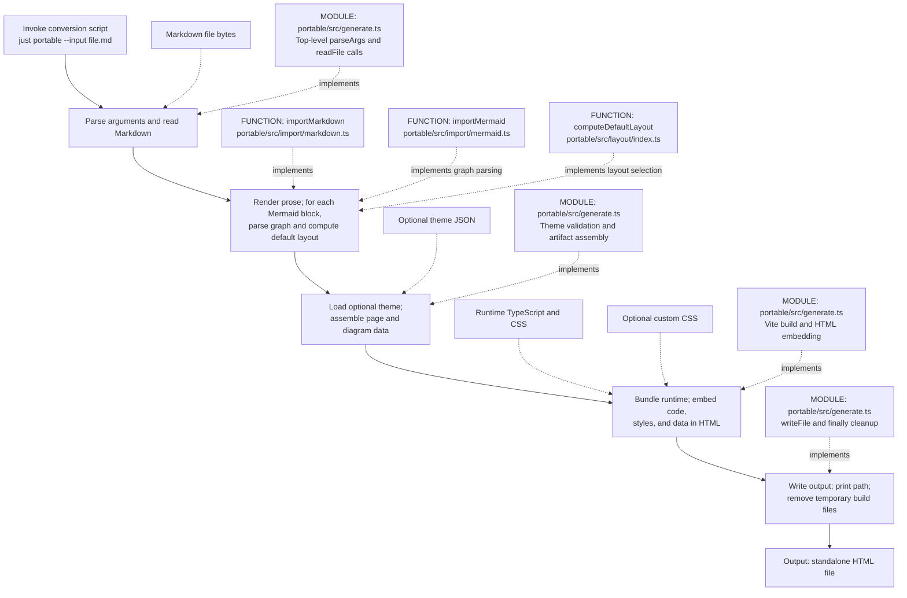
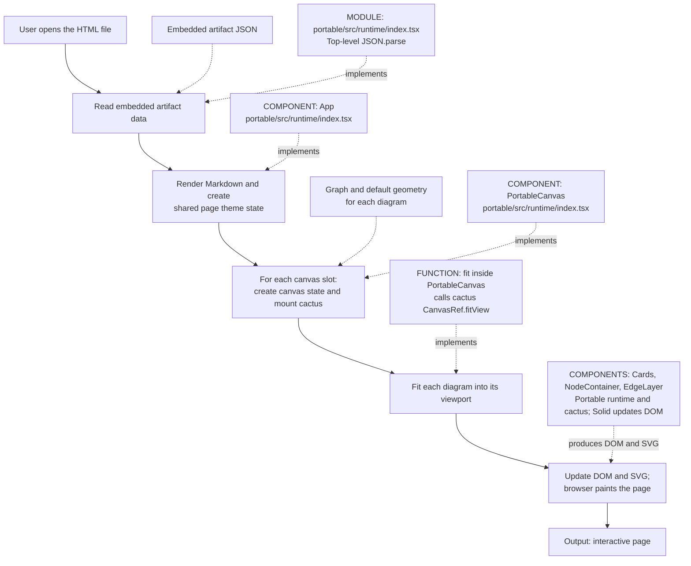
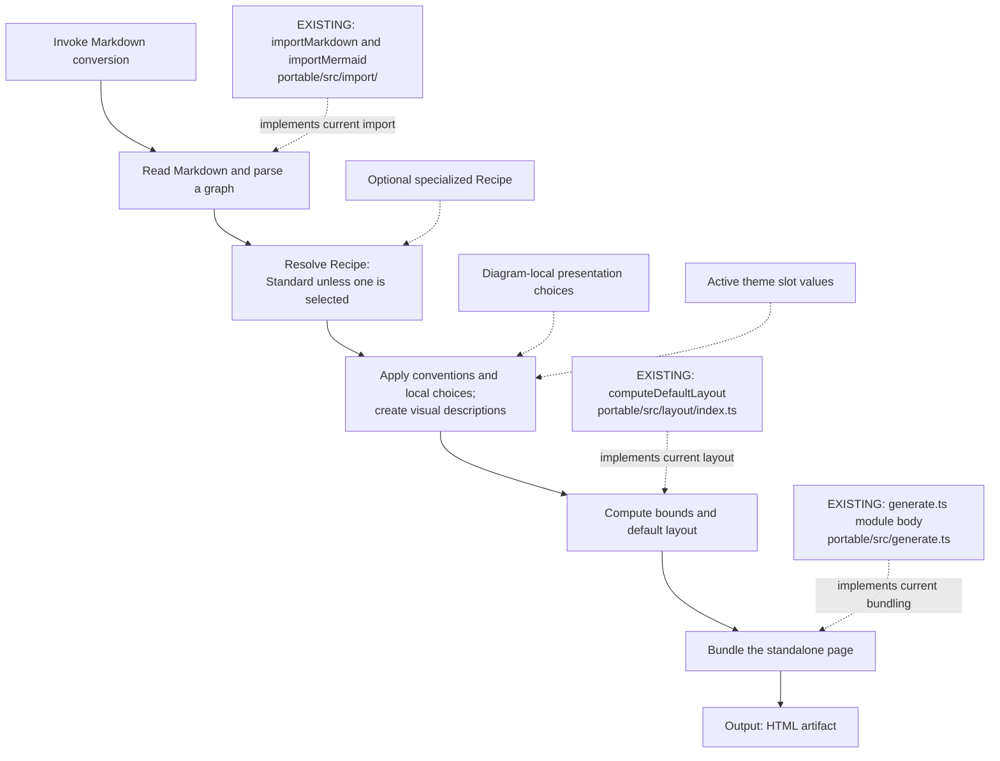

# What happens when Portable converts this file?

Read each action sequence from top to bottom. **Yellow** marks an invocation or output
artifact, **red** marks an action, and **blue** marks data supplied to an action.
**Purple** marks implementing modules/functions; their arrows mean “implements,”
not “executes next.” Data and code cards sit above and to the left of the action they feed. Repeated work is summarized in a card.

```sh
just portable --input packages/portable/examples/conversion-walkthrough.md --theme packages/portable/examples/conversion-walkthrough.theme.json --output packages/portable/examples/generated/conversion-walkthrough.html --debug-performance --force
```

## Conversion: from invocation to output

This is the implemented pipeline. Parsing and layout repeat for each Mermaid
block; a plain Markdown document has no diagrams to process.



```portable-canvas
title: Conversion pipeline
```

```portable-nodes
reader:
  component: card
  title: "portable/src/generate.ts"
  body: "Top-level parseArgs and readFile calls"
  footer:
    text: "packages/portable/src/generate.ts"
    href: "zed://file/home/saxon/code/github/saxonthune/luminous-portable/packages/portable/src/generate.ts"
parser:
  component: card
  title: "importMarkdown"
  body: "Render prose, collect diagrams, and compute their default layouts."
  footer:
    text: "packages/portable/src/import/markdown.ts"
    href: "zed://file/home/saxon/code/github/saxonthune/luminous-portable/packages/portable/src/import/markdown.ts"
mermaid:
  component: card
  title: "importMermaid"
  body: "Parse Mermaid into node, edge, and containment records."
  footer:
    text: "packages/portable/src/import/mermaid.ts"
    href: "zed://file/home/saxon/code/github/saxonthune/luminous-portable/packages/portable/src/import/mermaid.ts"
geometry:
  component: card
  title: "computeDefaultLayout"
  body: "Choose layout and compute default node bounds."
  footer:
    text: "packages/portable/src/layout/index.ts"
    href: "zed://file/home/saxon/code/github/saxonthune/luminous-portable/packages/portable/src/layout/index.ts"
themed:
  component: card
  title: "portable/src/generate.ts"
  body: "Theme validation and artifact assembly"
  footer:
    text: "packages/portable/src/generate.ts"
    href: "zed://file/home/saxon/code/github/saxonthune/luminous-portable/packages/portable/src/generate.ts"
bundler:
  component: card
  title: "portable/src/generate.ts"
  body: "Vite build and HTML embedding"
  footer:
    text: "packages/portable/src/generate.ts"
    href: "zed://file/home/saxon/code/github/saxonthune/luminous-portable/packages/portable/src/generate.ts"
writer:
  component: card
  title: "portable/src/generate.ts"
  body: "writeFile and finally cleanup"
  footer:
    text: "packages/portable/src/generate.ts"
    href: "zed://file/home/saxon/code/github/saxonthune/luminous-portable/packages/portable/src/generate.ts"
invoke:
  component: card
  title: "Invoke conversion script"
  body: "just portable --input file.md"
  footer:
    text: "Invocation"
read:
  component: card
  title: "Parse arguments and read Markdown"
  footer:
    text: "Action"
parse:
  component: card
  title: "Render prose; for each Mermaid block"
  body: "parse graph and compute default layout"
  footer:
    text: "Action"
theme:
  component: card
  title: "Load optional theme"
  body: "assemble page and diagram data"
  footer:
    text: "Action"
bundle:
  component: card
  title: "Bundle runtime; embed code"
  body: "styles, and data in HTML"
  footer:
    text: "Action"
write:
  component: card
  title: "Write output; print path"
  body: "remove temporary build files"
  footer:
    text: "Action"
output:
  component: card
  title: "Output: standalone HTML file"
  footer:
    text: "Output artifact"
md:
  component: card
  title: "Markdown file bytes"
  footer:
    text: "Data"
palette:
  component: card
  title: "Optional theme JSON"
  footer:
    text: "Data"
runtime:
  component: card
  title: "Runtime TypeScript and CSS"
  footer:
    text: "Data"
custom:
  component: card
  title: "Optional custom CSS"
  footer:
    text: "Data"
```

## Opening the generated file

The generator has finished. Opening the file starts its embedded browser code.
Each canvas owns its positions, selection and camera; the page theme is shared.



```portable-canvas
title: Opening the generated file
```

```portable-nodes
decoder:
  component: card
  title: "portable/src/runtime/index.tsx"
  body: "Top-level JSON.parse"
  footer:
    text: "packages/portable/src/runtime/index.tsx"
    href: "zed://file/home/saxon/code/github/saxonthune/luminous-portable/packages/portable/src/runtime/index.tsx"
app:
  component: card
  title: "App"
  body: "Render the page and share its theme across canvases."
  footer:
    text: "packages/portable/src/runtime/index.tsx"
    href: "zed://file/home/saxon/code/github/saxonthune/luminous-portable/packages/portable/src/runtime/index.tsx"
canvas:
  component: card
  title: "PortableCanvas"
  body: "Own canvas geometry, selection, and camera state."
  footer:
    text: "packages/portable/src/runtime/index.tsx"
    href: "zed://file/home/saxon/code/github/saxonthune/luminous-portable/packages/portable/src/runtime/index.tsx"
fitter:
  component: card
  title: "fit inside PortableCanvas"
  body: "calls cactus CanvasRef.fitView"
  footer:
    text: "packages/portable/src/runtime/index.tsx"
    href: "zed://file/home/saxon/code/github/saxonthune/luminous-portable/packages/portable/src/runtime/index.tsx"
renderers:
  component: card
  title: "Cards, NodeContainer, EdgeLayer"
  body: "Portable runtime and cactus; Solid updates DOM"
  footer:
    text: "packages/portable/src/runtime/index.tsx"
    href: "zed://file/home/saxon/code/github/saxonthune/luminous-portable/packages/portable/src/runtime/index.tsx"
open:
  component: card
  title: "User opens the HTML file"
  footer:
    text: "Invocation"
decode:
  component: card
  title: "Read embedded artifact data"
  footer:
    text: "Action"
page:
  component: card
  title: "Render Markdown and create"
  body: "shared page theme state"
  footer:
    text: "Action"
mount:
  component: card
  title: "For each canvas slot:"
  body: "create canvas state and mount cactus"
  footer:
    text: "Action"
fit:
  component: card
  title: "Fit each diagram into its viewport"
  footer:
    text: "Action"
draw:
  component: card
  title: "Update DOM and SVG"
  body: "browser paints the page"
  footer:
    text: "Action"
result:
  component: card
  title: "Output: interactive page"
  footer:
    text: "Output artifact"
embedded:
  component: card
  title: "Embedded artifact JSON"
  footer:
    text: "Data"
diagrams:
  component: card
  title: "Graph and default geometry"
  body: "for each diagram"
  footer:
    text: "Data"
```

## Where Recipes would enter — proposal

The Standard Recipe is the default when no specialized Recipe is selected.
This sequence summarizes that choice within the resolution action. Recipe resolution
and formalization remain proposed; this example exercises the action-sequence layout
and color slots, not a working Recipe API.



```portable-canvas
title: Recipe pipeline — proposal
```

```portable-nodes
importer:
  component: card
  title: "importMarkdown and importMermaid"
  body: "Read Markdown and parse each Mermaid graph."
  footer:
    text: "packages/portable/src/import/markdown.ts"
    href: "zed://file/home/saxon/code/github/saxonthune/luminous-portable/packages/portable/src/import/markdown.ts"
layoutCode:
  component: card
  title: "computeDefaultLayout"
  body: "Compute expanded node bounds and arrange the graph."
  footer:
    text: "packages/portable/src/layout/index.ts"
    href: "zed://file/home/saxon/code/github/saxonthune/luminous-portable/packages/portable/src/layout/index.ts"
bundleCode:
  component: card
  title: "generate.ts module body"
  body: "Bundle code and embed the standalone page."
  footer:
    text: "packages/portable/src/generate.ts"
    href: "zed://file/home/saxon/code/github/saxonthune/luminous-portable/packages/portable/src/generate.ts"
invoke:
  component: card
  title: "Invoke Markdown conversion"
  footer:
    text: "Invocation"
import:
  component: card
  title: "Read Markdown and parse a graph"
  footer:
    text: "Action"
resolve:
  component: card
  title: "Resolve Recipe:"
  body: "Standard unless one is selected"
  footer:
    text: "Action"
project:
  component: card
  title: "Apply conventions and local choices"
  body: "create visual descriptions"
  footer:
    text: "Action"
layout:
  component: card
  title: "Compute bounds and default layout"
  footer:
    text: "Action"
bundle:
  component: card
  title: "Bundle the standalone page"
  footer:
    text: "Action"
output:
  component: card
  title: "Output: HTML artifact"
  footer:
    text: "Output artifact"
selection:
  component: card
  title: "Optional specialized Recipe"
  footer:
    text: "Data"
local:
  component: card
  title: "Diagram-local presentation choices"
  footer:
    text: "Data"
slots:
  component: card
  title: "Active theme slot values"
  footer:
    text: "Data"
```

No implementation node is attached to Recipe resolution or Recipe projection:
those operations are still proposed. Code nodes elsewhere name existing code,
including module-level statements where no named function exists.

Users can build a flexible diagram first and formalize reusable conventions later.
Use **Fullscreen**, **Expand width**, and zoom to inspect longer action sequences.
