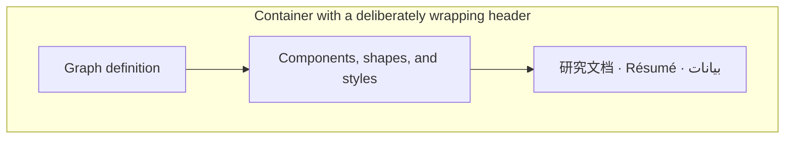
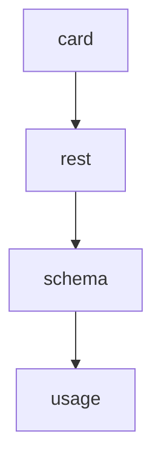

# Styled label measurement

Large labels and multiline components are measured before placement.



```portable-canvas
title: Plain labels with larger type
```



```portable-canvas
title: Shared component measurement
```

```portable-nodes
card:
  component: card
  title: A longer Card heading that must remain visible
  body: Card bodies retain their content when typography changes.
  footer:
    text: Source details
rest:
  component: rest-card
  title: /research-documents
  methods: [GET, PUT, DELETE]
schema:
  component: schema-card
  title: Document record
  fields:
    - name: document
      type: Document
      kind: object
      schema:
        component: schema-card
        title: Research Document with a longer title
        fields:
          - name: markdown
            type: string
            kind: text
usage:
  component: usage-card
  title: Document details
  usage:
    uiRoute:
      paths: ["/documents/{id}"]
      context: Selected document.
    startup:
      - method: GET
        endpoint: /api/documents/{id}
        description: Loads the selected document.
    capabilities: []
```
