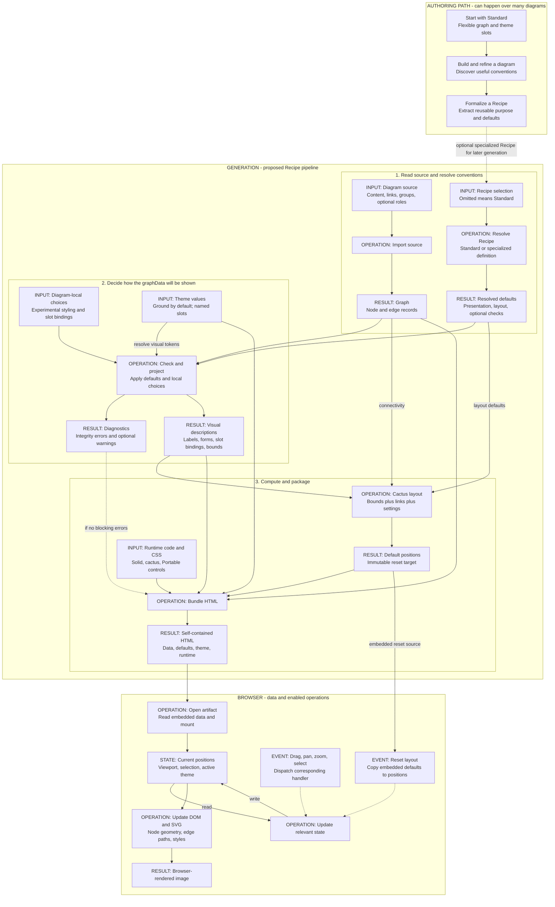
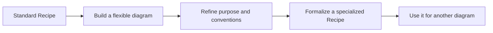

# Recipe pipeline

This notebook follows inputs through generation and then into browser state.
The Recipe engine is a **design proposal**, while Portable renders these canvases today.

## Inputs, operations, and results

Beige cards hold data; green cards are operations; blue is mutable state; rose marks events or choices. Solid arrows carry data; dashed arrows indicate a condition or event.

## Discover a Recipe through use

Start without a specialized Recipe. Build a diagram using the Standard Recipe,
experiment with theme slots, and extract useful conventions once they emerge.
This canvas can be moved, fitted, and reset independently of the pipeline above.

## Reading the runtime portion

The generated HTML carries data and executable instructions. Opening it creates
browser state. Pointer and keyboard events change selected parts of that state;
Solid and cactus update the DOM and SVG that the browser renders.

Changing one canvas does not change the other canvas. The page theme is shared.
